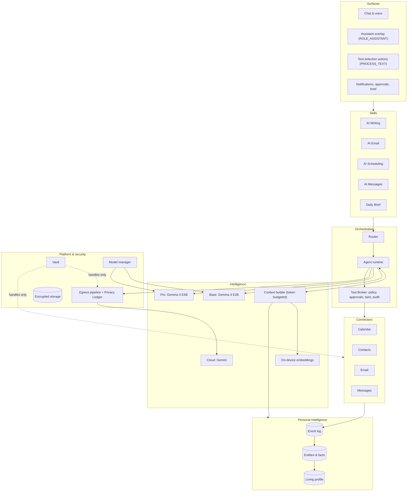
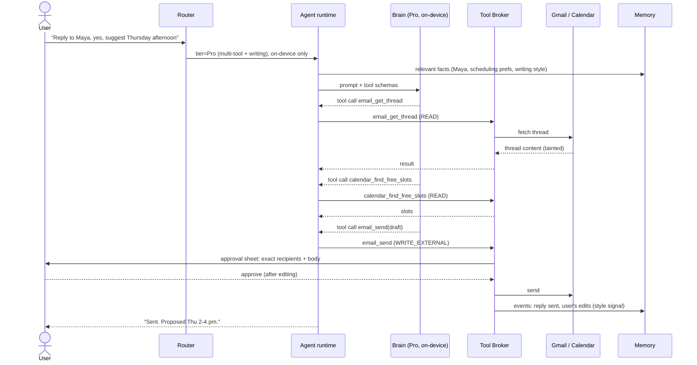
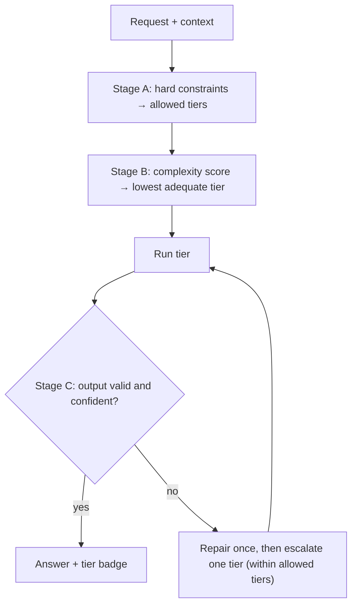
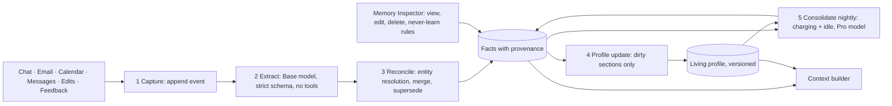

# Anu for Android: Architecture

Version 1.2.0 · Draft · 2026-09-25
Status: proposed. OD-1 to OD-4 were resolved on 2026-09-25 (§16).
Product intent lives in [VISION.md](VISION.md).

> **This document is the source of truth for how Anu is built.** All work must follow it. Any change that alters the design updates this document in the same change (§17).

**Contents**

1. Goals and scope
2. Principles and invariants
3. System overview
4. Modules, dependency rules, tech stack
5. Models and runtimes
6. Router
7. Agent runtime
8. Personal intelligence (memory and profile)
9. Connectors
10. Skills
11. Vault
12. Security and privacy
13. Surfaces
14. Data storage
15. Quality: tests, evals, budgets
16. Open decisions, risks, spikes
17. Change process, decision log, component status, changelog
18. Lessons carried over from earlier repos

---

## 1. Goals and scope

Anu is an Android app. It runs a private personal AI on the phone and:

- answers and acts using **Gemma 4 E2B** (Base) and **Gemma 4 E4B** (Pro) on the phone, and **Gemini** (Cloud) when needed;
- **routes** each request to the lightest tier that can do it well;
- runs an **on-device agent** that uses tools, with policy and approvals enforced outside the model;
- connects through official APIs to **calendar, contacts, Gmail, messaging apps** (through their notifications) and **SMS history** (in the `personal` build only);
- keeps a **living memory and profile** of the user that updates with every change;
- provides **AI Writing, AI Email, AI Scheduling, AI Messages and a Daily Brief**;
- keeps third-party credentials (for example a Meta Muse API key) in a **vault**, where models can use them but never see them.

**Builds.** There are two product flavors (ADR-012):
- **`personal`**: the first release, for the owner's phone. It includes SMS, uses the owner's own Gemini key, and sideloads models.
- **`play`**: a later Play Store release. It leaves out Play-restricted features.

**Out of scope for v1:**
- an Anu-run server, multi-device sync, and iOS;
- a web-browsing agent and a general web-fetch tool;
- fine-tuning on the device;
- Outlook / Microsoft 365;
- acting as a password manager for other apps (OD-3).

## 2. Principles and invariants

**Principles**

- **P1. On-device by default, cloud by exception.** Cloud calls are minimized, consented to, and logged in a ledger.
- **P2. The model proposes; the system decides.** Every side effect goes through the Tool Broker, which enforces policy and approvals in code, never in a prompt.
- **P3. Secrets never enter the model's context.** The model deals only in handles; the network layer attaches the real value.
- **P4. Content from connectors is data, not instructions.** It is marked as tainted, and tainted runs lose automatic permissions.
- **P5. Every memory can be explained and changed.** It has a source, a confidence and a history, and the user can edit or delete it.
- **P6. Every AI decision is validated, repaired or given a fallback.** Output is parsed strictly. If parsing fails, the model gets one repair attempt. After that, the request escalates or falls back to deterministic code.
- **P7. Measured, not claimed.** A capability counts as "Verified" only once its eval passes, and docs describe what actually exists.
- **P8. Respect the device.** Heavy work waits for charging or idle time, the app reacts to thermal and memory pressure, and models are unloaded when the app is in the background.

**Invariants.** Each of these is enforced by an automated test (§15) and must never be broken.

| # | Invariant |
|---|---|
| I1 | No secret value appears in any model prompt, log line, memory record, crash report, or network payload. The only exception is the auth header sent to that secret's bound host. |
| I2 | No `WRITE_EXTERNAL` or `DESTRUCTIVE` tool runs without a recorded user approval of the **exact** payload. |
| I3 | Personal data leaves the device only through the egress pipeline (§12), and every egress writes a Privacy Ledger entry. |
| I4 | Every fact in memory has provenance: at least one source event, or an explicit statement from the user. |
| I5 | Deleting a source removes, or re-derives, everything that was derived from it. |
| I6 | Output that is about to trigger an action is schema-validated first. Invalid output is never executed. |
| I7 | Cancelling stops generation and tool execution. Target: within 500 ms. |
| I8 | Chat templates and tool-call formats come from the runtime or the model's own metadata, never from hand-built strings. |

## 3. System overview



**How a request flows**

1. A surface captures the request, and the router decides on a tier (§6).
2. The agent runtime asks the context builder for a token-budgeted prompt, built from the profile slice, retrieved memories, the conversation, and the schemas of the tools that are relevant.
3. The brain streams events back. Any tool call goes to the Tool Broker, which checks the schema, the policy, taint and the budget, and asks the user for approval when required. It then executes the call and audits it.
4. Results feed back into the loop. Every step also becomes an event, which grows memory.



## 4. Modules, dependency rules, tech stack

### 4.1 Module map (Gradle)

| Module | Responsibility | Android deps? |
|---|---|---|
| `app` | Application, navigation, DI graph, surface entry points | yes |
| `core:common` | Result types, dispatchers, clock, IDs, logging that redacts | no |
| `core:model` | Brain contracts, `BrainEvent`, messages, `ToolCall`, schema generation, `DataClass` (S0–S3); test fixtures such as `ScriptedBrain` | **no** |
| `core:agent` | Agent loop, Tool Broker, policy, approvals, budgets, run store interface | **no** |
| `core:router` | Router stages, features, scorer, telemetry interface | **no** |
| `core:memory` | Event log, entities, facts, profile, retrieval, memory pipeline | yes (WorkManager) |
| `core:security` | `SecretRef`/`SecretUse` handles, PII detection, reversible redaction, egress gate, Privacy Ledger interface | **no** |
| `core:vault` | Keystore + Tink vault store, host-bound HTTP injector (`withVault`), and the shared `KeystoreAead` primitive with its `KeyPolicy` | yes |
| `core:data` | Room database on SQLCipher (ADR-024), DAOs, and the stores behind `TranscriptStore`, `PrivacyLedger` and `VaultAudit` | yes |
| `core:device` | Device class, battery, thermal, memory and network state | yes |
| `brain:litertlm` | Gemma E2B/E4B adapter; ModelManager (download, verify, load, residency) | yes |
| `brain:gemini` | Gemini REST/SSE adapter; every request passes the egress gate | **no** (OkHttp) |
| `connector:calendar` | CalendarContract tools and observer | yes |
| `connector:contacts` | ContactsContract resolver | yes |
| `connector:gmail` | Gmail API tools and incremental sync | yes |
| `connector:messages` | Notification listener capture and reply actions for any messaging app | yes |
| `connector:sms` | SMS provider history and incoming SMS. **`personal` flavor only** | yes |
| `feature:home` | Chat and voice | yes |
| `feature:writing` | Writing tools; PROCESS_TEXT entry point | yes |
| `feature:email` | Priority inbox, summaries, drafts | yes |
| `feature:scheduling` | Scheduling assistant | yes |
| `feature:memory` | Memory Inspector | yes |
| `feature:vault` | Vault UI | yes |
| `feature:settings` | Models (download, delete), the Gemini key, the Privacy Ledger. Later: connectors and privacy options | yes |
| `eval` | JVM harness: router, tools, memory, injection, performance scripts | no |

### 4.2 Dependency rules (enforced by module boundaries)

- `core:model`, `core:agent`, `core:router`, `core:security` and `brain:gemini` are pure Kotlin with no `android.*` imports. They are unit-tested on the JVM and can later become Kotlin Multiplatform modules for iOS.
- Features depend on core contracts, never on a concrete brain or connector. Implementations are bound in `app` (`AppGraph`). For example, screens see models only through `OnDeviceModels` in `core:model`, which `ModelManager` implements.
- Connectors never call brains, and brains never call connectors. They meet only in the agent runtime.
- Only `core:vault` can decrypt secrets. Only the vault's HTTP injector can attach one to a request.
- Only `core:data` touches the database.
- Nothing depends on `app` or on `feature:*`.
- Code restricted to one flavor (SMS) lives in its own modules and is wired in only through `personalImplementation`. The `play` flavor must build and pass its tests without it, and its merged manifest must contain no SMS permissions.

### 4.3 Tech stack

| Concern | Choice | Note |
|---|---|---|
| Language / build | Kotlin 2.x, JDK 21 toolchain, Gradle wrapper, version catalog | |
| SDK levels | minSdk 31; target/compile = latest stable at scaffold time | 31 is required for the on-device `SpeechRecognizer` |
| UI | Jetpack Compose, Material 3, Navigation Compose, ViewModel + StateFlow | One-way data flow |
| DI | Manual: one `AppGraph` in `app` | ADR-023. Hilt is reconsidered when the graph outgrows one file |
| Settings storage | `SharedPreferences` for non-sensitive values only, such as the vault handle of the Gemini key | DataStore replaces it once there's more than a handful of settings |
| Async | Coroutines and Flow, structured concurrency | Cancellation must reach native generation (I7) |
| Serialization | kotlinx.serialization | Tool JSON Schemas are generated from serializers |
| On-device LLM | LiteRT-LM Android, `com.google.ai.edge.litertlm:litertlm-android` | 0.17.1 is the latest on Google Maven as of 2026-09-25; version pinned in Phase 0 |
| Embeddings | EmbeddingGemma on LiteRT (to verify, S3); MediaPipe TextEmbedder as fallback | |
| Cloud LLM | `personal`: Gemini API with the owner's key from the vault, sent in the `x-goog-api-key` header, never the URL. `play`: Firebase AI Logic, evaluated in Phase 5 | ADR-013 |
| Build flavors | `personal` and `play` | ADR-012 |
| Google auth | Credential Manager + Google Identity Services `AuthorizationClient` | Per-scope, incremental consent |
| Database | Room on SQLCipher (`net.zetetic:sqlcipher-android`) | Key wrapped by Android Keystore |
| Crypto | Android Keystore (StrongBox where available) + Tink AEAD; `androidx.biometric` | `androidx.security:security-crypto` is deprecated, so not used |
| Network | OkHttp + kotlinx.serialization | Interceptors for vault injection and the egress ledger |
| Background work | WorkManager; foreground service only for live voice | |
| Tests | JUnit, Turbine, Robolectric, Compose UI tests, scripted fake brains | Real-model tests are opt-in |
| CI | GitHub Actions: build, unit tests, lint, invariant tests | Status badges only once workflows exist |

Application ID: `io.github.sandeepvijayarao09.anu`. It can change until the first Play upload.

## 5. Models and runtimes

| Tier | Model | Runtime | Where | Used for |
|---|---|---|---|---|
| Direct | none | Kotlin handlers | device | Simple intents with a deterministic answer ("when's my next meeting?") |
| Base | Gemma 4 E2B-it (`.litertlm`) | LiteRT-LM | device | Classification, extraction, short replies, rewrites, single tool calls |
| Pro | Gemma 4 E4B-it (`.litertlm`, ~3.7 GB file) | LiteRT-LM | device | Multi-step tool use, long-form writing, scheduling reasoning, profile synthesis |
| Cloud | Gemini, Flash or Pro (model IDs come from config, not code) | Gemini API; the key is a vault item bound to `generativelanguage.googleapis.com` | cloud | Work beyond on-device quality or context limits, with consent |
| Embeddings | EmbeddingGemma (to verify) or fallback | LiteRT | device | Retrieval, entity resolution, router features |

**Runtime rules**

- **Not MediaPipe `tasks-genai`.** Its LLM Inference API is deprecated. See ADR-002.
- **Native formats only (I8).** Use the runtime's chat template and tool-calling support, not hand-built prompt formats.
- **Brain contract** (`core:model`):

  ```kotlin
  interface Brain {
      val id: BrainId                        // BASE, PRO, CLOUD_FLASH, CLOUD_PRO
      val capabilities: BrainCapabilities    // context window, tool calling, vision, audio
      fun stream(request: BrainRequest): Flow<BrainEvent>   // cold: collecting starts generation, cancelling stops it
  }

  sealed interface BrainEvent {
      data class TextDelta(val text: String) : BrainEvent
      data class ToolCallRequested(val call: ToolCall) : BrainEvent
      data class Usage(val inputTokens: Int, val outputTokens: Int) : BrainEvent   // request totals, emitted once
      data class Finished(val reason: StopReason) : BrainEvent
  }
  ```

- **LiteRT-LM adapter** (API checked against the 0.17.1 AAR: 20 MB, arm64-v8a + x86_64, minSdk 24):
  - **Tools, `automaticToolCalling = false` always (ADR-017).** Tools are declared through `OpenApiTool` descriptions generated from our serializers. The runtime only *reports* `Message.toolCalls`, and the Tool Broker executes them. LiteRT-LM's default auto mode would run tools inside the runtime, bypassing policy and approvals (P2, I2), so it is forbidden.
  - **Conversation is a cache; our transcript is the truth (ADR-018).**
    - The KV cache lives in a LiteRT-LM `Conversation`, reused across the turns of a run.
    - Our persisted transcript is the source of truth.
    - `cancelProcess()` does not roll back conversation state. After a cancel or an error, the conversation is closed and later rebuilt from the transcript (`initialMessages`).
    - **The system prompt stays the same between turns (ADR-033).** The cache is reused only when a request extends what the conversation has already seen, with the same system prompt and tools. So per-turn facts never go in the system prompt. The current time travels with the newest user message (`BrainRequest.sentAt`, shown to the model as `[Fri 2026-09-25 14:46] …`), and the prompt carries only the date. On the emulator, a prompt with the time to the minute made every turn re-read the whole chat: one reply took over six minutes on CPU. With the time on the message, the same turn took 15–27 s.
  - **Streaming and cancellation.**
    - `sendMessageAsync(…, MessageCallback)` is wrapped in `callbackFlow`.
    - `awaitClose` calls `cancelProcess()`. The native side then reports `onError(CancellationException)`.
    - The conversation is closed only after that final callback, never while decoding is still running (I7).
  - **Structured output.** Router decisions, extraction and classification use `ResponseFormat.json(schema)`, which constrains decoding to the schema (P6).
  - **Budgets.** Token counts come from `getTokenCount()`. Per-tier limits are set with `maxNumTokens` (engine) and `maxOutputToken` (per request). `ThinkingConfig` is off for Base short tasks.
  - **Backends.** `CPU`, `GPU`, `NPU` and `GOOGLE_TENSOR` (the Pixel TPU) are all available. S1 measures each on the reference device.
  - **Metrics.** `ExperimentalFlags.enableBenchmark` reports init time, time to first token, and prefill/decode tokens per second. It is used by S1 and the performance evals.
  - **Embeddings.** LiteRT-LM ships an `EmbeddingEngine`, which is the first candidate for S3.
  - **Evals on the Mac.** `litertlm-jvm` (the same API on macOS) lets `eval` run real-model evals on the development Mac without a phone.
- **ModelManager.**
  - An artifact manifest lists name, version, URL, SHA-256, size and minimum RAM for each model.
  - Downloads run through WorkManager: resumable, and on unmetered networks by default.
  - The hash is verified before load, and files live in `noBackupFilesDir`.
  - **Delivery:**
    - `personal`: download inside the app from pinned URLs. The `litert-community` Hugging Face repos are **not gated** (checked 2026-09-25), so no token is needed. During development, `adb push` from the local Hugging Face cache.
    - `play`: Play for On-device AI packs, in Phase 5.
  - **Artifact per backend and chip (ADR-019).** Hugging Face publishes a different file for each backend, and the manifest picks one per device after the first-run benchmark. Sizes as of 2026-09-25:

    | Model | CPU (generic) | GPU | NPU |
    |---|---|---|---|
    | E2B | `gemma-4-E2B-it.litertlm`, 2.59 GB | `gemma-4-E2B-it-gpu.litertlm`, 2.01 GB | Tensor G5 3.11 GB, Tensor G6 3.31 GB, Snapdragon sm8750 3.02 GB |
    | E4B | `gemma-4-E4B-it.litertlm`, 3.66 GB | `gemma-4-E4B-it-gpu.litertlm`, 2.97 GB | none published |

    There is no NPU build for Tensor G3 or G4. A Pixel 8 Pro or 9 Pro therefore runs on CPU or GPU, and `GOOGLE_TENSOR` applies only to Pixel 10 and later with E2B.
  - **Weight cache (ADR-020).** `EngineConfig.cacheDir` must point to app-private storage (`noBackupFilesDir/litertlm-cache`). Without it, the CPU backend tries to write its XNNPack weight cache next to the model file and silently falls back to no cache. That was observed when a model was loaded from `/data/local/tmp`, where Android's security policy denies the write. Budget free disk space for the cache on top of the model file; S1 measures the cache's size.
- **Residency policy.** These are hypotheses; spike S1 sets the real thresholds.
  - **Implemented now** (`OnDeviceBrains`): at most one on-device model is loaded. A tier switch waits for the running generation, closes the old engine and loads the new one. Everything unloads on `TRIM_MEMORY_BACKGROUND`.
  - Reference device: Pixel 8 Pro or newer, with 12–16 GB RAM (ADR-016).
  - Low-RAM devices: Base only.
  - Mid: Base stays loaded; Pro loads on demand and replaces it.
  - High, which includes the reference device: both stay loaded while memory allows.
  - Models unload on `onTrimMemory` and when the app goes to the background.
  - The backend (CPU, GPU or NPU) is chosen by a micro-benchmark on first run.
- **Gemini adapter** (`brain:gemini`, ADR-022):
  - **Transport:** REST `v1beta/models/{model}:streamGenerateContent?alt=sse`, over a `withVault` client.
  - **Schemas:** tool and response schemas are sent as JSON Schema (`parametersJsonSchema`, `responseJsonSchema`), so `core:model` schemas pass through unchanged.
  - **Thought signatures** are kept on `ToolCall.signature` and echoed back with the transcript.
  - **Usage:** Gemini reports running totals on every chunk; the adapter keeps the last and emits it once.
  - **Sampling:** Gemini's defaults (only output length and schema are set).
  - **Models:** IDs come from config. The defaults are the aliases `gemini-flash-latest` and `gemini-pro-latest`.
  - **Not yet checked:** the exact field names and aliases haven't been verified against the live API (spike S8).
- **Extension point.** Additional cloud brains plug in through one OpenAI-compatible adapter, for example Meta Muse Spark, using a key held in the vault. Nothing ships in v1 without a decision-log entry.

## 6. Router



**Stage A: hard constraints**

These are deterministic rules that decide which tiers are *allowed*:

- **Offline:** device tiers only.
- **Sensitive data (S2) in the request:** device tiers only, unless the user consents for that request.
- **User pinned a tier:** that tier.
- **Needed capability missing on the device** (such as very long context): Cloud, subject to consent.
- **Hot device, or battery low and not charging:** Pro is removed, unless it is the only tier. The request moves to the next allowed tier up (Cloud, subject to consent), or down to Base if nothing is higher.
- **Cloud policy `NEVER` for the skill:** Cloud is removed whenever the request carries personal data. Turning the cloud off completely is a device setting, which removes Cloud from the available tiers.
- **Secrets (S3):** the request is rejected before routing (I1).

**Stage B: complexity score**

- **Features:**
  - the skill;
  - the estimated number of tools and steps;
  - multiple entities, or "and then" chains;
  - input tokens against each tier's budget;
  - required output length and polish;
  - reasoning cues (compare, plan, calculate);
  - language;
  - how this user's similar requests have fared before.
- **v1** (`core:router` `ComplexityScorer`): transparent weighted rules, each of which adds a reason.
  - **Weights:** skill weight (Chat, Memory, Messages 0; Writing, Email 1; Brief, Scheduling 2); two or more action verbs +2; chained steps +1; reasoning cues +1; long-form output +1; short-task cues −1.
  - **Thresholds:** a score of 1 or less goes to Base, 2–5 to Pro, and 6 or more to Cloud. Cloud's threshold is high on purpose, because on-device is the default (P1).
  - **Prompt size:** a prompt over the Base budget goes to Pro at least; over the Pro budget, to Cloud. Budgets start at 3,000 and 6,000 tokens; these are hypotheses until S1.
- **v2:** a small on-device classifier (embedding plus a logistic head). It is trained on router data and user feedback, and evaluated on a held-out set it was **not** tuned on (§18).

**Stage C: cascade with verification**

- **Checks:** parse and schema validity, tool-call validity, and a self-check for long outputs. These are pluggable `OutputValidator`s; plain chat requires a non-blank answer.
- **Implementation:** `core:agent` `Cascade`.
- **On a validation failure:** repair once on the same tier with greedy sampling, then escalate one tier.
- **On an error** (crash, out of memory, load failure): escalate right away, because a repair wouldn't help.
- **Streamed text** from a failed attempt is marked `Discarded` so the UI can clear it.
- **Cloud and consent:** the Cloud tier is used only if Stage A allowed it. If consent is needed, the cascade stops with `ConsentNeeded` before anything is sent.
- **Cancellation** is never swallowed (§18).

**Output and learning**

- **Decision:** `RouteDecision(tier, allowedTiers, reasons, confidence)`, logged locally.
- **UI:** a badge shows which tier answered, for example "On-device · Base", with a **Retry with Pro** action.
- **Feedback:** retries, edits and escalations feed router telemetry, which tunes the thresholds for each user.

## 7. Agent runtime

### 7.1 Tools and risk tiers

```kotlin
interface Tool<I : Any, O : Any> {
    val name: String
    val description: String
    val input: KSerializer<I>          // JSON Schema generated from this, never hand-written
    val output: KSerializer<O>
    val risk: RiskTier
    val dataClasses: Set<DataClass>    // which personal data the tool touches (§12)
    suspend fun invoke(input: I, ctx: ToolContext): O
}
```

As implemented in `core:agent` `Tool`:
- **Risk depends on the input:** `risk(input)`. For example, `calendar_create_event` is `WRITE_PRIVATE` without attendees and `WRITE_EXTERNAL` with them.
- **Every tool writes its own `describe(input)`,** a one-sentence summary used on the approval sheet, in the audit and in the chat's action lines. It is never the model's words.
- **Tools declare `returnsUntrustedContent`.** Calendar event titles, for example, are untrusted because other people can write them through invites.

Tool names are snake_case `<connector>_<verb>`, for example `email_get_thread`. `ToolSpec` enforces this, and snake_case is the style small models see most in training. Parameter schemas come from `JsonSchemas.of(serializer)` in `core:model`, with `@Description` annotations for the text the model reads.

| Risk tier | Meaning | Policy |
|---|---|---|
| `READ` | No side effects | Automatic |
| `WRITE_PRIVATE` | Changes only the user's own data and can be undone: own event with no attendees, email draft, label | Automatic with visible undo. **Needs approval once the run is tainted.** |
| `WRITE_EXTERNAL` | Visible to others, or leaves the user's control: send email, reply, invite, share | **Always** approval of the exact payload (I2) |
| `DESTRUCTIVE` | Delete, unsubscribe, or anything irreversible | Approval; bulk actions also need biometric confirmation |

### 7.2 Loop

- The core is a streaming tool loop: brain events → tool calls → broker → results → brain. It repeats until the brain finishes or a budget is hit (ADR-004).
- **Budgets:** steps, tokens, wall-clock time and cloud cost, all enforced in `core:agent`. Usage comes from `BrainEvent.Usage` totals, which are never double-counted.
- **Tool Broker**, in order:
  1. validates the arguments against the schema;
  2. applies policy (risk tier, taint, data class against the brain's location);
  3. requests approval if needed. `ApprovalGate` suspends the run until the user decides, and a timeout counts as a denial;
  4. executes the tool;
  5. writes to the audit log.
- **Taint.** Any tool result that carries connector content marks the run as tainted. A tainted run cannot auto-execute `WRITE_PRIVATE`, and its egress content is re-checked.
- **Persistence.** Runs, steps, tool results and approvals are stored. Each `WRITE_*` call has an idempotency key, so resuming never repeats a side effect that has already happened (§18).
- **Planner.** There is none in v1. A plan-then-execute mode is added only if evals show the tool loop failing on multi-step tasks.
- **As built (`ToolBroker`, `Agent`):**
  - **Outcomes, not exceptions.** Every call returns an outcome: `Ok`, `Invalid`, `Rejected` or `Failed`. Each is sent back to the model as the tool's result, so the model can correct itself. Two invalid rounds in a row escalate.
  - **Refusals say why, in words the model can act on (ADR-035).** A rejection carries a code:
    - `declined`: the user saw it and said no;
    - `no_answer`: nobody answered the approval within 10 minutes;
    - `not_allowed`: policy.
    On the emulator, a plain `not_allowed` for a declined reply made the model blame "the system". An invalid call names what would work, for example the recent chats when a chat isn't found.
  - **Validation is strict about types and required fields, and ignores unknown keys.** Input that fails while the tool assesses it, such as an end time before the start, is `Invalid` and is never shown for approval.
  - **Idempotency keys are content-based:** `sha256(turn key | tool | canonical payload)`. Re-sending the same turn after consent replays the stored result instead of acting twice.
  - **Approvals go through `ApprovalCenter`,** which the chat screen observes. v1 offers approve or deny only; editing is Planned. A timeout (10 minutes) counts as a denial.
  - **Escalation mid-run continues the same transcript (ADR-026).** The stronger brain sees the tool results already produced, so side effects never repeat.
  - **Budgets:** 8 steps and 12 tool calls per turn.
  - **Persistence:** the audit and the idempotency results are stored in the encrypted database (schema v2), and Settings shows them under Activity.

### 7.3 Context builder

The context builder assembles each prompt within a **per-tier token budget that includes the system prompt**. It is built from:

- a compact system prompt for the tier;
- the relevant profile slice;
- retrieved facts and episodes;
- the conversation window;
- schemas for only the tools this skill needs. Small models do better with fewer tools.

Untrusted content goes in clearly delimited data blocks. Budgets are set per tier from spike S1 measurements.

**Dates for scheduling.** Small models are poor at date arithmetic. S1 on the emulator saw E4B turn "tomorrow" into the wrong day. So scheduling prompts include a small table: today, tomorrow, and the next seven days with weekday names and ISO dates. They also say that calling `calendar_create_event` *is* how to ask the user, because the approval sheet is the confirmation.

**Time and tool hints (ADR-033).** The system prompt carries the date, never the time: the time goes with the newest user message, so the on-device KV cache survives between turns. Each tool hint is given only when its tool is offered. For example, "call `messages_reply` with the final text; it takes the chat's name or phone number" appears only with the messaging tools.

### 7.4 Output handling

- Every structured output has a strict parser, one repair attempt, and a deterministic fallback or escalation (P6, I6).
- **Claims are checked against what happened (ADR-027).** A final answer that claims an action ("I've scheduled…", "I sent the invite…") is rejected if the Tool Broker recorded no successful write in the run.
  - The model gets one repair attempt, with a system note that nothing has been done yet.
  - If it still claims, the request escalates.
  - If no tier is left, the answer is shown marked "not actually done".
  - This was found on the emulator: E4B claimed it had created an invite that it never requested. The broker had correctly stopped nothing, because nothing was asked for, but the chat still showed a false claim.
- **Every answer shows its real actions.** The chat lists, under each answer, what the broker actually did: done, declined, or failed. Each line uses the tool's own summary, never the model's words. The user sees the truth whatever the model writes.

### 7.5 Proactive agents

These run as WorkManager jobs, within charging, idle and network constraints:

- the daily brief;
- follow-up detection ("no reply in 3 days");
- commitment tracking ("I'll send it Friday");
- meeting prep.

They produce notifications, never unapproved external actions.

## 8. Personal intelligence (memory and profile)

### 8.1 Data model

| Record | Contents |
|---|---|
| `Event` (append-only) | Time, source (chat, email, calendar, notification, sms, edit, feedback, tool), actors, encrypted content reference, sensitivity, retention |
| `Entity` | Person, organization, place, project or topic. Aliases (emails, phone numbers), plus a link to ContactsContract where possible |
| `Fact` | Subject, predicate, value, confidence, source events (provenance, I4), first seen, last confirmed, valid until, sensitivity, status (active, superseded, rejected), origin (inferred or user-stated) |
| `Episode` | Daily and weekly digests (episodic memory) |
| `ProfileSection` | Synthesized text, backing fact IDs, version. Sections: identity & roles; people & relationships; work & projects; routines & schedule patterns; preferences (communication, scheduling, writing style per recipient); goals & commitments; places |

### 8.2 Pipeline: builds with every change



1. **Capture.** Every change becomes an event, and this is cheap. The sources are chat turns, connector deltas, tool results, draft-versus-sent differences (a writing-style signal), accepted or rejected suggestions (preferences), and router retries (quality preferences).
2. **Extract.** The Base model extracts candidate entities and facts, in batches or when the phone is idle. Untrusted content is only extracted from, in a quarantined call with no tools.
3. **Reconcile.**
   - Entities are matched by alias first, then by embedding similarity with a model check.
   - A matching fact updates its confidence and "last confirmed" date.
   - A contradicting fact supersedes the old one, which is kept in history.
4. **Profile update.** Sections whose backing facts changed are regenerated incrementally, and each version can be diffed and rolled back.
5. **Consolidate.** Every night, while charging, the pipeline dedupes facts, decays unconfirmed low-confidence ones, writes episode summaries, and re-embeds.

### 8.3 Retrieval

- Retrieval is hybrid: entity match, then vector similarity, then recency, within the context builder's budget.
- **Vector search, v1:** int8 vectors stored in the database, with brute-force top-k over a candidate set pre-filtered by entity and time.
- A dedicated vector index is adopted only if measured latency exceeds the budget.

### 8.4 User control and privacy

- **Memory Inspector:**
  - shows every fact with a "because of" link to its sources;
  - lets the user confirm, edit or delete facts;
  - supports never-learn rules for a contact, a mail label, a messaging app or a topic.
- **Deletion cascades (I5):** deleting a source re-evaluates everything derived from it.
- **The profile never leaves the device by default.** Cloud requests receive only the minimal, policy-approved facts, and each one is ledgered (I3).

## 9. Connectors

All connectors implement a single contract: an auth method, a sync mode, tools (with risk tiers), and emitted events. All connector content is **tainted** (P4).

| Connector | Official API | Access | Sync | Tools (risk) | Constraints |
|---|---|---|---|---|---|
| Calendar | `CalendarContract` provider (every account synced to the phone: Google, Exchange, Samsung) | `READ_CALENDAR`, `WRITE_CALENDAR` | ContentObserver + periodic reconcile | list/search, find free slots (READ); own event (WRITE_PRIVATE); event with attendees (WRITE_EXTERNAL) | The account's sync adapter sends invites, so they count as external |
| Contacts | `ContactsContract` | `READ_CONTACTS` | Observer + periodic | resolve person (READ) | Feeds entity resolution |
| Gmail | Gmail API via `AuthorizationClient` | Least scopes per skill; reading mail needs restricted scopes | `history.list` incremental polling (≥15 min, plus on open); backfill window defaults to 90 days | search/read thread (READ); draft, label (WRITE_PRIVATE); send/reply (WRITE_EXTERNAL); delete (DESTRUCTIVE) | `personal` runs in Google's OAuth testing mode, which allows up to 100 test users. `play` needs Google verification. Push notifications need a server (Pub/Sub), so v1 polls |
| Messages | `NotificationListenerService`, reading `MessagingStyle` from any messaging app; reply through the notification's `RemoteInput` action | Notification access, granted in Settings | Real time while the listener is bound | list and read chats (READ); reply (WRITE_EXTERNAL) | Sees only messages that arrive as notifications; no history backfill. WhatsApp and RCS offer no third-party API. Android 15+ hides one-time-code notifications from listeners |
| SMS (`personal` only) | `Telephony` SMS provider | `READ_SMS` only | Queried when a tool asks (v1) | search history (READ) | Replies go through the notification reply action. There is no `SEND_SMS` in v1. Play restricts SMS permissions to default handlers, so the `play` flavor leaves this module out |

**As built in Phase 2:**
- **`connector:calendar`:** three tools on `CalendarContract`, with recurring events expanded through Instances:
  - `calendar_list_events` (READ, untrusted);
  - `calendar_find_free_slots` (READ; returns times only; quarter-hour starts; never in the past; working hours are parameters);
  - `calendar_create_event` (`WRITE_PRIVATE`, or `WRITE_EXTERNAL` with attendees). Attendee emails are validated; events are limited to a day; events go into the primary writable calendar.
- **`connector:contacts`:** `contacts_find` (READ) on `ContactsContract`, returning names, emails and phones.
- **`connector:gmail` (ADR-029, ADR-030):** the Gmail REST API (`gmail.googleapis.com/gmail/v1/users/me`).
  - **Tools:**
    - `email_search` (READ, untrusted);
    - `email_get_thread` (READ, untrusted; message bodies are cut to 4,000 characters);
    - `email_create_draft` (`WRITE_PRIVATE`);
    - `email_send` (`WRITE_EXTERNAL`; can reply in a thread).
  - **Tokens.** Short-lived access tokens come from Google Play services' `AuthorizationClient`. Anu never stores them. A host-bound interceptor attaches them only to `gmail.googleapis.com`, over HTTPS, with redirects off: the vault's pattern. A 401 gets one fresh token and one retry.
  - **Scopes.** v1 asks for `gmail.readonly`, `gmail.compose` and `gmail.send` together at Connect. Asking for them one at a time is Planned.
  - **Setup.** There is no client ID in the app. Google matches the Android OAuth client by package name and signing certificate, which the owner creates in Google Cloud. `personal` runs in OAuth testing mode.
  - **Header injection is refused.** CR/LF in any header value, invalid addresses, and more than 20 recipients are all rejected before approval. Messages are built by Anu's own RFC 5322 writer, never from model-written raw MIME.
- **Permissions** are requested from Settings → Connectors. Without them, tools fail cleanly and the model is told.

- **`connector:messages` (ADR-031):** a `NotificationListenerService` that keeps only `MessagingStyle` conversations. Other notifications are ignored and never stored, and so are Anu's own.
  - **Tools:**
    - `messages_list_conversations` (READ, untrusted);
    - `messages_read_conversation` (READ, untrusted);
    - `messages_reply` (`WRITE_EXTERNAL`). It sends through the notification's own `RemoteInput` reply action, as Android Auto and Wear do, so it works with any app that offers a reply action.
  - **Naming a chat (ADR-035).** A chat is found by its id, or else by the one chat whose name or phone number matches. Numbers match on their last digits, so "+1 555-123-4567" is "(555) 123-4567". Part of a name, such as "Patel", needs at least three letters. If two chats match, neither is guessed. An unknown chat is refused before any approval, and the refusal lists the recent chats so the model can correct itself. The approval sheet names the chat that was found.
  - **App names.** Android 11+ hides other apps' names. The module declares `<queries>` for 14 well-known chat apps and for whichever app handles `smsto:`, never all apps, so the approval sheet says "Reply in Messages to …" rather than showing a package name.
  - **Messages Android hides (Android 15+).** Android gives notification listeners a stand-in text instead of sensitive content such as one-time codes, and marks it as the user's own message. Anu recognizes the stand-in, `android:string/redacted_notification_message` in the phone's language, and records the message as received and hidden: "(Android hid this message from Anu. It may contain a verification code.)". When Android also removes the sender, the chat is called "Someone". The emulator confirmed both.
  - **Titles.** A chat's title is its conversation title, or else the newest other sender, or else the notification's title, but never the user's own name. Android puts the user's name there when an app names the user on their own messages.
  - **Storage.** v1 keeps an in-memory window: the last 30 conversations, 50 messages each. It's lost when the process dies. When the listener reconnects, it recaptures the notifications still showing. Persisting chats through the memory pipeline is Phase 3.
  - **Access.** Settings → Messaging apps opens Android's notification-access page for Anu, or the list page on phones that lack it. Granting access is the user's own step. The row checks again when Settings resumes. After a force-stop, Android binds the listener again when Anu next starts (verified on the emulator).
- **`connector:sms` (`personal` only, ADR-032):** read-only, from the `Telephony` provider.
  - **Tools:** `sms_search` (READ, untrusted): newest first, received and sent, by words or sender. `sms_read_thread` is Planned.
  - **One form per number.** Numbers are normalized to E.164. The provider stores "+15551234567" for received texts and "5551234567" for sent ones, and the emulator showed the model taking them for two people.
  - **Replies.** There is no `SEND_SMS`. Replies go through `messages_reply` on the SMS app's notification, and `messages_reply` accepts the number found in a text.
  - **Permission.** Only the `personal` build shows the Settings row. Android's dialog says "send and view SMS messages" because it names the whole SMS group, but Anu asks only for `READ_SMS`.
  - **Play safety (ADR-012).** `verify<Variant>HasNoSms` runs with `check`, `assemble` and `bundle` of every `play` variant, including CI's `assemblePlayDebug`, and fails the build if the merged manifest declares any SMS permission. A test with an injected `READ_SMS` failed the build as intended.
- **Verification codes are secrets (S3).** One-time codes in messages and SMS ("Your code is 482913") are masked before any tool returns them. No model, on-device or cloud, ever sees one (I1). On the emulator, a search for the code returned "Your Anu test verification code is ••••••".

**Sideloaded installs.** Android can block notification access (and, on newer versions, other sensitive permissions) for apps installed from an APK file until the user turns on **Allow restricted settings** in App info. Installs from Android Studio or `adb` are normally not affected. Spike S5 checks this on the reference device.

Outlook / Microsoft 365 is not in v1 (OD-2). The connector contract allows adding it later without changing the design.

## 10. Skills

**Skill detection** (`SkillDetector`, v1): keyword rules choose Email, Messages, Scheduling or Chat (ADR-028, ADR-034).
- **Words that mean one thing decide it.** "Inbox" and "email" mean email. "Texts", "WhatsApp" and "group chat" mean messages. Bare "text" and "chat" don't, because "shorten this text" is writing. A message that starts with "text", "message" or "DM" is messaging ("Text Maya I'm late").
- **Shared words follow the conversation.** "Reply", "draft" and "unread" keep messaging if the chat is about texts or names a phone number, and otherwise mean email. They come before scheduling, so a reply that proposes a time keeps its reply tools.
- **Replay.** The skill is found by replaying the last 20 user turns, so "check my texts", then "reply that 7 works", then "make it 7:30" all keep the messaging tools. A short follow-up (80 characters or fewer, such as "yes please") keeps the previous skill, at most three times in a row. The emulator found the first bug: "yes please" dropped the calendar tools, and the model wrote raw tool-call markup as text.
- Answers containing control markup (for example `<|tool_call>`) are treated as invalid output: repaired once, then escalated.

| Skill | Does | Typical tier | Uses | Approval |
|---|---|---|---|---|
| AI Writing | Compose, rewrite (tone, length), proofread, summarize, translate, in the user's voice for each recipient | Base for short text; Pro for long-form | memory (style) | None; the output is text the user controls |
| AI Email | Priority inbox, thread summaries, drafts in the user's voice, follow-up tracking, turning email into tasks or events | Base to triage, Pro to draft | email, calendar, memory | Send |
| AI Scheduling | Natural-language events, free slots that respect learned preferences, conflict fixes, meeting prep | Pro | calendar, contacts, email, memory | Invites |
| AI Messages | Summarize busy chats, find texts, suggest replies, reply from the notification | Base | messages, SMS (`personal`), contacts, memory | Reply |
| Daily Brief | Schedule, email that needs you, follow-ups, commitments | Pro, scheduled while charging | calendar, email, memory | None |
| Memory | "Remember…", "What do you know about…", corrections | Base | memory | Deletions confirmed |

## 11. Vault

- **Items:** `VaultItem(id, type, label, service, username?, secret, boundHosts, allowedUsers, requireAuthOnUse, createdAt, lastUsedAt)`.
  - Types: API key, password login, OAuth token, app password, secure note.
  - `boundHosts` lists the only hosts the secret may be sent to.
  - `allowedUsers` lists which connectors or brains may use it.
- **Crypto (ADR-021):**
  - **Protection levels.** Each item has one of two levels, backed by its own Keystore master key (StrongBox where available):
    - `USER_PRESENCE`, the default: the key works for a short session after `BIOMETRIC_STRONG` or device-credential authentication. The session length is a setting, 5 minutes by default.
    - `DEVICE_UNLOCKED`: works whenever the phone is unlocked (`setUnlockedDeviceRequired`). Only API keys and tokens may use it, so background features such as the brief can call an API.
  - **Keysets.** Each level has one Tink AES-256-GCM keyset, stored encrypted under its master key.
  - **Binding.** Each item is encrypted with associated data that binds its id, type, level, bound hosts and allowed users. Editing the stored metadata to point a secret elsewhere makes decryption fail.
  - **Errors.** An expired session surfaces as `VaultLockedException`: the UI prompts, then retries.
  - **Revealing** a secret on the vault screen always shows a biometric prompt first, whatever the level.
- **Recovery (Planned):** an optional recovery passphrase (Argon2id-derived key) that also wraps the keysets. Until it exists:
  - Keys are created with `setInvalidatedByBiometricEnrollment(false)`, so a new fingerprint doesn't wipe the vault. The device credential already guards access.
  - If the device key is lost anyway, the vault resets and the user must re-enter secrets. This is warned about at setup.
- **Using a secret without exposing it (P3, I1):**
  - Code and models handle only a `SecretRef`. A request asks for a secret by tagging itself with `SecretUse(ref, header, caller)`.
  - `SecretInjector` attaches the value as that header at send time. It runs as an OkHttp **network** interceptor, so it checks the host of the hop actually being sent. It requires HTTPS, a bound host, and a caller in `allowedUsers`. Otherwise it throws before anything is sent.
  - Clients built with `withVault` never follow redirects, because custom headers such as `x-goog-api-key` aren't stripped on redirect the way `Authorization` is.
  - `Vault.useSecret` is `internal` to `core:vault`, so no other module can read a value. `revealForUser` exists only for the vault screen. No tool returns a secret: the model can ask to *use* a service, never *read* a key.
- **Hygiene:**
  - `FLAG_SECURE` on vault screens.
  - Copying marks the clipboard as sensitive (`EXTRA_IS_SENSITIVE`) and clears it automatically.
  - The vault is excluded from backup and device transfer. Encrypted export is optional and user-initiated.
  - Every use is audited, and the user can see the audit.
- **Scope (OD-3, ADR-014).** The vault holds only secrets that Anu itself uses. Examples:
  - the Gemini API key, bound to `generativelanguage.googleapis.com`;
  - the Meta Model API key for Muse, bound to Meta's API host (pinned when that integration is added);
  - email app passwords;
  - OAuth tokens.

  It is **not** an Autofill or Credential Manager provider for other apps.

## 12. Security and privacy

### 12.1 Data classes

| Class | Examples | Rule |
|---|---|---|
| S0 General | No personal data | Any tier |
| S1 Personal | Names, schedules, email and message content | Device tiers; Cloud with consent and minimization |
| S2 Sensitive | Health, finance, precise location, IDs, intimate content | Device only, unless consented per request |
| S3 Secret | Credentials, and one-time verification codes seen in messages | Vault only, or masked at the source; never in any model context (I1) |

### 12.2 Egress pipeline (the only path to the cloud, I3)

1. **Minimize:** include only the context the task needs.
2. **Classify:** assign S-classes.
3. **Redact** (`core:security` `EgressGate` + `RedactionSession`): tokenize reversibly and rehydrate locally.
   - **What is replaced:** emails and phone numbers (S1); card numbers that pass the Luhn check, IBANs and US SSNs (S2). Each becomes a stable placeholder such as `[EMAIL_1]`.
   - **Where:** the system prompt, every turn, tool arguments and tool results.
   - **Overlaps** resolve to the earliest, then longest, match, so values are never split into pieces.
   - **Coming back:** placeholders are restored in streamed text, holding back partial placeholders across chunks, and in tool-call arguments, before the Tool Broker sees them.
   - **Not yet detected (v1 limitation):** names. Contact-based name redaction arrives with memory in Phase 3.
4. **Check policy and consent:** by default, ask on each request, with an "always allow for this skill" option.
5. **Send.**
6. **Rehydrate** the response locally.
7. **Write a Privacy Ledger entry:** what was sent, where, why, and how many tokens.

**Connector traffic (ADR-030).** Requests to the user's own account provider, such as Gmail search queries, drafts and sends, carry personal data off the device. Each one writes a ledger entry: destination, purpose, data class and size. It is **not redacted**, because the provider needs the real content to do the job, and it is the user's own account. Sending is also gated by approval of the exact message (I2).

Recommend a **paid** Gemini tier for personal data. Google's terms for unpaid Gemini API services allow submitted content to be used to improve its products.

### 12.3 Threat model

| Threat | Mitigation |
|---|---|
| Prompt injection in an email or message asks the agent to send or leak something | Taint (§7.2), exact-payload approvals (I2), host-bound secrets, no general fetch tool, quarantined extraction |
| Stolen or compromised device | Encryption at rest, optional app lock, auth-bound vault keys, `FLAG_SECURE` |
| Cloud leakage | Egress pipeline, consent, ledger, paid tier |
| Tampered model file | Pinned SHA-256 and pinned sources |
| Other apps abusing Anu | No exported providers; every incoming intent (PROCESS_TEXT, share) treated as untrusted |
| Over-collection | Never-learn rules, retention limits, deletion cascades |
| Leaks through logs | A logger that redacts; crash reporting off or local-only by default |

## 13. Surfaces

| Surface | How |
|---|---|
| Home | Compose chat with voice. Voice uses the on-device `SpeechRecognizer` and `TextToSpeech`, speaks sentence by sentence, and stops speaking when the user starts talking. Whether Gemma 4's own audio input can replace speech recognition is spike S6 |
| Assistant overlay | `ROLE_ASSISTANT` + `VoiceInteractionService`, so Anu can be the default assistant. Phase 4 |
| Writing everywhere | `ACTION_PROCESS_TEXT` actions in the text-selection toolbar; share target |
| Notifications | Approvals with the exact payload, suggested replies, brief, follow-ups |
| Management | Memory Inspector, Vault, Privacy Ledger, model and connector settings |

## 14. Data storage

| Store | Contents | Protection | Backup |
|---|---|---|---|
| Main database (Room + SQLCipher) | Now: transcripts (`messages`), Privacy Ledger (`ledger`), vault audit (`vault_audit`). Later: events, entities, facts, episodes, profile versions, runs, approvals, router telemetry | Database key wrapped by Keystore (ADR-024) | Excluded |
| Vault store (separate files) | Vault items | Tink keyset per protection level, wrapped by Keystore master keys (§11) | Excluded |
| Blob store | Large content (email bodies, attachments), cached for extraction | Tink streaming AEAD | Excluded |
| Settings (`SharedPreferences`) | Non-sensitive values only, such as vault handles | None needed | Excluded |
| Model files | `.litertlm` and embedding models | SHA-256 verified | Excluded (`noBackupFilesDir`) |

**Database encryption (ADR-024)**

- **Key.** 256 random bits, created on first launch, and stored only wrapped by the Keystore key `anu.data.db` in `noBackupFilesDir/db/key.bin`.
  - The key uses `KeyPolicy.AfterFirstUnlock`: no user check. Background work such as Gmail sync and overnight consolidation must run while the phone is locked.
  - At rest, the data is protected three ways: Android's credential-encrypted storage (unreadable until the first unlock after boot), SQLCipher, and a hardware-bound key. A copied database file, with or without `key.bin`, is unreadable on any other device.
- **Opening.** SQLCipher gets the key in raw-key form (`x'…'`). The key is already random, so passphrase stretching is skipped and opening is faster.
- **Location.** The database lives at `noBackupFilesDir/db/anu.db`. Backup and device transfer are excluded for all data (`data_extraction_rules.xml`).
- **Schemas** are exported to `core/data/schemas` and committed, so every migration can be reviewed. Version 1 is the current schema.
- **Tests.**
  - JVM (Robolectric): the store logic runs against Room's real SQL, unencrypted.
  - Device: `EncryptedDatabaseTest` checks that the file has no plain SQLite header and no canary text, and that a wrong key can't open it. It needs a device dedicated to Anu.

Retention: raw connector content is kept for a configurable window, 90 days by default. Facts and profile persist until deleted.

## 15. Quality: tests, evals, budgets

- **Unit tests** cover the pure-Kotlin cores on the JVM, using scripted fake brains that are deterministic.
- **Integration tests** use fake connectors: an in-memory Gmail and a calendar provider fixture.
- **Real-model tests** are opt-in. They run on the emulator for correctness and on a device for performance.
- **Invariant tests (I1–I8).** These must pass on every change:
  - Secret canaries are planted and checked for in every prompt, log and payload.
  - Approval-bypass attempts are made.
  - Egress without a ledger entry is checked for.
  - Deletion cascades are verified.
- **Evals** (`eval/`), each with a separately authored held-out split:
  - **Router:** tier accuracy, how often it under- or over-routes, and latency.
  - **Tools:** state-based scoring (the final state of the fake accounts), with **real** approval handling. Approvals are never auto-approved in safety evals.
  - **Memory:** extraction precision and recall; profile correctness.
  - **Prompt injection:** a red-team suite of hostile emails and messages.
- **Performance budgets.** Hypotheses, set after S1: time to first token and tokens per second per tier and device class, peak RAM, and battery cost of background memory work.
- **Definition of done.** Code is merged, tests and evals pass, and this document is updated (component status, decision log, changelog).

## 16. Open decisions, risks, spikes

**Open decisions**

| ID | Question | Status |
|---|---|---|
| OD-1 | Who is the first release for? | **Resolved 2026-09-25:** the owner first, Play later. Two flavors (ADR-012); the owner's own Gemini key (ADR-013) |
| OD-2 | Which email and messaging providers are in v1? | **Resolved 2026-09-25:** Gmail, messaging apps through notifications, and full SMS history (`personal` only). No Outlook (ADR-015) |
| OD-3 | Vault only for Anu's own secrets, or a full password manager with autofill? | **Resolved 2026-09-25:** Anu's own secrets only (ADR-014) |
| OD-4 | Test device(s)? | **Resolved 2026-09-25:** Pixel 8 Pro or newer. The API 36 emulator is used for correctness only (ADR-016) |
| OD-5 | Which code repository? | Default in effect: local git in `Android_ANU`; ask before pushing |
| OD-6 | Default cloud consent | Default in effect: ask per request, with "always allow for this skill" |

**Spikes (Phase 0).** Each one records measured results here and updates the decision log.

| ID | Question to answer with measurements |
|---|---|
| S1 | LiteRT-LM with Gemma 4 E2B and E4B: API surface, load time, time to first token, tokens/s, peak RAM, native tool calling, context limits, how well cancellation works |
| S2 | `personal` model delivery: can the app download straight from Hugging Face, or is it gated? `adb push` for development. (Play for On-device AI packs are left to Phase 5.) |
| S3 | On-device embeddings: EmbeddingGemma on LiteRT, or the fallback. Quality and speed |
| S4 | Gmail through `AuthorizationClient` with restricted scopes, in testing mode. **Partly done:** the flow launches from Anu (Play services 25.26 on the emulator). Consent and the live API wait for the owner's Cloud setup |
| S5 | Notification-listener quality across WhatsApp, Google Messages and Telegram; reliability of notification replies; SMS provider access; the restricted-settings behavior for sideloaded installs on the reference device |
| S6 | Gemma 4 audio input through LiteRT-LM, which might replace speech recognition |
| S7 | Room + SQLCipher performance at the expected data volume, including vectors |
| S8 | Gemini API with the owner's key: `parametersJsonSchema` and `responseJsonSchema` accepted, thought-signature round trip, the `-latest` aliases, and the SSE framing |

**Spike log.** Measured results only, newest first.

- **Messaging end to end, 2026-09-25.** Anu emulator, E4B CPU, Google Messages as the SMS app, and SMS from made-up numbers sent with `adb emu sms send`. Notification access was granted with `cmd notification allow_listener` after checking that the Settings button opens Android's page for Anu.
  - **Read:** "Any new texts?" found Maya's text through the notification. On another run the model used `sms_search` for the same question.
  - **Reply, run 1:** correct call and exact payload, but each turn re-read the whole chat because the system prompt held the time to the minute: over six minutes for the reply turn. Led to ADR-033. After the fix, reply turns took 15–27 s.
  - **Reply, run 2:** the model found the text with `sms_search`, passed the phone number as the chat id, and was refused, so it asked the user for an "ID". Led to ADR-035.
  - **Reply, run 3:** approved. The reply went out through Google Messages' reply button, and the SMS provider shows it as sent. The action line matched.
  - **Declined:** nothing was sent. The model first blamed "the system", and after ADR-035 said the user declined.
  - **"Text the 555 number that I am running late":** first no tools at all (ADR-034), then a search that returned the number in two forms. After ADR-034, ADR-035 and E.164 numbers: search, reply by number, approval, and sent.
  - **Codes:** Android 15+ hid the code's notification from Anu, and the SMS search masked the code.
  - **Found and fixed:** a conversation title that showed the user's own name; the chat app shown by package name; a hidden code attributed to the user.
  - **Test-harness notes.** A `jdb` breakpoint on the main thread froze input long enough for an ANR dialog that kept coming back until the app restarted. `emu-type.sh` now escapes shell characters such as apostrophes. Android's SMS store can be checked with `adb shell content query --uri content://sms`.

- **Phase 2 end to end, 2026-09-25.** Anu emulator, E4B CPU, a local calendar and a made-up contact "Maya Chen". Request: "Schedule a 30 minute design review with Maya tomorrow afternoon".
  - **Run 1:** the model looked up Maya and searched the wrong day (the 27th), then claimed it had scheduled and invited. **Nothing was created**; the broker had not been asked. Led to ADR-027 and the date table.
  - **Run 2:** correct day, honest proposal. The follow-up "yes please" lost its tools, and the model wrote raw tool-call markup. Led to ADR-028.
  - **Run 3:** lookups, a proposal in plain words, then "yes please". The approval sheet showed the tool's summary and the exact payload. After approval, the event was created: Sat 26 Sep 12:00–12:30 America/Los_Angeles, with the attendee, verified in the calendar provider. The action lines matched what happened.
  - **Test-harness note:** fast `adb input text` loses characters on Gboard. Type word by word and verify.

- **S1, run 2, 2026-09-25.** Dedicated emulator `anu_api36` (API 36, arm64, 10 GB RAM, on the M5 Pro development Mac). E4B CPU file, `maxNumTokens` 4096, weight cache in app-private storage (ADR-020). These are emulator numbers; the phone's are still to come.
  - **Brain contract on the real model: all four tests pass.**
    - Schema-constrained JSON came back valid.
    - A tool call was reported but not run (`weather_get_current{"city":"Paris"}`), and after the tool result was sent back the answer was correct.
    - Cancel took **32 ms** (the I7 target is 500 ms), and the next request worked.
  - **Benchmark (emulator CPU):**

    | | Short prompt | 814-token prompt |
    |---|---|---|
    | Load | 7.5 s | |
    | Time to first token | 1.0 s | 4.1 s |
    | Prefill | 27.5 tok/s | 199 tok/s |
    | Decode | 23.7 tok/s | 30.4 tok/s |

  - **Memory in the app with E4B loaded:** 4.9 GB resident, no swap. Run 1, without the weight cache, reached 7.3 GB plus 1.6 GB of swap and was killed. **ADR-020 is confirmed on the emulator.** The weight cache takes 2.0 GB on disk, next to the 3.4 GB model.
  - **App end to end:**
    - The first answer took 34 s, which includes the first model load and building the weight cache. A warm follow-up took 4 s and used the earlier context.
    - History came back from the encrypted database after a force-stop.
    - The database file starts with random bytes, not a SQLite header. The device test for encryption at rest passes.
  - **Cold start:** 3.7–4.3 s for the debug build on an emulator whose host was swapping heavily (the system Settings app took 1.9 s). Opening the database takes 44–95 ms on the main thread. Real startup numbers need a release build on the reference phone.

- **S2, 2026-09-25:**
  - Both `litert-community/gemma-4-E2B-it-litert-lm` and `gemma-4-E4B-it-litert-lm` are ungated, so in-app download needs no token.
  - Separate CPU, GPU and NPU files exist; see the table in §5 (ADR-019).
- **S1, run 1, 2026-09-25.** Emulator: API 36, arm64, 10 GB RAM. E4B generic file (3.66 GB), CPU backend, `maxNumTokens` 4096.
  - **Load:** the model loaded from `/data/local/tmp`. The XNNPack weight cache couldn't be written, because the security policy denies it, so the runtime ran without one (led to ADR-020).
  - **Memory:** during the first generation, about 110 s into the run, Android's low-memory killer stopped the test process at **7.33 GB resident memory plus 1.63 GB swap**. No speed metrics were captured.
  - **Hypothesis to test next.** Part of that memory is repacked weights held in anonymous memory because there was no cache. With a cache, they would be file-backed. Measure on the reference device with `cacheDir` set, on CPU and GPU (the GPU file is smaller).
  - **Process note.** That emulator belonged to another project. Its app was also killed. Only devices dedicated to Anu may be used for real-model tests.

**Top risks:**

- On-device quality or speed on mid-range phones (mitigated by the router and cloud escalation).
- Background limits delaying memory updates.
- Play policy, for SMS and Gmail restricted scopes.
- Prompt injection through connected content.

**Roadmap phases.** Each phase ends when its evals pass:

| Phase | Contents |
|---|---|
| 0 | Scaffold and spikes S1–S7 |
| 1 | App shell, onboarding and model download, brains, router v1, chat, encrypted storage, vault v1, ledger |
| 2 | Tool Broker and approvals, calendar, contacts, Gmail, messages; AI Scheduling and AI Email v1 |
| 3 | Memory pipeline, profile, Memory Inspector, style learning, writing everywhere |
| 4 | Proactive agents, voice, assistant role, learned router |
| 5 | Hardening, performance and battery, security review; `play` flavor readiness (Gmail verification, Firebase AI Logic, Play model delivery) |

## 17. Change process, decision log, component status, changelog

**Change process**

1. Read the sections affected by the change first.
2. If the work diverges from this document, update the document in the same change:
   - the affected sections;
   - a decision-log row;
   - component status;
   - a changelog entry, with a version bump (minor for design changes, patch for clarifications).
3. For big shifts, propose the change before building.
4. Status is honest: Planned → In progress → Implemented → Verified (its eval passes).

### Decision log

| ADR | Date | Decision | Why |
|---|---|---|---|
| 001 | 2026-09-25 | Native Android app in Kotlin; router, agent and model cores in pure Kotlin | Android-first; iOS can share them later without a rewrite |
| 002 | 2026-09-25 | LiteRT-LM for Gemma 4 E2B/E4B, not MediaPipe `tasks-genai` | MediaPipe's LLM Inference API is deprecated; LiteRT-LM runs `.litertlm` natively on Android |
| 003 | 2026-09-25 | Use the runtime's native chat templates and tool calling (I8) | Anu-iOS's hand-built Gemma 3 format broke Gemma 4 |
| 004 | 2026-09-25 | Streaming tool loop; no planner in v1 | Simplest design that works; add a planner only if evals show the need |
| 005 | 2026-09-25 | Policy and approvals enforced in the Tool Broker; `WRITE_EXTERNAL` always needs approval | In earlier repos, prompt-level confirmation failed or didn't block |
| 006 | 2026-09-25 | Secrets as handles, attached at the HTTP layer only for bound hosts | Prompt injection can't leak what the model never sees |
| 007 | 2026-09-25 | Memory is an event log plus facts with provenance plus a versioned profile, on-device | Explainable, editable and deletable; builds with every change |
| 008 | 2026-09-25 | Keystore + Tink + SQLCipher | Current, supported primitives; security-crypto is deprecated |
| 009 | 2026-09-25 | Messages through the official NotificationListener; the SMS provider only if eligible | The only official cross-app path; SMS is restricted by Play |
| 010 | 2026-09-25 | Router: rules, then score, then a validated cascade; learned classifier later, evaluated on a held-out set | Transparent now, and measured before it's trusted |
| 011 | 2026-09-25 | No Anu-operated server in v1 | Privacy and simplicity; Gmail is polled instead of pushed |
| 012 | 2026-09-25 | Two product flavors, `personal` and `play`; Play-restricted code in its own modules | The owner's build ships first with SMS; the Play build must stay possible without rework (OD-1) |
| 013 | 2026-09-25 | `personal` calls Gemini with the owner's key from the vault; Firebase AI Logic is deferred to `play` | No Firebase project or app-paid billing needed for a personal build |
| 014 | 2026-09-25 | Vault holds only Anu's own secrets; no Autofill or Credential Manager provider | Keeps the security surface small (OD-3) |
| 015 | 2026-09-25 | v1 connectors: calendar and contacts (on-device), Gmail, messaging apps via notifications, SMS history (`personal`) | The user's choice (OD-2); Outlook deferred |
| 016 | 2026-09-25 | Reference device is a Pixel 8 Pro or newer (12–16 GB RAM); emulator for correctness only | Residency and router thresholds come from real-device numbers (OD-4) |
| 017 | 2026-09-25 | LiteRT-LM always runs with `automaticToolCalling = false`; the Tool Broker executes every tool | The runtime's default auto mode would bypass policy and approvals |
| 018 | 2026-09-25 | A LiteRT-LM `Conversation` is only a KV cache; the persisted transcript is the truth; rebuild after a cancel or error | `cancelProcess()` doesn't roll state back (upstream b/450903294) |
| 019 | 2026-09-25 | ModelManager picks the model file per backend and chip (CPU generic, GPU, or NPU per SoC) | Hugging Face publishes different files per backend; GPU files are smaller; NPU builds exist only for some chips |
| 020 | 2026-09-25 | `cacheDir` always set to app-private storage | Without it, the XNNPack weight cache is silently skipped, which slows loading and probably raises memory use (S1, run 1) |
| 021 | 2026-09-25 | Vault: two Keystore protection levels (`USER_PRESENCE` and `DEVICE_UNLOCKED`), one Tink keyset per level, and associated data binding each item's hosts and callers; the injector is a network interceptor and redirects are off | Background features need API keys without a prompt, while logins need presence. Binding makes metadata tampering fail. Custom key headers aren't stripped on redirect |
| 022 | 2026-09-25 | Gemini through REST/SSE with JSON Schema fields; Gemini's default sampling; model IDs from config (default `-latest` aliases) | Our schemas pass through unchanged. Gemini 3 advises against changing temperature. Hard-coded model IDs go stale |
| 023 | 2026-09-25 | Manual dependency injection (`AppGraph`) instead of Hilt for now | A small graph; avoids annotation processing on the brand-new AGP 9 toolchain; one readable place where contracts meet implementations |
| 024 | 2026-09-25 | Database: SQLCipher with a random 256-bit key wrapped by a Keystore key that has no user check (`AfterFirstUnlock`); raw-key format | Background work must read and write while the phone is locked. Credential-encrypted storage plus a hardware-bound key still protect data at rest. A random key needs no stretching |
| 025 | 2026-09-25 | A dedicated emulator, `anu_api36`, is the correctness device until the Pixel is available. Emulators use the CPU model files | The user asked to build with an emulator. Emulators have no OpenCL for LiteRT's GPU backend. Speed numbers still come only from the reference phone (ADR-016) |
| 026 | 2026-09-25 | Escalating mid-run continues the same transcript on the stronger brain; idempotency keys are content-based per turn | Tool results and side effects already produced are never redone, even across a resend after consent |
| 027 | 2026-09-25 | Answers are checked against the broker's record: action claims without a successful write are repaired, then escalated, then shown with a warning. Every answer lists its real actions in the tool's own words | On the emulator, E4B claimed an invite it never requested. Approvals stopped nothing real, but the chat showed a false claim |
| 028 | 2026-09-25 | A short follow-up keeps the previous skill; scheduling prompts carry a table of dates; leaked control markup is invalid output | Emulator findings: "yes please" lost the tools, "tomorrow" became the wrong day, and raw `<\|tool_call>` text reached the chat |
| 029 | 2026-09-25 | Gmail through REST with Play services' `AuthorizationClient` tokens, attached by a host-bound interceptor, never stored; read, compose and send scopes requested together at Connect in v1 | No token storage to protect; the same host-binding as the vault; one consent screen for the owner's personal build |
| 030 | 2026-09-25 | Connector traffic to the user's own provider is ledgered but not redacted; email content is untrusted and taints the run | Redaction would break search and sending. The ledger keeps I3 honest. Inbound email is the main prompt-injection channel (P4) |
| 031 | 2026-09-25 | Messages: a notification listener keeps only MessagingStyle conversations in memory (v1); replies go through the notification's own RemoteInput action, always approval-gated | The only official way to reach many chat apps. Nothing else is kept. Persistence arrives with the memory pipeline |
| 032 | 2026-09-25 | SMS is read-only in `personal`, with no `SEND_SMS`; a build check keeps SMS permissions out of `play`; one-time codes are masked before any model sees them | Play restricts SMS permissions. Replies already work through notifications. OTP codes act as credentials (I1) |
| 033 | 2026-09-25 | Per-turn facts never go in the system prompt: the time travels with the newest user message (`BrainRequest.sentAt`), and tool hints appear only with their tools | A prompt that changed every minute defeated the KV cache (ADR-018). One reply took over six minutes on the emulator, and 15–27 s after the fix |
| 034 | 2026-09-25 | Skills are found by replaying recent user turns. Shared words such as "reply" follow the conversation, a phone number or a leading "text" means messaging, and a skill carries over at most three follow-ups | On the emulator, "Reply that 1 works" after reading texts needed the messaging tools, and "Text the 555 number…" got no tools at all |
| 035 | 2026-09-25 | Tools accept what small models naturally have, such as a chat's name or number, when exactly one thing matches; refusals say how to recover (`declined`, `no_answer`, the known chats) | On the emulator, E4B passed a phone number as the chat id, then asked the user for an "ID", and blamed a declined reply on "the system" |

### Component status

| Component | Phase | Status |
|---|---|---|
| Project scaffold: Gradle 9.6, AGP 9.4.1, Kotlin 2.4.20; `app` with `personal` and `play` flavors | 0 | Implemented. Both flavors build |
| CI workflow (`.github/workflows/ci.yml`), including the Play SMS-permission check | 0 | Implemented, not yet run (the repo hasn't been pushed). The SMS check runs locally |
| Spike S1 (runtime on device) | 0 | In progress. Run 2 on the Anu emulator passed: contract, tools, schema, cancel, memory. Speed on the reference phone is still pending |
| Spike S2 (model delivery) | 0 | Partly done: ungated, and per-backend files found |
| Spikes S3–S7 | 0 | Planned |
| `core:model`: brain contracts, `JsonSchemas`, `ToolSpec` | 1 | Implemented. JVM unit tests pass; the tool-call path is not yet verified on a real model |
| `brain:litertlm`: `LiteRtLmBrain`, `EngineHolder` | 1 | Implemented. Real-model tests pass on the Anu emulator (E4B, CPU). Not yet run on the reference phone |
| ModelManager: pinned catalog, resumable verified download worker | 1 | Implemented, with 7 JVM tests (resume, restart, corrupted file deleted, catalog). The worker hasn't run on a device yet |
| Residency: one model at a time (`OnDeviceBrains`) | 1 | Implemented. Not device-tested; thresholds come from S1 |
| `core:security`: PII detection, redaction, `EgressGate`, ledger interface | 1 | Implemented, with 9 unit tests. The ledger is persisted by `core:data` |
| `brain:gemini` | 1 | Implemented, with 6 unit tests against a fake server. Not verified against the live API (S8) |
| Router v1: `core:router` stages A and B, escalation, and skill detection | 1 | Implemented, with 17 unit tests. Not yet Verified: there's no router eval set yet (§15) |
| Cascade (Stage C: validate, repair, escalate, consent stop) in `core:agent` | 1 | Implemented, with 9 unit tests using `ScriptedBrain` |
| Direct tier (deterministic handlers) | 2 | Planned. Needs connectors |
| `core:vault`: store, Keystore protector, `SecretInjector` | 1 | Implemented. 10 JVM tests, plus 2 device tests with the real Keystore on the Anu emulator. The device tests found and fixed a hidden screen-lock error. Recovery passphrase Planned |
| Vault UI and biometric prompt (`feature:vault`) | 1 | Planned |
| Encrypted database (`core:data`): Room 2.8 + SQLCipher 4.19, key wrapping, transcript, ledger and audit stores | 1 | **Verified on the Anu emulator**: the encryption-at-rest device test passes (no plain header, no canary, wrong key refused). Plus 8 JVM tests |
| Persistence wired: chat history restored at launch, ledger persisted, vault activity shown in Settings | 1 | Implemented, with a ViewModel test for restore. Not yet run on a device |
| Chat UI (`feature:home`): streaming, tier badge, Retry with Pro, cloud consent dialog, Stop, Markdown | 1 | Implemented. It runs end to end on the Anu emulator with E4B, and has 11 JVM tests. The cloud consent dialog isn't exercised on a device yet (needs a Gemini key) |
| Save the answering tier with each message (restored answers currently lose their badge) | 1 | Planned: schema v2 |
| Open the database off the main thread (44–95 ms today) | 1 | Planned |
| `ChatSession` (transcript as the truth, consent resend, take back last, stable prompt, skill replay) in `core:agent` | 1 | Implemented, with 8 unit tests |
| Settings UI (`feature:settings`): models (with delete confirmation), Gemini key into the vault, connectors (calendar and contacts, Gmail, messaging apps, SMS in `personal`), activity, vault activity, Privacy Ledger | 1 | Implemented. It runs on the Anu emulator |
| App wiring (`AppGraph`, device state, no-backup rules) | 1 | Implemented; lint clean (two warnings: newer Gradle available, no app icon yet) |
| Agent loop, Tool Broker, approvals, taint, claim check (`core:agent`) | 2 | Implemented. 33 JVM tests, and works end to end on the Anu emulator with E4B: lookups, free slots, and an approval-gated invite |
| Connectors: calendar, contacts | 2 | Implemented. JVM tests, plus provider tests on the Anu emulator (real `CalendarContract` and `ContactsContract`) |
| Gmail connector (`connector:gmail`): search, thread, draft, send; host-bound tokens; MIME writer; ledgered egress | 2 | Implemented. 8 JVM tests (fake server). On the emulator the Connect button starts Google's own consent flow, and cancelling is handled. **Live Gmail untested:** it needs the owner's one-time Google Cloud setup ([GMAIL_SETUP.md](GMAIL_SETUP.md)) and their Google account on the device |
| Connectors: messages (notifications), SMS (`personal`) | 2 | **Verified on the Anu emulator** with E4B and Google Messages: reading a real SMS from its notification, an approved reply sent through the notification's reply button (confirmed in the SMS provider), a declined reply that sent nothing, SMS search, and code masking. 4 instrumented tests and 10 JVM tests. WhatsApp and Telegram are untested (S5) |
| AI Messages v1: messaging skill, list, read and reply tools, SMS search (`personal`), Settings rows | 2 | Implemented. Verified by hand on the emulator; no eval set yet (§15) |
| AI Scheduling v1 (chat with calendar and contacts tools) | 2 | Implemented. Verified by hand on the emulator; no eval set yet (§15) |
| AI Email v1: email skill detection, email tools plus contacts and calendar lookups, drafts and approval-gated sends | 2 | Implemented. Not yet run against a real mailbox (see the Gmail row) |
| Tool audit and idempotency persistence (schema v2), Activity in Settings | 2 | Implemented. Migration test passes on the emulator |
| Memory pipeline, profile, Memory Inspector | 3 | Planned |
| AI Writing everywhere (PROCESS_TEXT) | 3 | Planned |
| Proactive agents, voice, assistant role | 4 | Planned |
| Hardening, release readiness | 5 | Planned |

### Changelog

- **1.2.0** (2026-09-25): messaging, and what the emulator taught.
  - `connector:messages`: a notification listener, three tools, and replies through the notification's own reply button (ADR-031). It handles messages Android 15+ hides, and names chat apps through targeted `<queries>`.
  - `connector:sms` in `personal` only: `sms_search` with E.164 numbers; a build check that keeps SMS permissions out of `play` (ADR-032).
  - One-time codes masked before any model sees them (`OneTimeCodes`).
  - The time moves from the system prompt to the newest user message, so the KV cache survives between turns (ADR-033).
  - Skill detection for messages, with conversation replay (ADR-034).
  - Tools accept a chat's name or number; refusals carry `declined` or `no_answer` (ADR-035).
  - Settings rows for messaging apps and SMS; progress notes for message and email tools.
  - Verified end to end on the emulator: read, approved reply, declined reply, SMS search, code masking.
- **1.1.0** (2026-09-25): Gmail.
  - `connector:gmail`: four tools, `AuthorizationClient` tokens attached by a host-bound interceptor (ADR-029), and a header-injection-proof MIME writer.
  - Connector egress is ledgered but not redacted (ADR-030).
  - Email skill detection; a Gmail Connect row in Settings.
  - `docs/GMAIL_SETUP.md` covers the owner's one-time Google Cloud setup.
- **1.0.0** (2026-09-25): Phase 2, first slice: the agent can act, with approval.
  - `Tool` contract with input-dependent risk and tool-written summaries.
  - `ToolBroker` with policy, taint, idempotency, approvals and audit; `ApprovalCenter` and the approval sheet.
  - `Agent` tool loop (ADR-026), with the claim check and real action lines (ADR-027).
  - `SkillDetector` with follow-ups, the date table, and the control-markup check (ADR-028).
  - Calendar and contacts connectors.
  - Schema v2 with tool audit and results; Connectors and Activity in Settings.
  - End to end on the emulator: an approval-gated calendar invite.
- **0.9.0** (2026-09-25): built and run on an emulator.
  - A dedicated emulator, `anu_api36`, uses the CPU model files (ADR-025).
  - S1 run 2 results: the contract, tools, schema and cancel all pass, and ADR-020 cut memory from about 9 GB to 4.9 GB.
  - Fixes found by running on a device: the vault's screen-lock error is no longer hidden by Tink, and the dev model-install script handles Hugging Face symlinks.
  - Markdown in answers; model deletes need confirmation.
  - Two gaps recorded: the tier isn't saved with each message, and the database opens on the main thread.
- **0.8.0** (2026-09-25): encrypted persistence.
  - New module `core:data`: Room on SQLCipher, with the key wrapped by Keystore (ADR-024).
  - `KeystoreAead` and `KeyPolicy` extracted as a shared primitive in `core:vault`.
  - `TranscriptStore` contract; the chat is persisted and restored.
  - The Privacy Ledger and the vault audit are persisted, and vault activity is shown in Settings.
  - Settings storage is excluded from backup too.
- **0.7.0** (2026-09-25): an end-to-end Phase 1 app, not yet run on a device.
  - `ModelManager` with a pinned catalog and resumable, verified downloads.
  - Residency: one model at a time.
  - `ChatSession` and the chat and settings screens.
  - `OnDeviceModels` contract.
  - Manual DI (ADR-023); `SharedPreferences` for non-sensitive settings.
  - Backup and transfer are excluded for all data.
- **0.6.0** (2026-09-25): security, the vault and Gemini.
  - `core:security` is now pure Kotlin.
  - PII redaction details documented (§12.2).
  - Vault crypto redesigned around protection levels and binding (ADR-021, §11).
  - `brain:gemini` is pure Kotlin, with its wire format documented (ADR-022).
  - `ToolCall.signature` for provider data.
  - `BrainRequest` now carries `dataClasses` and `purpose` for the ledger.
  - Spike S8 added.
- **0.5.0** (2026-09-25): router v1 and the cascade.
  - New modules `core:router` and `core:agent`.
  - `DataClass` moved into `core:model`.
  - `ScriptedBrain` test fixture added.
  - Stage A rules made precise (constrained devices, `NEVER` policy, secrets rejected).
  - Stage B weights and thresholds documented.
  - Stage C: errors escalate right away; validation failures get one repair.
- **0.4.0** (2026-09-25):
  - Phase 0 scaffold landed: `app`, `core:model`, `brain:litertlm`, CI.
  - Tool naming convention (§7.1).
  - Model file chosen per backend and chip (ADR-019).
  - Mandatory `cacheDir` (ADR-020).
  - Spike log with the S1 run 1 and S2 results.
  - Honest component status.
- **0.3.0** (2026-09-25): LiteRT-LM adapter rules from reading the 0.17.1 API:
  - manual tool calling only (ADR-017);
  - the conversation is a cache and the transcript is the truth (ADR-018);
  - the cancellation protocol, constrained JSON output, backends including `GOOGLE_TENSOR`, benchmark metrics, `EmbeddingEngine`, and `litertlm-jvm` for evals on the Mac.
- **0.2.0** (2026-09-25): resolved OD-1 to OD-4.
  - Added the `personal` and `play` flavors and the `connector:sms` module.
  - Gemini now uses the owner's key from the vault.
  - The vault holds only Anu's own secrets.
  - v1 connectors are calendar, contacts, Gmail, notification messages and SMS; Outlook is removed.
  - The reference device is a Pixel 8 Pro or newer.
  - Added the sideload restricted-settings note, and adjusted spikes S2 and S5 and Phase 5.
  - ADR-012 to ADR-016.
- **0.1.0** (2026-09-25): initial draft from the product spec: Gemma E2B/E4B + Gemini, router, on-device agent, connectors, living profile, AI skills, vault.

## 18. Lessons carried over from earlier repos

| Seen in | Problem | Design response |
|---|---|---|
| Anu-iOS | Hand-built Gemma 3 prompt format sent to Gemma 4 | I8, ADR-003 |
| Anu-iOS | System prompt not counted against a 2k context | §7.3: budgets include the system prompt |
| Anu-iOS | Stop didn't stop native generation | I7; cancellation through `callbackFlow` |
| Anu-iOS | Web search skipped the privacy scrub; API key sent in the URL | I3 egress for every cloud call; keys in headers through the vault only |
| Swift-Agents | Tools had no input schemas | Schemas generated from serializers and tested |
| Swift-Agents | Cumulative usage counted repeatedly | `Usage` emitted once per request as totals |
| Swift-Agents | Resume re-ran side effects that were already approved | Persisted runs and idempotency keys |
| Swift-Agents | Sandbox was honor-system; web fetch auto-approved | Broker-enforced policy; no general fetch tool |
| Swift-Agents / agentic-master | Didn't compile; tests checked for strings in source | CI builds and runs real tests from day one |
| agentic-master | Confirmation didn't block later steps | `ApprovalGate` suspends the run; tested by I2 |
| DeviceControlSlm | Safety eval auto-approved confirmations | Safety evals use real approval handling |
| DeviceControlSlm | Held-out set built by the same generator | Held-out splits written separately, plus real prompts |
| on-device-ai-games | Deprecated MediaPipe API | LiteRT-LM (ADR-002) |
| on-device-ai-games | Decide → repair → fallback worked well | Adopted as P6 |
| dual-llm-system | Router tuned on its own test weaknesses | Router evaluated on a held-out set (ADR-010) |
| All | READMEs claimed more than the code did | P7 and the honest component status table |
