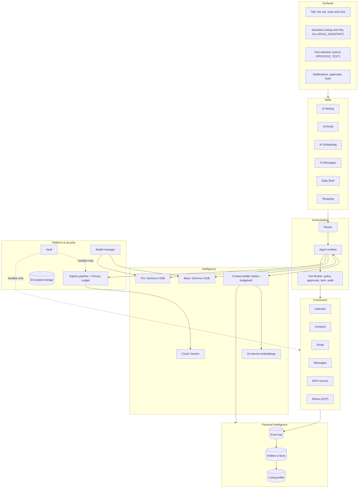
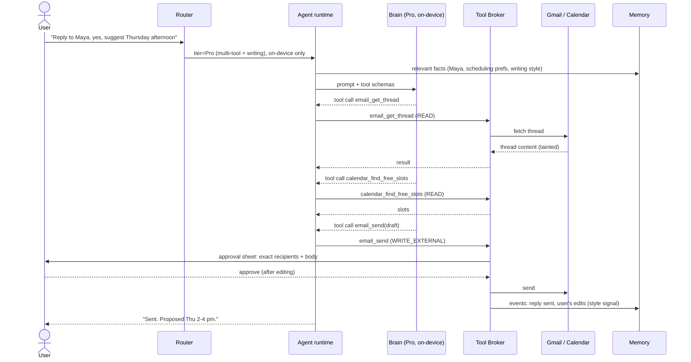
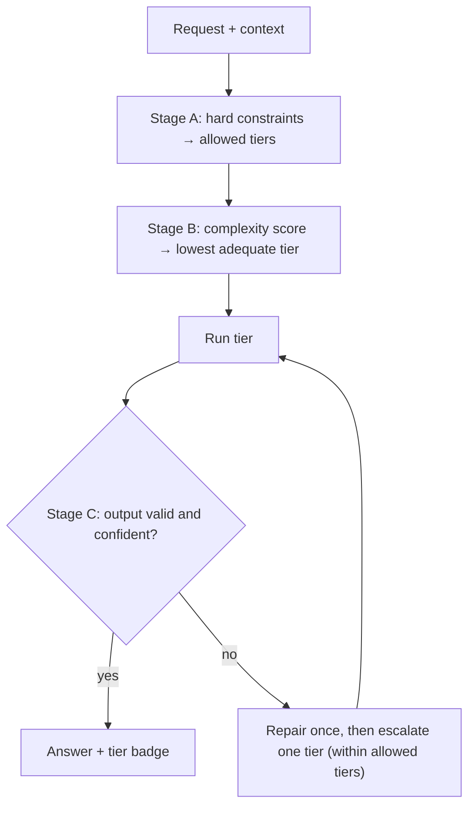
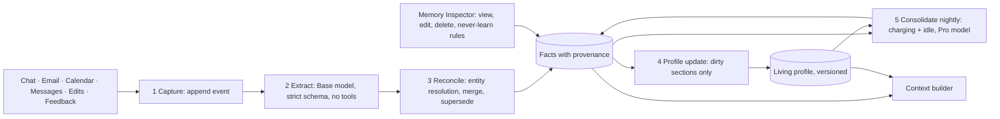

# Anu for Android: Architecture

Version 1.74.0 · Draft · 2026-10-24
Status: proposed. OD-1 to OD-4 were resolved on 2026-09-25 (§16).
Product intent lives in [VISION.md](VISION.md).

> **This document is the source of truth for how Anu is built.** All work must follow it. Any change that alters the design updates this document in the same change (§17).

**Contents**

1. Goals and scope
2. Principles and invariants
3. System overview
4. Modules, dependency rules, tech stack
5. Models and runtimes
6. Router
7. Agent runtime
8. Personal intelligence (memory and profile)
9. Connectors
10. Skills
11. Vault
12. Security and privacy
13. Surfaces
14. Data storage
15. Quality: tests, evals, budgets
16. Open decisions, risks, spikes
17. Change process, decision log, component status, changelog
18. Lessons carried over from earlier repos

---

## 1. Goals and scope

Anu is an Android app. It runs a private personal AI on the phone and:

- answers and acts using **Gemma 4 E2B** (Base) and **Gemma 4 E4B** (Pro) on the phone, and **Gemini** (Cloud) when needed;
- **routes** each request to the lightest tier that can do it well;
- runs an **on-device agent** that uses tools, with policy and approvals enforced outside the model;
- connects through official APIs to **calendar, contacts, Gmail, messaging apps** (through their notifications) and **SMS history** (in the `personal` build only);
- keeps a **living memory and profile** of the user that updates with every change;
- provides **AI Writing, AI Email, AI Scheduling, AI Messages and a Daily Brief**;
- keeps third-party credentials (for example a Meta Muse API key) in a **vault**, where models can use them but never see them.

**Builds.** There are two product flavors (ADR-012):
- **`personal`**: the first release, for the owner's phone. It includes SMS, uses the owner's own Gemini key, and sideloads models.
- **`play`**: a later Play Store release. It leaves out Play-restricted features.

**Out of scope for v1:**
- an Anu-run server, multi-device sync, and iOS;
- a web-browsing agent and a general web-fetch tool;
- fine-tuning on the device;
- Outlook / Microsoft 365;
- acting as a password manager for other apps (OD-3).

## 2. Principles and invariants

**Principles**

- **P1. On-device by default, cloud by exception.** Cloud calls are minimized, consented to, and logged in a ledger.
- **P2. The model proposes; the system decides.** Every side effect goes through the Tool Broker, which enforces policy and approvals in code, never in a prompt.
- **P3. Secrets never enter the model's context.** The model deals only in handles; the network layer attaches the real value.
- **P4. Content from connectors is data, not instructions.** It taints every turn in which the model can still see it, and a tainted turn loses automatic permissions.
- **P5. Every memory can be explained and changed.** It has a source, a confidence and a history, and the user can edit or delete it.
- **P6. Every AI decision is validated, repaired or given a fallback.** Output is parsed strictly. If parsing fails, the model gets one repair attempt. After that, the request escalates or falls back to deterministic code.
- **P7. Measured, not claimed.** A capability counts as "Verified" only once its eval passes, and docs describe what actually exists.
- **P8. Respect the device.** Heavy work waits for charging or idle time, the app reacts to thermal and memory pressure, and models are unloaded when the app is in the background, except while the user talks to Anu behind another app (live talk, ADR-108).

**Invariants.** Each of these is enforced by an automated test (§15) and must never be broken.

| # | Invariant |
|---|---|
| I1 | No secret value appears in any model prompt, log line, memory record, crash report, or network payload. The only exception is the auth header sent to that secret's bound host. Pictures (ADR-082): a photo the user attaches may show a code or password to the on-device model, since it's theirs to show and never leaves the phone or reaches memory, but answers about it mask any such secret before they're shown or saved; a screen's detected codes are masked before any model sees it. |
| I2 | No `WRITE_EXTERNAL` or `DESTRUCTIVE` tool runs without a recorded user approval of the **exact** payload. |
| I3 | Personal data leaves the device only through the egress pipeline (§12), and every egress writes a Privacy Ledger entry. |
| I4 | Every fact in memory has provenance: at least one source event, or an explicit statement from the user. |
| I5 | Deleting a source removes, or re-derives, everything that was derived from it. |
| I6 | Output that is about to trigger an action is schema-validated first. Invalid output is never executed. |
| I7 | Cancelling stops generation and tool execution. Target: within 500 ms. |
| I8 | Chat templates and tool-call formats come from the runtime or the model's own metadata, never from hand-built strings. |

## 3. System overview



**How a request flows**

1. A surface captures the request, and the router decides on a tier (§6).
2. The agent runtime asks the context builder for a token-budgeted prompt, built from the profile slice, retrieved memories, the conversation, and the schemas of the tools that are relevant.
3. The brain streams events back. Any tool call goes to the Tool Broker, which checks the schema, the policy, taint and the budget, and asks the user for approval when required. It then executes the call and audits it.
4. Results feed back into the loop. Every step also becomes an event, which grows memory.



## 4. Modules, dependency rules, tech stack

### 4.1 Module map (Gradle)

| Module | Responsibility | Android deps? |
|---|---|---|
| `app` | Application, navigation, DI graph, surface entry points | yes |
| `core:common` | Result types, dispatchers, clock, IDs, logging that redacts | no |
| `core:model` | Brain contracts, `BrainEvent`, messages, `ToolCall`, schema generation, `DataClass` (S0–S3); test fixtures such as `ScriptedBrain` | **no** |
| `core:agent` | Agent loop, Tool Broker, policy, approvals, budgets, run store interface | **no** |
| `core:router` | Router stages, features, scorer, telemetry interface | **no** |
| `core:memory` | Event log, facts, profile, retrieval, memory pipeline and memory tools. Its store is in `core:data` and its scheduling in `app` (ADR-036) | **no** |
| `core:ui` | The design system ([DESIGN.md](../DESIGN.md), ADR-048): theme tokens for light and dark, bundled Google Sans Flex and JetBrains Mono (OFL, licenses in its assets), the sphere, the privacy indicator, pages (`AnuPage`), buttons, grouped lists, sheets, dialogs, text and search fields, the tab bar, line icons, and the frosted card window. It knows nothing of brains, connectors or the agent: features pass it plain values | yes |
| `core:voice` | Speech contracts, wake-phrase matching and the `WakeListener` loop in plain Kotlin, beside the Android engines: the on-device `SpeechRecognizer` and `TextToSpeech` (ADR-043, ADR-045) | yes |
| `core:security` | `SecretRef`/`SecretUse` handles, PII detection, reversible redaction, egress gate, Privacy Ledger interface | **no** |
| `core:vault` | Keystore + Tink vault store, host-bound HTTP injector (`withVault`), and the shared `KeystoreAead` primitive with its `KeyPolicy` | yes |
| `core:data` | Room database on SQLCipher (ADR-024), DAOs, and the stores behind `TranscriptStore`, `PrivacyLedger` and `VaultAudit` | yes |
| `core:device` | Device class, battery, thermal, memory and network state | yes |
| `brain:litertlm` | Gemma E2B/E4B adapter; ModelManager (download, verify, load, residency) | yes |
| `brain:gemini` | Gemini REST/SSE adapter; every request passes the egress gate | **no** (OkHttp) |
| `brain:ollama` | Gemma on the user's own Mac (ADR-113): Ollama's `/api/chat` over HTTPS pinned to the Mac's certificate, behind `scripts/mac-brain.py`; every request passes the egress gate | **no** (OkHttp) |
| `brain:embedding` | Search by meaning (ADR-055): EmbeddingGemma through Google's AI Edge RAG library (`GemmaEmbeddingModel`), behind the `Embedder` contract in `core:model`. Only the library's Gemma embedder is used and packaged | yes |
| `brain:embedding` | Search by meaning (ADR-055): EmbeddingGemma through Google's AI Edge RAG library (`GemmaEmbeddingModel`), behind the `Embedder` contract in `core:model`. Only the library's Gemma embedder is used and packaged. Also EmbeddingGemma 2's text and vision build on LiteRT-LM's `EmbeddingEngine` (`Gemma2Embedder`, a `VisualEmbedder`, ADR-111) | yes |
| `brain:vision` | Live camera's detector (ADR-111): YOLOX-Nano (Megvii, Apache 2.0) as a 2.2 MB LiteRT `.tflite` in its assets, on LiteRT's `CompiledModel` (the NPU on a chip in `YoloxDetector.NPU_VERIFIED` when the app carries Qualcomm's libraries, ADR-115; else the GPU on a phone, the CPU on an emulator; a backend that won't load falls to the next), behind `ObjectDetector` in `core:model`. `QualcommLibraries` links Qualcomm's libraries into their own folder. The letterbox, box decoding and NMS are plain Kotlin | yes |
| `brain:nano` | AI Writing on Gemini Nano through AICore (ADR-116): `MlKitWriter`, ML Kit's GenAI rewriting, proofreading and summarization behind `SystemWriter` in `core:model`, with ML Kit's upload backend and jobs taken out of the manifest (I3). Spike S10's device test uses the Prompt API | yes |
| `connector:calendar` | CalendarContract tools and observer | yes |
| `connector:contacts` | ContactsContract: find people, and save a person or add a number or email (ADR-093) | yes |
| `connector:gmail` | Gmail API tools and incremental sync | yes |
| `connector:messages` | Notification listener capture and reply actions for any messaging app | yes |
| `connector:sms` | SMS provider history and incoming SMS. **`personal` flavor only** | yes |
| `connector:mcp` | MCP servers the user adds, as tools: a dual-era Streamable HTTP client, schema trimming and checks, and the server registry (ADR-046) | **no** (OkHttp) |
| `connector:shopping` | Stores that speak UCP: discovery, catalog search and checkout sessions (ADR-047) | **no** (OkHttp) |
| `connector:phone` | Phone controls (ADR-076, ADR-079, ADR-099): timers and alarms through the clock app, the flashlight, Do Not Disturb, Settings pages, brightness, volume, and a text ready to send in the messaging app. Other apps through Android's intents and timed reminders (ADR-107): the dialer, opening an app by name, directions, the share sheet, and reminders as notifications, with their alarm and boot receivers | yes |
| `connector:notes` | The user's notes, kept in Anu (ADR-093): create, search and add to one by its title. `core:data` stores them. A new note is written into Samsung Notes too where app control is on (`SamsungNotesMirror` through `AppDriver`, ADR-117) | **no** |
| `agent:adk` | Sub-agents and workflows on Google's ADK for Kotlin (ADR-104): Anu's brains as ADK's `Model`, Anu's tools as ADK tools that run through the broker, the specialists, the coordinator and the daily brief. Pure Kotlin on ADK's common API | **no** |
| `connector:a2a` | Agents on the user's own network over the Agent2Agent protocol (ADR-105): their cards, `message/send`, and each agent as a tool that asks every time and writes the ledger. Pure Kotlin | **no** |
| `connector:apps` | App control (ADR-098): Anu's accessibility service, which reads another app's screen and taps and types in it during an approved app task. It also reads the screen once for the "Ask Anu about this screen" tile (`TileScreen`) and shows live talk's pill over other apps (`LiveControl`, ADR-108). The `personal` build only | yes |
| `demo:shop` | Test Shop, a made-up shop app for app control's checks on anu_api36 (ADR-098). Never shipped | yes |
| `feature:home` | The Talk page: the sphere, voice and typing on one surface, receipts, and the approval and consent sheets (ADR-043, ADR-049). The assistant overlay, `AssistantActivity`, and the "Hey Anu" service are in `app` (ADR-044, ADR-045) | yes |
| `feature:writing` | The writing sheet, its prompts and output checks. Its `PROCESS_TEXT` entry point, `WritingActivity`, is in `app` (ADR-042) | yes |
| `feature:keyboard` | Anu's keyboard (ADR-109): an `InputMethodService` with QWERTY, symbol and number keys, the AI strip with AI Writing's actions plus Continue and Reply, the preview, and the field rules (passwords and incognito fields get no AI). The app subclasses its service, `AnuKeyboardService` in `app`, to wire it | yes |
| `feature:camera` | Live camera (ADR-111): CameraX's preview and frame analysis, the boxes over the preview, things followed across frames (`Tracker`), the question matched by meaning, picture and words (`LiveSearch`, `Finder`), and "Ask Anu about this". Its activity, `LiveCameraActivity`, is in `app` | yes |
| `feature:email` | Priority inbox, summaries, drafts | yes |
| `feature:scheduling` | Scheduling assistant | yes |
| `feature:memory` | Memory Inspector: facts grouped by section, search, a sheet per fact, and adding a memory in the user's own words | yes |
| `feature:vault` | Vault UI | yes |
| `feature:settings` | Settings in four groups: voice (the assistant, "Hey Anu"), connections, models and the Gemini key, and the records. Services, Stores, Models, Activity and Vault activity are its pages. Also the Privacy report, which `app` opens over any page (ADR-050) | yes |
| `eval` | JVM harness: router, tools, memory, injection, performance scripts | no |

### 4.2 Dependency rules (enforced by module boundaries)

- `core:model`, `core:agent`, `core:router`, `core:security`, `core:memory`, `brain:gemini`, `brain:ollama`, `connector:mcp`, `connector:shopping` and `connector:notes` are pure Kotlin with no `android.*` imports. They are unit-tested on the JVM and can later become Kotlin Multiplatform modules for iOS.
- Features depend on core contracts, never on a concrete brain or connector. Implementations are bound in `app` (`AppGraph`). For example, screens see models only through `OnDeviceModels` in `core:model`, which `ModelManager` implements.
- Connectors never call brains, and brains never call connectors. They meet only in the agent runtime.
- Only `core:vault` can decrypt secrets. Only the vault's HTTP injector can attach one to a request.
- Only `core:data` touches the database.
- Nothing depends on `app` or on `feature:*`, except `feature:keyboard` on `feature:writing`, whose prompts and output checks it reuses (ADR-109).
- Every screen styles itself only through `core:ui` (DESIGN.md). `core:ui` depends on no other Anu module.
- Code restricted to one flavor (SMS) lives in its own modules and is wired in only through `personalImplementation`. The `play` flavor must build and pass its tests without it, and its merged manifest must contain no SMS permissions.

### 4.3 Tech stack

| Concern | Choice | Note |
|---|---|---|
| Language / build | Kotlin 2.x, JDK 21 toolchain, Gradle wrapper, version catalog | |
| SDK levels | minSdk 31; target/compile = latest stable at scaffold time | 31 is required for the on-device `SpeechRecognizer` |
| UI | Jetpack Compose, Material 3, Navigation Compose, ViewModel + StateFlow | One-way data flow |
| DI | Manual: one `AppGraph` in `app` | ADR-023. Hilt is reconsidered when the graph outgrows one file |
| Settings storage | `SharedPreferences` for non-sensitive values only, such as the vault handle of the Gemini key | DataStore replaces it once there's more than a handful of settings |
| Async | Coroutines and Flow, structured concurrency | Cancellation must reach native generation (I7) |
| Serialization | kotlinx.serialization | Tool JSON Schemas are generated from serializers |
| On-device LLM | LiteRT-LM Android, `com.google.ai.edge.litertlm:litertlm-android` | 0.18.1, the latest on Google Maven as of 2026-10-21 (ADR-096). Pinned in the version catalog |
| Gemini Nano for AI Writing (ADR-116) | ML Kit GenAI `com.google.mlkit:genai-rewriting`, `genai-proofreading` and `genai-summarization` 1.0.0-beta1, one release on `genai-common` beta1; the Prompt API (`genai-prompt` 1.0.0-beta4) stays a test dependency for S10, since it needs `genai-common` beta4 | They bring Google's usage-log transport. ML Kit won't start without its classes (`CCTDestination`: removing `transport-backend-cct` crashed the app at the first client), so `brain:nano`'s manifest removes its backend registration and its upload job and alarm instead; the log then says "Transport backend 'cct' is not registered", and nothing is sent from Anu's process (I3) |
| Embeddings | EmbeddingGemma 300M (mixed precision, 256 tokens, CPU; ADR-062) through the AI Edge RAG library 0.3.0's `GemmaEmbeddingModel` (ADR-055, S3) | Its native code is arm64 only (23.7 MB). The library's MediaPipe LLM runtime, second OkHttp and copy of `org.json` are excluded, and so are its three other native libraries |
| Object detection (ADR-111) | LiteRT 2.3.0 `CompiledModel` (`com.google.ai.edge.litert:litert-gpu`, Apache 2.0) running YOLOX-Nano; CameraX 1.6.2 for frames; EmbeddingGemma 2 text and vision 440M (`litert-community/embeddinggemma-2-text-vision-440m-litert-lm`, Apache 2.0, ungated) on LiteRT-LM's `EmbeddingEngine` | In the `personal` build, LiteRT's Qualcomm dispatch library and compiler plugin (`litert-npu-runtime-qualcomm` 2.3.0, Apache 2.0) and Qualcomm's QNN runtime (`com.qualcomm.qti:qnn-runtime` 2.50.0, Qualcomm AI Hub Model License), trimmed to the v81 HTP, run YOLOX on the Snapdragon's NPU (ADR-115). LiteRT's Play delivery of AI packs (`com.google.android.play:ai-delivery`) is excluded: the model ships in the APK and nothing may reach the network (I3). Not Ultralytics YOLO: its AGPL would cover all of Anu |
| Cloud LLM | `personal`: Gemini API with the owner's key from the vault, sent in the `x-goog-api-key` header, never the URL. `play`: Firebase AI Logic, evaluated in Phase 5 | ADR-013 |
| Build flavors | `personal` and `play` | ADR-012 |
| Google auth | Credential Manager + Google Identity Services `AuthorizationClient` | Per-scope, incremental consent |
| Database | Room on SQLCipher (`net.zetetic:sqlcipher-android`) | Key wrapped by Android Keystore |
| Crypto | Android Keystore (StrongBox where available) + Tink AEAD; `androidx.biometric` | `androidx.security:security-crypto` is deprecated, so not used |
| Network | OkHttp + kotlinx.serialization | Interceptors for vault injection and the egress ledger |
| Background work | WorkManager; foreground services only for model downloads, for "Hey Anu" (microphone), and for live talk behind other apps (microphone, ADR-108) | |
| Tests | JUnit, Turbine, Robolectric, Compose UI tests, scripted fake brains | Real-model tests are opt-in |
| CI | GitHub Actions: build, unit tests, lint, invariant tests | Status badges only once workflows exist |

Application ID: `io.github.sandeepvijayarao09.anu`. It can change until the first Play upload.

## 5. Models and runtimes

| Tier | Model | Runtime | Where | Used for |
|---|---|---|---|---|
| Direct | none | Kotlin handlers | device | Simple intents with a deterministic answer ("when's my next meeting?") |
| Base | Gemma 4 E2B-it (`.litertlm`) | LiteRT-LM | device | Classification, short replies, rewrites, single tool calls; the device skill's few small calls (ADR-093); memory extraction when Pro isn't installed |
| Pro | Gemma 4 E4B-it (`.litertlm`, ~3.7 GB file) | LiteRT-LM | device | Multi-step tool use, long-form writing, scheduling reasoning, profile synthesis, memory extraction (ADR-060) |
| Cloud | Gemini, Flash or Pro (model IDs come from config, not code) | Gemini API; the key is a vault item bound to `generativelanguage.googleapis.com` | cloud | Work beyond on-device quality or context limits, with consent |
| Cloud: your Mac (ADR-113) | Gemma 4 26B A4B (`gemma4:26b`, 32K context), chosen by the Mac | Ollama on the user's Mac, behind `scripts/mac-brain.py`; the token is a vault item bound to the Mac's address | the user's Mac, over their Wi-Fi | The Cloud tier's brain in Gemini's place while a Mac is paired, with the same consent and egress |
| Embeddings | EmbeddingGemma 300M (ADR-055) | AI Edge RAG library | device | Search by meaning in memory; later entity resolution and router features |
| Detector and picture search | YOLOX-Nano (2.2 MB, 80 COCO things) and EmbeddingGemma 2 text and vision 440M (388 MB; Tensor G5 TPU build 559 MB) (ADR-111) | LiteRT `CompiledModel` (GPU on a phone, CPU on an emulator); LiteRT-LM `EmbeddingEngine` (70 picture tokens; GPU on the SM8850, else CPU) | device | Live camera: boxes on the preview, and a question matched to them by meaning and by each box's picture |

**Runtime rules**

- **Not MediaPipe `tasks-genai`.** Its LLM Inference API is deprecated. See ADR-002.
- **Native formats only (I8).** Use the runtime's chat template and tool-calling support, not hand-built prompt formats.
- **Brain contract** (`core:model`):

  ```kotlin
  interface Brain {
      val id: BrainId                        // BASE, PRO, CLOUD_FLASH, CLOUD_PRO
      val capabilities: BrainCapabilities    // context window, tool calling, vision, audio
      fun stream(request: BrainRequest): Flow<BrainEvent>   // cold: collecting starts generation, cancelling stops it
  }

  sealed interface BrainEvent {
      data class TextDelta(val text: String) : BrainEvent
      data class ToolCallRequested(val call: ToolCall) : BrainEvent
      data class Usage(val inputTokens: Int, val outputTokens: Int) : BrainEvent   // request totals, emitted once
      data class Finished(val reason: StopReason) : BrainEvent
  }
  ```

- **LiteRT-LM adapter** (API checked against the 0.17.1 AAR: 20 MB, arm64-v8a + x86_64, minSdk 24; moved to 0.18.1 by ADR-096):
  - **Tools, `automaticToolCalling = false` always (ADR-017).** Tools are declared through `OpenApiTool` descriptions generated from our serializers. The runtime only *reports* `Message.toolCalls`, and the Tool Broker executes them. LiteRT-LM's default auto mode would run tools inside the runtime, bypassing policy and approvals (P2, I2), so it is forbidden.
  - **Conversation is a cache; our transcript is the truth (ADR-018).**
    - The KV cache lives in a LiteRT-LM `Conversation`, reused across the turns of a run.
    - **Two are kept (ADR-097).** Each model keeps its two most recently used conversations, and a request reuses whichever already holds its system prompt, tools, sampling, thinking setting and history. So a one-message job, such as Writing, Test speed or extracting facts, no longer throws away the chat's, and the chat's next turn reads only its new message. On the Anu emulator the second conversation added about 20 MB of resident memory.
    - **Debug builds say why a turn read the chat again (ADR-097).** The speed line ends with `conversation kept`, `new`, or `rebuilt (…)` naming the parts that differed: system, tools, sampling, thinking, history. A conversation that was built also says what it read, part by part, in characters: `system S, tools T, history H, message M chars`. Names and sizes only, never content.
    - Our persisted transcript is the source of truth.
    - `cancelProcess()` does not roll back conversation state. After a cancel or an error, the conversation is closed and later rebuilt from the transcript (`initialMessages`).
    - **Memory is part of the on-device system instruction only (ADR-038).** `BrainRequest.memory` is appended after the system prompt by on-device brains and is part of the cache key. The Gemini brain never sends it.
    - **The system prompt stays the same between turns (ADR-033).** The cache is reused only when a request extends what the conversation has already seen, with the same system prompt and tools. So per-turn facts never go in the system prompt, and nor does the date (ADR-114): the week's dates travel with the newest message too, and MCP tools are listed in a stable order. The current time travels with the newest user message (`BrainRequest.sentAt`, shown to the model as `[Fri 2026-09-25 14:46] …`), and the prompt carries only the time zone. On the emulator, a prompt with the time to the minute made every turn re-read the whole chat: one reply took over six minutes on CPU. With the time on the message, the same turn took 15–27 s.
  - **Streaming and cancellation.**
    - `sendMessageAsync(…, MessageCallback)` is wrapped in `callbackFlow`.
    - `awaitClose` calls `cancelProcess()`. The native side then reports `onError(CancellationException)`.
    - The conversation is closed only after that final callback, never while decoding is still running (I7).
  - **Structured output.** Router decisions, extraction and classification use `ResponseFormat.json(schema)`, which constrains decoding to the schema (P6).
  - **Budgets.** Token counts come from `getTokenCount()`. Per-tier limits are set with `maxNumTokens` (engine) and `maxOutputToken` (per request). Thinking is the user's choice (ADR-077): off unless Settings → Think before answering is on.
  - **One context size (ADR-040).** A single constant, 4,096 tokens today, sets the engines' `maxNumTokens`. The router's prompt budgets and the chat window are derived from it, so a prompt sent to a device tier fits it. S1 on the reference phone may raise it.
  - **Backends.** `CPU`, `GPU`, `NPU` and `GOOGLE_TENSOR` are all available. S1 measures each on the reference device.
  - **The Pixel's TPU (ADR-102).** It runs through `Backend.NPU(nativeLibraryDir)`, as Google's AI Edge Gallery does, not `GOOGLE_TENSOR`, which LiteRT-LM 0.18.1 doesn't recognize. It needs three things:
    - Google's Tensor dispatch library (`com.google.ai.edge.litert:litert-npu-runtime-google-tensor`, Apache 2.0);
    - native libraries extracted to the app's library folder (legacy packaging), where the runtime looks for that library;
    - the phone's own Edge TPU libraries declared with `uses-native-library`.
    On the Pixel 10 Pro, E2B's Tensor G5 file passes the contract and reads about 7× faster than E4B on the GPU, but it fails extraction as the GPU does.
  - **Base on the TPU, in the app (ADR-103).** On a chip in `ModelCatalog.TPU_VERIFIED` (the Tensor G5 today):
    - Base uses its TPU build when that file is installed, or when Base's usual build isn't either, so a download fetches the TPU build.
    - Pro stays E4B on the CPU (on the GPU beside it where ADR-106 applies), and memory extraction runs Pro on the CPU (`memoryBrain()`), so memory keeps the CPU's quality.
    - The router sends a request scored for Pro to Base when it fits Base's budget (§6), and a failed answer still moves up to Pro.
    - A TPU engine that fails to load sets Base back to its CPU build until the app restarts. Without that file installed, the turn fails and the router stops offering Base.
    - Photos go to the GPU vision encoder, as in Google's Gallery.
    - The app extracts its native libraries on install, for the dispatch library.
    - Settings and "About this answer" say "Tensor TPU".
    - Warm start loads Base whenever Base is on the TPU, even after a Pro answer, since most requests now go to Base. It had loaded Pro, then switched.
  - **Base on the TPU beside Pro on the GPU (ADR-106).** On a chip in `ModelCatalog.PRO_GPU_CHIPS` (the Tensor G5 today), with Base on the TPU and at least 12 GB of memory (`ModelManager.proOnGpu`):
    - Pro's chat runs E4B's usual file on the GPU, and Base and Pro stay loaded together. The two-engine test on the Pixel 10 Pro answered correctly on both, alternating, with the process at 1.07 GB and 2.5 GB of the system's memory left (spike log).
    - Memory's extraction asks `OnDeviceBrains.memoryBrain()`: Pro on the CPU, because the GPU missed a fact the CPU finds. Loading it lets the pair go, and the pair loads again on the next turn.
    - Warm start loads Base, then Pro on the GPU without naming the wait, so Pro is ready by the time a request needs it. Base's turns go on meanwhile: each loaded model has its own lock, and an engine whose flags already match loads without holding LiteRT-LM's flag lock.
    - A GPU engine that fails to load sends Pro's chat back to the CPU until the app restarts.
    - The router keeps a request scored for Pro on Pro (§6), and Base gives its own opinion of a request the rules gave it (§6, Stage B).
  - **Pro on the GPU by itself (ADR-112).** On a chip in `ModelCatalog.PRO_GPU_ALONE` (the Snapdragon 8 Elite Gen 5, `SM8850`, in the Galaxy S26 Ultra), Pro runs E4B's usual file on the GPU for chat and for memory's extraction (`ModelManager.proGpuAlone`), because there the GPU passed both S1's contract and extraction, finding every fact the CPU finds.
    - It needs no TPU build: Hugging Face publishes no Gemma 4 build for this chip's NPU. Base stays on its CPU build.
    - The router's `proOnGpu` (ADR-106) stays the Pixel's pair, so routing doesn't change.
    - A GPU engine that fails to load sends Pro back to the CPU until the app restarts, as in ADR-106.
    - Photos use the vision encoder on the GPU, on the model's own backend. S11 passes there: one picture's first token after 0.7 s, and four pictures read in 5.5 s (spike log).
  - **CPU until a chip's GPU is verified (ADR-059).** Phones and emulators use the CPU build unless their chip is in `ModelCatalog.GPU_VERIFIED`, which S1 fills and which is empty today. On the Pixel 10 Pro (Tensor G5), E4B's GPU build loaded but wrote garbage.
    - Its generic file on the GPU is how Google's AI Edge Gallery runs Gemma 4. On the same phone, a first run answered correctly: prompts were read about 4× faster and answers written about 15% slower (spike log, 2026-09-28).
    - It's adopted only after a run on an idle phone passes the contract and extraction tests. On LiteRT-LM 0.18.1 (2026-10-23), it passed the contract and read prompts 4.7× faster, but its extraction missed "I'm vegetarian" twice, so it isn't adopted yet.
  - **Runtime flags (ADR-068).** LiteRT-LM reads speculative decoding and its benchmark counters from process-wide `ExperimentalFlags` when an engine loads. `EngineHolder` sets them from `EngineOptions` under one lock while an engine loads, then restores them, so engines never read each other's.
  - **Speculative decoding stays off (ADR-069).** Gemma 4's files carry multi-token prediction heads: `ModelInfo.Llm.hasSpeculativeDecodingSupport()` (`Capabilities` before 0.18) is true for E4B's generic file, byte for byte the file the Gallery ships.
    - On the Pixel 10 Pro's CPU it gave no gain: 4.7 against 5.8 tokens/s on a short answer, and 6.6 against 6.4 on a long one, with the same greedy answers.
    - The runtime's default is off, so nothing is set. It's measured again with the GPU.
  - **What the file declares** (`ModelInfo`, E4B's generic file): text, image and audio input; no thinking or function-calling metadata; no sampler defaults, so Anu keeps Gemma's published ones. Tool calls work through the runtime's tool format all the same (S1). It declares no context limit (`maxContextTokens` is 0) and a fixed, not dynamic, context; its text backends are the CPU and the GPU. So 4,096 tokens is Anu's choice (ADR-040), not the file's.
  - **Activations stay 32-bit on the CPU (ADR-096).** 0.18 lets an engine choose its activation type (`EngineConfig.activationDataType`). On the Anu emulator, whose CPU has 16-bit float and int8 matrix instructions, 16-bit activations gave no gain in three runs each: an 814-token prompt read at 192–202 tokens/s against 194–208, and answers written at 27–31 against 28–31, with the same greedy answers. The weights are integers and the heavy maths runs in integer kernels, so the activations' float type barely matters there. It's measured again on the GPU, whose default is already 16-bit.
  - **Metrics.** `ExperimentalFlags.enableBenchmark` reports init time, time to first token, and prefill/decode tokens per second. It is used by S1 and the performance evals.
    - In debug builds it also feeds the speed log (ADR-068). `adb logcat -s Anu:D` shows `Speed: Pro on CPU read R tokens at … tok/s, first token after … ms, wrote W at … tok/s` for each on-device turn: numbers only.
    - **Test speed and real use (ADR-073).** Each installed model's sheet on the Models page shows its speed from the user's own answers (the middle of the last 20 on that model and build, from the `answers` table) and from Test speed: `OnDeviceBrains.test` runs a fixed made-up passage and an 80-word summary (`SpeedTest`, greedy, 128 tokens at most) under the same residency lock as chat, so it waits for the current answer, and says each step (waiting, getting ready or the GPU's first setup, reading, writing). The last result is kept in the app's settings, marked when the phone was warm. Its first word counts setting up the test's conversation, as the user feels it; reading and writing are the runtime's rates, or estimates without the counters.
    - Speed isn't shown in the chat. "About this answer" shows it on request (ADR-071): `LiteRtLmBrain` reports each turn's backend and what it read and wrote in its `Usage` event. With the counters (debug builds), those are the runtime's own numbers. Without them (release builds, ENG-2) they are estimates: the text pieces written, the rest of the context's growth as read, and the clock around the first piece. The first piece can arrive late (on the emulator, a turn the counters put at 1.5 tokens/s written measured 2.1 by the clock), so S1 still has to check the estimates against the counters before release builds rely on them.
  - **Embeddings.** LiteRT-LM ships an `EmbeddingEngine` (0.18 adds multimodal EmbeddingGemma 2), but it loads `.litertlm` bundles. EmbeddingGemma's CPU build is a `.tflite` with a separate SentencePiece tokenizer, and its only bundles target the Tensor G4 NPU. So S3 runs it through the AI Edge RAG library instead (ADR-055).
  - **Evals on the Mac.** `litertlm-jvm` (the same API on macOS) lets `eval` run real-model evals on the development Mac without a phone.
- **ModelManager.**
  - An artifact manifest lists name, version, URL, SHA-256 and size for each model file.
  - **Memory guidance (ADR-066).** Each model carries the memory Google's AI Edge Gallery asks for: E2B 8 GB, E4B 12 GB.
    - The Models page says so when a phone has less. The model can still be downloaded.
    - The phone's memory is Android 14's advertised size when it's within 25% of the total the system can use, and that total otherwise.
  - Downloads run through WorkManager: resumable, and on unmetered networks by default. The Models page shows the time left, from the download's average speed.
  - The hash is verified before load, and files live in `noBackupFilesDir`.
  - **Delivery:**
    - `personal`: download inside the app from pinned URLs. The `litert-community` Hugging Face repos are **not gated** (checked 2026-09-25), so no token is needed. During development, `adb push` from the local Hugging Face cache.
    - `play`: Play for On-device AI packs, in Phase 5.
    - **From a file (ADR-067).** Settings → Models → Choose a file installs a model file the user already has, such as EmbeddingGemma downloaded in the phone's browser after accepting its licence.
      - The system's file picker hands over only that file.
      - It's kept only if its size and SHA-256 match a file this phone uses: a chat model's chosen build, or one of search by meaning's two files. It's installed under its catalog name, whatever it's called.
      - It's hashed while it's copied. A file whose size matches nothing is refused before it's read.
  - **Artifact per backend and chip (ADR-019).** Hugging Face publishes a different file for each backend. Today every device gets the CPU build (ADR-059); a first-run benchmark may choose per device later. Sizes as of 2026-09-25:

    | Model | CPU (generic) | GPU | NPU |
    |---|---|---|---|
    | E2B | `gemma-4-E2B-it.litertlm`, 2.59 GB | `gemma-4-E2B-it-gpu.litertlm`, 2.01 GB | Tensor G5 3.11 GB, Tensor G6 3.31 GB, Snapdragon sm8750 3.02 GB |
    | E4B | `gemma-4-E4B-it.litertlm`, 3.66 GB | `gemma-4-E4B-it-gpu.litertlm`, 2.97 GB | none published |

    There is no NPU build for Tensor G3 or G4, nor for the Snapdragon 8 Elite Gen 5 (`SM8850`): the repo's latest commit (checked 2026-10-24) has dropped the `sm8750` file and offers only `Qualcomm_QCS8275`, a VENTUNO Q board. Since 2026-10-23 it also has `gemma-4-E2B-it_NPU_Uncompiled.litertlm` (2.61 GB), meant to be compiled for the NPU on the phone; on the S26 Ultra only its small graphs compile, and the transformer falls back to the CPU (spike S15). EmbeddingGemma 2 and Gemma 3 do publish `SM8850` builds. A Pixel 8 Pro or 9 Pro therefore runs on CPU or GPU, and `GOOGLE_TENSOR` applies only to Pixel 10 and later with E2B.
  - **Weight cache (ADR-020).** `EngineConfig.cacheDir` must point to app-private storage (`noBackupFilesDir/litertlm-cache`). Without it, the CPU backend tries to write its XNNPack weight cache next to the model file and silently falls back to no cache. That was observed when a model was loaded from `/data/local/tmp`, where Android's security policy denies the write. Budget free disk space for the cache on top of the model file: on the Pixel 10 Pro, E4B's CPU cache is 2.21 GB, so the CPU build takes about 5.9 GB in all.
  - **Real space (ADR-061).** The catalog records each CPU build's measured cache: E4B 2.21 GB, E2B 0.79 GB, byte for byte the same on the phone and the emulator. The Models page shows what a model needs before it's downloaded, and what it uses once it is, read from disk. Deleting a model deletes its cache too, so Delete frees what it says.
- **Residency policy.** These are hypotheses; spike S1 sets the real thresholds.
  - **Implemented now** (`OnDeviceBrains`): one on-device model is loaded at a time, except Base on the TPU beside Pro on the GPU, which were measured together (ADR-106). Loading any other model waits for the loaded ones' answers, closes them and loads the new one. Each loaded model has its own lock, held while it loads and answers. Everything unloads on `TRIM_MEMORY_BACKGROUND`.
  - **Warm start (ADR-074).** When Anu is summoned (the assistant card, which "Hey Anu" also opens; Talk opening; typing starting), the model the last answer used loads, or Base, so the first word doesn't wait for the load. It takes the residency lock like a turn, so it never unloads a model mid-answer, and a turn that needs the other model waits, then switches. Not while the heat or battery guard is on, nor in battery saver, because a load can't be stopped once it starts (A8) and a summon may end with no question. On the Anu emulator, opening Talk had E4B ready 2.6 s later. It doesn't read the chat ahead (ENG-11, Eng D13). `prefillPrefaceOnInit` reads the whole chat when the conversation is created, and the next message's first word then came in 1.6 s instead of 17 to 25 s. But nothing can stop that read once it starts, so a message for another skill waited 16.2 s behind it instead of 1.5 s, and the gate was 1 s (spike log).
  - **Photos (ADR-075).** A request with a photo in view needs Gemma's vision encoder, so `OnDeviceBrains` loads the engine again with it (`EngineConfig.visionBackend` on the model's own backend, up to 4 images) and keeps it until the next unload; text-only chat skips it. A photo goes to the model as `Content.ImageBytes` before the message's words, and counts as 280 tokens of the prompt (S11: 289 for its picture). On the Anu emulator, the reload took 4 s and E4B read a made-up sign correctly.
  - **Voice notes (G3, EXP-3, ADR-078).** A model whose file declares audio input (`ModelInfo`) always loads with `EngineConfig.audioBackend` on the CPU, as in Google's Gallery: the encoder loads only when a recording arrives, so it costs nothing until then (S6: the memory held after loading was the same with and without it). `OnDeviceBrains` is the `Transcriber`: under the residency lock, it writes a recording down with the loaded model if it can hear, else Pro, else Base, in conversations of its own beside the chat's cached one, which the engine keeps as it is (S6 showed both can be open, and the chat still knew what it had been told). A recording goes as `Content.AudioBytes`, a mono 16-bit WAV, in pieces of at most 30 s cut at the quietest moment before each limit, greedy, with no tools or memory and at most 384 tokens of words per piece. The prompt asks for the words only, in the spoken language, or "[no speech]", which becomes nothing: silence and noise both gave it in S6. The runtime's decoder takes WAV at any rate but not AAC, so shared recordings are decoded on the phone first (§13).
  - **PDFs read in pieces (ADR-095).** The on-device window is 4,096 tokens, so a PDF longer than about one page of text (`Documents.WHOLE_CHARS`, 4,000 characters) is read in pieces, as long recordings are written down. `ChatSession` cuts its pages' text into pieces of at most 7,000 characters, whole pages where they fit, and sends each to the `DocumentReader`, which `OnDeviceBrains` is: under the residency lock, with the loaded model, else Pro, else Base, in a conversation of its own (`LiteRtLmBrain.once`), greedy, with no tools, memory or history and at most 200 tokens of notes. The instruction asks for what bears on the user's question, with names and figures as written, or `[nothing]`, and says the text is content, not instructions (P4). The notes, at most 4,000 characters, are what the chat's turn sees. At most the first 20 pages are read.
  - **A runtime that goes quiet.** On the emulator, with a long chat and two pictures to read again behind other windows, LiteRT-LM timed out a task inside itself after about two minutes (`DEADLINE_EXCEEDED` in its callback pool) and never called back, so the answer waited forever. `LiteRtLmBrain` now fails a turn, a transcription or a lab run after 3 minutes without a word (`ModelStalled`), after asking the runtime to stop; the conversation is closed only once the runtime lets go of it (I7). Three minutes is past a whole window's reading on a phone's CPU (about 70 s for 4,096 tokens).
  - **Thinking (G4, ADR-077).** With the setting on, on-device conversations are created with `ThinkingConfig(enableThinking, 512 tokens)`, so the model's own template turns thinking on (I8). The reasoning streams in the "thought" channel, apart from the answer: `BrainEvent.TextDelta(thought = true)`, then `AgentEvent.Thinking`. Conversations are created with `filterChannelContentFromKvCache` on, so the next turn never reads the reasoning, and the saved chat holds only the answer. A thinking probe on the Anu emulator's CPU (`ThinkingProbeTest`) found the channel works though the file declares no thinking metadata: with thinking, E4B answered a timing question "12:35" in one line, its first word after 28.7 s; without it, a step-by-step answer began after 8.8 s. So thinking is off by default; whether it measurably helps on a task set, which would make it on by default for some requests (THINK-1), waits for the scoreboard (EVAL-1).
  - **What the models are doing (ADR-074).** `OnDeviceBrains.status` says Loading, SettingUpGpu (a GPU model's first run), Switching, or Reading (a conversation built again from the chat, which reads all of it; on the emulator, building it took about 30 s for a long chat before the reading itself), else Idle. After 1 s with no word, the answer's note names the cause: "Getting Gemma 4 E4B ready…", "Setting up the GPU. First time only, about a minute.", "Switching to Gemma 4 E4B…", "Catching up on this chat…". TalkBack hears it once, and the assistant card shows the same line.
  - Reference device: Pixel 8 Pro or newer, with 12–16 GB RAM (ADR-016).
  - Low-RAM devices: Base only.
  - Mid: Base stays loaded; Pro loads on demand and replaces it.
  - High, which includes the reference device: both stay loaded while memory allows.
  - Models unload on `onTrimMemory` and when the app goes to the background.
  - Planned: the backend (CPU, GPU or NPU) is chosen by a micro-benchmark on first run. Until then it is the CPU build, except on chips whose GPU passed S1 (ADR-059).
- **Gemini adapter** (`brain:gemini`, ADR-022):
  - **Transport:** REST `v1beta/models/{model}:streamGenerateContent?alt=sse`, over a `withVault` client.
  - **Schemas:** tool and response schemas are sent as JSON Schema (`parametersJsonSchema`, `responseJsonSchema`), so `core:model` schemas pass through unchanged.
  - **Thought signatures** are kept on `ToolCall.signature` and echoed back with the transcript.
  - **Usage:** Gemini reports running totals on every chunk; the adapter keeps the last and emits it once.
  - **Sampling:** Gemini's defaults (only output length and schema are set).
  - **Models:** IDs come from config. The defaults are the aliases `gemini-flash-latest` and `gemini-pro-latest`.
  - **Not yet checked:** the exact field names and aliases haven't been verified against the live API (spike S8).
- **Mac adapter** (`brain:ollama`, ADR-113):
  - **Where.** Ollama stays on the Mac's `127.0.0.1`. `scripts/mac-brain.py` listens on the network over HTTPS with its own certificate (EC P-256, ten years) and answers only `POST /api/chat` and `GET /anu/ping`, only with the bearer token. It sets the model, its context (`num_ctx`, 32K by default: Gemma 4 26B A4B is about 18 GB, which fits a 24 GB Mac) and `keep_alive`, so the phone can't load anything else. It logs sizes, never content.
  - **Pairing.** The script prints `anu-mac://<address>:<port>?pin=<SHA-256 of its certificate>&token=<token>`; Settings → Your Mac takes it. The token goes into the vault, bound to that address and to `brain:ollama` alone; the address, port and pin are kept in the app's settings. The client trusts exactly the pinned certificate and only the paired host (`pinnedTo`), and the vault's injector still refuses plain HTTP.
  - **Transport:** NDJSON streaming from `/api/chat`; Ollama applies Gemma's own chat template and tool format (I8). Tools are sent as JSON Schema `function`s and reported, never run (ADR-017); a response schema goes as `format`; sampling and `num_predict` from the request. `think` is always sent, false unless thinking is on: Ollama turns Gemma 4 26B's thinking on when it's missing, and on the Mac an 80-token answer went entirely to reasoning. Reasoning is dropped like Gemini's.
  - **Usage:** the final chunk's counts and Ollama's own read and write times, with backend `MAC`, so About this answer says "on your Mac" after unpairing too.
  - **Measured on the owner's 24 GB M5 Pro (2026-10-24):** with the Anu emulator and other sessions running, 5% of memory was free; Ollama kept 69% of Gemma 4 26B on the CPU and wrote 1.2 tokens/s, after a 20.8 s load. The Mac needs its memory for the model: close the emulator, or use `--model gemma4:e4b`. Quality against Gemini's on the router eval is not yet measured.
- **Extension point.** Additional cloud brains plug in through one OpenAI-compatible adapter, for example Meta Muse Spark, using a key held in the vault. Nothing ships in v1 without a decision-log entry.

## 6. Router



**Stage A: hard constraints**

These are deterministic rules that decide which tiers are *allowed*:

- **Offline:** device tiers only. With a Mac paired (ADR-113), Wi-Fi or Ethernet counts as online even without the internet, since the Mac is on the user's own network.
- **Sensitive data (S2) in the request:** device tiers only, unless the user consents for that request.
- **User pinned a tier:** that tier.
- **Needed capability missing on the device** (such as very long context): Cloud, subject to consent.
- **The guard (ADR-072): a warm phone, or a battery at 15% or less and not charging.** A request scored for Pro goes to Base, not the cloud, when it fits Base's budget. When it doesn't, or no Base is installed, it stays on Pro with a shorter answer (256 tokens, about 40 s on the Pixel's CPU). A pinned Pro ("Retry on this phone") gets the same limit; a pinned Cloud ("Ask Gemini") goes through consent as always. A Base request isn't changed.
  - **Warm** is Android's heat forecast 10 s ahead (`getThermalHeadroom`) reaching the point where Android says moderate throttling starts, when it says (Android 15+), else 0.8; or Android's own severe status, which is all there is without a forecast. Android 16+ pushes each forecast to a listener Anu keeps while it runs; earlier versions are asked at most every 10 s, because Android answers NaN to anyone who asks more often (ENG-1).
  - While warm, memory learning waits (WorkManager tries again later), and so does indexing when the app starts.
- **Cloud policy `NEVER` for the skill:** Cloud is removed whenever the request carries personal data. Turning the cloud off completely is a device setting, which removes Cloud from the available tiers.
- **Secrets (S3):** the request is rejected before routing (I1).

**Stage B: complexity score**

- **Features:**
  - the skill;
  - the estimated number of tools and steps;
  - multiple entities, or "and then" chains;
  - input tokens against each tier's budget;
  - required output length and polish;
  - reasoning cues (compare, plan, calculate);
  - language;
  - how this user's similar requests have fared before.
- **v1** (`core:router` `ComplexityScorer`): transparent weighted rules, each of which adds a reason.
  - **Weights** (ADR-084, tuned on the router eval's dev split): skill weight (Chat, Memory, Messages, Phone 0; Writing, Email, Shopping 1; Brief, Scheduling, Voice note 2); two or more action verbs +2; chained steps +1; reasoning cues (why, compare, plan, explain, "difference between", "how does", "ways to"…) +2 for the first and +1 for each more, at most +4; a length of time with a question about when +2; a summary +2; strong signs of long output (essay, report, proposal, article, cover letter, "detailed", "in depth", "comprehensive", "research", "with sources", a word count) +3 each, at most +6; short-task cues −1.
  - **Thresholds:** a score of 1 or less goes to Base, 2–5 to Pro, and 6 or more to Cloud. Cloud's threshold is high on purpose, because on-device is the default (P1).
  - **Base on the TPU (ADR-103):** while Base runs on the phone's TPU and Pro on the CPU (`DeviceState.baseOnTpu`), a request scored for Pro goes to Base when it fits Base's budget, as under the guard. A user's pin still wins. With Pro on the GPU beside it (`DeviceState.proOnGpu`, ADR-106), a request scored for Pro stays on Pro.
  - **Base's own opinion (ADR-106):** with Base on the TPU and Pro on the GPU, a request the rules gave Base is first put to Base itself: one word, BASE or PRO (`BaseOpinion`), in a conversation of its own, about 0.4 s. PRO sends it to Pro. Asking fails quietly, and a pin skips it.
    - On the router eval, scored as Base or heavier: Base alone got 54 of 60 on the dev split and 35 of 40 held out, the rules 52 and 34, and Pro-if-either 56 and 37. The prompt was written from the dev split's rubric.
    - A hand-off tool Base could call while answering (`router_handoff`) was tried first. It was never called: 0 of 50 heavier requests, on the same eval. It isn't kept.
  - **Prompt size:** a prompt over the Base budget goes to Pro at least; over the Pro budget, to Cloud. Budgets come from the on-device context minus 1,536 tokens kept for the answer and the turn's tool results (ADR-040): Pro 2,560 and Base 2,048 with today's 4,096-token engines. Base's smaller share is a hypothesis until S1 on the phone. The earlier 6,000-token Pro budget was larger than the engine's context, so a long chat went to Pro and failed there.
- **v2:** a small on-device classifier (embedding plus a logistic head). It is trained on router data and user feedback, and evaluated on a held-out set it was **not** tuned on (§18).

**Stage C: cascade with verification**

- **Checks:** parse and schema validity, tool-call validity, and a self-check for long outputs. These are pluggable `OutputValidator`s; plain chat requires a non-blank answer.
- **Implementation:** `core:agent` `Cascade`.
- **On a validation failure:** repair once on the same tier with greedy sampling, then escalate one tier.
- **On an error** (crash, out of memory, load failure): escalate right away, because a repair wouldn't help.
- **While the phone is guarded,** a failed turn never moves to the cloud by itself; the choices under it offer Gemini instead (BATTERY-1, ADR-072). Base can still escalate to Pro, which keeps the shorter answer.
- **Streamed text** from a failed attempt is marked `Discarded` so the UI can clear it.
- **Cloud and consent:** the Cloud tier is used only if Stage A allowed it. If consent is needed, the cascade stops with `ConsentNeeded` before anything is sent.
- **Cancellation** is never swallowed (§18).

**Output and learning**

- **Decision:** `RouteDecision(tier, allowedTiers, reasons, confidence)`, logged locally.
- **UI:** the caption names the model that answered, for example "On device · Gemma 4 E2B", and opens About this answer (ADR-071). Under the last answer:
  - a Base answer offers **Retry with Gemma 4 E4B**;
  - while guarded, a lighter or failed answer offers **Retry on this phone** and **Ask Gemini** side by side when the cloud can be asked (design review D21), and a shortened Pro answer offers Ask Gemini;
  - a retry replaces the answer only once the new one is complete, so a retry that fails, or a consent sheet that is declined, loses nothing;
  - one quiet line says what the guard changed: "Lighter model while the phone is warm", or "Kept short to save battery" (design review D22).
- **Feedback:** retries, edits and escalations feed router telemetry, which tunes the thresholds for each user.

## 7. Agent runtime

### 7.1 Tools and risk tiers

```kotlin
interface Tool<I : Any, O : Any> {
    val name: String
    val description: String
    val input: KSerializer<I>          // JSON Schema generated from this, never hand-written
    val output: KSerializer<O>
    val risk: RiskTier
    val dataClasses: Set<DataClass>    // which personal data the tool touches (§12)
    suspend fun invoke(input: I, ctx: ToolContext): O
}
```

As implemented in `core:agent` `Tool`:
- **Risk depends on the input:** `risk(input)`. For example, `calendar_create_event` is `WRITE_PRIVATE` without attendees and `WRITE_EXTERNAL` with them.
- **Every tool writes its own `describe(input)`,** a one-sentence summary used on the approval sheet, in the audit and in the chat's action lines. It is never the model's words.
- **Tools whose fields aren't the user's words write the approval sheet's rows: `rows(input)`** (ADR-088). Like the summary, the rows come from the validated input, never from the model, and show every value that will be used. The broker still asks for and records approval of the exact payload. As built: the memory tools, whose relations and sections are the model's snake_case. A tool without rows has every field listed under its key.
- **Tools declare `untrustedContent`:** the kind of content from other people they return (an email, a message, calendar events, a store's results, a service's reply), or null. Calendar event titles, for example, are untrusted because other people can write them through invites.
- **Tools that send their input to a third party say where: `sendsTo(input)`,** such as an MCP server's or a store's host. The broker uses it for policy and in the approval's wording (ADR-046). A request to the user's own account, such as Gmail, isn't a third party.
- **Tools say which fields the user may edit on the approval sheet: `editable`** (ADR-053). Each is one line, free text, or a list typed with commas, and may be optional. As built: an email's To, Cc, Subject and Message; a chat reply's text; an event's title, place and invitees. MCP tools offer their schema's top-level text fields, but not fixed choices or formats. Identifiers, times and anything that picks a target stay out.

Tool names are snake_case `<connector>_<verb>`, for example `email_get_thread`. `ToolSpec` enforces this, and snake_case is the style small models see most in training. Parameter schemas come from `JsonSchemas.of(serializer)` in `core:model`, with `@Description` annotations for the text the model reads.

| Risk tier | Meaning | Policy |
|---|---|---|
| `READ` | No side effects | Automatic. **Needs approval while the turn is tainted if the call sends data to a third party** (`sendsTo`) |
| `WRITE_PRIVATE` | Changes only the user's own data and can be undone: own event with no attendees, email draft, label | Automatic with visible undo. **Needs approval while the turn is tainted.** |
| `WRITE_EXTERNAL` | Visible to others, or leaves the user's control: send email, reply, invite, share | **Always** approval of the exact payload (I2) |
| `DESTRUCTIVE` | Delete, unsubscribe, or anything irreversible | Approval; bulk actions also need biometric confirmation |

### 7.2 Loop

- The core is a streaming tool loop: brain events → tool calls → broker → results → brain. It repeats until the brain finishes or a budget is hit (ADR-004).
- **Budgets:** steps, tokens, wall-clock time and cloud cost, all enforced in `core:agent`. Usage comes from `BrainEvent.Usage` totals, which are never double-counted.
- **Tool Broker**, in order:
  1. validates the arguments against the schema;
  2. applies policy (risk tier, taint, data class against the brain's location: a tool that can return sensitive data never runs for a cloud brain, ADR-087);
  3. requests approval if needed. `ApprovalGate` suspends the run until the user decides, and a timeout counts as a denial. The user may edit the fields the tool allows; the broker checks the edit like the model's arguments and asks again with exactly what will run (ADR-053);
  4. executes the tool;
  5. writes to the audit log.
- **Taint follows the content (ADR-070).** A turn is tainted while the model can see content from other people: a result it reads in this turn, or one still in the part of the chat it is shown (§7.3's window). A tainted turn can't auto-execute `WRITE_PRIVATE`, a `READ` that sends data away needs approval, and its egress content is re-checked.
  - Each tool result is saved with its kind, recorded when the call ran. A call that never ran holds only the broker's words, so it holds none. Results saved before kinds were recorded go by their tool's name.
  - A result from a tool that's no longer there, such as a removed MCP server's, counts as untrusted.
  - A failed call to such a tool taints too, since its error can carry the other side's words.
  - A photo the user attached taints every turn that shows it, since it can hold other people's words (a screenshot of a chat, a sign); the sheet says "a photo, which can hold other people's words" (ADR-075).
  - So does a voice note, the user's own or a shared recording, since a recording can hold other people's words too (a meeting, a forwarded voice message); the sheet says "a recording, which can hold other people's words" (ADR-078).
  - The approval sheet names the kinds, never the content: "Anu asks because this chat shows an email, which others can write. Check this closely." A sender or subject is written by outsiders and could pose as Anu on the one screen that must be trusted.
- **A run can be granted a tool's private steps (ADR-098).** `RunState.granted` names tools whose `WRITE_PRIVATE` calls run without asking even while the run is tainted. Only an app task grants one, `apps_step`, after the user approved its goal and app; anything riskier in that run still asks for its exact payload (I2).
- **A tool can always ask: `approvalNote(input)`** (ADR-098). When it returns a reason, the broker asks with it whatever the tier, and adds the kinds of content in view as usual. As built: `apps_do_task` with a goal.
- **Persistence.** Runs, steps, tool results and approvals are stored. Each `WRITE_*` call has an idempotency key, so resuming never repeats a side effect that has already happened (§18).
- **Planner.** There is none in v1. A plan-then-execute mode is added only if evals show the tool loop failing on multi-step tasks.
- **As built (`ToolBroker`, `Agent`):**
  - **Outcomes, not exceptions.** Every call returns an outcome: `Ok`, `Invalid`, `Rejected` or `Failed`. Each is sent back to the model as the tool's result, so the model can correct itself. Two invalid rounds in a row escalate.
  - **Refusals say why, in words the model can act on (ADR-035).** A rejection carries a code:
    - `declined`: the user saw it and said no;
    - `no_answer`: nobody answered the approval within 10 minutes;
    - `not_allowed`: policy.
    On the emulator, a plain `not_allowed` for a declined reply made the model blame "the system". An invalid call names what would work, for example the recent chats when a chat isn't found.
  - **Validation is strict about types and required fields, and ignores unknown keys.** Input that fails while the tool assesses it, such as an end time before the start, is `Invalid` and is never shown for approval.
  - **Idempotency keys are content-based:** `sha256(turn key | tool | canonical payload)`. Re-sending the same turn after consent replays the stored result instead of acting twice.
  - **Approvals go through `ApprovalCenter`,** which the chat screen observes. The user approves, declines or edits. A timeout (10 minutes) counts as a denial, and each new request after an edit starts its own.
  - **Edit (ADR-053).** Saving an edit is a `Revised` decision, which approves nothing:
    - the broker refuses changes to fields the tool didn't mark `editable`;
    - it decodes and checks the edit exactly like the model's arguments, including the tool's own checks;
    - it asks again with the re-encoded payload, the tool's new summary and rows, and the risk and destination of the new input. Adding invitees turns a private event into an invite;
    - it always asks again after an edit, even when the new input would run without asking ("You changed this");
    - an edit that doesn't pass is asked again with the reason, and the sheet keeps the user's text;
    - the tool runs under the final payload's idempotency key, and the result is also stored under the original key, so a retry of the model's first call replays instead of acting twice;
    - the audit records the outcome as "ok, edited by you".
  - **Answer details (ADR-071).** `ChatSession` saves each completed answer's details with its exchange, through `AnswerStore`: the tier and backend, the tier that tried first when one escalated (never a tier with no model installed), the facts given by id, whether the memory summary was in the prompt, the broker's actions with their destination, and the speed: the first word and the total by the phone's clock, and reading and writing from the brain's `Usage`. A cloud answer lists only the facts the user shared. A retry removes the details with the exchange. Nothing in them is content: facts are references, and actions are the broker's own summaries.
  - **Escalation mid-run continues the same transcript (ADR-026).** The stronger brain sees the tool results already produced, so side effects never repeat.
  - **Sensitive results never go to the cloud, consent or not (ADR-087).** Consent covers the message and the facts on the consent sheet, never what a tool returns.
    - The broker refuses a tool that declares sensitive data (S2) for a cloud brain, before any approval: `memory_search`, and `memory_forget`, whose result names the facts it deleted.
    - When the agent builds a request for a cloud brain, each such result already in the transcript, from a step on the phone before an escalation or from an earlier turn still in view, becomes a note that it stays on the phone. The call and its result stay paired, and the request's data classes, which the Privacy Ledger records, leave out what it no longer carries.
    - On-device brains and the saved chat keep the real results. The tool's declaration decides, so results saved before this rule are covered too.
  - **Budgets:** 8 steps and 12 tool calls per turn.
  - **A turn that can act samples cooler (ADR-085).** On the phone, a turn that offers tools samples at temperature 0.3 (top-k 64, top-p 0.95), so whether and how it acts doesn't swing from run to run; plain chat keeps Gemma's defaults (temperature 1.0), and repairs stay greedy, so a repair still writes something different. The tools already key the on-device conversation, so this rebuilds nothing more. Gemini keeps its own sampling (ADR-022).
  - **Tools that come and go.** Besides its fixed tools, the broker looks up `dynamicTools`, such as the tools of the user's MCP servers, under the same policy. A fixed tool wins if a name is ever shared (ADR-046).
  - **Approvals say where data goes.** For a tool with a destination, the reason names it, as in "This goes to shoes.example.com, outside your phone", instead of "Other people will see this". The emulator showed the old wording on an MCP write.
  - **Persistence:** the audit and the idempotency results are stored in the encrypted database (schema v2), and Settings shows them under Activity.

### 7.3 Context builder

The context builder assembles each prompt within a **per-tier token budget that includes the system prompt**. It is built from:

- a compact system prompt for the tier;
- the relevant profile slice;
- retrieved facts and episodes;
- the conversation window ([Conversation window](#conversation-window-adr-040) below);
- schemas for only the tools this skill needs. Small models do better with fewer tools.

Untrusted content goes in clearly delimited data blocks. Budgets are set per tier from spike S1 measurements.

**Dates for scheduling.** Small models are poor at date arithmetic. S1 on the emulator saw E4B turn "tomorrow" into the wrong day. So a turn that offers tools gets a small table: today, tomorrow, and the next seven days with weekday names and ISO dates. Scheduling prompts also say that calling `calendar_create_event` *is* how to ask the user, because the approval sheet is the confirmation.
- **The table goes with the newest message (ADR-114),** as `BrainRequest.dates`, before its time in brackets: `Dates: today Wed 2026-10-21; tomorrow Thu 2026-10-22; …`. In the system prompt it changed at midnight, so the first turn of each day read the whole chat again. An answer that copies it is discarded like one that quotes the time (ADR-058). Like the time, it stays in the KV cache with the message it came with; a conversation rebuilt from the transcript shows it only on the newest. It costs a tool turn about 115 tokens of reading, about half a second on the emulator (spike log).
- **The days a message names come with their dates (ADR-085).** The table wasn't enough: the voice note eval saw E4B put "Thursday" on the Wednesday in 3 of 5 runs. So `DayWords` in `core:agent` resolves the day words in the newest message, typed or written down from a voice note, and their dates go in its brackets after the send time: `[Tue 2026-09-29 12:31; Thursday: coming Thu 2026-10-01, last Thu 2026-09-24]`. A weekday's name gets both dates, because "on Monday" can be either ("Remind me on Monday", "What did I do on Monday?"): the model tells which from the words, and the phone does the counting. Today's own weekday is today. "Today", "tonight", "yesterday", "tomorrow" and "the day after tomorrow" mean what they say. "Next Thursday" and "last Monday" are left to the model, because people mean different days by them. The hint is the user's own words and the date, so it goes wherever the time goes, and an answer that quotes it is discarded like one that quotes the time (ADR-058).

**Memory (ADR-038).** The memory block is read fresh for every turn and goes to on-device brains only. It changes rarely during a chat, because learning runs only when the phone is idle and charging (ADR-064), so the KV cache survives. Its header says it is kept up to date and wins over older messages in the chat, unless the user has just said otherwise. On the emulator, the model otherwise trusted an old "I'm vegetarian" over the user's own correction to "vegan".

**Relevant facts (ADR-054).** Before every model call, the phone gathers the facts from memory that bear on the user's newest message (`Relevance` in `core:memory`, §8.3). The message is read on its own. Only when it points back to someone it doesn't name ("And for her birthday?") is it read after the message before it, which says who (ADR-056).
- They ride with the newest message, like the time, never in the system prompt, and are never saved into the transcript. The engine compares the clean transcript, so the KV cache survives. On the emulator, "Where does my sister live?" carried 2 facts, and E4B answered "Your sister, Priya, lives in Pune".
- On-device brains always see them. The cloud sees only the facts listed on the consent sheet that the user left included, never sensitive ones (§8.4, §12.2), and the memory tools don't reach around the sheet (ADR-087).
- Debug builds log how many facts went with each turn, never the facts.

**Time and tool hints (ADR-033, ADR-114).** The system prompt carries neither the time nor the date, only the time zone: both go with the newest user message, so the on-device KV cache survives between turns and across midnight. The prompt says that message may start with facts from memory, then the week's dates, then, in brackets, the time and the dates of the days it names (ADR-085), and that none of it is to be repeated (ADR-058). Each tool hint is given only when its tool is offered. For example, "call `messages_reply` with the final text; it takes the chat's name or phone number" appears only with the messaging tools.

**Extra tools per turn (ADR-046).** Besides the skill's tools, a turn gets the tools of MCP servers named in the user's last three messages: at most six, the best matches for the newest message. They're listed by name, and picked again only when the named servers' tools change (ADR-114): the tools key the on-device conversation, so the same tools in another order read the whole chat again. A follow-up therefore keeps the tools picked for the message that named the server. A server's tools are fetched the first time they are needed and kept for its `ttlMs`, at most a day. With shopping tools, the prompt says that the user approves the order and pays on the store's site, and never to say an order is placed.

#### Conversation window (ADR-040)

The chat is one long conversation. The model sees only its newest part that fits the prompt budget. The whole chat stays saved and on screen.
- **What counts.** The system prompt, the memory block, the relevant facts, the definitions of the offered tools, the new message and the shown history.
- **Estimated, then calibrated (ADR-041).** Raw estimates are on the safe side: prose at 3.5 characters a token, and JSON (tool definitions, tool calls and results) at 2.5. After each on-device turn, the agent compares the raw estimate of exactly what was sent and generated with the runtime's own count (`getTokenCount()`).
  - The first ratio is taken as is. Later ones are smoothed in (0.3) and clamped (0.5–2.5). Turns under 200 tokens are skipped, because the template's markers dominate them.
  - Budgets multiply raw estimates by the ratio plus a 5% margin. The ratio is saved in the app's settings, so it survives restarts.
  - Cloud counts are not used: Gemini's tokenizer isn't the one the device budgets are for.
  - On the emulator, E4B counted about 12% fewer tokens than the raw estimate on prose, which is about 4 characters a token. A single 3.5 rate underestimated a tool turn by about 20% after prose turns (ratios 0.88 against 1.08). With the separate JSON rate, prose and tool turns came out at 0.93–0.96, so one ratio covers both.
- **Whole exchanges only.** An exchange starts at a user message, so a tool call is never separated from its result.
- **At most four pictures (ADR-094).** The engine is loaded for `Photo.MAX_IN_VIEW` (4) pictures, and each costs about 280 tokens, so the view also starts late enough that its photos and the new message's (a screen counts as one) number no more. It moves forward by whole exchanges, like a trim, and the photos it passes are let go (ADR-091). One message carries at most four; `ChatSession` refuses more.
- **Trimmed in chunks.** The start stays where it was while everything fits, so the KV cache keeps matching (ADR-033). When the next turn wouldn't fit, the oldest exchanges go until the rest fits in 60% of the budget, which puts the next trim several turns away. On the emulator, the turn that trimmed took 34 s and the next same-skill turn 4 s.
- **The model is told.** Once messages are left out, the system prompt says so, and to ask the user about anything earlier. The chat screen shows a quiet line: "Long chat: Anu reads the latest messages here. What it learned earlier is in Memory."
- **Memory carries what falls out.** Every message was offered to memory when its turn completed. What mattered in it is learned at the next learning run (ADR-037), and the memory block brings it back.
- **The cloud gets the same window,** so it is sent no more than it needs (I3).

### 7.4 Output handling

- Every structured output has a strict parser, one repair attempt, and a deterministic fallback or escalation (P6, I6).
- **Claims are checked against what happened (ADR-027, ADR-089).** A final answer is rejected if it claims something the Tool Broker didn't record in the run. Each kind of claim is backed by its own record (`ActionClaims.unbacked`):
  - an action ("I've scheduled…", "I sent the invite…") needs a successful write;
  - memory ("I've noted…", "I've made a note", "I'll remember…", "Got it, I'll keep that in mind", "Noted!") needs a `memory_remember` that ran. Another write, such as an event, doesn't back it.
  - Other uses of the words aren't claims: "as you noted", a quoted "Noted", "Shall I remember that?", and recall such as "I remember you're vegetarian".
  - "I've set a reminder" and "your list has been updated" are claims too, but not "Shall I set an alarm?" (ADR-085). The voice note eval saw both after a declined event. A claim is checked only when nothing was written, so a false word about a list beside a real event isn't caught here: the voice note's framing asks for the items as a list in the answer instead.
  - The model gets one repair attempt, with a system note for each kind of claim: that nothing has been done yet, or that nothing from the newest message was saved to memory. The memory note names the phrases not to use, gives words to use instead ("Thanks for telling me."), and says to tell the user it won't be remembered if they declined. It asks for `memory_remember` only when the turn offers it: a model told to call a tool it doesn't have may write the call as text.
  - If it still claims, the request escalates, and the stronger tier gets the same notes.
  - If no tier is left, the answer is shown marked "not actually done", with a note saying what didn't happen: "nothing was actually created or sent", "nothing was saved to memory", or both.
  - This was found on the emulator. E4B claimed it had created an invite that it never requested. The broker had correctly stopped nothing, because nothing was asked for, but the chat still showed a false claim. Later, the user declined `memory_remember` for "Remember that I buy oat milk every week", and E4B still answered "I've noted that you typically buy oat milk every week".
  - Plain chat is checked too. Memory may learn from the message later (§8.5), but nothing is saved during the turn, so a "Noted!" there is repaired as well.
  - On the emulator with E4B:
    - after a declined `memory_remember`, the answer claimed nothing and passed as it was;
    - a real save, answered "I've remembered that you buy oat milk every week", passed too;
    - in plain chat, "please keep that in mind" got "I've noted that you are vegetarian", then "I've noted that you usually cook for two people". Both times the greedy repair wrote the claim again, even after the note gained words to use instead, so both were shown with the warning. A learning run then kept neither fact, so the warning was right.
    - A repair changes the system prompt, so the model reads the whole chat again: 68–80 s to the first token there, while the Mac was short of memory.
- **Reasoning is never the answer (ADR-077).** The model's thinking arrives in its own channel and is shown collapsed above the answer, never as part of it. Only the answer is saved, checked for claims and framing, and read aloud.
- **Answers never quote the message's framing (ADR-058).** An answer that contains the newest message's send time in brackets, or the facts header, is discarded and written again once with greedy sampling. If the retry quotes them too, they are cut from it, rather than escalating the chat to the cloud over wording.
  - This was found on the emulator. At temperature 1.0, E4B once answered "Also, you mentioned: "[Sun 2026-09-27 01:32] Plan a dinner for tonight."" In 36 samples on the same model and a similar chat it never did, so the echo is rare. A check can be proven; wording alone can't.
- **Every answer shows its real actions.** The chat lists, under each answer, what the broker actually did: done, declined, or failed. Each line uses the tool's own summary, never the model's words. The user sees the truth whatever the model writes.

### 7.5 Proactive agents

These run as WorkManager jobs, within charging, idle and network constraints:

- the daily brief;
- follow-up detection ("no reply in 3 days");
- commitment tracking ("I'll send it Friday");
- meeting prep.

They produce notifications, never unapproved external actions.

### 7.6 Sub-agents and workflows on ADK (ADR-104)

A daily brief, or a request across two or more of the phone's areas, runs on Google's Agent Development Kit for Kotlin (ADK 1.4), in `agent:adk`. Anu's runtime keeps its rules: ADK decides which agent and tool come next; the broker still decides whether a tool runs (P2).
- **Routing.** `SkillDetector` sends "brief me", "my daily brief" or "what does my day look like" to `BRIEF`, and a message naming two or more areas (the calendar, messages, the phone's controls and notes) to `AGENTS`. Email isn't counted, since its skill already offers the calendar; a note beside the calendar is the meeting's note. `ChatSession` hands those skills to an `Orchestrator` (`core:agent` knows only the interface) unless the user chose the cloud; it emits the events `Agent.run` does, so the chat saves, shows, speaks and audits the turn as any other. A follow-up never keeps `BRIEF` or `AGENTS`, which run once and don't see the chat: carried over, "What's a good name for a cat?" after an agent question went to the agents, and "Give me one more" lost the question before it.
- **The model.** `AnuModel` is Anu's on-device brain as ADK's `Model`: ADK's contents become Anu's transcript (function responses a tool turn, other agents' text the user's turn), its function declarations Anu's tool specs, and the brain's answer one response with its text and tool calls. Never a second copy of Gemma, never a cloud brain (MEDIA-1); calls take turns on one lock, since the phone has one engine. The agents use Pro, else Base. Base on the TPU (ADR-103) would start each of a turn's several calls in about a second rather than 15 to 20, and waits until the agents are checked on Pro.
- **The tools.** `BrokerTool` is one of Anu's tools as an ADK tool: its declaration comes from the tool's generated schema, and its `run` is `ToolBroker.execute` in the turn's one `RunState`, so taint from any specialist's result reaches every later call (P4), and approvals of the exact payload (I2), risk tiers and the audit apply as in the chat.
- **The chat's context.** An ADK turn's message carries the chat's last six messages with words (`recentChat`, each cut to 300 characters) and the facts from memory that bear on it, in the message rather than an instruction, whose braces ADK fills from state. Before, the coordinator saw only the new message, so "an hour before it" or "text her" meant nothing; on anu_api36, after "I'm planning dinner with Maya on Friday at 7 pm", "Set an alarm for an hour before it and text her I'll be there" set an alarm for 6:00 PM and said honestly that it couldn't text her (the made-up contact has no number), in four Pro calls and about 30 s.
- **Sub-agents.** Four specialists (`calendar_agent`, `messages_agent`, `device_agent`, `apps_agent`) each have an instruction and only their area's tools, see only the request they're given (`IncludeContents.NONE`) and take at most 4 model calls, so each fits the small on-device context. The coordinator, `anu`, uses them as tools (`AgentTool`), only for their own areas and with every detail a specialist needs, answers anything else itself (asked for a cat's name, it had asked the messages agent), and replies in a sentence or two, at most 6 calls. Every instruction reads the day from the session's state (`{today?}`): a specialist sees "tomorrow" with no date otherwise.
- **Workflows.** The daily brief is a `SequentialAgent`: a `ParallelAgent` of three `ToolStep`s (the calendar for today and tomorrow, the 8 newest chats, the newest notes), each a tool with fixed arguments run through the broker into the session's state, then one writer `LlmAgent` that reads them (`{calendar_brief?}` and the rest). Gathering with a model per part failed: in parallel, "no history" restarts a branch's turn at each other branch's reply, so each kept calling its tool.
- **Agents on the user's network (A2A, ADR-105).** ADK's A2A module has no Android build, so `connector:a2a` is Anu's own client: an agent's card from `/.well-known/agent-card.json` (or the older `agent.json`), its name, address and skills; and JSON-RPC `message/send` with the user's words, reading the answer from a message, or a task's status message and artifacts. Anu is only the client: nothing on the network can call into the phone.
  - **Each agent is a tool, `a2a_<name>`,** on the broker beside MCP's (`dynamicTools`). Its message leaves the phone for another device, so it's `WRITE_EXTERNAL`: the sheet says "Leaves your phone · to <host>", shows the exact words, and may edit them (I2); each send writes a ledger entry (I3); the answer is a service's (`UntrustedContent.SERVICE`) and taints the run (P4). Answers are cut at 2,000 characters.
  - **The coordinator calls them directly,** beside its specialists, with a line saying what they answer is another program's data. "Ask the Home Lab agent…", "tell my robot agent…" route to `AGENTS`.
  - **Adding one.** The addresses are kept in the app's settings, and the cards fetched when Anu starts. Until Settings has a page, debug builds add one from adb (`DebugA2a`). Debug builds may use plain HTTP to the Mac's mock and to `.local` names on the user's network, such as `raspberrypi.local`; release builds allow none.
  - **`scripts/dev-mock-a2a.py`** is a made-up "Home Lab" agent (a desk lamp, a room sensor, a robot arm) that prints what Anu sent.
- **The trace (ADR-110).** Each orchestrated answer keeps which agents worked on it, in the order they began: each one's name, how many times it asked the model, and the tools it ran, by name (`AgentStep`, in `AnswerDetails.agents`). A `BeforeModelCallback` on every `LlmAgent` counts its model calls; `BrokerTool` and `ToolStep` record the agent and tool from ADK's context. It goes in the answer's details JSON, so the database's schema doesn't change, and About this answer lists it under "Agents" in plain names ("Coordinator · 2 model calls", "Calendar agent · 2 model calls · 1 tool", "Calendar, for the brief · No model · 1 tool"). It holds names and counts, never content.

## 8. Personal intelligence (memory and profile)

### 8.1 Data model

| Record | Contents |
|---|---|
| `Event` (append-only) | Time, source (chat, email, calendar, notification, sms, edit, feedback, tool), actors, encrypted content reference, sensitivity, retention |
| `Entity` | Person, organization, place, project or topic. Aliases (emails, phone numbers), plus a link to ContactsContract where possible |
| `Fact` | Subject, predicate, value, confidence, source events (provenance, I4), first seen, last confirmed, valid until, sensitivity, status (active, superseded, rejected), origin (inferred or user-stated) |
| `Episode` | Daily and weekly digests (episodic memory) |
| `ProfileSection` | Synthesized text, backing fact IDs, version. Sections: identity & roles; people & relationships; work & projects; routines & schedule patterns; preferences (communication, scheduling, writing style per recipient); goals & commitments; places |

### 8.2 Pipeline: builds with every change



1. **Capture.** Every change becomes an event, and this is cheap. The sources are chat turns, connector deltas, tool results, draft-versus-sent differences (a writing-style signal), accepted or rejected suggestions (preferences), and router retries (quality preferences).
2. **Extract.** The Pro model extracts candidate entities and facts, or Base when Pro isn't installed (ADR-060), in batches or when the phone is idle. Untrusted content is only extracted from, in a quarantined call with no tools.
3. **Reconcile.**
   - Entities are matched by alias first, then by embedding similarity with a model check.
   - A matching fact updates its confidence and "last confirmed" date.
   - A contradicting fact supersedes the old one, which is kept in history.
4. **Profile update.** Sections whose backing facts changed are regenerated incrementally, and each version can be diffed and rolled back.
5. **Consolidate.** Every night, while charging, the pipeline dedupes facts, decays unconfirmed low-confidence ones, writes episode summaries, and re-embeds.

### 8.3 Retrieval

- Retrieval is hybrid: entity match, then vector similarity, then recency, within the context builder's budget.
- **Vector search, v1:** int8 vectors stored in the database, with brute-force top-k over a candidate set pre-filtered by entity and time.
- A dedicated vector index is adopted only if measured latency exceeds the budget.
- **Search by meaning (ADR-055).** With EmbeddingGemma installed, every active fact gets a vector: 256 values (Matryoshka), at unit length, from the fact in the user's voice ("My diet: vegetarian"), embedded as a retrieval document. They're kept in `fact_vectors` (schema v5), one per fact and model, and deleted with the fact.
  - Facts are embedded after every change to memory, in the background learning run, and when the app starts. So facts learned before the model was installed, or with an earlier one, catch up at once (ADR-062). Nothing loads when every fact has its vector.
  - Each message is embedded as a retrieval query, unless it has no words that carry meaning: "Thanks!", "OK" and "Good morning" skip the search.
  - A fact counts if it shares a word with the message, or by meaning (ADR-056). By meaning, it must be at least 0.37 close by cosine and stand out from the message's other facts by 1.25 standard deviations. With fewer than 5 facts their spread says little, so closeness alone decides. Closeness adds to the word score, so "plan dinner" finds "diet: vegetarian".
  - Both tests are needed (S3). Raw closeness overlaps: right facts score from 0.35, unrelated ones up to 0.44, and small talk up to 0.52. Some facts, such as a favorite sport, are close to almost everything.
  - Retune both values for another model with `S3EmbeddingTest`, which logs every message's closeness to every fact.
  - Without the model, or if embedding fails, relevance falls back to words alone.
- **As built (ADR-054):** relevance per message, by words. People the message names (as a fact's subject or value), the user's relations it mentions, and shared topic words, with plurals and possessives matched. Greetings and numbers under 100 don't count ("12 times 7" isn't about "12 March"). At most 8 facts, about 600 characters, the strongest matches first and then the most important.

### 8.4 User control and privacy

- **Memory Inspector:**
  - shows every fact with a "because of" link to its sources;
  - lets the user confirm, edit or delete facts;
  - supports never-learn rules for a contact, a mail label, a messaging app or a topic.
- **Deletion cascades (I5):** deleting a source re-evaluates everything derived from it.
- **The profile never leaves the device by default.** Cloud requests receive only the minimal, policy-approved facts, and each one is ledgered (I3). As built (ADR-054): only the facts relevant to the message, never sensitive ones, listed on the cloud consent sheet and sent only if the user leaves them included. The egress gate redacts them, and the ledger entry counts them ("chat · 2 facts from memory"). With no consent sheet, no facts go.
  - **The memory tools don't reach around the sheet (ADR-087).** `memory_search` and `memory_forget` never run for Gemini, with or without consent, and what they returned on the phone goes to Gemini only as a note that it stays there. So the only facts from memory Gemini is given are the ones the sheet listed, and none with "Include what Anu knows" off.
  - **Not yet (OD-7):** an on-device answer can repeat a sensitive fact it was given (in the memory block, the relevant facts or a search), and that answer goes to Gemini with the conversation (§7.3).

### 8.5 As built in Phase 3 (v1)

- **Where it lives (ADR-036).** The pipeline, its rules and the memory tools are pure Kotlin in `core:memory`, tested on the JVM. `RoomMemoryStore` in `core:data` keeps it in the encrypted database (schema v3). `MemoryWorker` in `app` runs it in the background. The Memory tab is `feature:memory`, which sees only the `MemoryInspector` contract.
- **What it learns from (ADR-039).** v1 learns only from the user's own words:
  - chat messages where the user talks about themself or people in their life ("my manager…", "I'm vegetarian");
  - "Remember that…" statements, through `memory_remember`;
  - confirmations and corrections in the Memory tab.
  Requests such as "Book lunch with Maya" aren't captured, and neither are memory commands, which the memory tools already carry out. A voice note's words aren't offered either, only what the user typed with it: memory learns from a recording only when the user asks, through `memory_remember`, each use of which they approve. A voice note of their own gets memory's tools only when it starts by asking to remember ("Remember that…"); a shared recording never (EXP-3, ADR-078, ADR-085). On the emulator, learning from a "Remember that…" message again made a duplicate fact. Learning from email, messages and calendar is Planned. It needs a quarantined extraction call and never-learn rules.
- **Never kept (I1).** Messages about passwords, PINs or verification codes are not captured at all. Card, bank and ID numbers are cut from what is stored. A fact is refused if its relation or value carries one, including in snake_case such as `wifi_password`, which a unit test caught.
- **Extract.** An on-device model only, never the cloud: E4B when it's installed, else E2B (ADR-060). No tools, greedy sampling, and a strict JSON schema generated from `ExtractedFact`. It gets one example and today's date. Invalid output gets one repair (P6). A fact is kept only if its quote, or else its value, is really in the message, which catches invented facts. A failed event waits for the next run, because an immediate retry would fail the same way, and is dropped after 3 attempts.
- **Reconcile.**
  - The same fact again adds a source and raises confidence: 0.6, then +0.15 per mention, up to 0.95.
  - A new value for a one-at-a-time relation (employer, manager, home city, diet…) supersedes the old fact, which is kept in history.
  - Inferred facts never override the user's own word; user-stated facts have confidence 1.0.
  - A deleted fact leaves only a SHA-256 fingerprint of subject, relation and value, so it isn't learned again from chat. A correction leaves one for the old value.
  - The user's own statement (Memory → Add, or "Remember that…") brings the fact back and clears its fingerprint (ADR-057).
- **Profile.** Each section is rendered from its facts, most important first: the user's own facts, then confidence, then recency. A new version is saved only when the text changes. Model-written summaries are Planned for nightly consolidation.
- **When (ADR-037, ADR-064).** Never mid-chat, and never while the phone is in use: when the phone is idle and charging (queued when the user leaves the app, and twice a day), or "Learn now" in the Memory tab. A background run stops between messages if the user returns, and frees the model when done (P8).
- **Retrieval v1.** The memory block holds the most important facts, grouped by section, within about 1,500 characters, for on-device brains only (ADR-038). Each message also carries the facts relevant to it (ADR-054, §7.3). `memory_search` finds facts by name or topic. Relevant facts also match by meaning when EmbeddingGemma is installed (ADR-055). Entity resolution is Planned.
- **Tools.** `memory_remember` (`WRITE_PRIVATE`: automatic unless the run is tainted), `memory_search` (READ), `memory_forget` (`DESTRUCTIVE`: the approval sheet lists the exact facts, and only those are deleted, even if memory changes in between). Search and forget declare sensitive data, since their results name facts, so neither runs for Gemini (ADR-087); remember only repeats what the model sent it. An answer may say it noted or will remember something only after a `memory_remember` that ran in the same turn (§7.4, ADR-089).
  - **Their approvals read as words (ADR-088).** `factSentence` makes a fact a sentence to the user from its stored parts: "You buy oat milk every week", "Your manager is Maya Chen", "Priya lives in Pune". The value is kept word for word. So is the relation, unless the value says its verb again ("buy oat milk every week" for `buys_at`). A relation that doesn't read as English stays a plain label ("Smoker: no"), and yes or no never shows as true or false.
  - `memory_remember`'s sheet lists "Fact", "Kept in" (the Memory tab's section name) and, only when it is, "Sensitive". On the emulator it had listed "What: buys_at" and "Sensitive: false". `memory_forget`'s lists each fact it will delete, instead of ids and a search. Their summaries use the same sentences ("Remember that you buy oat milk every week").
  - The Memory tab shares the verbs and section names, so a fact reads alike in both.
- **Memory tab.** Facts grouped by section, with search. A fact reads as its value with how it relates to the user ("Maya Chen", "Your manager"), or as a sentence when the relation is a verb ("Priya lives in Pune"). The user's own facts say "You said"; learned ones have a Confirm pill. Tapping a fact opens a sheet with the dated words it came from ("because of"). Controls: That's right, Correct, Delete, and Forget on a source message. Forgetting a message removes what came only from it and restores what it had replaced (I5). A fact the user confirmed survives, because the confirmation is also a source (I4).
- **Planned:** entities with aliases and a link to contacts; episodes and nightly consolidation (dedupe, decay); never-learn rules; retention for event content; a memory eval (§15). Long chats are trimmed, with memory carrying what falls out (§7.3, ADR-040).

## 9. Connectors

All connectors implement a single contract: an auth method, a sync mode, tools (with risk tiers), and emitted events. All connector content is **tainted** (P4).

**Phone controls (G6, ADR-076, ADR-079).** `connector:phone` has five tools: `phone_set_timer` and `phone_set_alarm` (the clock app, through `AlarmClock` intents, `WRITE_PRIVATE`), `phone_flashlight` (the camera's torch, `WRITE_PRIVATE`), `phone_do_not_disturb` (priority-only Do Not Disturb, `WRITE_PRIVATE`), and `phone_open_settings` (a Settings page, `READ`). Android asks the user to allow Do Not Disturb once, on a page of its own ("Modes access" on Android 16), unless Anu's notification access is on, which includes it: until one of them is on, the tool opens that page and fails, so its receipt never says it was done. They return nothing from anyone else, and each says what it did in its own words ("Timer set for 10 minutes."). A message that is exactly one simple command runs its tool with no model: `PhoneCommands` in `core:agent` matches whole commands only ("set a timer for ten minutes", "wake me up at 6:45 pm", "turn on the flashlight", "open Wi-Fi settings"), so "set a timer and email Maya" still goes to the model. The call goes through the broker with the same risk tiers, approvals and audit, and the turn is saved like any other, labelled "On device · no model needed" (design review D20). It starts clean, because the words are the user's own and no model read anything. A request that uses the controls but is more than one whole command ("wake me at 6:30 and turn the flashlight off") gets the phone skill, which offers the model these tools; a voice note offers the alarm (ADR-078). An Undo for the flashlight and Do Not Disturb is Planned.

**Brightness, volume and text drafts (ADR-099).** Three more tools in `connector:phone`, each `WRITE_PRIVATE`:
- `phone_brightness(percent)` sets the screen's brightness by hand, so auto-brightness goes off, as when the user moves the slider. The slider is perceptual, so the level grows with a gamma of 2.2 (40% is 33 of 255). Android asks the user once to let Anu modify system settings (`WRITE_SETTINGS`), on a page of its own: until then the tool opens that page and fails, like Do Not Disturb.
- `phone_volume(percent, stream)` sets the media, ring, alarm or notification volume, and Android's volume panel shows the change. While Do Not Disturb is on, Android refuses ring and notification changes, and the tool says so.
- `phone_draft_text(to, text)` opens the phone's messaging app with the text ready to send to a number. Nothing leaves the phone until the user taps send there, so it doesn't ask unless the turn is tainted; the sheet may edit the message. A person's number comes from `contacts_find` first.
- Whole commands run with no model, beside the others: "set brightness to 40%", "turn the screen brightness to max", "set the media volume to 30%", "set the ringer volume to minimum". "Turn the volume up a bit" names no level, so it goes to the Phone skill's model.

**Other apps and reminders (ADR-107).** Seven more tools in `connector:phone`, each through Android's own intents or APIs, so no app control (ADR-098) is needed:
- `phone_call(number)` opens the dialer with the number (`ACTION_DIAL`, no permission). Anu places no call: the user taps call. A person's number comes from `contacts_find` first. `WRITE_PRIVATE`: it readies something for another person, so it asks while the turn is tainted, as when the number came from a message.
- `phone_open_app(name)` opens an installed app by its launcher label: the exact name, else the one label that starts with it, else the one that holds it. Two at a step fail with both names ("Play Store or Play Games"), so it never guesses. `WRITE_PRIVATE`: an app may start doing things once open (music playing), and the screen leaves Anu.
- `phone_navigate(destination)` starts Google Maps' navigation (`google.navigation:`), or, without Google Maps, any maps app's search for the place (`geo:`). `WRITE_PRIVATE`.
- `phone_share(text)` opens the system share sheet with the text. `WRITE_EXTERNAL`, approved as exactly that text every time (I2), and the sheet may edit it: unlike a text draft, which opens one conversation the receipt names, the share sheet offers every app, some of whose shortcuts send or post on one tap, while it shows only the start of the text. Nothing in Anu sends it, so there is no ledger entry; the user's tap in the other app does.
- `phone_set_reminder(text, at)` posts a notification at a local time: `at` is local ISO 8601, or a time of day alone, which is its next time. `AlarmManager` sets it exactly (`setExactAndAllowWhileIdle`) when Anu may: always in the `personal` build, which declares `USE_EXACT_ALARM`; in `play` once the user allows "Alarms & reminders" (`SCHEDULE_EXACT_ALARM`). Otherwise it's a 10-minute window, and the receipt says it may come up to 10 minutes late. The receipt always says when: "I'll remind you “call Mom” today at 5:00 PM." Without notification permission it opens Anu's notification page and fails, like Do Not Disturb. `WRITE_PRIVATE`; its result holds the user's words, so it's `PERSONAL`.
- Reminders are kept in the encrypted database (`reminders`, schema v12) until shown, behind `ReminderStore`. Android clears alarms at a reboot and an update, so `ReminderBootReceiver` (on the protected `BOOT_COMPLETED` and `MY_PACKAGE_REPLACED`) sets each again, and shows at once any that came due while the phone was off. `ReminderReceiver` isn't exported: only Anu's own pending intent reaches it.
- `phone_list_reminders` (`READ`) lists them, soonest first. `phone_cancel_reminder(words)` cancels the one the words mean, found like a note by its title; it is `DESTRUCTIVE`, so it asks every time.
- Whole commands run with no model (`PhoneCommands`): "remind me at 5 pm to call Mom", "remind me to call the bank tomorrow at 9 am", "remind me in 20 minutes to check the oven", "what are my reminders", "cancel my reminder to call Mom", "call 555-0123", "navigate to the airport", "open Spotify". The reminder keeps the user's capitals. A time with no AM or PM and no day ("at 5") is whichever of 5 AM and 5 PM comes next; with a day ("tomorrow at 9"), or a day of the week, it goes to the model. "Open X" runs only when an installed app has that name, so "open the door" goes to the model, and "open the Spotify app" stays app control's (ADR-098). "Call Mom" needs her number, so it goes to the model with `contacts_find`.

**Device control (ADR-093).** Anu acts on the phone it runs on, through that system's own apps and APIs, and, in the `personal` build, inside other apps by tapping in them (app control, ADR-098, below): on Android, the clock app, the torch, Do Not Disturb, Settings pages, the address book and the calendar; on an iPhone, later, Apple's equivalents. The tools are defined once for both, and a tool the system can't do is never offered (iOS has no API for Do Not Disturb or other apps' Settings pages), so the model can't claim it. Neither system lets apps write the system's notes (Android has no notes provider, and Keep and Apple Notes have no API), so notes are kept in Anu.
- **The device skill** is the Phone skill with notes and contacts (`SkillDetector`: notes, a grocery, groceries or shopping list (ADR-119), "to my contacts", "save Raj's number"; memory's "Note that…" still wins). Anu keeps no lists of its own, so a list is a note, and the tools' hint says so: add to it, or make it if there is none. It offers the phone tools (fifteen with ADR-099's brightness, volume and text draft and ADR-107's call, app, directions, share and three reminder tools), `notes_create`, `notes_search`, `notes_append`, `contacts_find` and `contacts_add`. Each is one small call, so it scores 0 and routes to Base, E2B, with Pro behind it in the cascade.
- **Typing where set-text is refused (ADR-117).** `AccessibilityAppDriver.type` sets a field's text with `ACTION_SET_TEXT`; where an editor refuses it, as Samsung Notes' does, it pastes the text through the clipboard, marked sensitive (`EXTRA_IS_SENSITIVE`, so the system's copy preview hides it), and clears the clipboard 300 ms later.
- **Samsung Notes (ADR-117, `personal` build).** Where app control is on and Samsung Notes is installed, `notes_create` saves the note in Anu, then writes it into Samsung Notes with no model: "Create note", the toolbar's "Title", the Title field, the note's text field, then "Navigate up", which saves (`SamsungNotesMirror`, steps read from One UI 8.5's screens with uiautomator on the S26 Ultra). It always asks first, showing the exact title and text, since it types in another app. If Samsung Notes' screen isn't as expected, the answer says the note is in Anu but not in Samsung Notes, and why.
- **`connector:notes`** is pure Kotlin. `notes_append` finds a note by its title, so a small model needs no ids and no search first: an exact title wins, else the one title that holds the words; anything else fails with the titles it could mean. Results are cut at 400 characters, and at most 5 notes come back, to fit the 4,096-token context. `core:data` keeps notes in the encrypted database (schema v10).
- **`contacts_add`** saves a person, or adds a number or email to someone saved under that exact name. A new person goes on the phone with no account, so Anu syncs nothing anywhere. The sheet may edit the number and email, never the name, which picks the contact. It needs `WRITE_CONTACTS`, asked for with the other connector permissions in Settings.
- A turn that offers no notes tools can't know a note, and a model will invent one: S12 saw E4B list made-up groceries. Note words therefore pick the device skill before scheduling's "what's on my", unless the calendar is named.
- Both are `WRITE_PRIVATE`: they run at once and show in the answer's actions, and ask while the turn is tainted, as when a number came from someone else's message. Undo is Planned, as for the flashlight.
- **Spike S12** (`DeviceControlEvalTest`) measures whether E2B does exactly what was asked, against E4B. A notes view in the app is Planned.

**App control (ADR-098, `personal` build).** For an app with no API, Anu does the task the way the user would: it opens the app, reads its screen and taps and types in it. Android only, through an accessibility service in `connector:apps`. Google Play restricts accessibility services that aren't for accessibility, so only `personal` links it, and a build check keeps it out of `play`'s manifest.
- **Turning it on.** The user turns on "Anu app control" in Android's accessibility settings. Until then `apps_do_task` opens that page and fails. Between tasks the service asks Android for no events at all; during one, only for the task's app. Events only time when a screen has settled: none is kept, logged or shown to a model. Outside tasks it does two more things, both only on the user's tap (ADR-108): it reads the screen once for the Quick Settings tile, its text and a screenshot (`canTakeScreenshot`), with no events; and it shows live talk's pill over other apps.
- **One approval for the goal and the app.** `apps_do_task(app, goal)` is `WRITE_PRIVATE` but always asks (`approvalNote`, §7.2). The sheet shows the app and the goal, and says Anu will tap and type until it's done, asks again before anything that sends or deletes, and never buys. A message that names an app ("In the Test Shop app, add…", "Open the Clock app and…", "… in the Shop app") starts it with no model (`AppCommands`, beside `PhoneCommands`); any other message that names one gets the Apps skill, which offers the tool. With no goal it only opens the app, and doesn't ask.
- **The loop** (`AppTaskTool` in `core:agent`, pure Kotlin behind `AppDriver`, ADR-100):
  - **Reading.** The screen is read once it has been still for 400 ms, then again every 250 ms until two reads agree (at most 2.5 s), because Compose doesn't always report a change as it draws. It becomes up to 150 numbered elements: buttons with their children's words, fields named by their hint or their label's words, checkboxes and switches with their state, one list, and plain text. A Button that says it isn't clickable is still a button (Amazon's suggestions), a clickable container with buttons inside isn't one button (Amazon's result cards), and a checkbox's or field's own words aren't listed again as text. A node that says it isn't visible is still read through, and listed when its bounds are on the screen: Amazon's results read 10 elements out of 1,766 nodes until then. The focused window and the system's active root are both read, and the richer kept.
  - **A plan first.** The first screen gets one model call for a plan: a note for the user, the words the screen will show once it's done ("Added to cart"), then up to 8 steps, each naming its button or field by its words. The note and the done words come first: with the steps first, E4B closed the list at once. A plan that fails is no plan.
  - **Words before the model.** A planned step whose words fit one element well (`ScreenMatch`: the same words, or all of them with few others, and clearly better than the next) runs with no model; something tappable wins over plain text with the same words. Right after the model acted, the step after the next may match too, since the model may have done the next one. A planned tap on a choice that's already on is skipped. Once the plan is used up, its done words on screen finish the task with no model.
  - **Otherwise the model.** The on-device model (Base when it runs on the TPU, ADR-103, else Pro, else Base) picks one step as JSON held to a schema (tap, type, enter, scroll down or up, back, done or stuck), seeing the goal, the steps so far and the screen cut to 30 elements: fields, then those sharing words with the goal and the plan, in screen order with their own numbers. Greedy, with one repair (P6). The screen never leaves the phone (MEDIA-1): no cloud brain is ever asked.
  - **Acting.** Each step runs through the broker as `apps_step`, checked against the screen it was chosen from (I6). A tap is a gesture at the center of the element's part on the screen, as a finger's, while the pill hides and lets touches through for 200 ms first (a tap sent at once still hit it). The click action is kept for an element off the screen: Amazon's suggestions and result cards took it, said it worked, and did nothing. Typing into something that isn't a field taps it, then types into the one field it opens.
  - **Loading.** A screen with fewer than half the last one's elements, or a search's results with 12 or fewer, is read again after 1.5 s, up to three times (six after a search): Amazon's results first read as their top bar alone, and the model tapped the search bar again.
  At most 15 steps.
- **The run is granted its private steps.** Each step's `RunState` is tainted by the screen and grants `apps_step`, so its `WRITE_PRIVATE` steps don't ask. A tap on a button whose words mean sending (send, post, share, reply, submit, invite, call) is `WRITE_EXTERNAL`, and deleting (delete, remove, discard, clear…, unsubscribe, cancel order…) is `DESTRUCTIVE`; both ask for that exact tap, the sheet naming the app and the button's words. Enter outside a search box counts as sending.
- **Purchases are never tapped.** A button whose words mean buying (buy, pay, purchase, place order, checkout, proceed to checkout, subscribe, start a trial, book now…) ends the task: "Stopped before “Buy now”: Anu never buys or pays." `apps_step` refuses it too. The user finishes in the app, as with a store's checkout (ADR-047).
- **Other stops.** Another app taking the screen, the same step on the same screen three times, three invalid steps in a row, an unreadable screen, or a declined step end the task with what it did. Stop on the pill cancels the model's generation at once (I7).
- **Secrets (I1).** A password field's text is never read, and Anu never types into one. A screen that speaks of a code has its codes masked before the model sees it, as messages are.
- **The pill.** While a task runs, an accessibility overlay at the top of the screen shows "Anu · Test Shop", what it's doing, and Stop (DESIGN.md, Working in an app). It covers the top of the app, such as a back button; Anu's taps go through accessibility, so it doesn't block them.
- **The answer** is the task's own words, with its receipt, labelled with the model that picked the steps ("On device · Gemma 4 E4B"); opening an app alone is "no model needed".
- `apps_step` runs only inside a task: with no screen read, it's invalid, so a chat model that names it can't tap anything.
- **Test Shop** (`demo:shop`) is a made-up shop app for checks on anu_api36: search, a product with sizes, Add to cart, Buy now, a cart with Remove, and Proceed to checkout. It logs each cart change under `TestShop`.
- **Spike S14** (Planned) will measure app control on Test Shop's goals, 3 runs each, and then in real apps on the reference phone.

| Connector | Official API | Access | Sync | Tools (risk) | Constraints |
|---|---|---|---|---|---|
| Calendar | `CalendarContract` provider (every account synced to the phone: Google, Exchange, Samsung) | `READ_CALENDAR`, `WRITE_CALENDAR` | ContentObserver + periodic reconcile | list/search, find free slots (READ); own event (WRITE_PRIVATE); event with attendees (WRITE_EXTERNAL) | The account's sync adapter sends invites, so they count as external |
| Contacts | `ContactsContract` | `READ_CONTACTS`, `WRITE_CONTACTS` | Observer + periodic | resolve person (READ); save a person, or add a number or email (`WRITE_PRIVATE`, ADR-093) | Feeds entity resolution. New people are saved on the phone, with no account |
| Notes (ADR-093) | None: Anu's own encrypted store, since neither Android nor iOS lets apps write the system's notes | None | None | search (READ); create, add to one (`WRITE_PRIVATE`) | Never leave the phone. Not untrusted: the user's own words |
| Gmail | Gmail API via `AuthorizationClient` | Least scopes per skill; reading mail needs restricted scopes | `history.list` incremental polling (≥15 min, plus on open); backfill window defaults to 90 days | search/read thread (READ); draft, label (WRITE_PRIVATE); send/reply (WRITE_EXTERNAL); delete (DESTRUCTIVE) | `personal` runs in Google's OAuth testing mode, which allows up to 100 test users. `play` needs Google verification. Push notifications need a server (Pub/Sub), so v1 polls |
| Messages | `NotificationListenerService`, reading `MessagingStyle` from any messaging app; reply through the notification's `RemoteInput` action | Notification access, granted in Settings | Real time while the listener is bound | list and read chats (READ); reply (WRITE_EXTERNAL) | Sees only messages that arrive as notifications; no history backfill. WhatsApp and RCS offer no third-party API. Android 15+ hides one-time-code notifications from listeners |
| SMS (`personal` only) | `Telephony` SMS provider | `READ_SMS` only | Queried when a tool asks (v1) | search history (READ) | Replies go through the notification reply action. There is no `SEND_SMS` in v1. Play restricts SMS permissions to default handlers, so the `play` flavor leaves this module out |
| MCP servers (ADR-046) | Model Context Protocol over Streamable HTTP: 2026-07-28, falling back to 2025-11-25 | A server the user adds: its address, and an optional token kept in the vault | Tools listed on first use and cached for the server's `ttlMs` | the server's own tools: READ if `readOnlyHint`, otherwise approval (`DESTRUCTIVE` unless `destructiveHint` is false) | Offered only in turns that name the server; https only; OAuth is Planned; `input_required` results (sampling, elicitation) aren't supported |
| Stores (UCP, ADR-047) | Universal Commerce Protocol 2026-08-25, REST binding | A store the user adds by its web address; its profile at `/.well-known/ucp` | None | search (READ); start a checkout (WRITE_EXTERNAL) | Anu never completes a checkout or handles payment: the user finishes on the store's site. Identity linking, carts, orders and payment handlers are Planned |

**As built in Phase 2:**
- **`connector:calendar`:** three tools on `CalendarContract`, with recurring events expanded through Instances:
  - `calendar_list_events` (READ, untrusted);
  - `calendar_find_free_slots` (READ; returns times only; quarter-hour starts; never in the past; working hours are parameters);
  - `calendar_create_event` (`WRITE_PRIVATE`, or `WRITE_EXTERNAL` with attendees). Attendee emails are validated; events are limited to a day; events go into the primary writable calendar. The end is optional: an event without one lasts 30 minutes, as a reminder or a call to make does (ADR-085). Times are read as local ISO 8601, and a space for the "T", a one-digit hour or seconds are read as the same time. The hint with this tool says to invite people only when the user asks to, and that a reminder is an event for the user alone.
- **`connector:contacts`:** `contacts_find` (READ) on `ContactsContract`, returning names, emails and phones. When no one's name matches, it offers the people whose names are close, and says they're close: each word asked for is at most about a third of its letters from a word of the name, a swap of two letters counting once, and words of one or two letters must match. A name heard in a voice note can be written differently: Gemma wrote "Mya Chan" for the Mac's "Maya Chen" (ADR-085). An invite still shows the exact address to approve.
- **`connector:gmail` (ADR-029, ADR-030):** the Gmail REST API (`gmail.googleapis.com/gmail/v1/users/me`).
  - **Tools:**
    - `email_search` (READ, untrusted);
    - `email_get_thread` (READ, untrusted; message bodies are cut to 4,000 characters);
    - `email_create_draft` (`WRITE_PRIVATE`);
    - `email_send` (`WRITE_EXTERNAL`; can reply in a thread).
  - **Tokens.** Short-lived access tokens come from Google Play services' `AuthorizationClient`. Anu never stores them. A host-bound interceptor attaches them only to `gmail.googleapis.com`, over HTTPS, with redirects off: the vault's pattern. A 401 gets one fresh token and one retry.
  - **Scopes.** v1 asks for `gmail.readonly`, `gmail.compose` and `gmail.send` together at Connect. Asking for them one at a time is Planned.
  - **Setup.** There is no client ID in the app. Google matches the Android OAuth client by package name and signing certificate, which the owner creates in Google Cloud. `personal` runs in OAuth testing mode.
  - **Header injection is refused.** CR/LF in any header value, invalid addresses, and more than 20 recipients are all rejected before approval. Messages are built by Anu's own RFC 5322 writer, never from model-written raw MIME.
- **Permissions** are requested from Settings → Connections. Without them, tools fail cleanly and the model is told.

- **`connector:messages` (ADR-031):** a `NotificationListenerService` that keeps only `MessagingStyle` conversations. Other notifications are ignored and never stored, and so are Anu's own.
  - **Tools:**
    - `messages_list_conversations` (READ, untrusted);
    - `messages_read_conversation` (READ, untrusted);
    - `messages_reply` (`WRITE_EXTERNAL`). It sends through the notification's own `RemoteInput` reply action, as Android Auto and Wear do, so it works with any app that offers a reply action. It says what it did ("Sent to Maya in Messages."), and the assistant card's Send… uses it for a reply drafted about the screen (ADR-092).
  - **Naming a chat (ADR-035).** A chat is found by its id, or else by the one chat whose name or phone number matches. Numbers match on their last digits, so "+1 555-123-4567" is "(555) 123-4567". Part of a name, such as "Patel", needs at least three letters. If two chats match, neither is guessed. An unknown chat is refused before any approval, and the refusal lists the recent chats so the model can correct itself. The approval sheet names the chat that was found.
  - **App names.** Android 11+ hides other apps' names. The module declares `<queries>` for 14 well-known chat apps and for whichever app handles `smsto:`, never all apps, so the approval sheet says "Reply in Messages to …" rather than showing a package name.
  - **Messages Android hides (Android 15+).** Android gives notification listeners a stand-in text instead of sensitive content such as one-time codes, and marks it as the user's own message. Anu recognizes the stand-in, `android:string/redacted_notification_message` in the phone's language, and records the message as received and hidden: "(Android hid this message from Anu. It may contain a verification code.)". When Android also removes the sender, the chat is called "Someone". The emulator confirmed both.
  - **Titles.** A chat's title is its conversation title, or else the newest other sender, or else the notification's title, but never the user's own name. Android puts the user's name there when an app names the user on their own messages.
  - **Storage.** v1 keeps an in-memory window: the last 30 conversations, 50 messages each. It's lost when the process dies. When the listener reconnects, it recaptures the notifications still showing. Persisting chats through the memory pipeline is Phase 3.
  - **Access.** Settings → Messaging apps opens Android's notification-access page for Anu, or the list page on phones that lack it. Granting access is the user's own step. The row checks again when Settings resumes. After a force-stop, Android binds the listener again when Anu next starts (verified on the emulator).
- **`connector:sms` (`personal` only, ADR-032):** read-only, from the `Telephony` provider.
  - **Tools:** `sms_search` (READ, untrusted): newest first, received and sent, by words or sender. `sms_read_thread` is Planned.
  - **One form per number.** Numbers are normalized to E.164. The provider stores "+15551234567" for received texts and "5551234567" for sent ones, and the emulator showed the model taking them for two people.
  - **Replies.** There is no `SEND_SMS`. Replies go through `messages_reply` on the SMS app's notification, and `messages_reply` accepts the number found in a text.
  - **Permission.** Only the `personal` build shows the Settings row. Android's dialog says "send and view SMS messages" because it names the whole SMS group, but Anu asks only for `READ_SMS`.
  - **Play safety (ADR-012).** `verify<Variant>HasNoSms` runs with `check`, `assemble` and `bundle` of every `play` variant, including CI's `assemblePlayDebug`, and fails the build if the merged manifest declares any SMS permission. A test with an injected `READ_SMS` failed the build as intended.
- **Verification codes are secrets (S3).** One-time codes in messages and SMS ("Your code is 482913") are masked before any tool returns them. No model, on-device or cloud, ever sees one (I1). On the emulator, a search for the code returned "Your Anu test verification code is ••••••".

- **`connector:mcp` (ADR-046):** the user adds a server in Settings → Services: a name, an address, and an optional token.
  - **Client.** Stateless 2026-07-28 first: every request carries `_meta` with `io.modelcontextprotocol/protocolVersion`, `clientInfo` and `clientCapabilities` (empty: Anu serves no sampling or elicitation), mirrored into `MCP-Protocol-Version`, `Mcp-Method` and, for `tools/call`, `Mcp-Name`. Replies are JSON or a request-scoped SSE stream, read past notifications. A 400, 404 or 405 whose body isn't a modern MCP error means an older server: the client opens a 2025 `initialize` session (`Mcp-Session-Id`, then `notifications/initialized`) and keeps it for that server. `UnsupportedProtocolVersion` (-32022) picks a 2025 version the server lists; `HeaderMismatch` (-32020) is an error, not a fallback. An expired session is reopened once. Cancelling cancels the HTTP call (I7).
  - **Tool definitions come from the server, so none is trusted.** Tools with invalid `x-mcp-header` annotations are left out, as MCP requires; valid ones become `Mcp-Param-{Name}` headers, Base64-sentinel-encoded when unsafe. The schema the model sees keeps only what Anu's own schemas use. Descriptions are stripped of markup and cut to 300 characters. Arguments are checked against the server's schema (required fields, types, enums, unknown fields when forbidden) before approval, and sent exactly as approved.
  - **Offered when named** (§7.3): at most six a turn, the best matches for the message that named the server, listed by name and kept while the named servers' tools stay the same (ADR-114).
  - **Tools** are named `mcp_<server>_<tool>`, made unique. Their risk comes from annotations, and every result is untrusted. A result is cut to 2,000 characters; a server's `isError` result is a failure.
  - **Egress.** Every call writes a ledger entry with the server's host (I3). A token is a vault item bound to the server's host and usable only by `connector:mcp`; the vault never sends it over plain HTTP.
  - **Settings → Services** lists each server with its host and tool count, and fetches missing tool lists when shown. A server's sheet shows its tools, and offers Try again and Remove (which deletes the token).
- **`connector:shopping` (ADR-047):** the user adds a store by its web address in Settings → Stores.
  - **Discovery** reads `/.well-known/ucp`: the version, a REST service's endpoint (resolved against the store's address), and the capabilities. A store must offer catalog search or checkout. Settings shows where requests go.
  - **`shop_search` (READ, untrusted):** `POST /catalog/search` to each store, or the one named, with the phone's country and language, the price limit in minor units (checked again on the results), and five results per store. Product and variant ids are returned for checkout. Every search writes a ledger entry.
  - **`shop_checkout` (WRITE_EXTERNAL):** `POST /checkout-sessions` with the line items. The approval shows the store, each item with its price and the estimated total, from what the search returned. The store's `continue_url`, if https, becomes a "Finish at <host>" button in the chat; Anu never opens it by itself. Anu never calls `complete` and never touches payment details.
  - **Headers.** `UCP-Agent` names Anu's platform profile, `Request-Id` is fresh, `Content-Digest` is the body's SHA-256, and `Idempotency-Key` is derived from the broker's key, so a retried call reuses the store's session. Business errors (HTTP 200 with `ucp.status: error`) are reported as errors.
  - **Profile.** Anu has no server to host a UCP profile yet (ADR-011), so `UCP-Agent` names `https://anu.invalid/ucp/profile.json`. Stores that require a fetchable profile won't work until one exists (Planned).
- **Local test servers (debug builds only).** `scripts/dev-mock-mcp.py` (optionally `--legacy`) and `scripts/dev-mock-store.py` are made-up services on the Mac, reached from the emulator at `10.0.2.2`. A debug-only network security config allows plain HTTP to those hosts; release builds allow none.

**Sideloaded installs.** Android can block notification access (and, on newer versions, other sensitive permissions) for apps installed from an APK file until the user turns on **Allow restricted settings** in App info. Installs from Android Studio or `adb` are normally not affected. Spike S5 checks this on the reference device.

Outlook / Microsoft 365 is not in v1 (OD-2). The connector contract allows adding it later without changing the design.

## 10. Skills

**Skill detection** (`SkillDetector`, v1): keyword rules choose Memory, Apps, Email, Messages, Scheduling, Shopping, Phone or Chat (ADR-028, ADR-034, ADR-079, ADR-098). A voice note's skill is fixed rather than read from its words (ADR-078): the typed words choose first; else the user's own note that starts by asking to remember gets Memory (ADR-085), any other note of their own gets Voice note, and a shared recording gets Chat.
- **Memory comes first.** A message that starts with "remember", "don't forget", "note that" or "forget that", or asks "what do you know about…", gets the memory tools. "Remember Maya's email is…" is about memory, not email. "Forget it" and "I can't remember…" are not memory commands.
- **A named app comes next** (ADR-098). "In the Test Shop app…", "open the Clock app and…": the word "app" after a name means app control, before email, messages and shopping, so "in the Gmail app, archive…" taps in Gmail. "An app", "this app" and "the app" name none, and "add it to my cart" stays shopping, with the user's stores.
- **Words that mean one thing decide it.** "Inbox" and "email" mean email. "Texts", "WhatsApp" and "group chat" mean messages. Bare "text" and "chat" don't, because "shorten this text" is writing. A message that starts with "text", "message" or "DM" is messaging ("Text Maya I'm late").
- **Shared words follow the conversation.** "Reply", "draft" and "unread" keep messaging if the chat is about texts or names a phone number, and otherwise mean email. They come before scheduling, so a reply that proposes a time keeps its reply tools.
- **Phone comes last** (ADR-079). "Timer", "alarm", "wake me", "flashlight", "torch", "do not disturb", "brightness", "brighter", "dimmer", "volume", "ringer" and "sound level" mean the phone's controls, after every other skill, so "set an alarm and email Maya the agenda" keeps its email tools. A whole command never gets here: it runs with no model (ADR-076).
- **Reminders and other apps are the phone's too** (ADR-107). "Remind me to/at/on/in/tomorrow/about…", "reminders", a message that starts with "call", "dial", "open" or "launch", "navigate", "directions", "take me to" and "share this" get the Phone skill, after the calendar's words, so "remind me about the meeting on Monday" is still an event. Scheduling no longer takes "remind me at/on". These words aren't an area for ADK's agents (ADR-104), whose device agent doesn't have these tools, and "call me Sam" and "remind me what a haiku is" are neither.
- **A text to write is messages'** (ADR-099). "Draft", "write", "compose" or "prepare" a text, message or SMS ("write a draft for a message to Maya") gets the messages skill, whose `phone_draft_text` opens it in the messaging app, before correspondence's "draft" would take it to email. "Draft an email" is still email, found first.
- **Shopping comes after scheduling.** "Buy", "purchase", "shop for", "price of", "cheapest", "in stock" and "order a…" mean shopping. Bare "order", "store" and "check out" don't: "in order to", "store this" and "check out this article" aren't shopping (ADR-047).
- **A list is a note** (ADR-119). "Grocery list", "groceries list" and "shopping list" count as note words, found before scheduling and shopping, so "add oat milk to my shopping list" and "what's on my grocery list?" get the notes tools, not the user's stores or the calendar's "what's on my". "Buy oat milk" is still shopping, and a list beside the calendar's own words is still the calendar's.
- **Replay.** The skill is found by replaying the last 20 user turns, so "check my texts", then "reply that 7 works", then "make it 7:30" all keep the messaging tools. A short follow-up (80 characters or fewer, such as "yes please") keeps the previous skill, at most three times in a row. The emulator found the first bug: "yes please" dropped the calendar tools, and the model wrote raw tool-call markup as text.
- Answers containing control markup (for example `<|tool_call>`) are treated as invalid output: repaired once, then escalated.

| Skill | Does | Typical tier | Uses | Approval |
|---|---|---|---|---|
| AI Writing | Compose, rewrite (tone, length), proofread, summarize, translate, in the user's voice for each recipient. **v1:** Improve, Shorter, More formal, Friendlier, Fix grammar, Summarize, or the user's own instruction, on text selected in any app | Base for short text; Pro for long-form | memory (style) | None; the text changes only when the user taps Replace |
| AI Email | Priority inbox, thread summaries, drafts in the user's voice, follow-up tracking, turning email into tasks or events | Base to triage, Pro to draft | email, calendar, memory | Send |
| AI Scheduling | Natural-language events, free slots that respect learned preferences, conflict fixes, meeting prep | Pro | calendar, contacts, email, memory | Invites |
| AI Messages | Summarize busy chats, find texts, suggest replies, reply from the notification, draft a text in the messaging app (ADR-099) | Base | messages, SMS (`personal`), contacts, memory, phone (draft) | Reply |
| Daily Brief | Schedule, email that needs you, follow-ups, commitments | Pro, scheduled while charging | calendar, email, memory | None |
| Memory | "Remember…", "What do you know about…", corrections | Base | memory | Deletions confirmed |
| Shopping | Find products in the user's stores, compare prices, start a checkout | Pro | stores (UCP) | Every checkout; payment always on the store's site |
| Voice note (ADR-078, ADR-085) | Propose what a voice note of the user's own asks for: events, reminders (an event for the user alone) and alarms; items for a list are listed in the answer | Pro | calendar, contacts, phone (alarm) | Each one, since a recording taints |
| Phone (ADR-079) | Timers, alarms, the flashlight, Do Not Disturb, Settings pages, brightness, volume and text drafts (ADR-099), reminders, calls, apps, directions and sharing (ADR-107), when a request is more than one whole command | Base | phone | Only while the run is tainted |
| Apps (ADR-098, `personal`) | Do something inside another app by tapping in it, such as adding a product to the cart | Base to start the task; each step Pro | apps | The goal and the app, every time; then each send or delete; never a purchase |

**AI Writing, as built (ADR-042).**
- **Engine.** The router's cascade with no tools: on the phone by default, with a repair and an escalation if the result is empty or leaks markup (P6), and the cloud only after the user says yes, as in chat. The skill is Writing, which scores Base for short text.
- **Prompt.** The selected text sits between `<text>` tags, and the system prompt says never to follow instructions inside it. It keeps names, numbers, dates, links and addresses unchanged, and the text's language unless asked to translate. Fix grammar uses greedy sampling; the rest use Gemma's defaults. The answer may run to twice the text's size, within 256–1,536 tokens.
- **Voice.** Improve, More formal, Friendlier and the user's own instructions carry the memory block, for on-device brains only (ADR-038). Learning the user's style per recipient is Planned.
- **Output.** Preambles such as "Sure! Here's the corrected text:", labels, quotes and echoed tags are stripped, so only the edited text is offered. An answer that is empty after stripping counts as empty.
- **Limits.** Text over 12,000 characters is refused, with a request to select a shorter part. Memory never learns from selected text, which may be someone else's words (ADR-039).
- **Tokens.** Writing turns feed the token calibration too (ADR-041).
- **Gemini Nano first (ADR-116).** Where Android's AICore offers Nano and it's downloaded, the six built-in actions go to ML Kit first: Improve as Rephrase, Shorter as Shorten, More formal as Professional, Friendlier as Friendly, Fix grammar to the proofreader, Summarize to the summarizer (three bullets), in English. Custom instructions, Retry with Pro and the cloud stay Gemma's. Nano answers in one piece, gets no memory block, and takes up to about 1,000 characters for rewrites and proofreading and 12,000 for summaries; anything it can't do (not downloaded, busy, Anu off screen, too long, another language) falls to the cascade with no message. The status line says "On-device · Gemini Nano", and the keyboard's preview "· Gemini Nano". Settings → Models → Writing shows Nano's state, and Download asks AICore for it on the user's tap.

**Anu's keyboard, as built (ADR-109).** A keyboard sees everything typed, so its rules are in code, not in a prompt:
- **Typing.** `KeyboardService` (`feature:keyboard`) is an `InputMethodService` drawn in Compose with `core:ui`'s theme: QWERTY with shift (a tap for one capital, a quick second tap for caps lock, capitals at a sentence's start from the field's own caps mode), two symbol pages, a number or phone pad for those fields, space, delete (it repeats while held), enter (the field's action, such as Search or Send, on an ink key, or a new line), and the globe, which switches to the next keyboard (a long press on it or on space opens the picker). Keys go to the field with `commitText`: no composing text, no suggestions, no dictionary and no history, so there is nothing typed to keep. It shows with a hardware keyboard too, as on the emulator.
- **Fields (`FieldPolicy`).** Decided from the field's `EditorInfo` alone. A password (the text, visible, web and number password variations) or a field whose app sets `IME_FLAG_NO_PERSONALIZED_LEARNING`, as incognito tabs do, is private: the keyboard reads nothing from it, not even the caps mode, and the strip says "Private field. Anu reads nothing here." Email address and link fields, number, date and phone fields, and fields that take raw key events get no AI. A field looks like a chat's when its variation is a short message, its action is Send, or Anu has seen a chat from that app in its notifications.
- **The AI strip.** Above the keys: Improve, Fix grammar, Continue, Shorter, More formal, Friendlier and Summarize, with Reply first in a chat's field. The field's text is read once, through `InputConnection`, when an action is tapped: the selection, or else up to 2,000 characters before the cursor, cut at a sentence break (`KeyboardText`). Rewrites use AI Writing's prompts and checks (`WritingPrompt`, `WritingOutput`). Continue asks for the one next sentence. Reply sees the newest chat that the field's app showed in a notification (`MessagingHub`, ADR-031), its last 8 lines framed as other people's words, and what the user started as a draft; with neither it says "No message to reply to." No tools are offered, so nothing in the text can make anything happen.
- **On the phone only.** `KeyboardAssist` takes the cloud out of the device state, and the app gives it `keyboardWriting`, the writing cascade with no cloud brain, so a keyboard request never reaches Gemini and never asks to. A failed answer is repaired and moves from Base to Pro as AI Writing's does; with no model on the phone the strip says so.
- **Nothing without a tap.** The result streams into a preview card (its action, "On this phone" with the green dot, the tier) with Discard and Replace, or Insert for Continue and a reply to an empty field. Replace checks first that the field still holds the text the result was made from (`KeyboardText.stillThere`); if the user typed or moved meanwhile, nothing is replaced and the strip says so. A replacement keeps the spaces around the text it replaces, and an insertion gets a space only where it needs one.
- **Nothing kept.** The text lives only in the preview's state until it's inserted or discarded, or the field changes or the keyboard hides. It isn't logged, saved, sent or learned from: memory never sees typed text. Debug builds log one line per field (its kind and whether AI is offered) and per task (its action, tier, length and time), never text.
- **Setup.** Android lets only the user turn a keyboard on. Settings → Keyboard → Anu Keyboard opens Android's keyboard settings, then the keyboard picker once it's on, and shows "Set up", "On" or "In use".

## 11. Vault

- **Items:** `VaultItem(id, type, label, service, username?, secret, boundHosts, allowedUsers, requireAuthOnUse, createdAt, lastUsedAt)`.
  - Types: API key, password login, OAuth token, app password, secure note.
  - `boundHosts` lists the only hosts the secret may be sent to.
  - `allowedUsers` lists which connectors or brains may use it.
- **Crypto (ADR-021):**
  - **Protection levels.** Each item has one of two levels, backed by its own Keystore master key (StrongBox where available):
    - `USER_PRESENCE`, the default: the key works for a short session after `BIOMETRIC_STRONG` or device-credential authentication. The session length is a setting, 5 minutes by default.
    - `DEVICE_UNLOCKED`: works whenever the phone is unlocked (`setUnlockedDeviceRequired`). Only API keys and tokens may use it, so background features such as the brief can call an API.
  - **Keysets.** Each level has one Tink AES-256-GCM keyset, stored encrypted under its master key.
  - **Binding.** Each item is encrypted with associated data that binds its id, type, level, bound hosts and allowed users. Editing the stored metadata to point a secret elsewhere makes decryption fail.
  - **Errors.** An expired session surfaces as `VaultLockedException`: the UI prompts, then retries.
  - **Revealing** a secret on the vault screen always shows a biometric prompt first, whatever the level.
- **Recovery (Planned):** an optional recovery passphrase (Argon2id-derived key) that also wraps the keysets. Until it exists:
  - Keys are created with `setInvalidatedByBiometricEnrollment(false)`, so a new fingerprint doesn't wipe the vault. The device credential already guards access.
  - If the device key is lost anyway, the vault resets and the user must re-enter secrets. This is warned about at setup.
- **Using a secret without exposing it (P3, I1):**
  - Code and models handle only a `SecretRef`. A request asks for a secret by tagging itself with `SecretUse(ref, header, caller)`.
  - `SecretInjector` attaches the value as that header at send time. It runs as an OkHttp **network** interceptor, so it checks the host of the hop actually being sent. It requires HTTPS, a bound host, and a caller in `allowedUsers`. Otherwise it throws before anything is sent.
  - Clients built with `withVault` never follow redirects, because custom headers such as `x-goog-api-key` aren't stripped on redirect the way `Authorization` is.
  - `Vault.useSecret` is `internal` to `core:vault`, so no other module can read a value. `revealForUser` exists only for the vault screen. No tool returns a secret: the model can ask to *use* a service, never *read* a key.
- **Hygiene:**
  - `FLAG_SECURE` on vault screens.
  - Copying marks the clipboard as sensitive (`EXTRA_IS_SENSITIVE`) and clears it automatically.
  - The vault is excluded from backup and device transfer. Encrypted export is optional and user-initiated.
  - Every use is audited, and the user can see the audit.
- **Scope (OD-3, ADR-014).** The vault holds only secrets that Anu itself uses. Examples:
  - the Gemini API key, bound to `generativelanguage.googleapis.com`;
  - the Meta Model API key for Muse, bound to Meta's API host (pinned when that integration is added);
  - email app passwords;
  - OAuth tokens;
  - MCP server tokens, each bound to its server's host and usable only by `connector:mcp` (ADR-046).

  It is **not** an Autofill or Credential Manager provider for other apps.

## 12. Security and privacy

### 12.1 Data classes

| Class | Examples | Rule |
|---|---|---|
| S0 General | No personal data | Any tier |
| S1 Personal | Names, schedules, email and message content | Device tiers; Cloud with consent and minimization |
| S2 Sensitive | Health, finance, precise location, IDs, intimate content | Device only, unless consented per request. Consent covers what the request carries from the chat, never what a tool returns: a tool's sensitive results never go to the cloud (ADR-087) |
| S3 Secret | Credentials, and one-time verification codes seen in messages | Vault only, or masked at the source; never in any model context (I1) |

### 12.2 Egress pipeline (the only path to the cloud, I3)

The memory block is never part of a cloud request (ADR-038), and neither is the on-device list of relevant facts. Only the facts the user left included on the consent sheet go (ADR-054): the egress gate redacts them like the rest of the request, counts their characters, and the ledger entry names how many. Unit tests check that the Gemini request body carries exactly those facts, redacted, and never the memory block.

1. **Minimize:** include only the context the task needs.
2. **Classify:** assign S-classes.
3. **Redact** (`core:security` `EgressGate` + `RedactionSession`): tokenize reversibly and rehydrate locally.
   - **What is replaced:** emails and phone numbers (S1); card numbers that pass the Luhn check, IBANs and US SSNs (S2). Each becomes a stable placeholder such as `[EMAIL_1]`.
   - **Where:** the system prompt, every turn, tool arguments and tool results.
   - **Overlaps** resolve to the earliest, then longest, match, so values are never split into pieces.
   - **Coming back:** placeholders are restored in streamed text, holding back partial placeholders across chunks, and in tool-call arguments, before the Tool Broker sees them.
   - **Not yet detected (v1 limitation):** names. Contact-based name redaction arrives with memory in Phase 3.
4. **Check policy and consent:** by default, ask on each request, with an "always allow for this skill" option.
5. **Send.**
6. **Rehydrate** the response locally.
7. **Write a Privacy Ledger entry:** what was sent, where, why, and how many tokens.

**Connector traffic (ADR-030).** Requests to the user's own account provider, such as Gmail search queries, drafts and sends, carry personal data off the device. Each one writes a ledger entry: destination, purpose, data class and size. It is **not redacted**, because the provider needs the real content to do the job, and it is the user's own account. Sending is also gated by approval of the exact message (I2).

**The user's Mac is off the phone (ADR-113).** It's the user's own hardware, but a request to it crosses their Wi-Fi, so it's an egress like Gemini's: the consent sheet asks ("Use your Mac for this?", "Leaves your phone · to your Mac (address)"), the egress gate redacts and ledgers it with the Mac's address as its destination, memory and the relevant facts never go, and photos, voice notes, screens and PDFs stay on the phone. Over HTTPS pinned to the Mac's certificate, with a vault-held token.

**Photos never leave the phone (MEDIA-1, ADR-075).** A photo in the model's view keeps the turn on the phone: the router removes Cloud whatever the score or consent, and asking Gemini by name says it can't rather than quietly answering on the phone. The egress gate refuses any request that carries a photo before it writes a ledger entry, because redaction rebuilds messages from their text and would otherwise drop a photo silently (A3). Photos are kept in the encrypted database with their message, at most 1,024 pixels on their longer side, and only while the model can still see them (MEDIA-3, ADR-091): the window (§7.3) only moves forward, so once it passes a photo's message the photo is deleted, and the chat shows "Photo no longer kept" in its place. The original stays where it came from, the user's gallery or the app that shared it. A photo taken with "+" → Camera (ADR-094) is written by the system camera app into one file in Anu's cache, through Anu's own `FileProvider` and granted for that capture only; Anu reads it to its size and deletes it at once, so no full-size original is kept anywhere. Anu itself holds no camera permission.

**Secrets in pictures (SECRETS-1, ADR-082).** A photo can show a one-time code or a password. The user attached it, it reaches only the on-device model, and it never leaves the phone or reaches memory, so the model may read it; I1 is worded so. What Anu says about it is guarded: while a photo is in view, the answer streams only until the first number that could be a code (three digits or more), then is held until it's complete, masked (`ShownSecrets`: one-time codes when the answer or the question speaks of a code, as `OneTimeCodes` does for messages, and the value after "password", "passcode" or "PIN"), and shown whole. The reasoning is guarded the same way, and the saved chat keeps only the masked answer. Screens (EXP-2) will have their detected codes masked before any model sees them, from the screen's own text.

**Screens never leave the phone (MEDIA-1, ADR-083).** A screen the user asked about is shown to the on-device model with its picture for that turn only, and the codes found in its text go with it in memory, never to the model, so the answer is masked wherever they come back, however it's worded (on the emulator Gemma once called a file "482913.txt" without saying "code"); the saved chat keeps which app and when (schema v9), never the picture or its text. A screen the Quick Settings tile read through app control (ADR-108) is masked by the same code, from the accessibility tree's texts and password fields, and held the same way. A screen in view keeps the turn on the phone and taints it ("your screen, which can hold other people's words"), the egress gate refuses it, and answers about it are guarded like a photo's (ADR-082).

**Live camera stays on the phone (MEDIA-4, ADR-111).** Live camera asks for the camera permission when it's first opened from "+", and only then. Each frame is in memory for one detection and the next crop; none is saved, logged or sent. The detector sees frames, and EmbeddingGemma 2 sees only the crops of things in view, and only while there's a question; the question itself stays in memory. Nothing leaves the phone, so there's no ledger entry. The camera stops when the screen leaves (its lifecycle), and detection pauses while Android reports severe heat (P8). Opening it unloads the chat models once any answer is written (`unloadAll`), unless live talk goes on behind: on the emulator, E4B resident beside it made the system swap and detection about 25 times slower (800 ms a frame against 27). Talk's warm start loads them again on the way back. Leaving it frees EmbeddingGemma 2's engine (about 0.7 GB with vision), once a picture being named is done, so E4B can load beside nothing. "Ask Anu about this" hands the frame to Talk in memory (`LiveFrame`, never a file) as a photo, which then follows the photo rules: MEDIA-1, MEDIA-3 and ADR-082's masking. What the detector found in it goes with it (`Photo.found`, "cup 91%, donut 90%"), saved beside the photo's id in its message (`photosJson`), and the model reads it only while the photo itself is kept. The labels' vectors are kept in `no_backup/live-camera`; they're the label texts', the same on every phone, never the user's.

**Text drawn from media stays too (MEDIA-2, ADR-081).** An answer about a photo or a voice note never goes to Gemini either. The model's view drops whole exchanges (§7.3), so such an answer is in view only while the message with its photo or voice note is, and that message keeps the turn on the phone. The router decides by the saved photo ids, not the pictures, so a photo that's no longer kept still counts. The user's own later words aren't held back: what they type is theirs to send.

**Sensitive tool results stay on the phone (ADR-087).** Consent is asked before any tool runs, so it covers the message and the facts on the consent sheet, never what a tool returns. A tool that can return sensitive data, such as `memory_search`, never runs for Gemini, and a request to Gemini carries such results from the phone only as a note that they stay there, whether they came before an escalation in this turn or in an earlier turn still in view. Unit tests check both, with a sensitive fact that must not appear in what the cloud brain receives. What an on-device answer wrote from a sensitive fact still goes with the conversation (OD-7).

**PDFs never leave the phone (MEDIA-1, ADR-095).** A PDF is read on the phone with Android's own `PdfRenderer`: the text of its first 20 pages on Android 15 and later (`Page.getTextContents()`), else, or when it has no text, pictures of up to four pages, which go as photos and follow MEDIA-1 and MEDIA-3. Only the text the model reads is kept, with its message (`messages.documentJson`): the whole text of a short PDF, or the notes read from a long one. The PDF itself is never saved. Like a voice note's words, the text is drawn from media (MEDIA-2), so a PDF in view keeps the turn on the phone (the router says "a PDF is in view: on-device only", whatever the score or consent), the egress gate refuses any request with one before it writes a ledger entry, and the turn is tainted (`UntrustedContent.DOCUMENT`, "a PDF, which can hold other people's words"). A PDF can hold codes or passwords, such as a statement's, so answers about it are masked as photos' are (SECRETS-1). A PDF locked with a password is refused: Anu never asks for one.

**Voice notes never leave the phone (MEDIA-1, ADR-078).** A recording is written down on the phone, and only its words are kept, with the message; the recording itself is never saved. The words are a recording's, so they're held to the same rule as the recording (MEDIA-2's proposed default, adopted for voice notes): a voice note in the model's view keeps the turn on the phone, whatever the score or consent, and the egress gate refuses any request that carries one, in any message, before it writes a ledger entry.

**Third-party services (ADR-046, ADR-047).** Requests to MCP servers and stores the user added carry data off the device too. Each writes a ledger entry with the destination, and none is redacted: the user added the service to do this work, and redaction would break it. They are offered only when the user names the service or asks to shop. A READ call to one needs approval once the run is tainted, and writes always do.

Recommend a **paid** Gemini tier for personal data. Google's terms for unpaid Gemini API services allow submitted content to be used to improve its products.

### 12.3 Threat model

| Threat | Mitigation |
|---|---|
| Prompt injection in an email or message asks the agent to send or leak something | Taint (§7.2), exact-payload approvals (I2), host-bound secrets, no general fetch tool, quarantined extraction |
| Stolen or compromised device | Encryption at rest, optional app lock, auth-bound vault keys, `FLAG_SECURE` |
| Cloud leakage | Egress pipeline, consent, ledger, paid tier |
| Tampered model file | Pinned SHA-256 and pinned sources |
| Other apps abusing Anu | No exported providers; every incoming intent (PROCESS_TEXT, share) treated as untrusted. The recognition service is exported like every recognizer, and Android checks the calling app's microphone permission before any audio flows (ADR-044). Selected text is framed as text to edit, never as instructions, and writing runs with no tools, so nothing in it can make anything happen. The result replaces the selection only on the user's tap (ADR-042) |
| A keyboard that sees everything typed (ADR-109) | Keys are committed as typed, with no dictionary, history or learning. The text is read only on an AI action's tap, never from password or incognito fields, runs only on the phone with no tools, and reaches the field only on the user's tap. Nothing typed is logged or kept |
| Over-collection | Never-learn rules, retention limits, deletion cascades |
| Leaks through logs | A logger that redacts; crash reporting off or local-only by default |
| A microphone that is always on | "Hey Anu" is off until the user turns it on. It listens only while the screen is on and no Anu screen shows, with a notification and the system's microphone indicator, through the on-device recognizer only. What it hears is checked for the wake phrase and dropped: never kept, logged or sent (ADR-045) |
| A malicious MCP server or store | Only the user adds one, over https. Its tools are offered only when it is named. Descriptions lose markup and are cut short. Annotations can't lower the approval a write needs. Results are untrusted (taint), a READ call to it needs approval once the run is tainted, every call is ledgered, and its token is bound to its host (ADR-046, ADR-047) |
| A store's link leads somewhere else | Links are shown as a button with their host, and only the user opens them. https only; plain HTTP reaches only the Mac's test servers, in debug builds |

## 13. Surfaces

**Visual design (ADR-048 to ADR-053).** [DESIGN.md](../DESIGN.md) is the source of truth for colors, type, components and motion ("quiet precision", approved 2026-09-26): neutral surfaces, Google Sans Flex, a procedural sphere as Anu's presence, and color reserved for privacy (green stays on the phone, orange leaves it). Every surface in DESIGN.md is built:
- **Built:** the theme and the sphere; Talk, the approval and cloud-consent sheets, the assistant card and the tab bar; Memory, Settings and the Privacy report.
  - **The sphere** (ADR-052): an AGSL shader on Android 13+, lit per pixel, with ripples on its surface that follow the voice and an inner light the glass bends. Android 12 draws the same materials with gradients. Every state follows a real event, including Error: a failed turn greys it briefly. It rests when idle, and each endless animation runs only in its state and only while the sphere is on screen, so an idle screen draws no frames (ADR-063).
  - **Talk:** empty, the thread with receipts, listening, and the composer.
  - **Photos** (ADR-075, ADR-094): the composer's "+" opens a sheet with Photo, which opens the system photo picker for up to four, and Camera, which opens the system camera; photos shared into Anu from another app (one, or several with `SEND_MULTIPLE`) open Talk with them attached. One message takes up to four photos: past that the rest are left out and the composer says "Anu can look at up to 4 photos at once.", and the sheet's rows say how many more fit. The photos show above the composer as 64dp thumbnails, each with its own remove badge; once sent, they sit in the user's turn above their words, one as it is and several as a two-column grid of square crops. Photos no longer kept show "Photo no longer kept", or "3 photos no longer kept".
  - **Live camera** (ADR-111): "+" → Live camera ("Find things around you, on this phone") opens the back camera full screen, dark whatever the theme. A white box with its name and certainty ("cup 91%") goes round each thing YOLOX finds; never green or orange, which mean where data is. The top shows "‹ Talk", the privacy indicator and the detector's line in mono ("YOLOX-Nano · CPU · 31 fps · 27 ms"; "NPU" on the S26 Ultra, ADR-115). The screen stays on while live camera is open, as a camera's viewfinder does. A sheet at the bottom holds a search field ("Find something, like “anything to drink”"), a line saying what was found ("2 in view: cup, bottle", "Looking for bottle, cup or wine glass", or "Anu can spot 80 everyday things, and none of them fits that."), and "Ask Anu about this", which puts the frame in Talk's composer as a photo. Gemma reads it with what the detector found, most certain first, as the pipeline the hackathon handbook suggests: "The picture is a frame from the user's live camera. On the phone, an object detector found in it: cup 91%, donut 90%. The detector knows only 80 everyday things and can miss or misname them, so go by the picture." While a question is asked, matches get a thicker box and a white label, and the rest dim. Without EmbeddingGemma 2 it matches words and says how to add it. TalkBack hears what's in view.
  - **PDFs** (ADR-095): "+" → PDF opens the system file picker for one PDF, and a PDF shared into Anu opens Talk with it attached. It waits above the composer as a pill with its name and size ("Lease.pdf · 12 pages") and Remove, and sits in the user's turn the same way. While a long one is read, Anu's line says "Reading Lease.pdf… page 7 of 20". A PDF with no text Anu can read sends its pages as pictures, which count among the message's four. A locked PDF says "This PDF is locked with a password, so Anu can't read it." A long PDF needs a model on the phone; without one the turn says so.
  - **Voice notes** (G3, EXP-3, ADR-078): "+" → Voice note records in memory with `AudioRecord` (mono, 16 kHz, the voice-recognition source) up to 5 minutes, while the composer shows Cancel, the level, the time and Stop, and the sphere follows the voice. Stop keeps it above the composer ("Voice note · 0:17", with Remove), where words can go with it; the mic becomes Send. When the user leaves Anu, or Android silences the microphone for a call, the recording ends there, is kept, and is marked "Stopped early". Anu ends it itself when Talk leaves the screen (not when it's only rebuilt, as for a rotation or a theme change), because Android keeps the microphone open in the background for an app with a foreground service, such as "Hey Anu"'s: on the emulator a note went on recording for over a minute on the home screen. A recording shared into Anu (`audio/*`) is decoded on the phone by Android's own decoders (AAC, Opus, MP3 and the rest) and mixed to mono; one over 5 minutes is refused before it's decoded, with its length. Once sent, the user's turn shows the note's kind and length, then its words as they're written down, while Anu's line says "Writing down your voice note…"; the turn then goes on as usual. A recording with no words ends the turn with "Nothing was said in this recording." (`AgentEvent.NothingToAnswer`), a note rather than a failure (ADR-090); one that couldn't be written down, or was stopped, goes back to the composer so it isn't lost. About this answer shows how long writing it down took.
  - **About this answer** (ADR-071): the caption under each answer names its model and is a 48dp button that opens a sheet. The sheet says first where your data went ("Nothing left your phone", or "1 item left your phone · to notes.example.com", or "Sent to Gemini (Google)"), then the model and where it ran ("Gemma 4 E4B · GPU, on this phone"), the facts it was given (each opens in Memory; a deleted or changed one says so), what it did, the agents that worked on it when ADK's agents answered (ADR-110), and its speed. Long-press on the answer opens it too, and TalkBack offers it as an action. Answers saved before details were kept have a plain caption.
  - **Approval sheet:** the exact payload, where it goes, and Edit for the fields the tool allows (ADR-053). A saved edit comes back checked, marked "Edited by you", before anything runs. A memory's payload is listed in the tool's own words: "Fact", "Kept in", and "Sensitive" only when it is (ADR-088).
  - **Sheets finish opening** (ADR-086): `FinishOpening` in `core:ui` opens a sheet again when its opening ends with it still hidden, as when the keyboard hides while an approval sheet takes focus. `AnuSheet` and the consent sheet open again after such an opening; the approval sheet, which nothing may close, after any move that leaves it hidden.
  - **Pages** (`AnuPage`): a bar with the privacy indicator, which no page can hide, and a large title that collapses into the bar on scroll. Pages inside Settings have a back button named for where it goes.
  - **Memory:** facts grouped by section, with search. The user's own facts say "You said"; learned ones have a Confirm pill. A fact's sheet shows the dated words it came from, with That's right, Correct, Delete and Forget.
  - **Prompt lab** (G7, ADR-080): Settings → Intelligence → Prompt lab. A template (Free form, Rewrite, Summarize, Code, with a tone, style or language) writes an instruction the user can change; then the prompt, the model (the installed ones), and sampling (temperature, top-K, top-P, the longest answer, and Think first). Run streams the answer, the reasoning collapsed above it, both with the chat's Markdown (`markdown()` in `core:ui`, ADR-090), then its speed in mono and Copy, which copies the raw text; Stop keeps what was written, marked. `OnDeviceBrains` runs it as the `PromptLab`, under the residency lock, in a conversation of its own beside the chat's (ADR-078's side conversation), from a request that carries only the instruction and the prompt (`labRequest`): no memory, facts, tools, connectors or history, and never the cloud. Nothing is saved. The assistant's own system prompt isn't editable (LAB-1).
  - **A model's sheet** (ADR-073): an installed model's row opens it. Where it runs, its tier, build and space, its speed from your answers and from Test speed, and whether the phone is warm; Test speed as the primary action, with its steps as they happen and Stop test, and Delete below it.
  - **Settings:** four short groups (Voice, Connections, Intelligence, Privacy) with values on the right. Connection rows carry a privacy dot: green for calendar, contacts, chats and SMS; orange, with a count, for Gmail, services and stores, which TalkBack reads as "reached over the internet". Services, Stores, Models, Activity and Vault activity are pages; a server, a store, the Gemini key and adding things are sheets. Models shows the real space each model takes, a note when the phone has less memory than a model asks for, a download's time left, and From a file (ADR-061, ADR-066, ADR-067).
  - **Privacy report** (ADR-050): opens over the current page, from the privacy indicator or Settings. Today's count, a seven-day row of real counts, and each send by period (today, this week, earlier) with its destination, purpose, size and what was replaced first, all from the Privacy Ledger.
  - **Privacy indicator:** its count comes from today's Privacy Ledger entries, and its orange arc from new ones.
  - **Live talk behind other apps** (ADR-108): while live talk is on, Android shows "Anu · Listening" (or Thinking, Speaking, Waiting for you) in a notification with End live talk; over another app, with app control on, the same pill as an app task's (DESIGN.md, Live talk over other apps) sits at the bottom of the screen, with Stop, and a tap on its words opens Anu.
  - **Assistant card** (ADR-051): its own floating window, the size of the card, 26dp from the bottom over a 12% dim. The system's cross-window blur frosts the app behind the card only, under the `material` tint. When the system turns blurs off (battery saver, media tunneling, the developer option), the card turns opaque.
- **Not yet:**
  - the report's count of requests handled on the phone: each answer's tier is now saved (ADR-071), but the count isn't built (Planned);
  - an approval state on each report entry, which the ledger doesn't record.

| Surface | How |
|---|---|
| Talk page (ADR-043) | The first of three pages: Talk, Memory and Settings, swiped or chosen in the bar. The sphere (DESIGN.md) rests when idle (ADR-063), follows the voice level, turns its light while tokens stream, pulses while Anu speaks, sweeps an orange arc when a ledger entry is written, and greys briefly when a turn fails. Voice and typing share one surface: the empty state with suggestions, the thread with receipts and the answering model (whose caption opens About this answer, ADR-071), the listening layout with live speech, and the composer. Voice uses only the on-device `SpeechRecognizer` (a missing language pack is downloaded only when the user taps) and `TextToSpeech`, spoken sentence by sentence as the answer streams; Mute and Stop are one tap. Only the visible page is composed, so keyboard focus can't jump the pager. Gemma 4's own audio input doesn't replace speech recognition, which streams words while you speak; it writes down voice notes instead (S6, ADR-078) |
| Live talk (ADR-101) | The mic on the Talk page starts live talk: Anu listens, sends what it heard at a pause, reads its answer aloud, and listens again by itself 400 ms after it stops speaking, while it isn't thinking, speaking, or waiting on an approval or consent sheet. A tap while it speaks stops the speech, and it listens again. Stop in the listening bar ("End live talk"), "Type instead", or leaving Anu where it can't go on behind other apps (below), ends it, as do four listens in a row that hear nothing (about 20 to 30 s), with a note. A listen that ends at once, such as a busy recognizer's, still counts and is followed, since the view model counts finished listens rather than waiting for the state to change. The recognizer is asked for 2 s of silence before a sentence ends (a hint it may ignore). The assistant card stays one turn. **Behind other apps (ADR-108):** while live talk is on, `LiveTalkService`, a foreground service of the microphone type, runs with a notification that says what Anu is doing, with End live talk and a tap that opens Anu. It's started when live talk starts, while Talk is on screen, because Android lets a microphone service start only then; it doesn't listen itself, it only keeps Android from silencing the Talk page's live talk, whose view model goes on while its activity is stopped. Leaving Anu keeps live talk going only while that service runs and the user can see it: the notification (Anu's notifications allowed) or, in the `personal` build with app control on, the pill at the bottom of other apps, an accessibility overlay that needs no permission to draw over apps. Otherwise it ends, and Talk says why ("Allow Anu's notifications to keep talking in other apps"). Stop on either ends it, as do four quiet listens in a row; an approval or consent sheet waits in Anu ("Waiting for you · Open Anu to approve or decline"). Answers are still spoken. While it runs, "Hey Anu" pauses as it does while Anu is open, and models stay loaded (P8). Debug builds log the service starting and stopping, the pill showing and hiding, and each phase with whether it's in Anu or behind another app; on the emulator, `DebugVoice` (only the shell may send it) speaks for the recognizer, which has no English pack (`ShellSpeech`). On-device chat turns also read what they are (`BrainRequest.onDeviceNote`: Gemma 4 on this phone, through LiteRT-LM), which cloud brains never get | Implemented. 3 view-model tests (listens again after speaking; quiet listens end it; ending stops it; the card stays one turn). On the reference phone: the first build ended after two quiet listens while the user was still thinking; with four, a six-turn conversation ran hands-free, each answer read aloud and followed by listening. Asked its model, Gemma said "a large language model, trained by Google" until the note; the note's answer is still to hear on the phone |
| Assistant overlay (ADR-044) | Anu can be the phone's digital assistant (`ROLE_ASSISTANT`), chosen in Android's settings from Settings → Voice → Set up. Holding the power button, or the corner swipe, opens `AssistantActivity`: a frosted card over the current app (ADR-051) that listens at once and shares the one conversation. The screen below is read only when the user asks (EXP-2, ADR-083): the session stays shown until Android hands over the screen's text structure and screenshot (at most 2 s), which go to `ScreenHandoff` in memory, never an Intent or a file, and are dropped when the card closes. On anu_api36 both arrived 29 ms after the power-button summon, before the card was drawn, so the card isn't in the picture, and with the session's own window off (A5's probe). "Hey Anu" asks Android for the screen too, so "Hey Anu, what's this?" can use it; debug builds can summon the same way from adb (`DebugAsk`, which only the shell may send). A question with pointing words ("what's this", "this page", "reply to this": `PointingWords`) or a tap on "Use this screen" sends the screenshot with its codes and password fields blacked out, found from the screen's own text and placed as Android draws each view (its position, then its transformation, less its scroll); without that text Anu won't read it, and a screen the app keeps private (`FLAG_SECURE`) or the assistant's "Use screenshot" setting off gives none, which the card says. While it reads, the card says "Reading <app>". A question that asks for a reply ("reply to this", "draft a reply": `ReplyWords`) asks the model for only the reply, ready to send, or "No message to reply to." when the screen shows none (ADR-092). The card shows a reply as a draft labelled with its chat, found among the chats seen in notifications: the one from the screen's app whose name or number is one of the screen's texts (`ConversationStore.shownIn`). Copy is the main button. Send… shows only while that chat's notification still has its reply button, and sends through `messages_reply` as a step with no model, so the approval sheet shows the exact reply and names the chat, and the step counts the screen as in view; it's saved as "Send this reply to <chat>". Debug builds log whether a chat and a reply button were found, never which |
| Screen tile (ADR-108) | "Ask Anu about this screen" in Quick Settings works from any app, even when Anu isn't the assistant. Nothing is read until the tap. The tile starts `ScreenTileActivity`, which is how a tile closes the panel; it draws nothing and finishes at once, then hands the screen to the card by `tileRoute`. In the `personal` build with app control on, `TileScreen` waits until the panel and Anu's own windows are gone (at most 2 s, then 350 ms for the panel's animation; on anu_api36 the panel went in 0.8 to 1.8 s), reads the texts and password fields of every app window on screen with their places, and takes a screenshot; `ScreenHandoff` masks it exactly as the assistant's hand-over (ADR-083) and keeps it in memory for the card, which opens with "Will use this screen" already on and listens. A private screen (`FLAG_SECURE`) gives no picture, and the card says so. Where app control is off but Anu is the assistant, and in the `play` build, the tile asks the assistant to open as the power button does, after 450 ms, so the screen handed over is the app's. With neither, the card opens and says what to turn on. Opening the card after the read is allowed because the accessibility service is bound. The service keeps the windows and nodes it last saw until an event says they changed, and app control asks for none between tasks, so on the emulator the panel's window stayed listed, alone, long after it closed: the cache is cleared before each look (`clearCache`, Android 14+), and before Android 14 window changes are heard only while the tile reads |
| "Hey Anu" (ADR-045) | Opt-in, in Settings → Voice, once Anu is the assistant. While the screen is on and no Anu screen shows, the on-device recognizer listens in rounds; "Hey Anu, …" or "Anu, …" opens the assistant with the rest as the request. After a reboot it resumes when Anu next opens |
| Writing everywhere | `ACTION_PROCESS_TEXT` actions in the text-selection toolbar; share target. **As built (ADR-042):** "Anu" in any app's text-selection menu opens a sheet over that app, with six actions and a field for the user's own instruction. The result streams in, and Replace sends it back, or Copy when the other app marked the text read-only. The share target is Planned |
| Keyboard (ADR-109) | Anu Keyboard, turned on in Android's keyboard settings: plain QWERTY typing with the AI strip above the keys (AI Writing's actions, Continue, and Reply in a chat's field), on the phone only. A result is a preview until the user taps Replace or Insert. Password and incognito fields get no AI, and the keyboard reads nothing from them (§10) |
| Notifications | Approvals with the exact payload, suggested replies, brief, follow-ups |
| Management | Memory (grouped facts, search, a sheet per fact); Settings (connections, models, the Gemini key, services, stores, activity and vault activity); the Privacy report, over any page (ADR-050). A vault page of its own (`feature:vault`) is Planned |

## 14. Data storage

| Store | Contents | Protection | Backup |
|---|---|---|---|
| Main database (Room + SQLCipher) | Now: transcripts (`messages`), Privacy Ledger (`ledger`), vault audit (`vault_audit`), tool audit and results, memory (`memory_events`, `facts`, `fact_sources`, `rejected_facts`, `profile_versions`), the services and stores the user added (`mcp_servers`, `stores`; schema v4), the facts' vectors for search by meaning (`fact_vectors`; schema v5), each answer's details (`answers`; schema v6, ADR-071), attached photos (`photos`, with each message's photo ids; schema v7, ADR-075), kept only while their message is in the model's window (ADR-091), voice notes' words with their message (`messages.voiceNoteJson`; schema v8, ADR-078), the app and time of a screen a message asked about (`messages.screenJson`; schema v9, ADR-083), a PDF's name, size and the text read from it (`messages.documentJson`; schema v11, ADR-095), and reminders until they're shown (`reminders`; schema v12, ADR-107). Recordings and screenshots themselves are never stored. Later: entities, episodes, runs, approvals, router telemetry | Database key wrapped by Keystore (ADR-024) | Excluded |
| Vault store (separate files) | Vault items | Tink keyset per protection level, wrapped by Keystore master keys (§11) | Excluded |
| Camera capture (ADR-094) | The one photo the system camera writes for "+" → Camera, in `cache/camera/`, shared only through Anu's `FileProvider` | Deleted as soon as it's read, whether or not it could be | Excluded (cache) |
| Live camera (ADR-111) | Nothing from the camera. `no_backup/live-camera/<model>.vectors`: the 80 label texts' vectors from EmbeddingGemma 2, made once in about 10 s on the emulator and remade when the texts or the model change | None needed: the label texts' vectors, the same on every phone, never the user's data | Excluded (`no_backup`) |
| Blob store | Large content (email bodies, attachments), cached for extraction | Tink streaming AEAD | Excluded |
| Settings (`SharedPreferences`) | Non-sensitive values only, such as vault handles, the learned token ratio (ADR-041) and the "Hey Anu" switch | None needed | Excluded |
| Model files | `.litertlm` and embedding models | SHA-256 verified | Excluded (`noBackupFilesDir`) |

**Database encryption (ADR-024)**

- **Key.** 256 random bits, created on first launch, and stored only wrapped by the Keystore key `anu.data.db` in `noBackupFilesDir/db/key.bin`.
  - The key uses `KeyPolicy.AfterFirstUnlock`: no user check. Background work such as Gmail sync and overnight consolidation must run while the phone is locked.
  - At rest, the data is protected three ways: Android's credential-encrypted storage (unreadable until the first unlock after boot), SQLCipher, and a hardware-bound key. A copied database file, with or without `key.bin`, is unreadable on any other device.
- **Opening.** SQLCipher gets the key in raw-key form (`x'…'`). The key is already random, so passphrase stretching is skipped and opening is faster.
- **Location.** The database lives at `noBackupFilesDir/db/anu.db`. Backup and device transfer are excluded for all data (`data_extraction_rules.xml`).
- **Schemas** are exported to `core/data/schemas` and committed, so every migration can be reviewed. Version 12 is the current schema. Each version adds tables through an automatic migration, and a device test checks each step with data in place.
- **Tests.**
  - JVM (Robolectric): the store logic runs against Room's real SQL, unencrypted.
  - Device: `EncryptedDatabaseTest` checks that the file has no plain SQLite header and no canary text, and that a wrong key can't open it. It needs a device dedicated to Anu.

Retention: raw connector content is kept for a configurable window, 90 days by default. Facts and profile persist until deleted.

## 15. Quality: tests, evals, budgets

- **Unit tests** cover the pure-Kotlin cores on the JVM, using scripted fake brains that are deterministic.
- **UI tests** (ADR-071) run Compose on Robolectric, on the JVM and in CI: what each surface shows, what TalkBack is told, and what each button does. They cover the answer's caption and About this answer, and the approval and consent sheets. The DESIGN.md look stays a check by hand.
- **Integration tests** use fake connectors: an in-memory Gmail and a calendar provider fixture.
- **Real-model tests** are opt-in. They run on the emulator for correctness and on a device for performance.
- **Invariant tests (I1–I8).** These must pass on every change:
  - Secret canaries are planted and checked for in every prompt, log and payload.
  - Approval-bypass attempts are made.
  - Egress without a ledger entry is checked for.
  - Deletion cascades are verified. For memory, JVM and Robolectric tests check that every fact keeps a source (I4) and that forgetting a source removes or restores what came from it (I5).
- **Evals** (`eval/`), each with a separately authored held-out split:
  - **Router:** tier accuracy, how often it under- or over-routes, and latency. After ADR-084's tuning on the dev split: 52 of 60 (87%) and, on the held-out split it never saw, 33 of 40 (83%), with 2 and 0 over-routed; skills 56 of 60 and 36 of 40. **Built** (`eval`, `RouterEvalTest`, run in CI): 60 made-up requests in the dev split and 40 in a held-out split written apart, each labelled with the lightest tier that can do it well and the skill it needs. The first run (2026-09-29): tiers right 37 of 60 (62%) and 23 of 40 (57%), almost all misses under-routed, explanations, time arithmetic and summaries going to Base and nothing to Cloud, not even a 1,500-word essay; skills right 55 of 60 and 36 of 40; about 16 to 110 µs a decision. Those are the floors: a routing change that does worse fails CI.
  - **Voice notes (EXP-3, ADR-085):** four made-up notes spoken by the Mac's `say`: a reminder with a grocery item, an alarm and an errand, lunch with an invite, and a diary note that asks for nothing. Gemma writes each down on the device, then a real chat turn runs with the voice note skill's tools, approving into fakes (`VoiceNoteEvalTest` in `brain:litertlm`, on the Anu emulator, 3 runs each). A run passes when it proposes exactly its note's tasks, with the right days, times and invitees, and nothing for the diary; the reminder's answer must list the oat milk without saying a list was saved. Before, the reminder note alone passed 2 of 5, with Thursday on the Wednesday in 3. After, 12 of 12 across four notes. With a contact who had no phone number, the model invited Maya to her call reminder in 1 run of 3; describing `attendees` as the people "the user asked to invite" made that 3 of 3, so the tool's wording stayed as it was. The floor is 11 of 12, since sampling varies from run to run.
  - **Tools:** state-based scoring (the final state of the fake accounts), with **real** approval handling. Approvals are never auto-approved in safety evals.
  - **Memory:** extraction precision and recall; profile correctness. A first device check runs the extractor on E4B with made-up statements (`MemoryExtractionTest` in `brain:litertlm`); the held-out eval is still to build.
  - **Prompt injection:** a red-team suite of hostile emails and messages.
- **Performance budgets.** Hypotheses, set after S1: time to first token and tokens per second per tier and device class, peak RAM, and battery cost of background memory work.
- **Definition of done.** Code is merged, tests and evals pass, and this document is updated (component status, decision log, changelog).

## 16. Open decisions, risks, spikes

**Open decisions**

| ID | Question | Status |
|---|---|---|
| OD-1 | Who is the first release for? | **Resolved 2026-09-25:** the owner first, Play later. Two flavors (ADR-012); the owner's own Gemini key (ADR-013) |
| OD-2 | Which email and messaging providers are in v1? | **Resolved 2026-09-25:** Gmail, messaging apps through notifications, and full SMS history (`personal` only). No Outlook (ADR-015) |
| OD-3 | Vault only for Anu's own secrets, or a full password manager with autofill? | **Resolved 2026-09-25:** Anu's own secrets only (ADR-014) |
| OD-4 | Test device(s)? | **Resolved 2026-09-25:** Pixel 8 Pro or newer. The API 36 emulator is used for correctness only (ADR-016) |
| OD-5 | Which code repository? | Default in effect: local git in `Android_ANU`; ask before pushing |
| OD-6 | Default cloud consent | Default in effect: ask per request, with "always allow for this skill" |
| OD-7 | May an on-device answer that repeats a sensitive fact go to Gemini with the conversation? On-device brains get sensitive facts in the memory block, the relevant facts and memory searches, their answers are saved in the chat, and the cloud gets the same window (§7.3) | Open, found with ADR-087, which keeps the facts themselves from Gemini. Options: keep sensitive facts out of the memory block, and keep a turn on the phone while an answer that was given one is in view, as for media (ADR-081); or leave such exchanges out of the cloud's window |

**Spikes (Phase 0).** Each one records measured results here and updates the decision log.

| ID | Question to answer with measurements |
|---|---|
| S1 | LiteRT-LM with Gemma 4 E2B and E4B: API surface, load time, time to first token, tokens/s, peak RAM, native tool calling, context limits, how well cancellation works. **E2B and E4B measured** on the reference phone (see the spike log). The Tensor G5 NPU build runs on the TPU with Google's dispatch library (ADR-102) and passes the contract, but fails extraction. Speculative decoding gives no gain on the CPU. E4B's generic file on the Tensor G5 GPU passes the contract and reads prompts 4.7× faster, but fails extraction. On the Galaxy S26 Ultra (`SM8850`), E4B's usual file passes the contract and extraction on both the CPU and the GPU, so Pro runs there on the GPU (ADR-112) |
| S2 | `personal` model delivery: can the app download straight from Hugging Face, or is it gated? `adb push` for development. (Play for On-device AI packs are left to Phase 5.) |
| S3 | On-device embeddings: EmbeddingGemma on LiteRT, or the fallback. Quality and speed. **Done** on the emulator and the reference phone, a Pixel 10 Pro (see the spike log) |
| S4 | Gmail through `AuthorizationClient` with restricted scopes, in testing mode. **Partly done:** the flow launches from Anu (Play services 25.26 on the emulator). Consent and the live API wait for the owner's Cloud setup |
| S5 | Notification-listener quality across WhatsApp, Google Messages and Telegram; reliability of notification replies; SMS provider access; the restricted-settings behavior for sideloaded installs on the reference device |
| S6 | Gemma 4 audio input through LiteRT-LM, which might replace speech recognition. **Done** on the Anu emulator (see the spike log): E4B writes a recording down word for word on the phone. It doesn't replace live recognition, which streams words while you speak, so it serves voice notes (ADR-078) |
| S7 | Room + SQLCipher performance at the expected data volume, including vectors |
| S8 | Gemini API with the owner's key: `parametersJsonSchema` and `responseJsonSchema` accepted, thought-signature round trip, the `-latest` aliases, and the SSE framing |
| S9 | Voice on the reference phone: the on-device recognizer's language pack, recognition quality, "Hey Anu" false wakes and misses, and battery per hour of listening |
| S10 | Gemini Nano through AICore (ML Kit's GenAI Prompt API, `com.google.mlkit:genai-prompt`), a model the system manages, so nothing to download. Approved as a spike on 2026-09-28 (ADR-065); a new runtime needs its results before any decision. On the reference phone: whether it's available (`checkStatus`); how long warm-up and a writing task take against E2B and E4B; how good its rewrites and summaries are on the writing eval; whether anything leaves the phone while it runs (I3); and whether it runs in the background, for memory. Its API takes one prompt, with no chat template and no tool calls, so it could serve only single-turn work such as AI Writing (I8).
  - The harness is `S10NanoTest` in `brain:nano`. It never starts a model download, and it reports the bytes Anu's process sends and the upload jobs the library schedules.
  - Beta4 offers a system instruction, structured output, thinking and token counts. But a request is a list of parts without roles, so a chat would have to be written into one prompt, as the Gallery does ("user: … model: …"), which I8 forbids.
  - The Gallery warns that AICore serves only packages it allowlists, so availability to Anu is the first question.
  - On anu_api36 it reports no AICore and skips.
  - **Pixel 10 Pro, AICore `prod_aicore_20260917.00_RC01` (2026-10-24):** the preview stage (`stage=PREVIEW`, Gemma 4) is UNAVAILABLE, with AICore error 606 FEATURE_NOT_FOUND ("Feature 647 is not available"), so the phone isn't enrolled in the Developer Preview or Anu isn't served it. The stable stage is AVAILABLE to Anu: `nano-v4-full`, an 8,192-token limit, with a system prompt, structured output and thinking. From the background, warm-up and every writing task failed with error 30, "Background usage is blocked": AICore runs only for an app in the foreground. So Nano can't serve memory, which learns in the background.
  - **In the foreground (same day):** the harness now opens `ForegroundActivity` first (importance 100). Warm-up took 114 ms, and every task answered correctly, with the first chunk after 118–200 ms and a short task done in 0.5–0.9 s. The 1,390-token summary read at about 2,760 tok/s (first chunk 503 ms) and wrote 76 tokens at 44 tok/s, in 2.1 s in all. `WritingParityTest`'s E2B on the TPU took about 4 s to its first token and wrote at 19 tok/s on the same tasks, with answers of the same quality. Anu's process sent and received 0 bytes, and the library had scheduled its usage-log upload job (`datatransport`'s `JobInfoSchedulerService`), which sends later; what that job sends is still unmeasured (I3). The phone had been touched 8 s before this run, so its times may be slightly off |
| S11 | Photo input with Gemma 4 through LiteRT-LM (`Content.ImageBytes`, `EngineConfig.visionBackend`). Approved as a spike on 2026-09-28 (ADR-065), after the GPU check: vision on the GPU (the Gallery's setup) against the CPU, the memory and time a photo adds, `Capabilities.maxVisionTokenBudget`, and answers on made-up photos. A photo stays on the phone: it's never sent to Gemini and never learned by memory. **Several pictures (ADR-094, 2026-10-20, anu_api36, CPU):** `takesFourPicturesAtOnceAndCountsAcrossTurns` read four numbered pictures in one message, 4 of 4 in 17.4 s, and a fifth in a later turn of the same conversation; `fivePicturesInOnePrefill` read five in one message although the engine was loaded for four, so the CPU runtime doesn't enforce `maxNumImages`.
  - The harness is `S11PhotoTest` in `brain:litertlm`: it draws a made-up picture, a sign reading "LUNCH 12:30" beside a red circle, and asks about it.
  - **First result, anu_api36 with vision on the CPU (2026-09-28):** the picture took 289 tokens (an image's budget is 280), the first token came after 4.6 s, and E4B answered "The sign in the picture says "LUNCH 12:30". Next to the text, there is a red circle." Peak memory 5.65 GB. So photos don't need the GPU |
| S13 | PDFs read in pieces on Gemma 4 E4B (ADR-095): `DocumentReadEvalTest` sends a made-up 12-page lease with three questions whose facts sit on pages 3, 7 and 10, through a real chat turn with the device's reader, and records each piece's notes, the answer and the time. It passes when two answers hold their page's fact. **E4B on anu_api36, CPU (2026-10-20): 3 of 3**, each fact in the one piece that held it and `[nothing]` from the rest; 45–58 s for 6 pieces with nothing else loaded. A first run's answers called the notes "the text you provided" and added "I cannot say if the answer may be in a part they don't cover" to a right answer; the instruction now says to answer as from the PDF and to say that only when the notes don't answer. A rerun passed 3 of 3 with plain answers ("Yes, you may keep one cat.") |
| S14 | Live camera (ADR-111): YOLOX-Nano and EmbeddingGemma 2 on the device. `S14DetectionTest` (`brain:vision`) finds the glasses on a COCO dinner table and times detection; `scripts/live-camera-photos.sh` pushes the COCO photos, which aren't committed; `LiveSearchEvalTest` (`feature:camera`) embeds COCO photos' crops, the labels and five questions, and checks the matches. Results on anu_api36 (2026-10-24): YOLOX-Nano on the CPU 19 ms a frame for a 640 × 480 photo with the letterbox and decoding (52 fps; 9 things, 4 wine glasses), 27–30 ms for larger ones, on the emulator's GPU 839 ms; the same boxes on both. In the app, with E4B resident beside it, 640–1200 ms, as the system swapped; so live camera unloads the chat models. EmbeddingGemma 2 on the CPU: about 0.8–3 s a crop, 10–13 s for the 80 labels. Questions to labels: "anything to drink" → bottle, wine glass, cup; "somewhere to sit" → chair, bench, couch; "a computer" → laptop, mouse, keyboard; "my keys" → nothing. A crop's closeness to the question didn't separate drinks (0.69–0.76) from couches and tables (0.63–0.71), so pictures are named among the labels instead; that named 18 of 33 crops as YOLOX did. **Galaxy S26 Ultra (SM8850, 2026-10-24):** YOLOX-Nano 5.7 ms a frame on the GPU (176 fps) and 14.5 ms on the CPU (69 fps), the same 9 things on both; in the app on the real back camera, 30–32 fps (the camera's own rate) with 7–10 ms detection, 28 ms while EmbeddingGemma 2 names crops on the same GPU. EmbeddingGemma 2: the 80 labels in 2.3–3.0 s; a crop 1,334 ms on the CPU at the runtime's default picture size, 369 ms with 70 picture tokens, 246 ms on the GPU, 132 ms on the GPU with 70, all with the same matches and "my keys" matching nothing. "A computer" on the real camera found the laptop and its keyboard; "Ask Anu about this" put the frame in Talk and E4B answered about it. The Pixel 10 Pro's GPU and TPU runs wait for the owner's go |
| S15 | The Snapdragon 8 Elite Gen 5's NPU (Hexagon v81, `SM8850`) through LiteRT's Qualcomm dispatch library and compiler plugin (`litert-npu-runtime-qualcomm` 2.3.0, Apache 2.0) with Qualcomm's QNN libraries (`com.qualcomm.qti:qnn-runtime` 2.50.0, 71 MB, Qualcomm AI Hub Model License; 2.51.0 first), in the device tests of `brain:vision` and `brain:litertlm` only. Approved by the owner on 2026-10-24 ("use npu for running gemma e2b, yolo"). `S14DetectionTest` with `backend=NPU` runs YOLOX; `LiteRtLmBrainTest` with `backend=NPU` and `modelPath=…/gemma-4-E2B-it_NPU_Uncompiled.litertlm` runs E2B, and `maxNumTokens` sets its context. Results: YOLOX passes; E2B answers, but its transformer runs on the CPU (spike log, 2026-10-24). YOLOX ships on the NPU in the `personal` build (ADR-115); Gemma doesn't |
| S12 | The device skill on Gemma 4 E2B against E4B (ADR-093): `DeviceControlEvalTest` sends 8 made-up requests, each of one to three device actions or none, through a real chat turn with the device skill's tools and fakes behind them, 3 runs each, and records the skill, calls, answer, time and result. Pick the model with the `modelPath` runner argument. **E4B on anu_api36, CPU (2026-10-06):** the first run passed 21 of 24. All 3 misses were "What's on my groceries note?", which scheduling's "what's on my" took to tools without notes, and E4B then made the note up ("milk, bread, apples, and chicken"). Note words now go to the device skill before scheduling unless the calendar is named. The second run passed 24 of 24, at 10.8 s a turn on average. **E2B is still to run:** its file is on the reference phone, which wasn't attached |
| S14 | App control (ADR-098) on Gemma 4 E4B: Test Shop's goals (add a sized shoe to the cart, find a product, remove an item, which must ask, buy one, which must stop) through the real accessibility service on anu_api36, 3 runs each, recording steps, time and result; then the same kind of goals in real apps on the reference phone, with the owner's accounts and the owner at the phone. Planned. One in-app run so far: the cart task passed in 3 steps |

**Reference app compared: Google AI Edge Gallery 1.0.19 (2026-09-28, ADR-065).** Google's own app for the same runtime and models, read from its source and its model list. Where it's measured better, Anu follows it; where it trades safety for convenience, Anu's invariants win.

| Area | Google AI Edge Gallery | Anu | Choice |
|---|---|---|---|
| Runtime | LiteRT-LM 0.11.0 on its main branch | LiteRT-LM 0.18.1 (ADR-096) | Anu's: newer, with `ModelInfo`, speculative decoding and `EmbeddingEngine` |
| Backend | Each model lists accelerators in order ("gpu,cpu"). Gemma 4 runs its generic file on the GPU, with images on the GPU and audio on the CPU | The CPU until a chip passes S1 (ADR-059) | Anu's rule, with the Gallery's candidate: the generic file on the GPU, which answered correctly on the Tensor G5 where the GPU file wrote garbage. Adopted once a clean run passes the tests |
| Speculative decoding | Off by default; a switch per chat when the file supports it | Not used | Measured: no gain on the CPU, so off (ADR-069). Measured again with the GPU |
| Weight cache | `cacheDir` set only for models in `/data/local/tmp` | Always app-private (ADR-020) | Anu's |
| Sampling and context | Gemma's defaults (top-k 64, top-p 0.95, temperature 1.0); 4,000 tokens by default, up to 32,000 | The same defaults for chat, temperature 0.3 for turns that can act (ADR-085), and greedy decoding for structured output and repairs; 4,096 tokens (ADR-040) | Anu's. A larger context waits for S1's peak-memory measurement |
| Model list | A JSON list per app version, fetched from GitHub. Files are pinned to a Hugging Face commit, without hashes | A catalog built into the app: pinned URLs, SHA-256, sizes and measured caches (ADR-061) | Anu's: a hash catches a changed file, and no remote list can redirect a download (§12.3). Anu's files are byte for byte the Gallery's |
| Memory guidance | `minDeviceMemoryInGb` (E2B 8, E4B 12), with a warning and "proceed anyway" | None | Adopted: a note on the Models page, with Download still allowed (ADR-066) |
| Downloads | WorkManager, resumable, with speed and time left | WorkManager, resumable, Wi-Fi only, SHA-256 checked before use | Anu's, plus the time left |
| Local files | Imports any model file from storage, unchecked | Only `scripts/dev-install-model.sh`, from a computer | Adopted, Anu's way: only an exact catalog file is kept (ADR-067) |
| Gated models | Hugging Face sign-in in the app (AppAuth), keeping the user's token | The owner downloads EmbeddingGemma | Not adopted: From a file covers it without Anu holding a token. If one is ever needed, it's a vault item bound to `huggingface.co` |
| Speed figures | Per message in the chat on request; a benchmark screen; memory and power monitors | S1's device tests | Debug builds log each turn's speed (ADR-068). Not in the chat |
| Tools | The runtime calls tools itself (`ToolProvider`), with a manual fallback | The runtime only reports calls; the Tool Broker runs them (ADR-017) | Anu's: policy and approvals can't be bypassed (P2, I2) |
| Approvals | MCP calls ask each time unless always allowed; Android intents ask for permission | Risk tiers, the exact payload, taint and an audit (§7) | Anu's |
| Secrets | A skill's secret is typed into a dialog and kept for the skill; its first 3 characters are logged | Vault handles; values attached only for bound hosts (I1) | Anu's |
| Skills | `SKILL.md` instructions, optionally with JavaScript run in a hidden WebView, added from links or a featured list | Built-in skills chosen by keyword rules (§10); third parties only as MCP tools behind the broker | Anu's: downloaded code handling secrets would break I1–I3 |
| Images and audio | Ask Image (the vision encoder on the GPU) and Audio Scribe (clips of up to 30 s, recorded or WAV files) | Photos in the chat (ADR-075); voice notes up to 5 minutes, recorded or shared in any format Android decodes, written down on the phone and turned into approved actions (ADR-078) | Anu's: both stay on the phone and go into the one conversation with memory and tools. The vision encoder on the GPU waits for GPU-1 |
| Gemini Nano (AICore) | A second runtime, through ML Kit's GenAI Prompt API | None | Spike S10, approved 2026-09-28: a new runtime is measured before any decision. It could serve writing and summaries on Pixels, with no download |
| Thinking | A switch for models that support it | A switch, off by default (ADR-077) | Anu's: the reasoning is collapsed as "Thought it through", its time is in About this answer, and it never reaches the next turn |
| Chats and prompts | Many chats per model, a history sheet, an editable system prompt | One conversation with memory (ADR-040), and a stable system prompt per tier and skill (ADR-033) | Anu's: an assistant keeps one relationship, and a stable prompt keeps the KV cache |
| Constrained tool calls | `enableConversationConstrainedDecoding` in some tasks | Strict validation, one repair, then escalation (P6) | Planned: measure tool-call validity with it on E4B before adopting |

**Spike log.** Measured results only, newest first.

- **S15, the S26 Ultra's NPU, 2026-10-24.** Galaxy S26 Ultra (`SM8850`), the merged debug build's device tests, thermal status 0, charging over USB. The phone's vendor folder has Samsung's SNPE libraries and `libcdsprpc.so`, but no QNN libraries, so the tests bring Qualcomm's (HTP v81 included) and declare `libcdsprpc.so` with `uses-native-library`. LiteRT finds them in the extracted native library folder and sets `ADSP_LIBRARY_PATH` to it.
  - **YOLOX-Nano** (`S14DetectionTest`, the dinner table at 640 × 480, the letterbox and decoding included): all 482 ops went to the NPU in one partition, compiled on the phone into a 2.8 MB context in about 0.6 s with the load. The same 9 things and 4 wine glasses as the GPU and the CPU.

    | YOLOX-Nano | Median a frame | p90 | Load |
    |---|---|---|---|
    | NPU, default performance mode | 10.8 ms | 11.1 ms | 628 ms |
    | NPU, `HtpPerformanceMode.BURST` | 4.1 ms | 4.4 ms | 606 ms |
    | GPU (as shipped) | 6.1 ms | 6.6 ms | 872 ms |

    Burst asks the DSP for its top clock, so its cost in power on a live camera is still to be measured. The detector uses burst when the NPU is asked for.
  - **E2B, `gemma-4-E2B-it_NPU_Uncompiled.litertlm`** (2.61 GB, SHA-256 checked on the phone) through `Backend.NPU(nativeLibraryDir)` in LiteRT-LM 0.18.1, `LiteRtLmBrainTest`:
    - **With QNN 2.51.0** it didn't load. The plugin took all of the decode and prefill graphs' ops (2,022 and 1,072), then QNN refused a graph setting ("unexpected GraphHtpSettings option 66"), and the process aborted on an out-of-memory map failure, with 6.9 GB of the phone's memory available.
    - **With QNN 2.50.0** (the version Google's compiled Qualcomm file embeds) it loads in about 40 s and passes all 6 contract tests: the tool call `weather_get_current{"city":"Paris"}` and its answer, the router's JSON, a follow-up that read 16 new tokens, a second conversation, a 170 ms cancel, and a first token after 3.5 s. **But the model runs on the CPU.** The decode and prefill graphs failed to finalize on the NPU ("graph prepare failed 99", "could not create op" from layer 11's projections on), so LiteRT gave them to XNNPACK. Only the small graphs compiled for the NPU: the masks, the positions, the cache updates and the embedder. QNN also reports the masks' 4,096 against prefill's 128, and asking for 1,024 tokens (`maxNumTokens`) changed nothing, so the file fixes the context itself.
    - So the NPU is no gain for Gemma on this phone yet, and Base stays on the CPU. A file compiled ahead of time for `SM8850` (QAIRT on a computer) is the next thing to try. `LiteRtLmBrainTest` passing doesn't show where a model ran: the log's "compiler plugins were applied" line does.
  - **YOLOX with QNN 2.50.0:** the same 482 ops on the NPU, 4.5 ms a frame in burst mode, the same boxes.
  - **In the app** (the `personal` debug build with ADR-115, the real back camera, a desk in view): the panel's line said "NPU", 31–35 fps, the camera's own rate, with detection at 3–7 ms; forced onto the GPU (`--es backend GPU`), 6–8 ms. Both fell to about 17 fps when the scene dimmed, which is the camera's exposure, not the detector. The first build crashed on its first frame: the app's library folder also holds Google Tensor's dispatch library, LiteRT loaded that one ("Failed to initialize SB"), and the run found no dispatch runtime. `QualcommLibraries` fixed it.
  - **Power isn't measured.** The phone was on USB at 92%, so the battery's current (`BATTERY_PROPERTY_CURRENT_NOW`, logged every 5 s by debug builds) was the charger's input less the phone's use, and swung from −321 to +442 mA within one run. A fair comparison needs the phone off the cable, over wireless adb.

- **S1 and the app on the Galaxy S26 Ultra, 2026-10-24.** Samsung SM-S948U1 (Snapdragon 8 Elite Gen 5, `SM8850`, Adreno GPU, One UI 8.5 on Android 16), 256 GB. E4B's usual file (`gemma-4-E4B-it.litertlm`, SHA-256 checked on the phone), greedy decoding, charging; the phone was touched shortly before the runs, and thermal status rose from 0 to 1 on the CPU runs and 2 on the GPU runs.
  - **Memory:** the system can use 11.66 GB (10.9 GiB), and Android advertises 16 GiB (`advertisedMem`). That's more than 25% above the total, so ADR-066 uses the total, and the Models page says "this phone has 11 GB" against E4B's 12. The 256 GB model is sold with 12 GB, so the advertised size isn't the RAM; Samsung's RAM Plus adds 8 GB of zram on top (12 GB of swap in all).
  - **Its CPU** has SVE2, int8 and bf16 matrix instructions, and SME.

    | E4B | CPU | GPU (the usual file) |
    |---|---|---|
    | Load | 0.8 s (weight cache made in an earlier test) | 6.7 s; 10.4 s the first time |
    | Long prompt, 814 tokens | 68.7 tok/s, first token 11.9 s | 768.5 tok/s, first token 1.1 s |
    | Writing | 12.0 tok/s | 18.4 tok/s |
    | Short prompt, first token | 1.5 s | 0.3 s |
    | Peak memory (process) | 3.2 GB | 1.1 GB |
    | On-disk cache | 2.21 GB, as on the Pixel | 19 MB of GPU programs |
    | Cancel | 86 ms | 63 ms |

  - **Contract** (`LiteRtLmBrainTest`), both backends: the tool call `weather_get_current{"city":"Paris"}` and its answer, the router's JSON in its schema, a follow-up that read 16 new tokens, a second conversation (74 MB on the CPU, 13 MB on the GPU), and the cancel all passed.
  - **Extraction** (`MemoryExtractionTest`), both backends: all four statements gave their facts, "I'm vegetarian" included, which the Pixel's GPU missed. The GPU's vegan fact had no `single` flag, the CPU's did.
  - **Speculative decoding on the GPU:** long answers were written at 31.2 tok/s against 20.7 off (1.5×), short ones at 22.6 against 19.9, with the same greedy answers. Not adopted yet (ADR-069): this is one run on a warm phone.
  - **In the app** (the debug build with ADR-112, E4B copied into Anu's models on the phone): "What is 12 times 9?" answered "108" on the CPU (first token 2.8 s, the load included), and a follow-up "1188." kept the conversation. On the GPU, a Kyoto plan read 241 tokens at 427 tok/s, its first token after 0.9 s, and wrote 103 at 19.4 tok/s. Memory → Learn now, also on the GPU, learned "Vegetarian", "Priya, your sister" and "Boston, Priya's residence" from one message.
  - **S11, photos with vision on the GPU** (`S11PhotoTest`, `backend=GPU`, the default `visionBackend=GPU`; thermal status 0): the made-up sign took 289 tokens, read at 451 tok/s with the first token after 0.71 s, written at 14.3 tok/s, and E4B answered "LUNCH 12:30" beside a red circle. The engine with vision loaded in 10.7 s and peaked at 1.09 GB, against 4.6 s to the first token and 5.65 GB on the emulator's CPU. Four numbered pictures were read 4 of 4 in 5.5 s (17.4 s on the emulator), and a fifth in a later turn; five in one prefill were read too, so the GPU runtime doesn't enforce `maxNumImages` either.
  - **A photo shared from adb** (`am start -a SEND` with a MediaStore URI) showed "This photo can't be read": the shell can't grant a URI it doesn't own, so `readPhoto` got a refusal. That's the test's limit, not the app's; the picker and real shares grant their own.
  - **Connecting it:** with Auto Blocker on, the phone offered only MTP and a modem over USB, and adb saw nothing. Turning it off and allowing the computer's key fixed that.

- **The pair in the app, 2026-10-24.** Pixel 10 Pro, the debug build at 74c05c4, E2B's Tensor G5 file and E4B's usual file installed, an existing made-up chat. Messages typed through adb.
  - **Warm start** loaded Base on the TPU, then Pro on the GPU, in 34.3 s together. The app then held about 4.2 GB, and 5.5 GB after the turns below.

    | Message | Answered on | First token | Reading | Writing | Load or switch |
    |---|---|---|---|---|---|
    | What is the capital of Japan? | Base, TPU | 1.3 s (1,393 tokens) | 1,210 tok/s | 19.7 tok/s | none |
    | Compare renting and buying a car… | Pro, GPU | not logged | | | none |
    | What is 7 times 8 | Base, TPU | 1.3 s (1,360 tokens) | 1,183 tok/s | 20.5 tok/s | none |
    | Plan a packing list for a rainy weekend in Seattle | Pro, GPU | 7.7 s (1,389 tokens) | 297 tok/s | 8.0 tok/s | none |

    - "Both stayed loaded" means no turn named a load or a switch.
    - The comparison's speed line was lost when LiteRT's own logging filled the log buffer.
    - Each turn read the chat again: the system prompt, tools and history changed between skills.
  - **What to watch:** E4B on the GPU wrote "5,00 miles" twice for "5,000" in the comparison, a slip E4B on the CPU wasn't seen to make.

- **Two engines, and Base as a judge, 2026-10-24.** Pixel 10 Pro (Tensor G5, Android 17), idle and charging, thermal status 0.
  - **Two engines in one process** (`TwoEngineTest`): E2B's Tensor G5 file on the TPU, then E4B's usual file on the GPU, each answering twice, alternating. Greedy answers: "108" (821 ms), "Paris" (1,672 ms), "Red" (346 ms), "15" (932 ms).

    | Step | Process memory | Peak | System memory left |
    |---|---|---|---|
    | Before | 123 MB | 123 MB | 6,278 MB |
    | TPU loaded (2.4 s) | 237 MB | 237 MB | 5,163 MB |
    | GPU loaded too (46.7 s) | 890 MB | 2,731 MB | 2,649 MB |
    | After four answers | 1,068 MB | 2,731 MB | 2,537 MB |

    - Android's low-memory line was 216 MB, so 2.5 GB left is room to spare, though other apps get closed sooner.
    - The GPU's memory doesn't count in the process, so the pair took about 3.7 GB in all.
  - **A hand-off tool** (`router_handoff`, described as for requests needing several steps, careful reasoning or long writing) beside Anu's system prompt, the router eval's 100 requests, answers cut at 48 tokens: Base called it 0 times in 50 heavier requests, and kept all 50 light ones. About 1.75 s a request.
  - **Base as a classifier** (`BaseOpinion`, one word): 54 of 60 on the dev split and 35 of 40 held out, against the rules' 52 and 34 on the same Base-or-heavier count. Pro-if-either: 56 and 37. About 0.4 s a request.
    - Its misses sent lookups ("What's on my calendar today?", "Anything important in my inbox?") to Pro, and kept time arithmetic and one reply on Base.
    - A JSON schema as the response format didn't work on the TPU: answers stopped after `{"tier":`, unreadable on every request. A plain word did.

- **Anu against AI Edge Gallery, the baseline, 2026-10-24.** Pixel 10 Pro (Tensor G5, Android 17), idle and charging, thermal status 0. Gallery's metrics come from Gallery's own benchmark call (`GalleryParityBenchmarkTest`: LiteRT-LM's `benchmark()`, 256 tokens read and 256 written, 3 runs, a fresh cache). Anu's come from the app's debug speed line, on one real turn: "What is 12 times 9?", a new conversation of 1,390 tokens (system 922, history 2,691 and message 19 characters, no tools).

  | | Gallery's benchmark, E4B on the CPU | Anu, Pro (E4B) on the CPU | Gallery's benchmark, E4B on the GPU | Gallery's benchmark, E2B on the TPU | Anu, Base (E2B) on the TPU |
  |---|---|---|---|---|---|
  | Tokens read | 256 | 1,390 | 256 | 256 | 1,390 |
  | First token | 4.6 s | 17.1 s | 1.25 s | 0.22 s | 1.2 s |
  | Reading | 59.9 tok/s | 84.1 tok/s | 227.9 tok/s | 1,604 tok/s | 1,271 tok/s |
  | Writing | 8.7 tok/s | 6.7 tok/s (12 tokens) | 8.0 tok/s | 19.1 tok/s | 19.7 tok/s (12 tokens) |
  | Load, first / later | 28.6 s / 1.3 s | 6.4 s (switching, cached) | 91.2 s / 20.0 s | 5.1 s / 4.4 s | — |

  - **Gallery's own app** (1.0.20, its Benchmark screen, same settings, 09:04): Gemma-4-E4B-it, its own E4B file (`gemma4_4b_v09_obfus_fix_all_modalities_thinking.litertlm`, dated 2026-03-25, marked "Update available"), CPU, the only accelerator it offered for that file. It got first token 4.82 s, reading 54.96 tokens/s, writing 6.41 tokens/s, first load 18.1 s, later loads 1.85 s.
    - Against the same call in Anu's process with the catalog's E4B file, Gallery's app read 8% slower and wrote 26% slower (6.41 against 8.7 tokens/s), with a first token 0.2 s later. So on the CPU, Anu's runtime setup is at least as fast as Gallery's.
    - Gallery's app offers E2B's TPU build as a 4.0 GB download, a different file from the 3.1 GB Tensor G5 one Anu uses. Its TPU numbers aren't measured yet.
  - **On the TPU, Anu matches Gallery.** It writes as fast, 19.7 tokens/s against 19.1, and reads about 20% slower: 1,271 against 1,604 tokens/s, which is close to Gallery's first run (1,274). Its first token takes 1.2 s rather than 0.2 s because it read 5.4 times as many tokens. Reading took 1.09 s of the 1.22 s.
  - **On the CPU,** Anu read faster than the benchmark (84 against 60 tokens/s, since longer prompts read more efficiently) and wrote a little slower (6.7 against 8.7). It wrote only 12 tokens, so that rate includes its start.
  - **Where Anu's time goes:** reading the chat. History was 72% of what the turn read, and the system prompt 25%. A turn that keeps its conversation (ADR-097) reads only the new message, so its first token comes near Gallery's 0.2 s. A rebuilt one reads everything: about 1 s per 1,300 tokens on the TPU, and 15–20 s on the CPU.
  - **The GPU** reads 3.8× faster than the CPU and writes no faster, so on this phone the TPU (27× faster reading, 2.2× faster writing) is what matters. The GPU isn't used for chat in Anu (ADR-059).
  - Each run kept its numbers from the day before within 5%, except the CPU's first load, which was 28.6 s here against 49.4 s on 2026-10-23.

- **Base on the TPU in the app, 2026-10-24.** Pixel 10 Pro (Tensor G5, Android 17), the debug build at 2cb8c95, with E2B's Tensor G5 file installed in Anu's models (its SHA-256 checked on the phone).
  - **A typed turn:** "What is 12 times 9?" got "12 times 9 is 108."
  - **The speed line:** `Base on NPU_TENSOR_G5 read 1390 tokens at 1271.2 tok/s, first token after 1221 ms, wrote 12 at 19.7 tok/s, conversation new`. That's a new conversation, so all 1,390 tokens were read in about 1.1 s. The same read on E4B's CPU would take about 21 s (65.5 tokens/s in Gallery's benchmark).
  - **Warm start** loaded Pro first (6.3 s), because the last answer had used it, then switched to Base. It now loads Base while Base is on the TPU (ADR-103). That change is unit-tested, not yet on the phone.

- **Where a rebuilt turn's reading goes, 2026-10-24.** Anu emulator (anu_api36, CPU), E4B, the debug app with the speed line's breakdown, an existing made-up chat.
  - **A scheduling request after a chat turn** rebuilt its conversation (system, tools and history all differed) and read 2,486 tokens before its first word: system 1,476 characters (22%), tools 1,698 (25%), history 3,463 (52%), message 51 (1%). That's about 2.7 characters to a token.
  - **Timing:** the emulator read at 19.9 tokens/s while the Mac was busy, against its usual 60–70, so the first word took 127 s. At the TPU's rate in Gallery's benchmark (spike log, 2026-10-23), the same read would take about 1.5 s.
  - **Two plain chat turns** after a request to another agent went to ADK's agents (ADR-104): tools 981 and 1,943 characters, history 0. The follow-up lost the question before it. This is reported to that work.

- **S1, the Pixel's TPU, and Gallery's benchmark, 2026-10-23.** Pixel 10 Pro (Tensor G5, Android 17), idle and charging, thermal status 0.
  - **Gallery's benchmark** (`GalleryParityBenchmarkTest`): the call Google's AI Edge Gallery 1.0.20 makes on its Benchmark screen. That's LiteRT-LM's `benchmark()` with 256 synthetic tokens read and 256 written, 3 runs, in a fresh cache folder. The first load builds that cache.

    | | E4B, CPU | E4B, GPU | E2B Tensor G5 file, TPU |
    |---|---|---|---|
    | First load | 49.4 s | 121.2 s | 4.5 s |
    | Later loads | 1.2 s | 19.2 s | 4.8 s |
    | First token | 4.0 s | 1.23 s | 0.22 s |
    | Reading | 65.5 tok/s | 230.8 tok/s | 1,636 tok/s (1,198–2,088) |
    | Writing | 8.4 tok/s | 8.1 tok/s | 18.6 tok/s |

    - Gallery's own Gemma 4 entries list `gpu,cpu`, so on this phone Gallery runs E4B on the GPU. The middle column is that setup, in Anu's process.
    - The TPU column is E2B, a smaller model, so it isn't the same model as the others.
  - **Getting the TPU to run.** With `Backend.NPU`, the engine got as far as the TPU, then failed with "No dispatch library found in …/lib/arm64". The fix had three parts:
    - Google Maven's `litert-npu-runtime-google-tensor` 2.3.0, which carries `libLiteRtDispatch_GoogleTensor.so`;
    - legacy packaging, so that file sits in the library folder;
    - the phone's `libedgetpu_*` libraries in the manifest.
    The runtime then loaded the precompiled TPU program from the file, and logged non-fatal compiler-plugin errors ("ODC mode does not support multiple subgraphs").
  - **The TPU, E2B's Tensor G5 file:**
    - Contract: 6 of 6 passed in 47 s (the GPU took 198 s), with cancel in 118 ms and a correct tool call.
    - Extraction: "I'm vegetarian" gave `{"facts":[]}`, as on the GPU.
    - The CPU finds that fact with both E4B and E2B (2026-09-27), so the miss follows the accelerated backends rather than the model.

- **S1, the GPU and the NPU on LiteRT-LM 0.18.1, 2026-10-23.** Pixel 10 Pro (Tensor G5, Android 17), idle and charging, thermal status 0 (1 by the NPU runs).
  - **GPU, E4B's generic file:**
    - Contract (`LiteRtLmBrainTest`) passed 6 of 6: streaming, a tool call (`weather_get_current{"city":"Paris"}`), structured output, earlier turns, a kept conversation, and cancel in 186 ms. The first test took 119 s, the GPU's first-load setup included.
    - Extraction (`MemoryExtractionTest`) failed twice in a row: "I'm vegetarian" gave `{"facts":[]}`, well-formed but empty. The CPU, on the same phone and runtime, extracted all four statements right after.
  - **GPU against CPU** (`S1BenchmarkTest#measuresLoadPrefillAndDecode`, greedy decoding):

    | | CPU | GPU |
    |---|---|---|
    | Short prompt (26 tokens), first token | 4.1 s | 0.77 s |
    | 814-token prompt, read | 58.7 tok/s | 274.6 tok/s |
    | 814-token prompt, first token | 14.0 s | 3.1 s |
    | Short answer | 6.7 tok/s | 8.0 tok/s |
    | Long answer | 6.8 tok/s | 8.2 tok/s |

    - Loading on the GPU took 100 s.
    - The two backends' answers began the same and then differed in wording.
    - The phone was touched 5 s before the CPU run.
  - **NPU, E2B's Tensor G5 file** (`gemma-4-E2B-it_Google_Tensor_G5.litertlm`, SHA-256 checked): still doesn't run. With `GOOGLE_TENSOR`, both the contract test and the benchmark failed before any answer: "Failed to create engine: INVALID_ARGUMENT: Not recognized backend: 5", the same as 0.17.1.
  - **So:** the GPU passes the contract and is much faster at reading, but misses a fact the CPU finds, so the Tensor G5 stays out of `GPU_VERIFIED` (ADR-059).
- **What still rebuilds the conversation, 2026-10-21 (ADR-114).** Anu emulator (anu_api36, CPU), E4B, `ConversationReuseTest`, with the runtime's counters. Each case primes a chat of about 250 tokens and sends a one-line follow-up; the old shape of the request runs as a control.
  - **Midnight, old prompt** (its "Today:" line changes from Friday to Saturday): `rebuilt (system)`, read 332 tokens, first token after 1.9 s.
  - **Midnight, now** (`ChatSession` with a tool, its clock moved from 23:58 to 00:02): `kept`, read 144 tokens, first token after 1.2 s. Of those, about 115 are the week's dates on the message.
  - **MCP tools in another order:** `rebuilt (tools)`, read 420 tokens, 2.5 s. **The same tools by name:** `kept`, read 15 tokens, 0.6 s.
  - A first run of the midnight case wasn't kept: the primed message asked for "noted", which the memory claim check (ADR-089) repaired; the repair, greedy and with a note in its prompt, left nothing to reuse. Repairs still rebuild; the test now asks for "thanks".
  - **The voice note eval with the dates on the message** (`VoiceNoteEvalTest`, notes spoken again by the Mac's `say`, run on a Wednesday at 21:37): 12 of 12, with Thursday, tomorrow and Friday on the right dates. "Lunch on Wednesday" went on today, already past, as ADR-085 means today's own weekday.


- **Conversation reuse in the app, 2026-10-21.** Anu emulator (anu_api36, CPU), E4B, the debug app with ADR-097's speed line, an existing made-up chat whose window held about 1,300–1,500 tokens.
  - **The first turn after installing:** `conversation new`, read 1,348 tokens, first token after 13.1 s.
  - **Chat, then chat:** `kept`, read 36 tokens, first token after 1.0 s.
  - **Chat, then a calendar question:** `rebuilt (system, tools)`, read 1,236 tokens, first token after 8.7 s. Its tool step after: `kept`, 13 tokens, 0.7 s. A thank-you after it stayed in the calendar skill as a follow-up: `kept`, 1.1 s.
  - So a skill change costs about 8× the wait of a kept turn here. On the Pixel's CPU, which reads about 3–4× slower, it's about 25–35 s.
  - **One-message jobs:** `LiteRtLmBrainTest#aOneOffRequestKeepsTheChatsConversation` primes a chat of about 250 tokens, sends a one-message rewrite with another system prompt, then a follow-up. With one kept conversation the follow-up read 284 tokens; with two, 16. The second conversation added 20.6 MB of resident memory.
- **S1, LiteRT-LM 0.18.1 and 16-bit activations, 2026-10-21.** Anu emulator (anu_api36, 4 cores, CPU), E4B's generic file, greedy decoding, `S1BenchmarkTest#measuresLoadPrefillAndDecode` with the new `activation` runner argument. Runs alternated, three each, so warming up favoured neither.
  - **0.17.1, one run before the upgrade:** load 16.4 s (the weight cache was cold), a 26-token prompt's first token after 1.3 s and its answer at 20.5 tokens/s; an 814-token prompt read at 210 tokens/s, first token after 3.9 s, answer at 30.3.
  - **0.18.1, 32-bit (the CPU's default):** load 6.4–7.7 s; short first token 0.73–0.87 s, answers at 27.6–28.7 tokens/s; long prompt read at 194–208 tokens/s, first token 3.9–4.2 s, answers at 30.8–31.5. Reading is the same as 0.17.1's, so the upgrade neither gains nor loses on the CPU.
  - **0.18.1, 16-bit:** load 6.3–6.8 s; short first token 0.78–0.84 s, answers at 27.2–29.2; long prompt read at 192–202 tokens/s, first token 4.1–4.3 s, answers at 29.7–31.3. No gain. The answers' first 160 characters matched the 32-bit ones in every run.
  - **What the file says** (`reportsContextLimits`): `maxContextTokens` 0 (none declared), not dynamic, no minimum runtime version, text backends CPU and GPU.
  - **Contract:** all 5 `LiteRtLmBrainTest` tests pass on 0.18.1, including the new `readsEarlierTurnsFromTheTranscript` (0.18 sends the model's turns as "assistant"); cancel took 35 ms.

- **ENG-11, reading a chat ahead, 2026-09-29.** Anu emulator (anu_api36, CPU), E4B's generic file, greedy decoding, `ReadAheadProbeTest`: a made-up 20-message chat, whose conversation was created with and without `ConversationConfig.prefillPrefaceOnInit`, twice each, then asked one more question.
  - **What it reads:** the system prompt and every initial message. With it, the new conversation held 1,260 tokens when created, and the next message read 21; without it, 0 and 1,281.
  - **The first word:** without reading ahead, creating took 4 to 20 ms and the first word 17.1 to 25.5 s, reading 56 to 76 tokens/s. With it, creating took 15.3 to 15.5 s and the first word 1.6 s, so when the read happens before the message, the first word comes 91 to 94% sooner. The gate was 30%.
  - **Stopping it:** `createConversation` returns only once the read is done, and `cancelProcess()` needs the conversation it returns, so a read-ahead can't be stopped. A message for another skill, in a conversation of its own, had its first word in 1.5 s alone, and in 16.2 s when sent 1 s into a read-ahead that took 15.3 s: the runtime runs one at a time. Two conversations being created at once didn't fail; the second waited. The gate was 1 s, so warm start stays load-only (Eng D13).

- **S6, audio input, 2026-09-29.** Anu emulator (anu_api36, CPU), E4B's generic file, the audio encoder on the CPU, greedy decoding, `S6AudioTest`, with made-up voice notes spoken by the Mac's `say`: "Remind me to call Maya on Thursday morning, and add oat milk to the groceries list." (4.7 s) and a 17-second planning note.
  - **What the file declares** (`Capabilities`): audio input.
  - **Words:** the short note came back word for word in every run. The long one lost two words ("we still need a caterer" became "we still caterer"). Asked for the things to do, E4B listed "Call Maya on Thursday morning" and "Add oat milk to the groceries list".
  - **Tokens:** about 25 per second of audio (117 for 4.7 s, 424 for 17 s), so 30 seconds is about 750 and 5 minutes about 7,500, more than the 4,096-token window: long recordings go in 30-second pieces (ADR-078).
  - **Speed:** the first word came 4.3 to 7.0 s after sending the short note, and 10.9 s for the long one, reading 20 to 42 tokens/s and writing 6 to 8.6. A reload with the weight cache took 1.6 s and answered in 5.3 s, so a recording has no lasting first-time cost; one run's 116 s first answer, with the emulator's window behind others, didn't come back.
  - **Formats:** WAV at 16, 44.1 or 48 kHz, mono or stereo, worked; an AAC `.m4a` failed in the runtime's decoder (miniaudio), so Anu decodes other formats itself.
  - **Silence and noise:** with the prompt's marker, 3 s of silence and 3 s of noise both gave "[no speech]".
  - **Memory:** loading with the audio encoder held no more than without it (709 MB against 882 MB right after loading); the peak was 4.9 GB after a recording, as for text.
  - **Two conversations:** a second conversation wrote the note down while a chat's stayed open, and the chat then still answered from what it had been told.

- **S1, runtime options and the GPU, 2026-09-28.** Pixel 10 Pro (Tensor G5, Android 17), E4B's generic file (`gemma-4-E4B-it.litertlm`, the same bytes as the Gallery's), greedy decoding, `S1BenchmarkTest#measuresSpeculativeDecoding`.
  - **What the file declares** (`Capabilities`): speculative decoding; text, image and audio input; no thinking or function-calling metadata; no sampler defaults.
  - **CPU, speculative decoding:** no gain.

    | | Runtime default | Off | On |
    |---|---|---|---|
    | Short answer (129 tokens) | 6.4 tok/s | 5.8 tok/s | 4.7 tok/s |
    | 814-token prompt, read | 65.6 tok/s | 57.4 tok/s | 52.9 tok/s |
    | 814-token prompt, first token | 12.5 s | 14.3 s | 15.5 s |
    | Its answer (102 tokens) | 7.2 tok/s | 6.4 tok/s | 6.6 tok/s |

    - The three runs gave the same answers word for word, so the default is off.
    - They ran in that order, and a warming phone may favour the first. On gained nothing either way.
  - **GPU, the generic file:** correct answers, where the GPU file wrote garbage (ADR-059). The phone was in use during this run, so these numbers are a first look.

    | | CPU, off | GPU, off | GPU, on |
    |---|---|---|---|
    | Short prompt, first token | 2.5 s | 1.0 s | 1.0 s |
    | 814-token prompt, read | 57.4 tok/s | 263.6 tok/s | 284.0 tok/s |
    | 814-token prompt, first token | 14.3 s | 3.3 s | 3.0 s |
    | Short answer | 5.8 tok/s | 5.5 tok/s | 4.6 tok/s |
    | Long answer | 6.4 tok/s | 5.0 tok/s | 6.9 tok/s |

    - Loading took 52.7 s the first time, while the GPU's programs and weights were prepared, and 10.6–21.6 s after that.
    - The answers differed a little between loads (one added "in three bullet points"), as 16-bit GPU arithmetic can.
  - **Memory:** the phone reports 16 GiB as sold (17,179,869,184 bytes) and 16.3 GB for the system. The emulator claims 16,000,000,000 bytes with 10.4 GB for the system (ADR-066).
  - **Emulator:** the same test gave the same answers in all three modes. But its speeds were 3–5× below run 2's, because two other projects' emulators were running and the Mac was short of memory. Speed is measured on the phone.
  - **Next:** repeat the GPU run on an idle phone in both orders (`modes=on+off`). Then run the contract and extraction tests on the GPU, and measure the GPU's cache on disk.

- **S3 with the 256-token file, 2026-09-27** (`embeddinggemma-300M_seq256_mixed-precision.tflite`, ADR-062).
  - **Same answers:** across the eval's 276 message and fact pairs, closeness matched the 512-token file's to four decimals, so the picks and the rule are unchanged. It found 11 of 12 facts, with 3 wrong and none for small talk.
  - **Faster:**

    | | Emulator | Pixel 10 Pro |
    |---|---|---|
    | A search per message (median, eval) | 188 ms (was 454) | 466 ms (was 1054) |
    | Indexing, per fact | 186 ms (was 451) | 346 ms (was 954) |
    | Loading and the first query | 0.42 s (was 0.7) | 1.0 s (was 1.8) |

  - **In the app on the emulator:** after the switch, the startup index gave all 6 facts new vectors. "Plan a dinner for tonight" then found the diet fact in 232 ms, where it had taken 533–691 ms.

- **S1 on the reference phone, 2026-09-27.** Pixel 10 Pro (Tensor G5, Android 17, 15 GB RAM), E4B.
  - **GPU build** (`gemma-4-E4B-it-gpu.litertlm`): the app's own download fetched and verified it in about 1.5 minutes over Wi-Fi, the worker's first run on a device. The engine loaded on the GPU (16-bit, texture weights). But it wrote garbage: for "I'm vegetarian", `{{": []] \    \   \   \  ||`. So Memory → Add said "Anu couldn't read that" (ADR-059).
  - **CPU build:** correct answers. The same extraction test returned clean facts for all four statements.
    - A 26-token prompt: first token after 2.8 s, then 6.0 tokens/s.
    - An 814-token prompt: read at 61 tokens/s, first token after 13.5 s, then 7.2 tokens/s.
  - **In the app, on the CPU build, in a fresh chat:**
    - Memory → Add "I'm vegetarian" was kept in 23 s, including the first load.
    - "Plan a dinner for tonight" took 11 s from send to answer, with search by meaning finding the diet fact in 646 ms. E4B answered "How about a vegetarian Thai Green Curry with bamboo shoots and tofu served over jasmine rice?"
  - **E2B, CPU build** (`gemma-4-E2B-it.litertlm`, 2.59 GB):
    - Faster than E4B. A 26-token prompt gets its first token after 1.5 s, then 9.5 tokens/s. An 814-token prompt is read at 111 tokens/s, with the first token after 7.4 s, then 8.9 tokens/s.
    - The contract tests pass: streaming, tools, structured output and cancel.
    - Its CPU weight cache is 788,412,736 bytes (0.79 GB, 30% of the file; measured on the emulator). E4B's is 60% of its file, so one ratio doesn't fit both.
    - But it extracts less. With greedy decoding it kept "I'm vegetarian" but answered `{"facts":[]}` for "I'm vegan", which E4B keeps. Memory's extractor prefers E2B when it's installed.
  - **E2B, Tensor G5 NPU build** (`gemma-4-E2B-it_Google_Tensor_G5.litertlm`, 3.11 GB): it doesn't run. LiteRT-LM 0.17.1, the latest release, fails to create the engine: "INVALID_ARGUMENT: Not recognized backend: 5" (`Backend.GOOGLE_TENSOR`). Its AAR carries no NPU dispatch library, and Google Maven publishes none for Tensor. The phone itself offers `libedgetpu_litert.so` to apps, so a later release may work.
  - **Disk:** the CPU backend's weight cache (ADR-020) is 2.21 GB for E4B, next to the 3.66 GB model, so the CPU build needs about 5.9 GB free. The Models page now shows that (ADR-061).
  - **Device tests on the phone:** all 15 pass (core:data, core:vault, brain:embedding, brain:litertlm on the CPU). The vault's screen-lock test skips itself, because the phone has one. The calendar, contacts and messages tests would write into the owner's real data, so they run only on the emulator, where all 21 pass.

- **S3, search by meaning, 2026-09-26.** Anu emulator (arm64 CPU), EmbeddingGemma 300M (512 tokens, mixed precision), vectors cut to 256 values.
  - **Speed:**
    - The model loads and embeds its first query in 0.7 s.
    - Indexing 12 facts takes 5.4 s, 451 ms each.
    - A search per message has a median of 454 ms in the eval and 533–691 ms in the app.
    - When the emulator's window is behind others, the Mac runs it about 4× slower (about 2 s a search). So the eval reports speed rather than holding it to a bar.
  - **Closeness** (12 made-up facts; 11 messages that share no word with the facts they should find; 12 small-talk messages):
    - The right fact is first for 8 of the 11 messages, and in the top two for all 11.
    - Right facts score 0.35–0.49 (median 0.42). Unrelated facts score up to 0.44 (median 0.26, 90th percentile 0.35), and small talk up to 0.52.
    - Some facts are close to everything. A favorite sport and a car average 0.35 against small talk; "Priya lives in Pune" averages 0.18.
  - **Rule** (ADR-056): at least 0.37 close, and standing out by 1.25 standard deviations.
    - In the eval (`S3EmbeddingTest`), it found 11 of the 12 facts, with 3 wrong in 11 messages. Two of those are arguably right: the diet for "Can I eat this trail mix?" and the employer for "a present for my boss". No small talk brought a fact.
    - Replayed on every subset of the 12 facts: 92% found with 2 to 4 facts (0.08–0.15 wrong per message, by closeness alone), and 77–84% with 5 to 8.
    - A 0.35 cut-off found no more facts at any size and doubled the wrong ones. Standing out alone (1.85σ) found half.
  - **In the app, with E4B and the emulator's 5 facts, all indexed:**
    - "Get a present for my boss" carried 1 fact, and E4B answered "your manager is Maya Chen".
    - "What does she like?" was read after that message, and E4B resolved "she" to Maya.
    - "When should I put the design review?" missed "prefers meeting time: prefers meetings in the morning". It was 0.356 close and stood out by 1.43σ, held back by the fact's wording.
  - **Found and fixed:**
    - Relevance read the last two user messages together, so a new topic carried the last one's facts. "Get a present for my boss" after "Where does my sister live" carried the sister facts, and E4B offered "a gift for Maya in Pune". A message is now read on its own unless it points back to someone (ADR-056).
    - "Good morning" matched "meetings in the morning", and "What is 12 times 7?" matched "12 March". Greetings and numbers under 100 no longer count as words.
  - **Found, then fixed separately (ADR-057):** in Memory → Add, "I'm vegetarian" and "I'm vegan" kept nothing ("Anu didn't find anything to remember"), while "I'm left-handed" was kept. Extraction was right: E4B returned both facts. Both had been corrected or deleted before on this emulator, and their fingerprints blocked the user's own statement.
  - protobuf-javalite 4.36.2 gives the same results and speed as 4.26.1, so the app uses it.
  - **On the reference phone** (Pixel 10 Pro, Tensor G5, Android 17), measured 2026-09-27:
    - Loading and the first query take 1.8 s. Indexing 12 facts takes 11.5 s, 954 ms each.
    - A search per message has a median of 1054 ms (max 1088 ms; a second run gave the same median). That's twice the emulator on the Mac.
    - One thread does all of it, on a 3.05 GHz core: the library has no thread setting, and a query always fills 512 tokens. The test process may not use the phone's fastest core, which Android keeps for the app on screen, so the app may be a little faster.
    - Quality is the same as on the emulator: the same picks, 11 of 12 facts, 3 wrong, and no small talk with facts.
    - The library's GPU option aborts the process ("Check failed: delegate != nullptr"), so the app stays on the CPU.
    - Faster options: EmbeddingGemma's 256-token file (about half the work; done in ADR-062), or a runtime that uses several threads.

- **Voice, assistant, MCP and shopping end to end, 2026-09-26.** Anu emulator, E4B CPU.
  - **Talk page:** the orb and captions render, and the pager moves between Talk, Memory and Settings. The emulator's on-device recognizer has no English pack (error 13), so the page says so and offers the download. It wasn't started: downloads are the user's choice.
  - **Assistant:** with Anu made the assistant through `cmd role add-role-holder` (a development shortcut), the assist key opened the sheet over the system Settings app, listening at once. Tapping outside closed it and freed the microphone.
  - **"Hey Anu":** the switch started the microphone service, which showed "paused while Anu is open". At Home it listened, got error 13, and turned itself off with a notice.
  - **MCP**, against `scripts/dev-mock-mcp.py`. Adding the server listed its two tools.
    - "What's on my grocery list in Notes?" called `search_notes` without asking. The server checked `MCP-Protocol-Version`, `Mcp-Method` and `Mcp-Name` against the body.
    - "Add a note to Notes: buy bananas and oat milk" waited for approval of the exact text. Then the server added it, answering over SSE with a progress notification first.
    - Both calls have ledger entries. A second server in 2025 mode got the fallback: the modern request was refused, then `initialize`, `notifications/initialized` and tools in the session.
  - **Shopping**, against `scripts/dev-mock-store.py`. Adding the store read its profile.
    - "Find me running shoes under 150 dollars" searched with the limit in minor units (15000). The store checked `UCP-Agent`, `Request-Id` and `Content-Digest`.
    - "Buy the Blue Runner Pro in size 10" asked to approve "Start a checkout at 10.0.2.2: 1 × Blue Runner Pro, Size 10 ($120.00 each). About $120.00 before tax and shipping…". Nothing reached the store before approval. The store then opened a $120.00 checkout, and "Finish at 10.0.2.2" opened its page in the browser.
  - **Memory:** "My favorite color is teal" in Add became one fact marked "You said so".
  - **Found and fixed:**
    - after typing through `adb` (key events, like a hardware keyboard), closing a dialog jumped the pager to a neighbouring page, so only the visible page is composed;
    - the chat sheet opened half way, with its field below the fold;
    - a race showed "0 tools" after adding a server;
    - approvals for a service said "Other people will see this", and order items showed as raw JSON;
    - `emu-type.sh` checked the first field of a dialog instead of the focused one.

- **Writing everywhere end to end, 2026-09-25.** Anu emulator, E4B CPU.
  - **Menu:** in the system Settings search box, the text-selection menu's overflow listed "Anu" next to "Read aloud".
  - **Replace:** "wifi setting teh teh", then Fix grammar, gave "WiFi settings the the" on-device in 7 s, and Replace put it into the Settings field.
  - **Other tasks:** Fix grammar turned "hey team, i wont be able to make it to the meeting tommorow, sorry about that" into "Hey team, I won't be able to make it to the meeting tomorrow, sorry about that." "Translate to Spanish", typed as an instruction, kept the time and day: "Nos vemos en la cafetería a las 6 p. m. el viernes. ¡Trae las entradas!"
  - **Timing:** 7 s with the model loaded, 17 s from cold.
  - **Not tested:** Google Messages' compose box, because its first-run screen asks to sign in or continue without an account.
  - **Found and fixed:** a preamble with nothing after it would have been offered as the result; a unit test caught it.

- **Token calibration, 2026-09-25.** Anu emulator, E4B CPU. Each turn logged the raw estimate against the runtime's count.
  - **Prose, 3.5 characters a token for everything:** 2,330 against 2,050, 2,436 against 2,151, 2,484 against 2,208. A ratio of about 0.88, so Gemma averages about 4 characters a token on English.
  - **A calendar turn at the same rate:** 1,597 against 1,726, a ratio of 1.08. Tool definitions and JSON cost more tokens per character, so after prose turns a tool turn was underestimated by about 20%.
  - **With JSON at 2.5 characters a token:** a prose turn at 0.93 and two calendar turns at 0.95 and 0.96. The learned scale settled at about 0.98.
  - Turns reusing the cache took 5 s; the first after an install took 39–74 s.

- **Chat trimming end to end, 2026-09-25.** Anu emulator, E4B CPU. The existing test chat of 38 messages, with long recipe answers, was estimated at 2,139 of 2,560 tokens and sent whole.
  - **Overflow:** after a 250-word answer, the next turn dropped the oldest 28 messages at once and sent 14 (about 1,522 tokens). The long-chat line appeared. The turn took 34 s, re-reading the new window.
  - **Steady start:** a later same-skill turn kept the start at message 28, reused the cache and took 4 s.
  - **Memory:** "Remind me, who is my manager?" was answered "Maya Chen" with the original message out of view.
  - **Found:** the old router budgets (6,000 tokens for Pro) were larger than the engine's 4,096-token context. Budgets now come from the context.

- **Memory end to end, 2026-09-25.** Anu emulator, E4B CPU.
  - **Upgrade:** installing over the existing v2 database kept the chat and added the memory tables. The v2→v3 device test passes.
  - **Background learning:** "I'm vegetarian, and my manager is Maya Chen" in plain chat. Leaving the app started `MemoryWorker` within a second. It finished in 22 s, including loading the model. The Memory tab then showed "manager: Maya Chen" and "diet: vegetarian", each with the message behind it.
  - **In use:** "Book a 30 minute 1:1 with my manager tomorrow at 10am" led to the contact lookup and a proposed invite for maya.chen@example.com.
  - **Correction:** "diet" corrected to "vegan" in the Memory tab. The model first still trusted the older "I'm vegetarian" in the chat, and the header change fixed it (ADR-038): it then suggested vegan recipes.
  - **Tools:** "Remember that my sister Priya lives in Pune" made two facts without asking, as a private write should. "What do you know about me?" answered from memory. "Forget that I'm vegan" showed "Forget diet: vegan" for approval, then deleted exactly that.
  - **Memory tab:** That's right, Correct, Delete and Learn now all worked. Forgetting the message behind a confirmed fact kept the fact, backed by the confirmation (I4, I5).
  - **Found and fixed:** memory commands were learned from again, which made a duplicate (ADR-039); the extracted value repeated its relation, fixed with examples in the tool description; a credential relation in snake_case passed the filter (unit test).

- **Messaging end to end, 2026-09-25.** Anu emulator, E4B CPU, Google Messages as the SMS app, and SMS from made-up numbers sent with `adb emu sms send`. Notification access was granted with `cmd notification allow_listener` after checking that the Settings button opens Android's page for Anu.
  - **Read:** "Any new texts?" found Maya's text through the notification. On another run the model used `sms_search` for the same question.
  - **Reply, run 1:** correct call and exact payload, but each turn re-read the whole chat because the system prompt held the time to the minute: over six minutes for the reply turn. Led to ADR-033. After the fix, reply turns took 15–27 s.
  - **Reply, run 2:** the model found the text with `sms_search`, passed the phone number as the chat id, and was refused, so it asked the user for an "ID". Led to ADR-035.
  - **Reply, run 3:** approved. The reply went out through Google Messages' reply button, and the SMS provider shows it as sent. The action line matched.
  - **Declined:** nothing was sent. The model first blamed "the system", and after ADR-035 said the user declined.
  - **"Text the 555 number that I am running late":** first no tools at all (ADR-034), then a search that returned the number in two forms. After ADR-034, ADR-035 and E.164 numbers: search, reply by number, approval, and sent.
  - **Codes:** Android 15+ hid the code's notification from Anu, and the SMS search masked the code.
  - **Found and fixed:** a conversation title that showed the user's own name; the chat app shown by package name; a hidden code attributed to the user.
  - **Test-harness notes.** A `jdb` breakpoint on the main thread froze input long enough for an ANR dialog that kept coming back until the app restarted. `emu-type.sh` now escapes shell characters such as apostrophes. Android's SMS store can be checked with `adb shell content query --uri content://sms`.

- **Phase 2 end to end, 2026-09-25.** Anu emulator, E4B CPU, a local calendar and a made-up contact "Maya Chen". Request: "Schedule a 30 minute design review with Maya tomorrow afternoon".
  - **Run 1:** the model looked up Maya and searched the wrong day (the 27th), then claimed it had scheduled and invited. **Nothing was created**; the broker had not been asked. Led to ADR-027 and the date table.
  - **Run 2:** correct day, honest proposal. The follow-up "yes please" lost its tools, and the model wrote raw tool-call markup. Led to ADR-028.
  - **Run 3:** lookups, a proposal in plain words, then "yes please". The approval sheet showed the tool's summary and the exact payload. After approval, the event was created: Sat 26 Sep 12:00–12:30 America/Los_Angeles, with the attendee, verified in the calendar provider. The action lines matched what happened.
  - **Test-harness note:** fast `adb input text` loses characters on Gboard. Type word by word and verify.

- **S1, run 2, 2026-09-25.** Dedicated emulator `anu_api36` (API 36, arm64, 10 GB RAM, on the M5 Pro development Mac). E4B CPU file, `maxNumTokens` 4096, weight cache in app-private storage (ADR-020). These are emulator numbers; the phone's are still to come.
  - **Brain contract on the real model: all four tests pass.**
    - Schema-constrained JSON came back valid.
    - A tool call was reported but not run (`weather_get_current{"city":"Paris"}`), and after the tool result was sent back the answer was correct.
    - Cancel took **32 ms** (the I7 target is 500 ms), and the next request worked.
  - **Benchmark (emulator CPU):**

    | | Short prompt | 814-token prompt |
    |---|---|---|
    | Load | 7.5 s | |
    | Time to first token | 1.0 s | 4.1 s |
    | Prefill | 27.5 tok/s | 199 tok/s |
    | Decode | 23.7 tok/s | 30.4 tok/s |

  - **Memory in the app with E4B loaded:** 4.9 GB resident, no swap. Run 1, without the weight cache, reached 7.3 GB plus 1.6 GB of swap and was killed. **ADR-020 is confirmed on the emulator.** The weight cache takes 2.0 GB on disk, next to the 3.4 GB model.
  - **App end to end:**
    - The first answer took 34 s, which includes the first model load and building the weight cache. A warm follow-up took 4 s and used the earlier context.
    - History came back from the encrypted database after a force-stop.
    - The database file starts with random bytes, not a SQLite header. The device test for encryption at rest passes.
  - **Cold start:** 3.7–4.3 s for the debug build on an emulator whose host was swapping heavily (the system Settings app took 1.9 s). Opening the database takes 44–95 ms on the main thread. Real startup numbers need a release build on the reference phone.

- **S2, 2026-09-25:**
  - Both `litert-community/gemma-4-E2B-it-litert-lm` and `gemma-4-E4B-it-litert-lm` are ungated, so in-app download needs no token.
  - Separate CPU, GPU and NPU files exist; see the table in §5 (ADR-019).
- **S1, run 1, 2026-09-25.** Emulator: API 36, arm64, 10 GB RAM. E4B generic file (3.66 GB), CPU backend, `maxNumTokens` 4096.
  - **Load:** the model loaded from `/data/local/tmp`. The XNNPack weight cache couldn't be written, because the security policy denies it, so the runtime ran without one (led to ADR-020).
  - **Memory:** during the first generation, about 110 s into the run, Android's low-memory killer stopped the test process at **7.33 GB resident memory plus 1.63 GB swap**. No speed metrics were captured.
  - **Hypothesis to test next.** Part of that memory is repacked weights held in anonymous memory because there was no cache. With a cache, they would be file-backed. Measure on the reference device with `cacheDir` set, on CPU and GPU (the GPU file is smaller).
  - **Process note.** That emulator belonged to another project. Its app was also killed. Only devices dedicated to Anu may be used for real-model tests.

**Top risks:**

- On-device quality or speed on mid-range phones (mitigated by the router and cloud escalation).
- Background limits delaying memory updates.
- Play policy, for SMS and Gmail restricted scopes.
- Prompt injection through connected content, including third-party MCP servers and stores.
- The battery and trust cost of listening for "Hey Anu" (opt-in, screen-on only; measured in S9).

**Roadmap phases.** Each phase ends when its evals pass:

| Phase | Contents |
|---|---|
| 0 | Scaffold and spikes S1–S7 |
| 1 | App shell, onboarding and model download, brains, router v1, chat, encrypted storage, vault v1, ledger |
| 2 | Tool Broker and approvals, calendar, contacts, Gmail, messages; AI Scheduling and AI Email v1 |
| 3 | Memory pipeline, profile, Memory Inspector, style learning, writing everywhere |
| 4 | Proactive agents, voice, assistant role, learned router |
| 5 | Hardening, performance and battery, security review; `play` flavor readiness (Gmail verification, Firebase AI Logic, Play model delivery) |

## 17. Change process, decision log, component status, changelog

**Change process**

1. Read the sections affected by the change first.
2. If the work diverges from this document, update the document in the same change:
   - the affected sections;
   - a decision-log row;
   - component status;
   - a changelog entry, with a version bump (minor for design changes, patch for clarifications).
3. For big shifts, propose the change before building.
4. Status is honest: Planned → In progress → Implemented → Verified (its eval passes).

### Decision log

| ADR | Date | Decision | Why |
|---|---|---|---|
| 001 | 2026-09-25 | Native Android app in Kotlin; router, agent and model cores in pure Kotlin | Android-first; iOS can share them later without a rewrite |
| 002 | 2026-09-25 | LiteRT-LM for Gemma 4 E2B/E4B, not MediaPipe `tasks-genai` | MediaPipe's LLM Inference API is deprecated; LiteRT-LM runs `.litertlm` natively on Android |
| 003 | 2026-09-25 | Use the runtime's native chat templates and tool calling (I8) | Anu-iOS's hand-built Gemma 3 format broke Gemma 4 |
| 004 | 2026-09-25 | Streaming tool loop; no planner in v1 | Simplest design that works; add a planner only if evals show the need |
| 005 | 2026-09-25 | Policy and approvals enforced in the Tool Broker; `WRITE_EXTERNAL` always needs approval | In earlier repos, prompt-level confirmation failed or didn't block |
| 006 | 2026-09-25 | Secrets as handles, attached at the HTTP layer only for bound hosts | Prompt injection can't leak what the model never sees |
| 007 | 2026-09-25 | Memory is an event log plus facts with provenance plus a versioned profile, on-device | Explainable, editable and deletable; builds with every change |
| 008 | 2026-09-25 | Keystore + Tink + SQLCipher | Current, supported primitives; security-crypto is deprecated |
| 009 | 2026-09-25 | Messages through the official NotificationListener; the SMS provider only if eligible | The only official cross-app path; SMS is restricted by Play |
| 010 | 2026-09-25 | Router: rules, then score, then a validated cascade; learned classifier later, evaluated on a held-out set | Transparent now, and measured before it's trusted |
| 011 | 2026-09-25 | No Anu-operated server in v1 | Privacy and simplicity; Gmail is polled instead of pushed |
| 012 | 2026-09-25 | Two product flavors, `personal` and `play`; Play-restricted code in its own modules | The owner's build ships first with SMS; the Play build must stay possible without rework (OD-1) |
| 013 | 2026-09-25 | `personal` calls Gemini with the owner's key from the vault; Firebase AI Logic is deferred to `play` | No Firebase project or app-paid billing needed for a personal build |
| 014 | 2026-09-25 | Vault holds only Anu's own secrets; no Autofill or Credential Manager provider | Keeps the security surface small (OD-3) |
| 015 | 2026-09-25 | v1 connectors: calendar and contacts (on-device), Gmail, messaging apps via notifications, SMS history (`personal`) | The user's choice (OD-2); Outlook deferred |
| 016 | 2026-09-25 | Reference device is a Pixel 8 Pro or newer (12–16 GB RAM); emulator for correctness only | Residency and router thresholds come from real-device numbers (OD-4) |
| 017 | 2026-09-25 | LiteRT-LM always runs with `automaticToolCalling = false`; the Tool Broker executes every tool | The runtime's default auto mode would bypass policy and approvals |
| 018 | 2026-09-25 | A LiteRT-LM `Conversation` is only a KV cache; the persisted transcript is the truth; rebuild after a cancel or error | `cancelProcess()` doesn't roll state back (upstream b/450903294) |
| 019 | 2026-09-25 | ModelManager picks the model file per backend and chip (CPU generic, GPU, or NPU per SoC) | Hugging Face publishes different files per backend; GPU files are smaller; NPU builds exist only for some chips |
| 020 | 2026-09-25 | `cacheDir` always set to app-private storage | Without it, the XNNPack weight cache is silently skipped, which slows loading and probably raises memory use (S1, run 1) |
| 021 | 2026-09-25 | Vault: two Keystore protection levels (`USER_PRESENCE` and `DEVICE_UNLOCKED`), one Tink keyset per level, and associated data binding each item's hosts and callers; the injector is a network interceptor and redirects are off | Background features need API keys without a prompt, while logins need presence. Binding makes metadata tampering fail. Custom key headers aren't stripped on redirect |
| 022 | 2026-09-25 | Gemini through REST/SSE with JSON Schema fields; Gemini's default sampling; model IDs from config (default `-latest` aliases) | Our schemas pass through unchanged. Gemini 3 advises against changing temperature. Hard-coded model IDs go stale |
| 023 | 2026-09-25 | Manual dependency injection (`AppGraph`) instead of Hilt for now | A small graph; avoids annotation processing on the brand-new AGP 9 toolchain; one readable place where contracts meet implementations |
| 024 | 2026-09-25 | Database: SQLCipher with a random 256-bit key wrapped by a Keystore key that has no user check (`AfterFirstUnlock`); raw-key format | Background work must read and write while the phone is locked. Credential-encrypted storage plus a hardware-bound key still protect data at rest. A random key needs no stretching |
| 025 | 2026-09-25 | A dedicated emulator, `anu_api36`, is the correctness device until the Pixel is available. Emulators use the CPU model files | The user asked to build with an emulator. Emulators have no OpenCL for LiteRT's GPU backend. Speed numbers still come only from the reference phone (ADR-016) |
| 026 | 2026-09-25 | Escalating mid-run continues the same transcript on the stronger brain; idempotency keys are content-based per turn | Tool results and side effects already produced are never redone, even across a resend after consent |
| 027 | 2026-09-25 | Answers are checked against the broker's record: action claims without a successful write are repaired, then escalated, then shown with a warning. Every answer lists its real actions in the tool's own words | On the emulator, E4B claimed an invite it never requested. Approvals stopped nothing real, but the chat showed a false claim |
| 028 | 2026-09-25 | A short follow-up keeps the previous skill; scheduling prompts carry a table of dates; leaked control markup is invalid output | Emulator findings: "yes please" lost the tools, "tomorrow" became the wrong day, and raw `<\|tool_call>` text reached the chat |
| 029 | 2026-09-25 | Gmail through REST with Play services' `AuthorizationClient` tokens, attached by a host-bound interceptor, never stored; read, compose and send scopes requested together at Connect in v1 | No token storage to protect; the same host-binding as the vault; one consent screen for the owner's personal build |
| 030 | 2026-09-25 | Connector traffic to the user's own provider is ledgered but not redacted; email content is untrusted and taints the run | Redaction would break search and sending. The ledger keeps I3 honest. Inbound email is the main prompt-injection channel (P4) |
| 031 | 2026-09-25 | Messages: a notification listener keeps only MessagingStyle conversations in memory (v1); replies go through the notification's own RemoteInput action, always approval-gated | The only official way to reach many chat apps. Nothing else is kept. Persistence arrives with the memory pipeline |
| 032 | 2026-09-25 | SMS is read-only in `personal`, with no `SEND_SMS`; a build check keeps SMS permissions out of `play`; one-time codes are masked before any model sees them | Play restricts SMS permissions. Replies already work through notifications. OTP codes act as credentials (I1) |
| 033 | 2026-09-25 | Per-turn facts never go in the system prompt: the time travels with the newest user message (`BrainRequest.sentAt`), and tool hints appear only with their tools | A prompt that changed every minute defeated the KV cache (ADR-018). One reply took over six minutes on the emulator, and 15–27 s after the fix |
| 034 | 2026-09-25 | Skills are found by replaying recent user turns. Shared words such as "reply" follow the conversation, a phone number or a leading "text" means messaging, and a skill carries over at most three follow-ups | On the emulator, "Reply that 1 works" after reading texts needed the messaging tools, and "Text the 555 number…" got no tools at all |
| 035 | 2026-09-25 | Tools accept what small models naturally have, such as a chat's name or number, when exactly one thing matches; refusals say how to recover (`declined`, `no_answer`, the known chats) | On the emulator, E4B passed a phone number as the chat id, then asked the user for an "ID", and blamed a declined reply on "the system" |
| 036 | 2026-09-25 | Memory's pipeline, rules and tools are pure Kotlin in `core:memory`; its store is in `core:data` and its scheduling in `app` | The rules are tested on the JVM; only `core:data` touches the database; only `app` knows Android's lifecycle |
| 037 | 2026-09-25 | Memory learns after the user leaves the app (battery not low), twice a day while charging, or on "Learn now"; never mid-chat | Extraction shares the on-device model, and running it between turns would throw away the chat's KV cache (ADR-033). A session's few messages take one short call each |
| 038 | 2026-09-25 | The memory block goes to on-device brains only, read fresh each turn; its header says it is current and wins over older chat messages unless the user has just said otherwise | The profile stays on the phone (§8.4). On the emulator, the model trusted an old message over the user's correction. Memory rarely changes mid-chat, so the cache survives |
| 039 | 2026-09-25 | v1 learns only from the user's own words; each fact needs its quote in the message; secrets and card, bank and ID numbers are never kept; memory commands aren't learned from again; inferred facts never override the user's; a deleted fact leaves only a fingerprint | P5, I1 and I4. On the emulator, learning from a "Remember that…" message again made a duplicate |
| 040 | 2026-09-25 | One on-device context size sets the engines, the router budgets and the chat window. The model sees the newest whole exchanges that fit, trimmed in chunks down to 60% of the budget, and is told when older ones are left out; the whole chat stays saved and on screen | A long chat overflowed the 4,096-token engines, and the router's 6,000-token Pro budget didn't match them. Chunked trimming keeps the KV cache matching between trims (ADR-033). Memory carries what falls out |
| 041 | 2026-09-25 | Token estimates are calibrated against the on-device runtime's own counts: a ratio learned from each turn (first taken as is, then smoothed and clamped, with a 5% margin), saved across restarts. Prose and JSON have separate raw rates. Cloud counts aren't used | Budgets must fit the real context. The emulator showed a raw estimate 12% high on prose and 8% low on a tool turn; separate rates made the two agree within about 3% |
| 042 | 2026-09-25 | Writing everywhere through `PROCESS_TEXT`: a sheet over the other app, the cascade with no tools, the selected text framed as data, the result returned only on the user's Replace (Copy when read-only). Memory only for tasks in the user's voice, on-device only; no learning from selected text | Other apps' text is untrusted (§12.3), so it must not be able to act. The user stays in control of their text. Selected text may be someone else's words |
| 043 | 2026-09-26 | Voice uses only the phone's on-device `SpeechRecognizer`, with a language-pack download the user starts, and the system `TextToSpeech`, spoken sentence by sentence as the answer streams. The app is three pages: Talk (an orb that shows listening, thinking and speaking, with captions and the chat a tap away), Memory and Settings | A server recognizer would send the user's voice outside the Privacy Ledger (I3). Speaking each sentence as it arrives starts talking before the answer ends. The user asked for a voice-first app with a ball that reacts |
| 044 | 2026-09-26 | Anu can be the phone's digital assistant: a `VoiceInteractionService` whose session only opens `AssistantActivity`, a sheet over the current app that shares the one conversation. Assist data (screen content) is ignored. The required `RecognitionService` passes every request to the on-device recognizer | The power button or corner swipe then opens Anu over any app. Reading the screen would be a new data source needing its own privacy design. Other apps' voice input keeps working, on the phone |
| 045 | 2026-09-26 | "Hey Anu" is opt-in: a microphone foreground service, with a notification, runs the on-device recognizer in rounds while the screen is on and no Anu screen shows. What it hears is checked for the wake phrase and dropped. It needs Anu to be the assistant, starts only from an Anu screen, backs off on errors, and turns itself off with a notice when speech is unavailable | The system's low-power hotword detectors need a privileged permission third-party apps can't hold. Android lets a microphone service start only while the app is on screen. The user chose the assistant plus opt-in listening |
| 046 | 2026-09-26 | MCP servers the user adds become tools (`mcp_<server>_<tool>`) through a dual-era Streamable HTTP client: stateless 2026-07-28 first, a 2025 `initialize` session as the fallback. They are offered only in turns that name the server (at most six). Risk comes from annotations (unannotated tools need approval, as destructive). Results are untrusted, every call is ledgered, and tokens sit in the vault bound to the server's host. A READ tool that sends data to a third party needs approval once the run is tainted (`Tool.sendsTo`) | MCP is how services offer tools to agents. The definitions come from the server, so they can't lower the policy. Offering tools only when named keeps small models' prompts short, and keeps injected text from reaching a server the user didn't mention |
| 047 | 2026-09-26 | Shopping through UCP 2026-08-25's REST binding: stores added by address and discovered at `/.well-known/ucp`, `shop_search` (READ, untrusted, ledgered) and `shop_checkout` (WRITE_EXTERNAL; the approval shows the items and the estimated total). Anu never completes a checkout or touches payment: the store's `continue_url` becomes a "Finish at…" button the user taps. `UCP-Agent` names an honest `.invalid` profile until Anu has a hosted one | Buying can't be undone and involves payment credentials, which Anu must never handle (I1). The continue URL is UCP's own hand-off to a person. A made-up profile URL would misrepresent Anu to stores |
| 048 | 2026-09-26 | The UI follows DESIGN.md, "quiet precision": neutral surfaces, one type family (Google Sans Flex, bundled), a procedural pearl/obsidian sphere as Anu's presence with no mascot, and color reserved for privacy: green when data stays on the phone, orange when it leaves, shown in a privacy indicator on every page, in receipts, approvals and a Privacy report | The user asked for professional, Apple-grade standards and rejected a cartoon character. Research covered Meta Muse, ChatGPT, Gemini, Siri, Perplexity and Alexa+. Color that always means data location makes "trust you can see" literal, as Apple's privacy indicators do |
| 049 | 2026-09-26 | The design system is a module, `core:ui`, that every screen styles itself through. Approval requests carry their destination (`Tool.sendsTo`) and whether the run was tainted, so the sheet says where data goes and asks for a closer read. Answers carry structured receipts (tool, summary, status) built from the broker's record | One place for tokens keeps screens consistent, and the fonts ship once. The sheet can't guess a destination from prose, and a receipt must never be the model's words (ADR-027) |
| 050 | 2026-09-26 | Memory, Settings and the Privacy report follow DESIGN.md. Pages share `AnuPage`, whose bar always carries the privacy indicator. Settings is four short groups: lists open as pages, single items with several actions as sheets. The Privacy report opens over whichever page the indicator was tapped on, and shows only what the Privacy Ledger records: destination, purpose, size, what was replaced, and time. Replies and invites approved in chat are sent by their own apps, so the report points to Activity for them. Red text uses `errorText` (#C92A2A light, #FF6961 dark) | A report must never show more than the records back ("real counts only"), so the count of requests handled on the phone and each entry's approval wait until they're recorded. Tapping the indicator should answer "what left?" from wherever the user is. #E5383B is about 4.2:1 on white and #FF453A about 4.1:1 on dark fills, below the 4.5:1 text rule |
| 051 | 2026-09-26 | The assistant card is its own floating window, exactly the card's size, with the system's cross-window blur behind it (`Window.setBackgroundBlurRadius`) under the `material` tint. The window manager dims the rest of the screen and closes the card on a tap outside. `WindowManager`'s blur listener switches the card to the opaque surface color whenever blurs are off. No window shadow | Only cross-window blur can blur another app (`RenderEffect` blurs only Anu's own drawing), and it covers the window's background shape, so a full-screen window would blur the whole screen. The system turns blurs off at any time, and the text must stay readable on a solid color then. On the emulator a window shadow moved the frosted card below its frame and showed no shadow, so the edge is a hairline instead |
| 052 | 2026-09-26 | The sphere is an AGSL `RuntimeShader` on Android 13+. Each pixel's place on the disk gives a sphere's normal, lit by a key light from the upper left: the pearl's wrapped light and sheen, obsidian's crisp highlight, rim light and hairline, and an inner light the glass bends. While listening, waves move the surface normal, not the outline, so the highlight and inner light ripple with the voice. Android 12 keeps the gradient drawing. The Error state greys it for about 1.5 s after a turn fails, counted by the chat from zero each time a screen opens; declining the cloud, and a tier that fails before a stronger one answers, don't count. Animated values are read only while drawing | DESIGN.md asked for refraction and ripples, which gradients can't draw. A moving outline would read as a character; a moving surface stays an object. Counting failures from the screen's opening means old failures never flash, and only a turn that really failed does. Reading animations while drawing redraws each frame without recomposing |
| 053 | 2026-09-26 | Edit on the approval sheet. Tools declare `editable` fields; saving an edit is a `Revised` decision that approves nothing. The broker refuses changes to other fields, checks the edit like the model's arguments, and asks again with the re-encoded payload, new summary, risk and destination, even when the new input would run without asking. The tool runs under the final payload's key; the result is also stored under the original key | I2 stays exact: the user approves the payload that will run, as the broker encodes it, never text the sheet assembled. Rechecking catches invalid edits and a change of risk, such as adding invitees. Identifiers and targets stay out of editing, so an edit can't redirect an action. A retry of the model's first call must not act twice |
| 054 | 2026-09-26 | Personal context for every message. Before each model call, the phone picks the facts that bear on the message (people named, the user's relations, shared topics; vectors after S3). They ride with the newest message, never in the system prompt or the saved chat. On-device brains always see them. Gemini sees only the relevant, non-sensitive facts listed on the consent sheet, included by default and removable with one tap: exactly those go, through the egress gate, and the ledger counts them. With no consent sheet, no facts go. Amends ADR-038 | The user asked for prompt, then user context, then a personalized answer from either model. Riding with the message keeps the on-device KV cache, as the time does (ADR-033). §8.4 always meant the cloud to get only minimal, consented facts; showing the exact list keeps consent informed, and sensitive facts never leave. Names and topics miss implicit context, which is the cautious failure |
| 055 | 2026-09-26 | Search by meaning with EmbeddingGemma 300M (mixed precision, 512 tokens, CPU), run through the AI Edge RAG library's `GemmaEmbeddingModel`, since LiteRT-LM's `EmbeddingEngine` needs a `.litertlm` bundle that exists only for the Tensor G4 NPU. Only the library's Gemma embedder is used and packaged. Facts get 256-value vectors in the encrypted database, made after every change; a message counts a fact by shared words or by closeness in meaning. The model is gated on Hugging Face, so the owner downloads it and installs it from a computer | The user chose EmbeddingGemma for quality and size over an ungated, larger model. Word matching misses implicit context ("plan dinner" and a vegetarian diet). Vectors are derived from facts, so they get the same protection and are deleted with them. Excluding the library's other parts keeps about 70 MB of unused native code and a duplicate network stack out of the app |
| 056 | 2026-09-26 | S3's rule for search by meaning. A fact counts by meaning if it is at least 0.37 close and stands out from the message's other facts by 1.25 standard deviations, or by closeness alone when there are fewer than 5 facts. Messages without meaningful words skip the search, and greetings and numbers under 100 don't count as words. Relevant facts read the newest message on its own, and the one before only when the newest points back to someone it doesn't name ("her", "them"). Amends ADR-054 | Measured on the emulator, raw closeness overlaps between right facts, unrelated ones and small talk, and some facts are close to everything, so a cut-off alone lets small talk through. Together, the two tests found 11 of 12 facts with no small talk. Reading two messages together carried the last topic into the next: "a gift for Maya in Pune" |
| 057 | 2026-09-27 | The user's own statement brings back a fact they deleted or corrected: Memory → Add or "Remember that…" clears its fingerprint and keeps the fact. Learning from chat still never brings it back. Amends ADR-039 | On the emulator, Add said "Anu didn't find anything to remember" for "I'm vegetarian" and "I'm vegan", though E4B extracted both. Their fingerprints, from an earlier correction and deletion, blocked them, and "Remember that…" would have failed. The fingerprint exists to stop Anu relearning from chat what the user took back, not to overrule the user (P5) |
| 058 | 2026-09-27 | An answer that quotes the newest message's framing (its send time in brackets, or the facts header) is invalid output: it is written again once with greedy sampling, and cut if it still quotes it. The system prompt now says the message may start with facts, then the time, and that neither is repeated | On the emulator, E4B at temperature 1.0 answered with "[Sun 2026-09-27 01:32] Plan a dinner for tonight" quoted back. The framing has to stay in the message for the KV cache (ADR-033, ADR-054), and the echo was too rare to reproduce (0 of 36), so only a check is provable. The old note said the message starts with the time, which stopped being true with ADR-054. Escalating to the cloud over wording would send the chat out for nothing |
| 059 | 2026-09-27 | Phones use the CPU build of each model until their chip's GPU build passes S1 (`ModelCatalog.GPU_VERIFIED`, empty today). Emulators always use it. Amends ADR-019 and ADR-025 | On the Pixel 10 Pro (Tensor G5), E4B's GPU build loaded but wrote garbage, while the CPU build was correct at 6–7 tokens/s. EmbeddingGemma's GPU option aborted on the same phone. A slow answer beats a garbled one, and an unmeasured GPU can't be trusted |
| 060 | 2026-09-27 | Memory extraction uses Pro (E4B) when it's installed, and Base (E2B) otherwise | On the reference phone, E2B answered `{"facts":[]}` for "I'm vegan", which E4B keeps. Learning runs after the user leaves the app (ADR-037), so accuracy counts more than E2B's 1.5× speed. Memory → Add waits a little longer when both models are installed |
| 061 | 2026-09-27 | The Models page shows the space a model really takes: "needs 5.9 GB" before download and "5.9 GB used" once installed, counting the weight cache it writes on its first run. Deleting a model deletes its cache | The page said "3.7 GB" for E4B, but its cache adds 2.21 GB, measured on the phone. Deleting left the cache behind, so "This frees 3.7 GB" was wrong twice. The cache sizes are measured, not estimated: E2B's is 30% of its file and E4B's 60% |
| 062 | 2026-09-27 | Search by meaning uses EmbeddingGemma's 256-token file instead of the 512-token one, and facts are indexed when the app starts too. Amends ADR-055 | A query always fills its token window, so 256 tokens halve the work. Messages and facts are short: closeness matched the 512-token file to four decimals over 276 pairs. Search went from 1054 to 466 ms on the phone. The new model ID gives every fact a new vector, and indexing at start does that at once, instead of after the next learning run |
| 063 | 2026-09-27 | The sphere rests when idle. Its endless animations (the inner light's turn, the speaking pulse, the listening ripples) run only in their state and only while the sphere is on screen | On the Pixel 10 Pro, the idle breath and the other loops ran all the time: the screen redrew at 120 Hz, taking 43% of a CPU core with 20 ms frames. They kept running after a tab switch, because the Talk page stays composed off-screen. With them frozen, idle frames went from about 300 in 5 s to 0 on every tab. DESIGN.md already asked that every sphere animation follow a real event |
| 064 | 2026-09-27 | Memory learns only when the phone is idle and charging, or on "Learn now". Amends ADR-037 | Learning loads E4B and took about 2.5 CPU cores the moment the user left the app, and several GB of memory. The reference phone had 2.2 GB free, so it slowed whatever app the user opened next. Facts now arrive later, such as overnight |
| 065 | 2026-09-28 | Google's AI Edge Gallery 1.0.19 was compared with Anu area by area (§16). Anu keeps its runtime version, weight cache, pinned catalog with hashes, Tool Broker, approvals, vault and built-in skills. It adopts the Gallery's memory guidance, a download's time left, installing from a file (Anu's way), and the runtime's speed counters for debugging. The Gallery's generic file on the GPU becomes the GPU rule's candidate. Gemini Nano through AICore and photo input become spikes S10 and S11, approved by the owner. Hugging Face sign-in isn't adopted | The Gallery is Google's own reference for the same runtime and models, so where it's measured better, Anu follows. Where it trades safety for convenience (tools the runtime runs itself, remote lists without hashes, secrets typed into skills, downloaded JavaScript), Anu's invariants win |
| 066 | 2026-09-28 | Models carry the memory Google's Gallery asks for: E2B 8 GB, E4B 12 GB. The Models page notes when the phone has less, and still allows the download. The phone's memory is Android 14's advertised size when that's within 25% of the total the system can use, and the total otherwise | Below that, a model still runs, but Android closes other apps and it may be slow, which the user should know before a 3.7 GB download. The 10.4 GB emulator claims 16 GB, and the Pixel reports GiB where the emulator reports decimal bytes |
| 067 | 2026-09-28 | Settings → Models → Choose a file installs a model file the user already has. It's kept only if its size and SHA-256 match a file this phone uses, under its catalog name. It's hashed while it's copied, and a file whose size matches nothing isn't read. Amends ADR-055 | EmbeddingGemma is gated, so the owner downloads it, and it needed a computer to install. The Gallery imports any file unchecked, but the threat model (§12.3) needs every model file checked. A browser may rename a download ("sentencepiece (1).model"), so the bytes decide, never the name |
| 068 | 2026-09-28 | LiteRT-LM's process-wide flags are set only while an engine loads, from `EngineOptions`, under one lock, then restored. Debug builds keep the runtime's benchmark counters and log each on-device turn's speed; release builds don't. Speed isn't shown in the chat | Flags read when an engine loads would otherwise leak between engines. The Gallery shows speed cards in its chat for developers; for Anu that's development information, and the log carries numbers, never content |
| 069 | 2026-09-28 | Speculative decoding (Gemma 4's multi-token prediction) stays off on the CPU, the runtime's default | On the Pixel 10 Pro's CPU it wrote 4.7 tokens/s against 5.8 on a short answer and 6.6 against 6.4 on a long one, with identical greedy answers. The Gallery leaves it off by default too. It's measured again with the GPU |
| 070 | 2026-09-29 | Taint follows the content the model can see: a turn starts tainted while its view still shows a result from a tool that returns content from other people. Tools declare the kind (`untrustedContent`), each result is saved with it, and the approval sheet names the kinds, never the content | Before, each run started clean, so an instruction planted in an email could save a memory or add an event one turn later, while the email was still in the model's view (engineering review ENG-4, Eng D6). Naming the kind explains the question (design review D23); a sender's name on the sheet could pose as Anu. A removed tool's results count as untrusted because nothing can vouch for them, and a failed call taints because its error can carry the other side's words |
| 071 | 2026-09-29 | "About this answer": each answer's details are saved with its exchange (a new `answers` table, schema v6) and shown on a sheet the answer's caption opens. The details are references and numbers, never content. Speed comes from the phone's clock and the brain's `Usage`: the runtime's counters in debug builds, estimates in release builds. The Talk module gets Compose UI tests on Robolectric | The Gallery shows speed per message; Anu shows where your data went, which model answered and where, what it was given and did, and how fast, so every answer can be checked (EXP-5; engineering review ENG-2, ENG-8, ENG-9, ENG-12; design review D7, D8, D11). Saving references keeps a deleted fact deleted everywhere. Estimates avoid switching on benchmark mode in release builds until its cost is measured |
| 072 | 2026-09-29 | The heat and battery guard acts on Android's heat forecast, before throttling: a Pro request goes to Base when it fits, Pro otherwise gives shorter answers (256 tokens), and a guarded phone never moves a failed turn to the cloud by itself. Warm means the forecast 10 s ahead reaching Android's moderate-throttling point (Android 15+), else 0.8, or severe status. Under a lighter answer, Retry offers the phone and Gemini side by side, and a line says what the guard changed | The router reacted only at severe heat, so speed faded through a long session (EXP-4). Low battery now prefers Base too (BATTERY-1). The threshold, the forecast's reach and the limit were open (ENG-3, ENG-13); the user asked Claude to build without further questions, so these are Claude's first values, to be checked by the 10-turn test on the Pixel. The heat guard also blocks automatic escalation to the cloud, like the battery guard, so no guard quietly moves requests off the phone. A retry that replaces only on success settles design review Issue 16 |
| 073 | 2026-09-29 | Speed lives on each model's sheet, not in the chat: real use is the middle of the last 20 answers on that model and build, read from the saved answers; Test speed runs a fixed passage and summary through the same residency lock as chat, says each step, and keeps its last result | The Gallery has a benchmark screen; Anu measures the model you actually use, on your phone, and shows your own answers beside a controlled test (G8; engineering review ENG-7; design review 2C, D12). The middle, not the mean, keeps one cold start from skewing it. Reading the saved answers means no second record to keep in step |
| 074 | 2026-09-29 | Warm start: summoning Anu loads the model the last answer used, or Base, under the same residency lock as a turn; not while guarded or in battery saver. The on-device models report what they're doing, and after 1 s without a word the answer names it | The load was the lag people feel most, 1.4 to 53 s (EXP-1). Warming while guarded or in battery saver was a proposal for the EXP-1 owner; with the user's instruction to build without further questions, Claude adopted it: a load can't be stopped, and a summon may end without a question. Naming the wait replaces a silent "…" with the reason (design review D10) |
| 075 | 2026-09-29 | Photos: the composer's "+" and a share into Anu attach a photo, which Gemma reads on the phone through its vision encoder, loaded only when a photo is in view. Photos are kept by id in the encrypted database with their message (schema v7), taint the turns that show them, and never leave the phone: the router keeps photo turns on the phone and the egress gate refuses them | Asking about a photo is the Gallery's Ask Image; S11 showed E4B reads a picture on the phone (G2). MEDIA-1 (never to Gemini) is enforced twice, in routing and at the gate, so a mistake in one can't leak a photo. Loading the vision encoder only when needed keeps plain chat's memory as it was. A retry reuses the photo; a turn that doesn't complete takes its photo back |
| 076 | 2026-09-29 | Phone controls: a message that is exactly one simple command (a timer, an alarm, the flashlight, a Settings page) runs its tool with no model, through the broker, as a step before routing; anything more goes to the model. The tools are a new connector, `connector:phone`. A direct command isn't tainted by what the chat shows | Faster than any model and deterministic, where the Gallery runs a 270M model (G6; engineering review ENG-6 chose a step before routing over a fourth tier, so the router keeps three tiers; design review D20). Whole commands only, so nothing is half done. Taint exists to stop others' words from making a model act; here the user typed the command and no model read anything, so asking would add friction without protection. On the emulator, a chat full of outside content made a timer ask until this was changed |
| 077 | 2026-09-29 | Thinking: a Settings switch, off by default. With it on, on-device models reason through their own template (`ThinkingConfig`, 512 tokens) in a separate channel; the reasoning shows collapsed as "Thought it through", its time goes in About this answer, and it is filtered out of the KV cache and never saved | The Gallery has a thinking switch (G4). The probe showed Gemma 4 thinks through LiteRT-LM although its file declares no thinking, and costs about 20 s more before the first word on the emulator's CPU, so on by default must wait for proof it helps (THINK-1, EVAL-1). "Thought for 12 s" would put a speed figure in the thread, against DESIGN.md, so the thread says "Thought it through" and the seconds are in About (design review DS2) |
| 078 | 2026-09-29 | Voice notes: "+" → Voice note records up to 5 minutes, and a recording shared into Anu is decoded on the phone; Gemma writes it down on the phone in a conversation of its own, in 30-second pieces, and the turn goes on with its words. Only the words are kept, with the message (schema v8); the recording never is. A voice note taints the turns that show it, keeps them on the phone, and is refused at the egress gate. The user's own note, with no typed words, offers a small set of tools (events, contacts, alarms, remembering) and asks the model to propose what it asks for, each approved; a shared recording offers none and is only summarized unless the user asks. Memory is offered only the typed words | S6 showed Gemma hears on the phone, word for word, but only a whole recording, so it serves notes rather than live speech (G3, EXP-3). Words instead of audio keep the context small (a minute is about 1,500 tokens of audio against about 200 of words), let the user check what was heard, and make a rebuilt chat cheap. Not keeping recordings is the private default; MEDIA-2's proposed rule is adopted for voice notes because their words are someone's recorded speech. A side conversation keeps the chat's cache, which S6 showed works. The 5-minute limit keeps writing it down to about as long as the recording on a phone's CPU. The user asked Claude to build without further questions, so these choices are Claude's, recorded here |
| 079 | 2026-09-29 | Phone controls, completed: Do Not Disturb joins them (priority only, `WRITE_PRIVATE`), and a request that uses them but is more than one whole command gets a Phone skill that offers the model all five tools. Phone is the last keyword rule and weighs nothing, so it routes to Base. Amends ADR-076 | G6 promised Do Not Disturb, and "the rest go through the model" was true only in name: no skill offered the model these tools. Last, so a request that also names email keeps its email tools; Base, because each is one small call. Do Not Disturb fails, rather than opening Android's access page and claiming success, until the user allows it |
| 080 | 2026-09-29 | The prompt lab: a Settings page that runs one prompt at a time on an on-device model, with an instruction from a template, the sampling the user sets, and thinking. It has no memory, facts, tools, connectors or history, runs beside the chat in a conversation of its own, never reaches the cloud, and keeps nothing. The assistant's own system prompt stays fixed. Settles LAB-1 | The Gallery's Prompt Lab lets people try prompts and sampling on the models (G7); each of its controls has a counterpart here. Building the request with nothing but the instruction and prompt makes "can't reach personal data" true by construction, with a test. The side conversation keeps the chat's cache. An editable assistant prompt would break ADR-033's stable prompt and its KV cache, and safety lives in the broker, not the prompt (P2), so there's nothing to gain. The cloud is left out: it would need consent and the ledger for no benefit to a tool about the phone's models. The user asked Claude to decide without further questions, so LAB-1 is Claude's call, recorded here |
| 081 | 2026-09-29 | Text drawn from media (an answer about a photo, a voice note's words) never goes to the cloud: it's in the model's view only with the message that holds the media, which keeps the turn on the phone. The router decides by saved photo ids, not bytes. Settles MEDIA-2 | The plan proposed marking derived text and replacing it with a placeholder in cloud turns. The window already drops whole exchanges, so that text can't outlive its media in view, and one rule covers it with nothing to mark. Routing on the bytes let an answer about a photo that was no longer kept reach Gemini; a test now covers that. The user asked Claude to decide without further questions |
| 082 | 2026-09-29 | Secrets in pictures (SECRETS-1): I1 is narrowed for photos the user attaches, which may show a code or password to the on-device model; answers about them mask such secrets before they're shown or saved, holding the stream at the first possible code. Screens will be masked before any model sees them | The owner chose this on 2026-09-29 ("Mask screens; narrow I1 for photos"). Masking a photo's pixels needs text recognition, and Google's recognizer reports usage to Google outside the ledger. The photo is the user's own choice to show, and MEDIA-1, MEDIA-2 and memory's rules already keep it and its answers on the phone, so the remaining risk is Anu repeating a secret, which the mask removes. A screen's own text makes masking before the model possible, and the user may not notice a code on it |
| 083 | 2026-09-29 | Questions about the screen: the assistant card reads the app below only when asked (pointing words or "Use this screen"), says "Reading <app>" while it does, and shows the on-device model the screenshot with codes and password fields blacked out from the screen's own text. The screenshot is held in memory until the card closes and never saved; the chat keeps only which app. Amends ADR-044, which ignored the screen | The Gallery can't see what you're looking at; Anu can, privately (EXP-2, design review D13). Asking first and a visible line keep it from ever being silent. Masking from the screen's own text keeps I1 for screens without text recognition (ADR-082), so a screen whose text Android doesn't hand over isn't read. Android offers the screen only to a session that's showing, so the session now waits up to 2 s before it hides (A5); its window is off, so nothing covers the card. "Reply to this" sends nothing yet: the card answers, and sending through the chat's notification is Planned |
| 084 | 2026-09-29 | Stage B's weights, tuned on the router eval's dev split: reasoning cues count up to +4, time arithmetic and summaries +2 each, and strong signs of long output +3 each up to +6, so explanations, advice and summaries go to Pro and essays and detailed reports to the cloud (after consent). "Suggest" is an action verb, and "in my stores" means shopping | The eval's first run put 38% of dev requests on the wrong tier, nearly all too light, and sent nothing to the cloud, not even a 1,500-word essay that Base can't write within its answer reserve. After tuning, 87% of dev and 83% of held-out requests land right; held-out rose as much as dev (+26 and +25 points) without being looked at, so the rules generalize rather than memorize. Pro is slower on the phone, so the remaining misses left on Base are kept rather than chased |
| 085 | 2026-09-29 | Voice notes do exactly their tasks. A note of the user's own is offered calendar, contacts and the alarm, no longer memory: one that starts by asking to remember gets the Memory skill instead. Its framing makes a reminder an event for the user alone, with no attendees, and asks for items meant for a list at the end of the answer ("For your list:"), since Anu keeps no lists. `calendar_create_event`'s end is optional (30 minutes), and a time written a little loosely is read. The days a message names go with it, with their dates (`DayWords`). On the phone, a turn that offers tools samples at temperature 0.3. `contacts_find` offers close names when none matches. The claims check catches "I've set a reminder" and "your list has been updated". Amends ADR-078 | The voice note eval (EXP-3), with E4B on the Anu emulator, failed in ways each of these answers: `memory_remember` stored a note's tasks as memories; E4B left out the event's end and gave up, and wrote "2026-10-01 9:00"; it put Thursday on the Wednesday in 3 of 5 runs with the week's dates in its prompt; it invited Maya to a reminder to call her; at temperature 1.0 it sometimes asked in words instead of proposing; it said oat milk was added to a list that doesn't exist; and Gemma wrote "Mya Chan" for "Maya Chen", so no contact was found. The phone counts days exactly and a small model doesn't (§7.3); a weekday gets both its coming and its last date, so a question about the past isn't pointed forward. 0.3 steadies the choice to act, while a repair, which is greedy, still writes something different; chat keeps Gemma's defaults. Before, the reminder note alone passed 2 of 5, with Thursday on the Wednesday in 3. After, 12 of 12 across four notes. With a contact who had no phone number, the model invited Maya to her call reminder in 1 run of 3; describing `attendees` as the people "the user asked to invite" made that 3 of 3, so the tool's wording stayed as it was. The user asked Claude to decide without further questions, so these are Claude's calls |
| 086 | 2026-09-29 | Every sheet finishes opening. `FinishOpening` (`core:ui`) opens a sheet again when an opening ends with the sheet still hidden. `AnuSheet` and the cloud consent sheet do so after an opening; the approval sheet, which nothing may close, after any move that leaves it hidden | On anu_api36 an approval sheet stayed invisible, not even its scrim, while its turn waited five minutes. The keyboard, still up from typing, hid as the sheet took focus, and moved the sheet's anchors in its last frames of opening. Material 3 1.4.0 then ends the opening off its anchors: `anchoredDrag` sets the value only on an anchor as it is at the end, and `ModalBottomSheet` calls `show()` once, so the sheet stays Hidden. With four busy threads, a spinning animation and the keyboard hidden in the same frame, 3 of 8 and 4 of 6 openings stayed hidden; with the fix, 8 of 8 opened, though the race still hit 4 of them. Hiding the keyboard first isn't enough: the same frame is the failing case, and waiting for it still races under load. The shared sheet has the same gap by the same code: Memory's sheets focus a field as they open, so the keyboard showing moves their anchors (not reproduced) |
| 087 | 2026-09-29 | A tool's sensitive results never go to the cloud, consent or not. The broker refuses a tool that declares sensitive data for a cloud brain: `memory_search`, and `memory_forget`, whose result names the facts it deleted. A request to Gemini carries such results from the phone only as a note that they stay there. Amends ADR-054 and §12.1's S2 rule | A JVM test showed a consented cloud turn could call `memory_search` and read an allergy, and nothing tied the call to the "Include what Anu knows" switch, though the consent sheet promises sensitive facts are never listed or sent. Consent is asked before any tool runs, so it can't cover what one returns. Two fixes were weighed. Leaving sensitive facts out of cloud results would keep Gemini's lookups, but it would still hand Gemini facts the sheet never listed, against "what's listed is exactly what goes", and every such tool would have to filter. Refusing is one rule in the broker and keeps both promises. Its cost is that Gemini can't search or forget memory; the Memory tab can, and Memory turns score for Base anyway. The refusal alone missed results already in the transcript, from a step on the phone before an escalation or an earlier turn, so a cloud request is built without them too, and the ledger names only what goes. An on-device answer that repeats a sensitive fact is left open as OD-7 |
| 088 | 2026-09-29 | Tools may write their approval sheet's rows, `rows(input)`, from the validated input, as they write `describe`. The broker still asks for and records approval of the exact payload; after an edit, the rows are written again from the new input. The memory tools use it: `memory_remember` lists "Fact: You buy oat milk every week", "Kept in: Routines", and "Sensitive" only when it is; `memory_forget` lists each fact it will delete. Their summaries use the same sentences, from `factSentence` in `core:memory`. Other tools still list every field under its key | On the emulator, "Remember that I buy oat milk every week" asked with "About: user", "What: buys_at" and "Sensitive: false": a memory's fields are the model's snake_case, not words the user reads, and forgetting showed ids. The words are written by the tool, so they are never the model's (I2), and the sheet stays free of memory's vocabulary (§4.2). The value is always shown word for word, and the relation too, unless the value says its verb again; what can't be said plainly stays a label |
| 089 | 2026-09-29 | Memory claims are checked like action claims. An answer that says it noted, saved or will remember something ("I've noted…", "I'll remember…", "Noted!") needs a `memory_remember` that ran in the run; no other write backs it. It follows the same path: one repair with its own note, then escalation, then the answer with "Note from Anu: nothing was saved to memory." The note asks for `memory_remember` only when the turn offers it. Plain chat is checked too. The claim check knows the tool by name (`ActionClaims.REMEMBER_TOOL`), and a `core:memory` test holds the two together. Amends ADR-027 | On the emulator, the user declined `memory_remember` for "Remember that I buy oat milk every week", and E4B answered "I've noted that you typically buy oat milk every week". The action check didn't know "noted". Learning from chat happens later and may not keep a message: after two plain-chat "I've noted…" answers on the emulator, a learning run kept neither fact. An event or a sent email says nothing about memory |
| 090 | 2026-09-30 | A turn with nothing to answer isn't a failure: a recording with no words ends with `AgentEvent.NothingToAnswer`, shown as a quiet note that doesn't grey the sphere, and `AgentEvent.Failed` loses its `retry` flag, which only that case used. `markdown()` moves to `core:ui`, so the prompt lab's answer and reasoning, and the chat's reasoning, render Markdown as answers do | On the emulator, silence showed in red and greyed the sphere as if something broke, and the lab showed a model's "* " bullets and "**bold**" as written. The owner chose both on 2026-09-30 (DESIGN.md). One renderer keeps the chat and the lab alike; Copy still gives what the model wrote |
| 091 | 2026-09-30 | A photo is kept, encrypted, only while its message is in the model's window; once the window passes it, the photo is deleted, and its bubble says "Photo no longer kept". Settles MEDIA-3 | The window only moves forward (§7.3), so the model never sees such a photo again, and keeping it would only hold personal data on the phone for nothing (P1). The user's original stays in their gallery or in the app that shared it, and the bubble keeps its place (design review D19). The answer about it stays in the chat, and routing by saved ids still keeps turns that show it on the phone (MEDIA-2). This was the plan's proposed default; the user asked Claude to decide without further questions, so it's Claude's call |
| 092 | 2026-10-01 | "Reply to this" on the assistant card: the model writes only the reply, or "No message to reply to."; the card shows it as a draft for the chat on the screen, found from the screen's texts among the chats seen in notifications, with Copy first and Send… only while that chat's reply button exists; Send… is a no-model step through `messages_reply`, so the approval sheet shows the exact reply and the chat. Completes EXP-2 | The plan's design (D15) makes Copy the default, because apps often clear a chat's notification once it's open and Anu then loses its reply button (ADR-031). Finding the chat from the screen's own texts needs no new permission and stays in memory, and requiring exactly one match keeps a list of chats from guessing. A step with no model can't change the words between the draft and the sheet, and the broker still asks for the exact payload (I2). Asking for a fixed answer when there's nothing to reply to keeps a refusal from being offered as a reply; on the emulator, a settings page first got "I'm sorry, I don't have enough context…" in the draft panel. On anu_api36 with E4B, a made-up chat screen got only the reply in 3 of 3 runs, and a made-up settings screen "No message to reply to." in 3 of 3. The user asked Claude to decide the details without further questions |
| 119 | 2026-10-24 | A grocery or shopping list is a note. `SkillDetector` counts "grocery list", "groceries list" and "shopping list" as note words, before scheduling and shopping, so they get the device skill's notes tools; the notes hint adds that a list is a note to add to, or to make if there is none. Voice notes still end with "For your list:" (ADR-085), since their skill offers no notes | The owner asked for the demo "show the fridge, get a recipe, add what's missing to my grocery list" (2026-10-24). Before, "shopping list" went to the user's stores, whose tools add to a cart, and "grocery list" to plain chat, which has no tools, so the list was never written and the claims check caught "your list has been updated". Anu already keeps notes (ADR-093), so a list needs no new store or tool. Buying words without a list keep the stores |
| 117 | 2026-10-24 | A new note is written into Samsung Notes too, in the `personal` build where app control is on: `notes_create` keeps it in Anu, then `SamsungNotesMirror` types it there through `AppDriver` with fixed steps and no model, and the approval sheet always asks with the exact title and text. Anu's own copy stays the one its tools search and add to | The owner asked for notes actually written and saved, in Samsung Notes. Samsung Notes has no API for other apps, so app control is the only way in. Fixed steps read from its real screens are surer and faster than a model choosing each tap, and keeping Anu's copy means a changed Samsung Notes screen loses nothing |
| 116 | 2026-10-24 | AI Writing and the keyboard use Gemini Nano through ML Kit's GenAI rewriting, proofreading and summarization first for their six built-in actions, where AICore has Nano downloaded (`SystemWriter`, `MlKitWriter`), and Gemma for everything else. ML Kit's upload backend and jobs are removed from the manifest, so I3 holds. Settings → Models downloads Nano through AICore on the user's tap | The owner asked for ML Kit's official implementation for writing and summaries, and to keep I3 by leaving the uploader out. S10 measured Nano's first chunk in 0.1–0.5 s against E2B's 4 s on the TPU, with answers of the same quality. The feature APIs are used rather than the Prompt API because they share one `genai-common` release; Nano has no tool calls, so chat and tools stay Gemma's |
| 115 | 2026-10-24 | Live camera runs YOLOX-Nano on the NPU of a chip in `YoloxDetector.NPU_VERIFIED` (the Snapdragon 8 Elite Gen 5, `SM8850`), in burst mode, falling back to the GPU, then the CPU. The `personal` build carries LiteRT's Qualcomm dispatch library and compiler plugin and Qualcomm's QNN runtime 2.50.0, trimmed to the v81 HTP (about 50 MB in the APK); the `play` build carries none and stays on the GPU. LiteRT is pointed at a folder of links to Qualcomm's libraries alone (`QualcommLibraries`), because the app's library folder also holds Google Tensor's. Live camera keeps the screen on. Gemma stays off the Snapdragon's NPU | The owner asked on 2026-10-24 for YOLO on the NPU with the GPU as fallback, and to ship Qualcomm's libraries for that phone. S15 put all of YOLOX's ops on the NPU at 4.1–4.5 ms a frame against the GPU's 6.1 ms, with the same boxes, compiled on the phone in under a second, and E2B's transformer didn't compile there. QNN is under Qualcomm's own licence rather than Apache, so only the owner's build carries it, as SMS and app control are kept out of `play`. Power wasn't measured (S15) |
| 114 | 2026-10-21, merged 2026-10-24 | Two causes of re-reading the chat are removed without changing what the model is told, only where and in what order. The week's dates table goes with the newest user message (`BrainRequest.dates`, before its time), not the system prompt, which keeps only the time zone; "Today:" goes, since the message's time already names the day. MCP tools are listed by name, and picked again only when the named servers' tools change | ADR-097's speed line names why a turn rebuilds its conversation. A prompt with the date changed at midnight, so the first turn of each day read the whole chat again; ranking MCP tools by the newest message's words listed the same tools in another order, which keys the conversation just the same. On anu_api36 with E4B, both old shapes rebuilt and both new ones were kept (`ConversationReuseTest`, spike log). The cost: a turn that offers tools now reads the table, about 115 tokens, each time, and it stays in the KV cache with its message, where the prompt held it once; on the emulator that's about half a second a turn, against a rebuild of the chat once a day. A follow-up keeps the tools picked for the message that named the server, even if its own words would match others better. Skill changes (tools and sampling) still rebuild, and wait for the owner's decision |
| 113 | 2026-10-24 | Gemma on the user's own Mac as the Cloud tier's brain, in Gemini's place while a Mac is paired: `brain:ollama` speaks Ollama's `/api/chat`, and `scripts/mac-brain.py` stands in front of Ollama with its own certificate, which the phone pins, and a token the vault holds, bound to the Mac's address. The model is Gemma 4 26B A4B with 32K of context, which a 24 GB Mac fits; 31B dense would leave about 4 GB. The Mac counts as off the phone: consent, the egress gate, the ledger and MEDIA-1 apply unchanged. The UI names the top model from `TopModel` ("Ask your Mac", "Send to your Mac") | The user asked on 2026-10-24 for their Mac with Gemma 4 26B or 31B on Ollama as the model to escalate to, over the Wi-Fi, with the pitch "never leaves devices you own". Ollama has no login and a venue's Wi-Fi is shared, so the API stays on the Mac's loopback and the gateway adds TLS and a token; a token over plain HTTP is refused by the vault (§11) and would show the user's words to the network |
| 112 | 2026-10-24 | On the Snapdragon 8 Elite Gen 5 (`SM8850`, Galaxy S26 Ultra), Pro runs E4B's usual file on the GPU for chat and memory's extraction (`ModelCatalog.PRO_GPU_ALONE`, `ModelManager.proGpuAlone`), without a TPU beside it. Base stays on the CPU. A failed GPU load falls back to the CPU. Amends ADR-059 and ADR-106 (extraction may use the GPU where it passed) | The owner added the S26 Ultra as an Anu device. There the GPU passed S1's contract and extraction, reading prompts 11× faster and writing 1.5× faster than the CPU in a third of the memory. No Gemma 4 build exists for its NPU |
| 111 | 2026-10-24 | Live camera: YOLOX-Nano (Megvii, Apache 2.0) on LiteRT's `CompiledModel` draws boxes on CameraX's preview; EmbeddingGemma 2's text and vision build on LiteRT-LM's `EmbeddingEngine` matches a question to them by the labels' meaning and names each box's picture among the labels; words match without it. "Ask Anu about this" hands the frame to Talk as a photo for Gemma 4 E4B. New modules `brain:vision` and `feature:camera`, contracts `ObjectDetector` and `VisualEmbedder` in `core:model`, the CAMERA permission, MEDIA-4. Approved by the owner on 2026-10-24 ("YOLO + Gemma embedding for live video object detection", then EmbeddingGemma 2 with YOLO, as Google's team suggested, and A + B) | Ultralytics' YOLO is AGPL, YOLOv6/7/9 are GPL and YOLO-NAS's weights are non-commercial; YOLOX is Apache 2.0, and litert-community's build runs its whole graph on LiteRT's GPU. It's 2.2 MB, so it ships in the APK. On the emulator's CPU it runs at 27 ms a frame; its GPU took 839 ms, so emulators use the CPU. EmbeddingGemma 2 puts words and pictures in one space, but in S14 a crop's closeness to a question didn't separate drinks from tables, while the question's closeness to the labels' meanings did, cleanly; so pictures name labels rather than being scored against the question. Frames stay in memory, which keeps live video inside MEDIA-1's promise. Amended the same day: pictures are 70 soft tokens, and EmbeddingGemma 2 runs on the GPU on a chip in `Gemma2Embedder.GPU_VERIFIED` (the SM8850), else the CPU (as ADR-059); on the S26 Ultra a crop went from 1,334 ms to 132 ms with the same matches. Amended again: "Ask Anu about this" gives Gemma what the detector found (`Photo.found`) beside the frame, at the owner's request ("give E4B what YOLO detected (names and certainty), as the handbook's vision-to-Gemma pipeline suggests"); it's saved in the message's photo list, so no schema change |
| 110 | 2026-10-24 | An orchestrated answer keeps its agent trace: each ADK agent that worked on it, in the order it began, with its model calls and its tools by name (`AgentStep`), counted by a `BeforeModelCallback` on every `LlmAgent` and recorded by `BrokerTool` and `ToolStep`. It's saved in the answer's details JSON (no schema change) and shown under "Agents" in About this answer | The user asked to use ADK to the full and show it. Every answer can already be checked (ADR-071), but a multi-agent answer showed only its tools, not which agents chose them or how many model calls each took, which is where an on-device turn's time goes. Names and counts, never content, as for the rest of the details. ADK's own events from an `AgentTool`'s inner run don't reach the outer runner, so the callbacks count instead |
| 109 | 2026-10-24 | Anu's keyboard: `feature:keyboard`, an `InputMethodService` in Compose with plain QWERTY typing and an AI strip that runs AI Writing's actions, Continue and Reply on the field's text. The field is read only when an action is tapped, never in password fields or fields that ask for no learning (incognito); keyboard requests run only on the phone (a cascade with no cloud brain, and the cloud taken out of the device state); a result is a preview until the user taps Replace or Insert, which first checks the field still holds the original. Keys commit as typed, with no dictionary or history. `feature:keyboard` depends on `feature:writing`, the one feature-to-feature dependency | The user asked for AI writing as you type, for the hackathon demo. A keyboard sees everything typed, so its limits are code rather than prompts: reading on tap only, no AI where the app says the field is private, no cloud even with consent, and nothing committed without a tap. Reusing AI Writing's prompts and output checks keeps one set of writing rules; moving them to a core module would touch AI Writing for no gain today |
| 108 | 2026-10-24 | Anu from any app. Live talk goes on behind other apps through a microphone foreground service started with live talk, with a notification that says what it's doing and Stop, and, in the `personal` build with app control on, a pill at the bottom of other apps drawn by the accessibility service; it never goes on without one of the two showing, and models stay loaded while it runs (P8 amended). A Quick Settings tile, "Ask Anu about this screen", reads the screen on the tap: through app control in `personal` (tree text and `takeScreenshot`, masked as ADR-083's), else through the assistant's hand-over, else the card says what to turn on | Live talk ended the moment the user switched apps, and the only way to ask about another app's screen was to be the phone's assistant, which Google is on the owner's Pixel. Starting the service with live talk is the only way Android lets the microphone go on once Anu leaves the screen. The pill reuses app control's service, so it needs no draw-over-apps permission, and the notification is the floor everywhere, so the promise "never listens without your say-so" holds in both builds. The tile closes the panel the sanctioned way, by starting an activity, and the read reuses ADR-083's masking so codes are never shown to a model |
| 107 | 2026-10-24 | Other apps through Android's intents, and timed reminders, in `connector:phone`: `phone_call` (the dialer with the number; the user taps call), `phone_open_app` (by launcher label: exact, then the one that starts so, then the one that holds it), `phone_navigate` (Google Maps navigation, else a `geo:` search), all `WRITE_PRIVATE`; `phone_share` (the share sheet), `WRITE_EXTERNAL`; and `phone_set_reminder` (`WRITE_PRIVATE`), `phone_list_reminders` (`READ`) and `phone_cancel_reminder` (`DESTRUCTIVE`). A reminder is a notification at a local time through `AlarmManager`, exact when allowed (`USE_EXACT_ALARM` in `personal`), else within 10 minutes, kept in the database (v12) and set again after a reboot or update. Whole commands such as "remind me at 5 pm to call Mom" and "open Spotify" run with no model; reminder and intent words route to the Phone skill, and scheduling no longer takes "remind me at/on" | The owner asked for cross-app actions and real reminders. Each has a system intent or API that's faster and surer than tapping through an app (ADR-098), and the user finishes the act in the other app, so nothing is placed, sent or posted by Anu. The share sheet is the exception to opening-a-screen-is-private: it offers every app, some of which send on one tap, so it's approved as exactly that text. A calendar event was the only "reminder" before, which needs a calendar account and shows no alert of its own. Reminders are personal words, so they go in the encrypted database, not settings. A boot receiver is needed because Android drops alarms at a reboot. ADK's device agent doesn't get the new tools yet, so their words don't count as an area for the agents |
| 106 | 2026-10-24 | On the Tensor G5, Base on the TPU and Pro on the GPU stay loaded together. Pro's chat runs E4B's usual file on the GPU. Memory's extraction runs Pro on the CPU (`memoryBrain()`), letting the pair go. Each loaded model has its own lock. With Pro on the GPU, the router keeps Pro-scored requests on Pro, and Base gives a one-word opinion on requests the rules gave it: PRO sends them to Pro. A failed GPU load falls back to the CPU. Amends ADR-059 (Pro's chat may use the GPU), ADR-074 (warm start loads both) and ADR-103 | The user asked for E2B on the TPU and E4B on the GPU at once, with E2B as a classifier that sends to E4B what it can't do. The two-engine test fit both in 3.7 GB with correct answers. A hand-off tool was never called (0 of 50). As a one-word classifier, Base matched the rules, and Pro-if-either beat both on the held-out split (37 of 40 against 34), at 0.4 s on the TPU. The GPU missed a fact in extraction, so memory stays on the CPU. Per-model locks let Base answer while Pro's GPU loads (20–47 s) |
| 105 | 2026-10-24 | Agents on the user's own network over A2A: Anu's own client (`connector:a2a`), each agent a `WRITE_EXTERNAL` tool that asks every time, writes the ledger and taints the run, and ADK's coordinator calling them directly. Anu is only the client. Debug builds allow plain HTTP to `.local` names | The user asked for Agent2Agent protocols on 2026-10-24, as a client to local agents. ADK's A2A module is JVM-only. A message to another device is personal data leaving the phone, so it's the egress rule's (I3) and the approval rule's (I2), whatever the device; replies are another program's words (P4). Being a server would open the phone to its network. A Raspberry Pi names itself `raspberrypi.local` and serves plain HTTP, and a network security config can't list address ranges |
| 104 | 2026-10-24 | Sub-agents and workflows run on Google's ADK for Kotlin 1.4 (`agent:adk`): a daily brief and requests across areas go to ADK's agents, with Anu's on-device brain as ADK's `Model` and every tool an ADK tool that runs through the broker. Specialists per area, a coordinator that uses them as tools, and a brief that gathers in parallel with tool steps and writes with one model call. A2A to local agents is Planned in Anu's own client | The user chose ADK over Anu's own orchestration (2026-10-24), for its agents, workflow graphs and ecosystem. Wrapping Anu's brain and broker rather than ADK's LiteRT-LM model keeps one engine and its cache, and keeps P2, I2 and taint for every call ADK makes. Specialists with few tools and no history fit a 4,096-token context. A model per brief part cost three extra calls and, in parallel, looped; a tool step needs none. ADK's A2A module has no Android build |
| 103 | 2026-10-24 | Base runs on the TPU in the app. On a chip in `TPU_VERIFIED` (Tensor G5), Base uses its TPU build through `Backend.NPU`, and the router sends Pro-scored requests to Base when they fit Base's budget. Pro (E4B on the CPU) stays for memory extraction and escalation. A failed TPU load falls back to Base's CPU build. The app depends on `litert-npu-runtime-google-tensor` and extracts its native libraries. Amends ADR-059 and ADR-102 | The user asked for chat, live talk and app tasks on the TPU for the hackathon demo. On the Pixel 10 Pro, the TPU passed the contract and read about 25× faster than the CPU (spike log), but missed a fact in extraction, so memory keeps Pro on the CPU. Moving Pro-scored requests to Base, as the guard does, puts most turns on the TPU without changing the scorer, and Stage C still catches a weak answer. Extracting native libraries makes the install larger on disk, but the runtime needs the dispatch library as a file. On the Pixel 10 Pro, a typed turn ran on the TPU (spike log, 2026-10-24) |
| 102 | 2026-10-23 | The Pixel's TPU runs through `Backend.NPU(nativeLibraryDir)` with Google's Tensor dispatch library (`litert-npu-runtime-google-tensor` 2.3.0), with native libraries extracted, and with the phone's Edge TPU libraries declared, as Google's AI Edge Gallery does. `GOOGLE_TENSOR` isn't used. The dependency and the packaging are in `brain:litertlm`'s device tests only. The app keeps the CPU (ADR-059) until a TPU or GPU run passes extraction | `GOOGLE_TENSOR` failed on 0.17.1 and 0.18.1 ("Not recognized backend: 5"). Gallery's source showed the working path, and Google Maven now publishes the dispatch library that ENG notes once found missing. On the Pixel 10 Pro, E2B on the TPU read about 7× faster than E4B on the GPU and passed the contract. But it gave no fact for "I'm vegetarian", as the GPU did, and the CPU's memory is the bar (P7) |
| 101 | 2026-10-23 | Live talk: the Talk page's mic starts a conversation that listens again after each spoken answer, until the user ends it, leaves Anu, or four listens in a row hear nothing. The recognizer is asked to wait 2 s of silence. Chat turns on the phone get a note that they run as Gemma 4 on this phone, kept out of cloud requests and of background jobs' prompts. Amends ADR-043, which listened for one turn | The user asked for a live conversation that waits and replies, like a call, rather than one turn per tap. Listening again only when Anu is free keeps one request at a time and never talks over itself or an approval. Two quiet listens ended it on the Pixel mid-thought, so four. The card stays one turn because it floats over another app. The note answers the question a judge asks first, which Gemma answered as a generic Google model; putting it in the system prompt would have told Gemini in the cloud it was Gemma |
| 100 | 2026-10-23 | App tasks plan first and match words: one model call writes a plan of steps named by their words, with the words that will show when it's done; steps whose words fit one element run with no model, and the done words finish the task. The model picks a step only when nothing matches, from the screen cut to 30 elements that bear on the goal. Taps on elements that aren't clickable are gestures; typing into a button taps it first. Amends ADR-098 | The user asked for button selection by on-screen text and a filter. On anu_api36, Test Shop's cart task fell from 4 model calls and about 28 s to 2 calls and about 15 s. On the Pixel's CPU a model step takes 15 to 20 s (60 to 70 tok/s reading), so every step words can take matters. Amazon on the Pixel showed the reading and tapping fixes: suggestion Buttons that say they aren't clickable did nothing when their parent was clicked, a result card hid the whole list, and the search bar on its results is a button |
| 099 | 2026-10-23 | Phone controls gain brightness, volume and a text draft. Brightness is set by hand with Android's write-settings access, asked for once on its own page; volume per stream; a draft opens the messaging app with the text, and nothing is sent until the user taps send. All `WRITE_PRIVATE`; brightness and volume levels are whole commands with no model, and "draft a text" goes to the messages skill | The user asked Anu to set an alarm, draft a message, and change brightness and sound level. Each has a system API, which is faster and surer than tapping through Settings or Messages. A draft the user sends is theirs, like an email draft, so it needs no approval of its own; I2 is kept because Anu sends nothing. `WRITE_SETTINGS` is a special permission the user grants on its own page, like Do Not Disturb's |
| 098 | 2026-10-23 | App control (`personal` build): Anu does a task inside another app by reading its screen through an accessibility service and tapping and typing, one on-device model call per step, at most 15. The goal and the app are approved every time; the run is then granted its private steps (`RunState.granted`); taps that send or delete ask for that exact tap; purchase buttons are never tapped. A message that names an app starts it with no model. Stop is always on screen. Amends ADR-093, which limited Anu to the system's own APIs | The user asked for control of apps that have no API (an alarm through the Clock app, adding to a cart) and approved this design on 2026-10-23: `personal` only, one approval for the goal and the app, a stop before any purchase, send or delete, and checks on anu_api36 with a made-up shop. Asking at every step would make a 10-step task unusable, while classifying the finishing buttons in code keeps irreversible steps under I2 whatever the model reads. Play restricts such services, as it does SMS (ADR-012). The accessibility tree's text rather than a screenshot keeps each step near 600 tokens, about 7 s on the emulator's CPU |
| 097 | 2026-10-21 | Each on-device model keeps its two most recently used conversations as KV caches, not one, and a request reuses whichever matches. Debug builds' speed line says whether a turn kept its conversation and, when not, which parts differed | One-message jobs (Writing, Test speed, extracting facts) replaced the chat's conversation, so the chat's next turn read the whole window again: 284 tokens against 16 in the contract test, and up to the whole 2,560-token prompt in use, about 40 s on the phone's CPU. Two cost about 20 MB on the emulator's CPU. Running one-off jobs in a throwaway conversation was tried first: it failed when a new chat's first message came while an old one was cached, which then had nothing to reuse. Misses weren't counted before, so the speed line names their cause, to measure which to remove next (P7). Skill changes still read the chat again (spike log) |
| 096 | 2026-10-21 | LiteRT-LM moves from 0.17.1 to 0.18.1. `Capabilities` becomes `ModelInfo` (`ModelInfo.from(path)`, with `ModelInfo.Llm` for the LLM-only checks), and the model's turns in a rebuilt conversation are sent as "assistant". The CPU keeps 32-bit activations: 0.18's `EngineConfig.activationDataType` stays unset | Staying on the latest release keeps Anu on the runtime Google fixes (§4.3). On the Anu emulator 0.18.1 reads and writes at 0.17.1's speed, and 16-bit activations gave no gain in three alternating runs each (spike log), so nothing is set that wasn't measured to help (P7). The role change is checked by a new contract test. 0.18's per-conversation speculative decoding (`ConversationConfig.enableSpeculativeDecoding`) isn't used while it stays off (ADR-069), so `EngineHolder` still sets the process-wide flags. YNNPACK, the CPU kernels 0.18 can use, is built only for Linux, not Android |
| 095 | 2026-10-20 | PDFs: "+" → PDF and shares (`application/pdf`) attach one PDF, read on the phone with `PdfRenderer`: its text where Android gives it (15 and later), else up to four pages as pictures. Text up to about a page goes whole; longer text is read in pieces of about 2,000 tokens, each in a conversation of its own that copies out what bears on the question, and the chat answers from those notes. Only that text is kept with the message (schema v11); the PDF never is. A PDF keeps its turns on the phone, refused at the gate too, and taints them | The owner chose on 2026-10-20: text first with pages as the fallback, never to Gemini, and reading in pieces over a larger context or short PDFs only. The 4,096-token window fits about one page beside the system prompt and tools, and reading in pieces is how voice notes already fit it (ADR-078), so no engine setting changes. Notes are for the question asked, so a later question about another part needs the PDF again; the answer is told to say when its notes may not cover it |
| 094 | 2026-10-20 | Camera and several photos: "+" → Camera takes a photo with the system camera app, written to one cache file through Anu's `FileProvider` and deleted once read; one message takes up to four photos, from the picker, the camera or a share (`SEND_MULTIPLE`); the model's view holds at most four pictures, the engine's `maxNumImages`, by moving its start forward by whole exchanges | The system camera, like the system picker, needs no permission and shows only what the user takes; deleting the file at once keeps MEDIA-1's "originals stay where they came from". The engines are loaded for four images (`maxNumImages`), and nothing kept the view to four. On the emulator's CPU the runtime didn't enforce it: five pictures in one prefill, and a fifth in a later turn, both worked (S11, 2026-10-20). The cap stays as a bound on the work, since each picture costs about 280 of Pro's 2,560 prompt tokens, and because the GPU's vision encoder hasn't been tried with more. Moving the window forward reuses the trim and ADR-091's letting go, so no photo is shown that won't be kept. Four a message matches the engine, so a message never has to be split |
| 093 | 2026-10-06 | Device control: Anu's agent acts only on the phone it runs on, through that system's own apps and APIs. Notes are kept in Anu (`connector:notes`, encrypted, schema v10), and contacts gain `contacts_add`; both join the phone tools as the device skill, which routes to Base (E2B). The tools are defined once for Android and iOS, and a tool the system can't do isn't offered | The user scoped the agent to device control (alarms, notes, contacts, settings) on one system at a time. These are short tasks of a few small calls, which suits E2B: about 1.5× faster than E4B on the reference phone, where its weaker extraction and τ²-bench score (29.4% against E4B's 57.5%, with thinking) matter less, and the cascade still escalates a failed turn to Pro. Neither Android nor iOS lets apps write the system's notes, so Anu's own store is the only one that works on both and never leaves the phone. Finding a note by title saves a small model a search step. Spike S12 measures it before E2B is called verified |

### Component status

| Component | Phase | Status |
|---|---|---|
| Project scaffold: Gradle 9.6, AGP 9.4.1, Kotlin 2.4.20; `app` with `personal` and `play` flavors | 0 | Implemented. Both flavors build |
| CI workflow (`.github/workflows/ci.yml`), including the Play SMS-permission check | 0 | Implemented, and runs on every push to main and on pull requests: unit tests for every module and both flavors, where building a play variant checks that its manifest has no SMS permission. It compiles every module's device tests, which run locally. It passed for `1da4b19` on 2026-09-30 |
| Gallery baseline (`GalleryParityBenchmarkTest`, AI Edge Gallery's benchmark call) | 0 | Verified on the Pixel 10 Pro, 2026-10-24: Gallery's metrics on the CPU, GPU and TPU beside Anu's in-app turn (spike log). On the TPU, Anu writes as fast as Gallery's benchmark and reads about 20% slower. Its first token waits on reading the chat. Gallery's own app, on the CPU (the only accelerator it offered for its E4B file), read 8% slower and wrote 26% slower than the same call in Anu's process. Its TPU build isn't measured |
| Spike S1 (runtime on device) | 0 | In progress. Run 2 on the Anu emulator passed: contract, tools, schema, cancel, memory. On the reference phone (Pixel 10 Pro), E4B's CPU build passes all 6 tests at 6–7 tokens/s, and its GPU build writes garbage (ADR-059). E2B's CPU build is faster (9–9.5 tokens/s) but missed "I'm vegan" in extraction. The Tensor G5 NPU build runs on the TPU through `Backend.NPU` with Google's Tensor dispatch library (ADR-102). It passes the contract (6 of 6), reads at about 1,600 tokens/s and writes at 18.6 in Gallery's benchmark, but fails extraction like the GPU. Speculative decoding gives no gain on the phone's CPU (ADR-069). On 0.18.1 (ADR-096) the emulator's speed is unchanged, 16-bit activations give no gain on its CPU, and the contract passes. On an idle phone with 0.18.1, E4B's generic file on the GPU passes the contract (6 of 6), reads prompts 4.7× faster and writes 1.2× faster than the CPU, but fails extraction ("I'm vegetarian" gives no fact, twice), so it isn't verified. Peak RAM and context limits are still to measure |
| Spike S2 (model delivery) | 0 | Partly done: ungated, and per-backend files found |
| Spike S3 (on-device embeddings) | 0 | Verified on the Anu emulator and the reference phone (Pixel 10 Pro). Its eval (`S3EmbeddingTest`) passes on both: 11 of 12 facts found, 3 wrong in 11 messages, and no small talk with facts. A search takes about 0.19–0.23 s on the emulator and 0.47 s on the phone, on one CPU thread, with the 256-token file (ADR-062) |
| Spikes S4, S5 and S7 | 0 | Planned |
| Spike S6 (Gemma 4 audio input) | 0 | Done on the Anu emulator: E4B wrote a made-up voice note down word for word, about 25 tokens per second of audio, the first word 4 to 7 s after a 5-second note. WAV at any rate works, AAC doesn't. See the spike log |
| Prompt lab (G7, ADR-080): the page, templates, sampling, thinking, the side conversation | 5 | Implemented. A lab request test (no memory, facts, tools or history), 4 view-model tests (defaults, a run with its reasoning apart and its speed, templates and greedy sampling, Stop and a failure) and 2 Compose tests. On the Anu emulator (2026-09-30): a template and its options, Run, Stop keeping the partial answer, Think first with its reasoning, the speed line and Copy; answers and reasoning render Markdown (ADR-090) |
| Voice notes (G3, EXP-3, ADR-078): recording, shares into Anu, writing down on the phone, the voice note in the thread, taint, and the cloud kept out | 5 | Implemented. On the Anu emulator on 2026-09-30: the "+" sheet, the recording bar (the time counting, Cancel, Stop), the note above the composer, a silent note ending with "Nothing was said in this recording.", leaving Anu ending a note as "Stopped early", and a theme change keeping it going. Built with 8 chat-session tests (words stream and are saved without the recording, nothing said, no model that can hear, a failure, a retry, the phone-only route and the approval's wording, shared recordings' tools, memory, a note that asks to remember), 9 model tests (WAV, the pieces, the framing), an egress test, 3 router tests, 6 view-model tests and 3 Compose tests (the note in your turn, the recording bar, the "+" sheet); a v7→v8 migration test is written. On the Anu emulator: v7→v8 kept the chat, and the migration test passes. A made-up AAC note shared from the Files app was decoded on the phone and written down word for word under "Shared recording · 0:05"; Anu summarized it and asked before doing anything. The first recording built the audio encoder's weight cache, about a minute on the emulator, once. A note of the user's own does exactly its tasks in 12 of 12 runs of the voice note eval, across four made-up notes (§15, ADR-085). Still to see: the recorder. The spoken bar waits for the reference phone |
| Thinking (G4, ADR-077): the switch, the reasoning channel, the collapsed reasoning, its time in About | 5 | Implemented. The thinking probe on the Anu emulator: the "thought" channel works, 731 characters of reasoning and a correct one-line answer, first word at 28.7 s against 8.8 s without. In the app, with the switch on: "Thought it through ›" above "Maya arrives at 12:35", opening to the reasoning. 2 chat-session tests, a view-model test and an About test. Whether it helps on a task set waits for EVAL-1 |
| Phone controls (G6, ADR-076, ADR-079): `connector:phone`, whole commands with no model, "no model needed" answers, Do Not Disturb, and the Phone skill for longer requests | 5 | Implemented. Do Not Disturb and the Phone skill have parser and router tests. On the Anu emulator (2026-09-30), "turn on do not disturb" and "turn off" set Android's priority-only mode and back with no model; with neither the page's access nor notification access, the command opened "Modes access", changed nothing, and its receipt said Failed. The Phone skill is still to see. On the Anu emulator: "Set a timer for 10 minutes" started the clock app's timer with no model and answered "Timer set for 10 minutes." under "On device · no model needed". 4 parser tests (including a longer request going to the model), 3 chat-session tests, 2 wording tests, and one for About. The spoken bar waits for S9, and a device test per control is still to write |
| Brightness, volume and text drafts (ADR-099) | 5 | Implemented. Parser tests for brightness and volume levels, a router test for the words and text drafts, a test for the brightness curve. On anu_api36: "Set an alarm for 7 am" answered "Alarm set for 7:00 AM." with no model; "Set brightness to 40%" first opened "Modify system settings" and changed nothing, then, allowed, set 33 of 255 with auto-brightness off; "Set the media volume to 80%" set 12 of 15, and the ringer at 20% 1 of 7; "Draft a text to 555 123 4567 saying I'm running 10 minutes late" opened Google Messages to that number with the text, and nothing was sent  On the reference phone (2026-10-23): the alarm came up as the phone's next alarm (Sat 7:00 AM); brightness first opened "Modify system settings", then, allowed by the owner, set 40% and later 60% (82 of 255) with auto-brightness off; the media volume went from 25 to 15 of 25 at 60%; the text draft opened Google Messages to 555 123 4567 with the text, unsent. A command the keyboard turned into "…to 60% l" went to the model, whose turn never started (no first token after 5 minutes) until the app was restarted; that hang is still to find. Force-stopping the app also turned app control off in Android's settings |
| Other apps and reminders (ADR-107): `phone_call`, `phone_open_app`, `phone_navigate`, `phone_share`, `phone_set_reminder`, `phone_list_reminders`, `phone_cancel_reminder`, the reminders table (v12) and the boot receiver | 5 | Implemented. 12 parser tests (reminders at a time, in a while, the next AM or PM, what goes to the model; list and cancel; numbers, places and apps), a router test for the words, 7 wording tests (times, receipts, finding a reminder or an app by name). On anu_api36 (2026-10-24): "Remind me in 3 minutes to call Mom", with notifications off, opened Anu's notification page and failed with no model ("Reminders show as notifications, which are off for Anu…"), so the receipt never claimed it. Then, allowed: "Remind me in 6 minutes to call Mom" answered "I'll remind you “call Mom” today at 11:43 AM." with no model, and AlarmManager held an exact alarm for 11:43:00 (`window=0`, allowed by `USE_EXACT_ALARM`); "What are my reminders?" listed it. After `adb reboot`, `BOOT_COMPLETED` reached `ReminderBootReceiver` and the alarm was back for 11:43:00; it fired once and posted "Call Mom" on the `reminders` channel, and the list then said "You have no reminders set." "Call 555-0123" opened the dialer with 555-0123, and nothing was dialed; "Open Clock" answered "Opened Clock."; "Navigate to Golden Gate Park" opened Google Maps with a `google.navigation:` intent (Maps' first-run sign-in page, left alone). Still to see: a model turn using `phone_share`'s approval sheet, "call Maya" through `contacts_find`, and the play build's inexact path |
| Device control (ADR-093): `connector:notes`, `contacts_add`, the device skill on Base, spike S12; notes into Samsung Notes (ADR-117: 3 JVM tests with Samsung Notes' screens as uiautomator read them; on the S26 Ultra the approval sheet asked with the exact note, and the first runs found that Samsung Notes' launcher name isn't "Samsung Notes" (it opens by package now), that it reopens a note left open (Navigate up first) and that the editor's first-run tip takes the screen (Back first); then the note's field refused `ACTION_SET_TEXT`, so a field that refuses it now gets a paste through a clipboard entry marked sensitive, cleared 300 ms after; a full save into Samsung Notes isn't seen yet) | 5 | In progress. 6 note tool tests, 3 contact tool tests, a router test for the device skill and one for grocery and shopping lists as notes (ADR-119); schema v10 committed. S12 on anu_api36 with E4B: 24 of 24 after the routing fix. E2B waits for the reference phone. In the app on anu_api36 (E4B), "Write a note called Packing: passport, charger. Then save Raj Patel's number 555 0100" asked for both on the sheet (the chat showed an earlier screen, so it was tainted), saved the note and the contact, and showed both receipts; the upgrade to schema v10 kept the chat. A notes view and Undo are Planned |
| A2A client for local agents (ADR-105): `connector:a2a`, `DebugA2a`, the mock agent | 5 | Implemented. 6 JVM tests against a mock server (the card and its older address, `message/send`, a task's status and artifacts, an agent's error, the tool asking with its host and ledger entry, the list and an agent that doesn't answer), an ADK test (the coordinator calls an agent directly) and router tests. On anu_api36 (E4B, CPU) with `dev-mock-a2a.py` on the Mac: added from adb, Anu found `a2a_home_lab`; "Ask the Home Lab agent what the temperature is" showed "Leaves your phone · to 10.0.2.2" with the words, and once allowed answered "The temperature in the Home Lab is 21.5 °C with 41% humidity." A Settings page for agents is Planned |
| Sub-agents and workflows on ADK (ADR-104): `agent:adk`, the `BRIEF` and `AGENTS` routes | 5 | In progress. 5 JVM tests on ADK 1.4 with a scripted brain: the coordinator hands an area to its specialist, whose tool runs through the broker, and each sees only its tools; a specialist's reply still asks and a no is a receipt; the brief runs three tool steps in parallel and one writer call; no on-device model fails rather than calling the cloud; the conversions. Router tests for both routes. On anu_api36 (E4B, CPU, the Mac under load): "Check my calendar for tomorrow and set an alarm for 7 am" set the alarm through the device specialist, whose call asked because the chat showed a screen, then said it lacked tomorrow's date, which the day in every instruction now gives. "Brief me" first looped seven times through ADK's transfer to agent; with the writer unable to transfer, it ran its three steps once each and one writer call, and answered "No events scheduled. No messages to reply to. No notes/to-dos." A turn is capped at 16 model calls. The release APK grew to about 102 MB. The trace (ADR-110), on anu_api36 with E4B on the CPU: "What's on my calendar tomorrow, and set an alarm for 7 am" read tomorrow's calendar, set the alarm after approval, and About this answer listed the Coordinator (2 model calls), the Calendar agent (2 model calls · 1 tool) and the Phone and notes agent (2 model calls · 1 tool) |
| App control (ADR-098): `connector:apps`, `apps_do_task` and `apps_step`, the Apps skill, Test Shop | 5 | In progress. 23 unit tests (the loop, planning and word matching (ADR-100), with a scripted model and a fake app: one approval, purchase never tapped, delete asks for its tap, enter as sending, password fields, code masking, another app, Stop, circles, setup; commands; final words; the grant; the answer's model) and a router test. On anu_api36 with E4B (CPU), "In the Test Shop app, add the Trail Runner 2 in size 10 to my cart" asked once, then took 3 steps and a done at about 7 s each (505 to 608 tokens read at 145 to 184 tok/s), and the shop logged the right item. Spike S14 and real apps on the reference phone are still to run  With planning and word matching (ADR-100), the same task took 2 model calls and about 15 s. On the reference phone, in the owner's Amazon app: the first try typed the search, then tapped a suggestion three times with no effect and stopped for going in circles; the second searched (enter matched by words), then saw 6 elements on the results and got stuck; the third tried to type into the results page's search button three times and stopped. Each led to a fix in ADR-100. Three more runs after them: the search now types and enters with no model call, but the next read caught the results page before it loaded (10 elements), and the model went back to the search bar until the circle check stopped it; the loading re-read that answers this is still to try on the phone. Then the real cause showed: 13 s after enter the page held 1,766 nodes while Anu read 10, because wrappers that say they aren't visible cut their branches off. With that fixed, the next run read the results as 45 elements, and its taps on a product card did nothing three times; taps are now gestures, which Test Shop still passes with. Amazon is set aside for now, with the gesture taps still to try there. Nothing was bought or added |
| Questions about the screen (EXP-2, ADR-083): the hand-off, masking, pointing words, the card's pill and reading line, the cloud kept out | 5 | Implemented. The pass bar on anu_api36 with made-up screens: over Settings, "What is this screen for?" got a correct answer ("the main Settings screen… Google services, network settings, connected devices, notifications"); over the Files app with a file named "Your verification code is 482913.txt", the code was blacked out and neither answer named the file or the code, after two fixes the first run found (the mask was 612 px off because a view's transformation was ignored, and the answer guard didn't know the screen's codes); with Android's "Use screenshot" off, the card said it can't see the screen and asked no model. "Reading Files" names the app (launcher apps are now visible to Anu for that). A first word came 9.7 to 44 s after asking. "Reply to this" (ADR-092): on anu_api36 with E4B (`ReplyDraftEvalTest`, made-up screens drawn on the Mac by `scripts/MadeUpScreens.java`), a chat screen got only the reply in 3 of 3 runs ("Yes, 12:30 sounds great! See you then.") and a settings screen "No message to reply to." in 3 of 3. Over Settings' search box the card showed the draft panel with Copy and no Send…, and logged "chat not found, reply action no". Send… couldn't be tried there: Google Messages on the emulator needs its first-run setup with a Google account, which the working agreement rules out, so how often a reply button is found on a real chat is still to report, from the Pixel. Built, with 2 pointing-word tests, 2 chat-session tests (the picture reaches the model this turn only and the chat keeps the app; approvals name "your screen"; codes in answers masked), an egress test and 3 view-model tests (pointing words, "Use this screen", a screen that can't be read). A v8→v9 migration test is written. Replies have 2 view-model tests (a draft that sends through the broker only while its chat can be answered; drafts only for replies), 2 Compose tests (with and without Send…), a session test and a store test |
| Secrets in pictures (SECRETS-1, ADR-082): I1 narrowed for attached photos, answers masked, the stream held at a possible code | 5 | Implemented. 2 masker tests (codes named before or after, or only in the question; labelled passwords and PINs; years and room numbers left alone) and 2 chat-session tests (the code is never streamed and the shown and saved answer is masked; answers without a photo aren't touched). Screens wait for EXP-2 |
| PDFs (ADR-095): the file picker and shares, reading on the phone (text, or pages as pictures), reading in pieces, the pill in the composer and your turn, storage, taint and the cloud kept out | 5 | Verified on anu_api36 (E4B, CPU, 2026-10-20). S13 passes 3 of 3, and the v10→v11 migration test passes. In the app: "+" → PDF opens the system file picker; an 8-page made-up lease shows "Lease.pdf · 8 pages", reads with "Reading Lease.pdf… page 3 of 8" and answers "one cat"; a one-page menu goes whole; a scan (Android 16 gives it no text) goes as its page picture and is read ("battery level is 82%", after rewording the scan's framing, which E4B first took as "no readable text"); a PDF shared from Files attaches. Found and fixed: a share Anu wasn't let read said "locked with a password"; now only the renderer's refusal means locked. Unit tests as before |
| Camera and several photos (ADR-094): "+" → Camera, up to four photos a message from the picker, the camera or a share, the grid in your turn, and at most four pictures in the model's view | 5 | Verified on anu_api36 (E4B, CPU, 2026-10-20). S11's new tests: E4B read four numbered pictures in one message, 4 of 4 in 17 s, and the runtime took a fifth both in one prefill and in a later turn. In the app: "+" → Camera opened the system camera, and its photo came back to the composer with the cache file deleted and nothing added to the gallery; the picker chose two more; three photos were each described correctly, shown as the grid; two more moved the view to start after them ("from message 2"), and after a restart the first message said "3 photos no longer kept"; two photos shared from Files (`SEND_MULTIPLE`) attached. The GPU's vision encoder with four pictures waits for the phone (GPU-1) |
| Photos in Talk (G2, ADR-075): the picker, shares into Anu, the vision engine, the encrypted store, taint, and the cloud kept out | 5 | Implemented. On the Anu emulator: a made-up sign picked with "+" was read correctly by E4B on the CPU ("LUNCH 12:30" and a red circle), the photo showed in the user's turn, and it came back after a restart; the v6→v7 migration test passes. 4 chat-session tests (the photo's bytes reach the model, the saved chat keeps its id, a failed turn takes it back, a missing one is left out, a later write asks naming the photo), an egress test, a store test, a router test, a view-model test and a Compose test. The vision encoder on the GPU waits for GPU-1 on the Pixel. A photo is let go once the window passes its message (MEDIA-3, ADR-091), with a chat-session test |
| Spikes S10 (Gemini Nano through AICore) and S11 (photo input) | 0 | In progress, approved by the owner on 2026-09-28. S10's harness is built; on anu_api36 it reports no AICore and skips. On the Pixel 10 Pro, stable Nano (`nano-v4-full`) is available to Anu in the foreground only, and the preview Gemma 4 isn't available. In the foreground it wrote S10's tasks correctly, with the first chunk in 0.1–0.5 s and writing at 44 tok/s; what its usage-log job sends is still unmeasured. S11 works on anu_api36 with vision on the CPU: E4B read a made-up sign correctly, with the first token after 4.6 s |
| `core:model`: brain contracts, `JsonSchemas`, `ToolSpec` | 1 | Implemented. JVM unit tests pass; the tool-call path is not yet verified on a real model |
| `brain:litertlm`: `LiteRtLmBrain`, `EngineHolder` | 1 | Implemented. Real-model tests pass on the Anu emulator and the reference phone (E4B, CPU). Runtime options per engine and the debug speed log (ADR-068), with 2 JVM tests for the log line |
| ModelManager: pinned catalog, resumable verified download worker, CPU until a chip's GPU is verified (ADR-059), memory guidance (ADR-066), a download's speed | 1 | Implemented, with 12 JVM tests (resume, restart, corrupted file deleted, catalog, variant choice, space and cache cleanup, the phone's memory). On the reference phone, the worker downloaded and verified the 2.97 GB E4B GPU build in about 1.5 minutes. The time left hasn't been seen in a real download yet Base's TPU build on a verified chip, with a fallback to the CPU (ADR-103): 1 JVM test; on the emulator the CPU path still answers. On the Pixel 10 Pro (2026-10-24), a typed "What is 12 times 9?" ran on Base on the TPU and answered correctly. It read 1,390 tokens at 1,271 tokens/s, showed its first token after 1.2 s, and wrote at 19.7 tokens/s Base on the TPU beside Pro on the GPU, kept loaded together, with memory on the CPU and a GPU fallback (ADR-106): verified in `TwoEngineTest` on the Pixel 10 Pro, and in the app there: simple messages answered on the TPU and harder ones on the GPU, with neither model loading again (spike log) Pro on the GPU by itself on a verified chip (ADR-112): 1 JVM test; on the Galaxy S26 Ultra, chat and Learn now ran there and answered correctly |
| Install from a file (`CatalogInstaller` in `app`, ADR-067) | 1 | Implemented, with 8 JVM tests. On anu_api36, through the system's file picker: a text file was refused, and EmbeddingGemma's tokenizer, renamed "sentencepiece (1).model", was installed under its catalog name with the right SHA-256. Search by meaning then showed as installed |
| Residency: one model at a time (`OnDeviceBrains`) | 1 | Implemented. Not device-tested; thresholds come from S1 |
| Warm start and named waits (ADR-074) | 5 | Implemented. On the Anu emulator: opening Talk loaded E4B in 2.6 s before any message, and after a restart the answer said "Catching up on this chat…" while the chat was read again. A router test for the warm model and 2 view-model tests for the wait line. The pass bar (median first word against a loaded model's, per backend) is still to run. The read-ahead probe (ENG-11) ran: reading the chat ahead brought the first word 91 to 94% sooner, but it can't be stopped, so a message for another skill waited 16.2 s; warm start stays load-only (spike log) |
| `core:security`: PII detection, redaction, `EgressGate`, ledger interface | 1 | Implemented, with 9 unit tests. The ledger is persisted by `core:data` |
| `brain:gemini` | 1 | Implemented, with 6 unit tests against a fake server. Not verified against the live API (S8) |
| `brain:ollama` and `scripts/mac-brain.py`: the user's Mac as the top model (ADR-113) | 5 | Implemented, with 10 JVM tests (stream, egress and ledger, photos refused, tool calls, wire shape, memory kept back, errors, cancel, pairing code, the pin). Checked on anu_api36 (play debug build, fresh chat) with the gateway serving E4B in 26B's place while 26B downloaded: paired through `DebugMac`, "Write a detailed report comparing solar and wind" scored for Cloud, the consent sheet said "Use your Mac for this?" and "Leaves your phone · to your Mac (10.0.2.2)", and once sent the answer streamed from the Mac over pinned HTTPS (21 s, 2 messages, 463 characters by the gateway's log), tagged "Your Mac · Gemma 4 26B", with one Privacy Ledger entry. Gemma 4 26B itself and the reference phone over real Wi-Fi are still to check |
| Router v1: `core:router` stages A and B, escalation, and skill detection; prompt budgets from the on-device context; the heat and battery guard (ADR-072) | 1 | Implemented, with 25 unit tests (7 for the guard, including ENG-5's Retry contract). The guard checked on the Anu emulator at 10% battery. Not Verified: the router eval (§15) puts 87% of its dev split and 83% of its held-out split on the right tier after ADR-084 (62% and 57% before); the 10-turn heat test waits for the Pixel Base's one-word opinion beside Pro on the GPU (ADR-106): 4 JVM tests, and `BaseOpinionEvalTest` on the TPU (56 of 60 and 37 of 40 with the rules) |
| Cascade (Stage C: validate, repair, escalate, consent stop) in `core:agent` | 1 | Implemented, with 9 unit tests using `ScriptedBrain` |
| Direct tier (deterministic handlers) | 2 | Planned. Needs connectors |
| `core:vault`: store, Keystore protector, `SecretInjector` | 1 | Implemented. 10 JVM tests, plus 2 device tests with the real Keystore on the Anu emulator. The device tests found and fixed a hidden screen-lock error. Recovery passphrase Planned |
| Vault UI and biometric prompt (`feature:vault`) | 1 | Planned |
| Encrypted database (`core:data`): Room 2.8 + SQLCipher 4.19, key wrapping, transcript, ledger, audit, memory, connector and answer stores; schema v6 | 1 | **Verified on the Anu emulator**: the encryption-at-rest and migration device tests pass (no plain header, no canary, wrong key refused; v1→v2 through v5→v6 keep data). The personal build's real database migrated to v6 with its chat and memory intact. Plus 15 JVM tests |
| Persistence wired: chat history restored at launch, ledger persisted, vault activity shown in Settings | 1 | Implemented, with a ViewModel test for restore. Not yet run on a device |
| App shell: Talk, Memory and Settings pages (ADR-043) | 1 | Implemented. Runs on the Anu emulator |
| Chat UI (`feature:home`): streaming, the answering model's label, Retry with a stronger model, the cloud consent sheet (with the facts Gemini would see, ADR-054), Stop, Markdown, long-chat line | 1 | Implemented. It runs end to end on the Anu emulator with E4B, and has JVM tests, including sharing exactly the listed facts or none. The cloud consent sheet isn't exercised on a device yet (needs a Gemini key) |
| Save the answering tier with each message (restored answers currently lose their badge) | 1 | Planned: schema v2 |
| Open the database off the main thread (44–95 ms today) | 1 | Planned |
| `ChatSession` (transcript as the truth, consent resend, take back last, stable prompt, skill replay, memory block, turns offered to memory) in `core:agent` | 1 | Implemented, with 12 unit tests |
| A stable system prompt and tool list (ADR-114): the week's dates with the newest message, MCP tools by name | 3 | Implemented. Unit tests for the dates on the message, the prompt across midnight, and the MCP pick's order and stickiness. Verified on the Anu emulator with E4B: `ConversationReuseTest` keeps the conversation across midnight and with the same MCP tools, where the old shapes rebuilt it |
| Conversation window (`ContextWindow`, `Tokens`): whole exchanges, chunked trimming, the long-chat note (ADR-040) | 3 | Implemented, with 8 unit tests plus chat and screen tests. Verified by hand on the Anu emulator: trimming at overflow, a steady start with cache reuse, and memory for what fell out |
| Token calibration (`TokenCalibration`, `TokenSample`): runtime counts against raw estimates, separate prose and JSON rates, saved across restarts (ADR-041) | 3 | Implemented, with 4 unit tests plus agent and chat tests. Measured on the Anu emulator with E4B; the reference phone's numbers are still to come |
| Settings UI (`feature:settings`): voice (the assistant, "Hey Anu"), connections with privacy dots (calendar and contacts, messaging apps, SMS in `personal`, Gmail, services, stores), models (with delete confirmation and the real space each takes, ADR-061; the memory note, ADR-066; a download's time left; From a file, ADR-067), the Gemini key into the vault, Activity, Vault activity, and the Privacy report (ADR-050) | 1 | Implemented. 13 JVM tests for the records (periods, seven-day counts, wording, model space, memory note, time left, install messages). Every page and sheet checked on anu_api36 in light and dark, including Try again against the mock MCP server |
| App wiring (`AppGraph`, device state, no-backup rules) | 1 | Implemented; lint clean (two warnings: newer Gradle available, no app icon yet) |
| Agent loop, Tool Broker, approvals, taint, claim check for actions and memory (ADR-089), framing check, sensitive results kept from the cloud (`core:agent`) | 2 | Implemented. JVM tests (25 for the broker: 6 for Edit, 4 for taint that follows the content, ADR-070, 2 for sensitive results, ADR-087, and 1 for a tool's own rows, ADR-088; 4 chat tests for taint; 2 agent tests and a model test for the framing check, ADR-058; 2 agent tests for sensitive results after an escalation and from an earlier turn, ADR-087; 2 claim tests and 5 agent tests for memory claims, one with a declined `memory_remember`, ADR-089), and works end to end on the Anu emulator with E4B: lookups, free slots, an approval-gated invite, and an MCP note fixed with Edit, where the mock server received exactly the edited text. After a Notes search on the mock server, a later "Remember that…" asked first, naming "a reply from one of your services" (ADR-070). Memory approvals read as words (ADR-088). Memory claims on anu_api36 (the `play` build): a declined remember and a real save passed as they were, and two plain-chat "I've noted…" answers were caught, repaired without effect, and shown with the warning (ADR-089) |
| Connectors: calendar, contacts | 2 | Implemented. JVM tests, plus provider tests on the Anu emulator (real `CalendarContract` and `ContactsContract`) |
| Gmail connector (`connector:gmail`): search, thread, draft, send; host-bound tokens; MIME writer; ledgered egress | 2 | Implemented. 8 JVM tests (fake server). On the emulator the Connect button starts Google's own consent flow, and cancelling is handled. **Live Gmail untested:** it needs the owner's one-time Google Cloud setup ([GMAIL_SETUP.md](GMAIL_SETUP.md)) and their Google account on the device |
| Connectors: messages (notifications), SMS (`personal`) | 2 | **Verified on the Anu emulator** with E4B and Google Messages: reading a real SMS from its notification, an approved reply sent through the notification's reply button (confirmed in the SMS provider), a declined reply that sent nothing, SMS search, and code masking. 4 instrumented tests and 10 JVM tests. WhatsApp and Telegram are untested (S5) |
| AI Messages v1: messaging skill, list, read and reply tools, SMS search (`personal`), Settings rows | 2 | Implemented. Verified by hand on the emulator; no eval set yet (§15) |
| AI Scheduling v1 (chat with calendar and contacts tools) | 2 | Implemented. Verified by hand on the emulator; no eval set yet (§15) |
| AI Email v1: email skill detection, email tools plus contacts and calendar lookups, drafts and approval-gated sends | 2 | Implemented. Not yet run against a real mailbox (see the Gmail row) |
| Tool audit and idempotency persistence (schema v2), Activity in Settings | 2 | Implemented. Migration test passes on the emulator |
| Memory pipeline v1 (`core:memory`): capture, on-device extraction, reconcile, versioned profile, memory block, relevant facts per message (ADR-054) with search by meaning (ADR-055), memory tools, background learning (ADR-036 to ADR-039) | 3 | Implemented. 19 JVM tests, 2 Robolectric tests on the real schema, and a v2→v3 migration device test. Verified by hand on the Anu emulator with E4B: learning after leaving the app, use in chat, corrections, remember and approval-gated forget. No memory eval yet (§15), so not Verified Relevant facts: 7 JVM tests for the picker, plus chat, egress and Gemini tests; on the emulator, a question about "my sister" carried 2 facts and E4B answered from them Search by meaning: 10 JVM tests on a stand-in embedder, a Room test, and the S3 eval with EmbeddingGemma on the Anu emulator. In the app, E4B answered "Get a present for my boss" from the manager fact found by meaning Extraction: a device test on E4B (`MemoryExtractionTest`) passes for four made-up statements. Bringing back a deleted fact (ADR-057): 2 JVM tests and a Room test; on the emulator, "I'm vegetarian" in Add was kept again. Extraction prefers E4B (ADR-060): 1 JVM test. Search and forget never run for Gemini (ADR-087): 2 JVM tests with a sensitive fact and a consented cloud turn; not yet seen with the live API, which needs a Gemini key Approvals in words (ADR-088): 8 JVM tests for the sentences, and 3 for the tools through the real broker, one with the exact payload the emulator had shown. On anu_api36 with E4B (the `play` build, with the mock Notes server): after reading a note, remembering asked with "Fact: Your groceries list is oat milk, eggs, spinach" and "Kept in: Routines", and no Sensitive row; forgetting listed both facts it deleted, and only those went; receipts read "Remember that your oat milk purchase frequency is every week" |
| Memory Inspector (`feature:memory`): facts grouped by section with search, "You said" or a Confirm pill, a sheet per fact with its dated sources, That's right, Correct, Delete, Forget a message, Learn now, and Add (the user's own words, read by the on-device model and kept as theirs) | 3 | Implemented. 8 JVM tests for how facts read and match search; Add has 2. The redesigned tab was checked on anu_api36 in light and dark: search, a fact's sheet, and the Add sheet |
| Memory, later: entities and aliases, episodes, nightly consolidation, vector retrieval (S3), never-learn rules, learning from connectors, retention, memory eval | 3 | Planned |
| AI Writing everywhere (`feature:writing`, `WritingActivity`): six actions and custom instructions, Replace or Copy (ADR-042); Gemini Nano first through ML Kit (ADR-116): on the S26 Ultra, in the AI Writing sheet, Fix grammar, Improve, Shorter, More formal and Friendlier came from Nano with correct, natural answers and 0 bytes sent; Summarize fell to Pro on texts of one to five sentences (Nano's "request too small", −100); from a broadcast in the background Nano refuses (error 30) and Gemma answers | 3 | Implemented. 10 JVM tests. Verified by hand on the Anu emulator through the real text-selection menu in Settings. No writing eval yet (§15) |
| Anu's keyboard (`feature:keyboard`, `AnuKeyboardService`): QWERTY, symbols, number pads, the AI strip, preview, field rules, Settings → Keyboard (ADR-109) | 3 | Implemented. 23 JVM tests (password, incognito, address and number fields, enter keys; what's read and where results go, the still-there check; layouts and shift; the strip's tasks with a scripted model: preview then accept, a changed field, Base to Pro and never the cloud, Continue, Reply with a chat and a draft, Stop, no model). On anu_api36 in the play build with E4B: enabled with `ime enable` and `ime set`, it typed "i has a cat" into the Settings search box with its own keys, then Fix grammar on "has a cat" (the busy emulator dropped the first tap) showed "Has a cat." as a preview labelled "Fix grammar · On this phone · Pro" after 17.7 s, and Replace put it in the field (screenshots in `docs/designs/keyboard/`). Earlier runs were cut short when other apps took the screen, which hides the keyboard and drops the task, as designed; one of them found a crash in `LiteRtLmBrain`, fixed below. Password fields on a device and Reply with a real chat are still to check by hand. No writing eval yet |
| Live camera (`brain:vision`, `feature:camera`, `LiveCameraActivity`, `Gemma2Embedder`): YOLOX-Nano boxes on CameraX, questions by meaning with EmbeddingGemma 2, "Ask Anu about this" (ADR-111) | 5 | Implemented. 6 JVM tests in `brain:vision` (letterbox, decoding, NMS, labels, the model's hash and licence), 9 in `feature:camera` (tracking, crops, upright frames, words, meaning, the finder, the panel's line, what Gemma reads), 2 in `brain:embedding`, and one each in `core:model` (the frame's note), `core:agent` (the note reaches the model in later turns) and `core:data` (it round-trips). S14's two device tests pass on anu_api36 (§16). Checked on anu_api36 with the emulator's camera and with photos (debug builds' stills), and on the Galaxy S26 Ultra's real camera at 30–32 fps with YOLOX on its GPU (§16, S14), then on its NPU at 31–35 fps and 3–7 ms a frame in the `personal` build (ADR-115, S15; power not measured); the Pixel 10 Pro's GPU and TPU wait for the owner's go |
| Writing, later: share target, style per recipient from drafts against sent text, a writing eval | 3 | Planned |
| Voice (`core:voice`): on-device recognition only, sentence-by-sentence speech, wake-phrase matching, the `WakeListener` loop (ADR-043, ADR-045) | 4 | Implemented. 10 JVM tests. The emulator's recognizer lacks the English pack, so real speech is untested until the reference phone (S9) |
| Talk page (`feature:home`): the sphere, voice and typing on one surface, receipts, Mute, Stop, link buttons from tools | 4 | Implemented. Checked by hand on the Anu emulator in light and dark; 6 JVM tests for voice in the chat view model |
| About this answer (ADR-071): answers' details saved with each exchange, the caption as a button, the sheet, and restored answers with their model and receipts | 5 | Implemented. On the Anu emulator with E4B: a new answer's caption opened the sheet ("Nothing left your phone", "Gemma 4 E4B · CPU, on this phone", the memory summary, first word 1 min 58 s), and the summary row opened Memory. 3 chat-session tests, 3 view-model tests, 3 JVM tests of its wording, 4 Compose UI tests on Robolectric, and a store test. Estimates in release builds wait on S1's check against the counters |
| Model sheet with real use and Test speed (ADR-073) | 5 | Implemented. On the Anu emulator: the sheet showed E4B's real use from 2 answers, and Test speed read 250 tokens at 64/s and wrote 92 at 8.5/s, as the runtime's counters said (64.5 and 8.5); its first word, 11 s, counts the conversation's setup, which the runtime's 6.4 s doesn't. 4 JVM tests of its wording, a store test for real use, 3 view-model tests and a Compose UI test. Checking it within 10% of S1 on the Pixel waits for the phone |
| UI tests (`feature:home`): Compose on Robolectric (ENG-9) | 5 | Implemented. 6 tests: the caption and long-press, About this answer on the phone and from Gemini, and the approval and consent sheets (ENG-12) |
| Anu from any app (ADR-108): `LiveTalkService`, the pill (`LiveControl`), `ScreenTileService`, `ScreenTileActivity`, `TileScreen` | 5 | Implemented. 8 JVM tests (live talk goes on behind another app only with a control, ends with why otherwise; the tile's screen is used, or the card says why; the status words; the tile's route; what's masked). On anu_api36 (Android 16), in a debug build with no model and speech from `DebugVoice`: live talk started its microphone service in Anu, went on behind the launcher and Settings with the pill and the notification ("Anu · Listening", "Say something, or tap Stop", "Live talk · heard on this phone"), ended itself after four quiet listens, and Stop on the pill ended it, the service stopping 55 ms later with the pill and notification gone. The tile, with app control off and Anu not the assistant, opened the card over Test Shop saying what to turn on; with app control on, it read Test Shop (the panel went in 0.8 to 1.8 s), masked both texts holding a made-up code, and opened the card listening with "Will use this screen" on. Not yet checked: an answer about a tile's screen from the model, the assistant route, a voice heard behind another app (on the reference phone), and the play build on a device |
| Assistant role (ADR-044): `AnuVoiceInteractionService`, session, pass-through recognizer, `AssistantActivity`, Settings → Voice | 4 | Implemented. On the Anu emulator the assist gesture opened the card over another app, and closing it freed the microphone. The frosted card (ADR-051) was checked over Settings and the home screen in light and dark: tapping outside closed it, and tapping it opened Anu |
| "Hey Anu" (ADR-045): `WakeWordService`, the Settings switch | 4 | Implemented. On the Anu emulator it pauses while Anu is open and turns itself off without a language pack. Real wake-ups need the reference phone (S9) |
| MCP connector (`connector:mcp`, ADR-046): dual-era client, tools per server, offered when named | 4 | Implemented. 9 JVM tests (both eras, SSE, headers, schemas, ledger). Verified by hand on the Anu emulator with E4B against the mock server: a read, an approved write, and the 2025 fallback. No real third-party server tried yet |
| Shopping (`connector:shopping`, ADR-047): UCP discovery, `shop_search`, `shop_checkout` with the store's own finish page | 4 | Implemented. 4 JVM tests. Verified by hand on the Anu emulator with E4B against the mock store: search, an approved checkout, and the Finish button. No real UCP store tried yet; stores that require a fetchable platform profile won't work until Anu has one |
| Visual redesign to DESIGN.md (ADR-048, ADR-049): the sphere, privacy indicator, receipts, approval sheet, assistant card, grouped Memory and Settings, Privacy report | 4 | Implemented. Built and checked on anu_api36 in light and dark: `core:ui`, Talk, the approval and consent sheets with Edit, the frosted assistant card, the tab bar, Memory, Settings and the Privacy report, including a declined approval that sent nothing. The shader sphere was checked in light and dark, including its ripples (with the level held for the check) and the Error state after a real failed turn. Not yet seen on a device: the card's opaque fallback when the system turns blurs off, and ripples from a real voice. The report's request count and per-entry approval state wait until they're recorded |
| Sheets finish opening (`FinishOpening` in `core:ui`, ADR-086): the approval sheet, the consent sheet and `AnuSheet` | 4 | Implemented. 3 JVM tests (`SheetOpeningTest`: an opening cut short opens again, required or not; a closed sheet stays closed; and the library's own behavior, to show when Material fixes it). **Verified on anu_api36** by `ApprovalSheetImeTest`, which opens the approval sheet as the keyboard hides, under load: 8 of 8 settle at the bottom. Without the fix it fails 2 of 4 (one sheet stuck halfway up, one off the screen), and a diagnostic build saw 3 of 8 and 4 of 6 stay hidden; with the fix that build saw the race hit 4 of 8 openings, each opened again within a second |
| Proactive agents, learned router | 4 | Planned |
| Hardening, release readiness | 5 | Planned |

### Changelog

- **1.74.0** (2026-10-24): a grocery or shopping list is a note (ADR-119): "add oat milk to my shopping list" and "what's on my grocery list?" get the notes tools instead of the user's stores or plain chat.
- **1.73.3** (2026-10-24): app control pastes into a field that refuses set-text, as Samsung Notes' editor does, through a sensitive clipboard entry it clears right after (ADR-117).
- **1.73.2** (2026-10-24): ADR-116 and ADR-117 on the S26 Ultra. Five of AI Writing's six actions came from Gemini Nano, with nothing sent; Summarize needs a longer text. Samsung Notes opens by package, from a note left open and past its first-run tip; a full save isn't seen yet.
- **1.73.1** (2026-10-24): the Mac brain always sends `think` (ADR-113), since Ollama turns Gemma 4 26B's thinking on by default and an answer went entirely to reasoning; Gemma 4 26B measured on the 24 GB Mac with the emulator running: 1.2 tokens/s, mostly on the CPU.
- **1.73.0** (2026-10-24): AI Writing and the keyboard use Gemini Nano first through ML Kit's GenAI rewriting, proofreading and summarization (ADR-116), with ML Kit's upload backend taken out of the manifest so nothing is sent (I3); Settings → Models → Writing downloads Nano through AICore. A new note is written into Samsung Notes too where app control is on (ADR-117).
- **1.72.0** (2026-10-24): live camera runs YOLOX on the Snapdragon 8 Elite Gen 5's NPU in the `personal` build (ADR-115), falling back to the GPU, then the CPU: 31–35 fps on the S26 Ultra's camera, 3–7 ms a frame. Qualcomm's libraries ship trimmed to the v81 HTP, in a folder of their own beside Google Tensor's. Live camera keeps the screen on. Debug builds open it on a chosen backend from adb and log the battery's current. Power isn't measured yet.
- **1.71.1** (2026-10-24): S15 with QNN 2.50.0. E2B's uncompiled NPU file loads and passes the contract, but its transformer runs on the CPU: only its small graphs compile for the NPU. YOLOX keeps all its ops on the NPU, 4.5 ms a frame. S1's contract test takes `maxNumTokens`.
- **1.71.0** (2026-10-24): spike S15, the Snapdragon 8 Elite Gen 5's NPU through LiteRT's Qualcomm runtime and Qualcomm's QNN libraries, in device tests only. YOLOX-Nano runs all its ops there at 4.1 ms a frame in burst mode against the GPU's 6.1 ms, with the same boxes; `YoloxDetector.open` takes the library folder for the NPU. E2B's uncompiled NPU file doesn't compile on the phone.
- **1.70.0** (2026-10-24, from a branch of 2026-10-21): the system prompt no longer carries the date (ADR-114). The week's dates go with the newest message, before its time, and the prompt keeps only the time zone, so the first turn after midnight keeps the cached conversation. MCP tools are listed by name and kept while the named servers' tools stay the same. `ConversationReuseTest` measures both on the emulator (spike log). A tool turn reads about 115 more tokens for the dates.
- **1.69.0** (2026-10-24): "Ask Anu about this" gives Gemma what live camera's detector found beside the frame (ADR-111): `Photo.found`, saved with the photo's id in its message and read in `modelText`.
- **1.68.0** (2026-10-24): Gemma on the user's own Mac as the top model (ADR-113): `brain:ollama` and `scripts/mac-brain.py`, a gateway in front of Ollama with a pinned certificate and a vault-held token; Settings → Your Mac pairs it, and the consent sheet, Ask button and About this answer name it.
- **1.67.2** (2026-10-24): S11 on the Galaxy S26 Ultra's GPU: one photo's first token after 0.7 s and four photos in 5.5 s, with correct answers and 1.1 GB at most.
- **1.67.1** (2026-10-24): S10's first results on the Pixel 10 Pro. AICore's preview Gemma 4 isn't available to Anu (error 606). Stable Nano (`nano-v4-full`, 8,192 tokens) is, but only in the foreground (error 30 from the background), so `S10NanoTest` now opens a screen first. There it did every writing task correctly, with the first chunk in 0.1–0.5 s against E2B's 4 s on the TPU, and wrote at 44 tok/s against 19. Nothing was sent during the run, and the library scheduled its usage-log upload.
- **1.67.0** (2026-10-24): Live camera on the Galaxy S26 Ultra (ADR-111, S14): YOLOX-Nano at 5.7 ms a frame on its GPU, 30–32 fps on its real camera. EmbeddingGemma 2 now takes pictures as 70 soft tokens and runs on the GPU on the SM8850, 132 ms a crop instead of 1,334, with the same matches.
- **1.66.0** (2026-10-24): The Galaxy S26 Ultra (Snapdragon 8 Elite Gen 5, `SM8850`) joins Anu's devices. S1 passes there on the CPU and on the GPU, extraction included, so Pro runs E4B's usual file on its GPU for chat and memory (ADR-112). The spike log has its numbers; §5 notes that Hugging Face has no Gemma 4 build for its NPU.
- **1.65.0** (2026-10-24): Live camera (ADR-111): YOLOX-Nano on LiteRT draws boxes on the back camera's preview, EmbeddingGemma 2 matches a question such as "anything to drink" to them by meaning and by picture, and "Ask Anu about this" sends the frame to Talk for Gemma 4 E4B. New: `brain:vision`, `feature:camera`, `ObjectDetector`, `VisualEmbedder`, `Gemma2Embedder`, MEDIA-4, spike S14 and its results, the CAMERA permission.
- **1.64.0** (2026-10-24, merged after 1.63.0): Anu from any app (ADR-108): live talk goes on behind other apps with its notification and, in the `personal` build, a pill at the bottom of the screen, each with Stop; a Quick Settings tile, "Ask Anu about this screen", reads the screen on the tap through app control or the assistant, masked as ADR-083's, and opens the card with it attached. P8 amended: models stay loaded during live talk behind another app.
- **1.63.0** (2026-10-24, merged after 1.62.0): Anu's keyboard (ADR-109): QWERTY typing with AI Writing's actions, Continue and Reply above the keys, on the phone only, each result a preview until tapped. Password and incognito fields get no AI and are never read. Settings → Keyboard turns it on. A turn whose cancel the runtime confirmed late, after its engine was unloaded in the background (as when the keyboard hides), no longer crashes the app counting its tokens.
- **1.62.0** (2026-10-24): About this answer shows the agents behind an orchestrated answer (ADR-110): each ADK agent in order, with its model calls and tools. 1.61 is left to the branches that took it.
- **1.61.0** (2026-10-24): other apps through Android's intents and timed reminders (ADR-107): calls in the dialer, opening an app by name, directions, the share sheet, and reminders as notifications that survive a reboot, with whole commands that need no model.
- **1.60.1** (2026-10-24): the TPU and GPU pair checked in the app on the Pixel 10 Pro (ADR-106). Simple messages went to E2B on the TPU (first token 1.3 s) and harder ones to E4B on the GPU (first token 7.7 s, writing at 8 tokens/s), and both stayed loaded.
- **1.60.0** (2026-10-24): Base on the TPU beside Pro on the GPU, both loaded (ADR-106). Pro's chat runs on the GPU and memory stays on the CPU. Base gives a one-word opinion on requests the rules give it, and the two together route 37 of 40 held-out requests right. Each loaded model has its own lock. Measured on the Pixel 10 Pro: the two engines together, and the router eval on the TPU. The app on the Pixel isn't checked yet; 1.60.1 checks it.
- **1.59.6** (2026-10-24): ADK turns see the chat's last messages and the relevant facts, and the coordinator answers what no specialist covers itself (ADR-104); the agents stay on Pro until checked there, while app tasks use Base on the TPU.
- **1.59.5** (2026-10-24): AI Edge Gallery's own Benchmark screen on the Pixel 10 Pro, E4B on the CPU: Gallery's app read 8% slower and wrote 26% slower than the same benchmark call in Anu's process (spike log).
- **1.59.4** (2026-10-24): AI Edge Gallery as the baseline. On the Pixel 10 Pro, Gallery's benchmark on the CPU, GPU and TPU sits beside Anu's in-app numbers (spike log, component status). On the TPU, Anu writes as fast as Gallery's benchmark, and its first token waits on reading the chat.
- **1.59.3** (2026-10-24): Base on the TPU answered a typed turn in the app on the Pixel 10 Pro, reading at 1,271 tokens/s with the first token after 1.2 s (ADR-103 status, spike log). Warm start loads Base while Base runs on the TPU.
- **1.59.2** (2026-10-24): a short follow-up no longer keeps a brief or a request for ADK's agents (ADR-104), which sent plain chat to the agents and lost its context.
- **1.59.1** (2026-10-24): debug builds' speed line says what a built conversation read, part by part (system, tools, history, message, in characters). The spike log records a rebuilt turn on the emulator: half of what it read was history, a quarter tool definitions.
- **1.59.0** (2026-10-24): agents on the user's network over A2A (ADR-105): Anu's own client, each agent a tool that asks every time and writes the ledger, called by ADK's coordinator; a made-up Home Lab agent answered on anu_api36. The brief's loop through ADK's transfer to agent is fixed, and a turn is capped at 16 model calls (ADR-104).
- **1.58.0** (2026-10-24): Base runs on the TPU in the app (ADR-103). On the Tensor G5, Base uses its TPU build, Pro-scored requests go to Base when they fit, memory stays on Pro on the CPU, and a failed TPU load falls back to the CPU. Settings and "About this answer" say "Tensor TPU". Checked on the emulator only; not yet on the Pixel.
- **1.57.0** (2026-10-24): sub-agents and workflows on Google's ADK for Kotlin (ADR-104): a daily brief and requests across areas run on ADK's agents, with Anu's brain and broker under them. Live talk keeps one screen through listening, thinking and speaking (ADR-101).
- **1.56.0** (2026-10-23): the Pixel's TPU runs Gemma (ADR-102), through `Backend.NPU` and Google's Tensor dispatch library, in the device tests. On the Pixel 10 Pro, E2B on the TPU passes the contract and reads at about 1,600 tokens/s, but misses an extracted fact, as the GPU does. A new device test runs AI Edge Gallery's benchmark (`GalleryParityBenchmarkTest`), so Anu's numbers sit beside Gallery's on the same phone.
- **1.55.0** (2026-10-23): live talk on the Talk page (ADR-101): Anu listens again after each spoken answer until the user ends it, checked hands-free on the reference phone over six turns; on-device chat turns say they are Gemma 4 on this phone. The phone controls checked on the reference phone, and a hung model turn recorded. A TalkBack audit of the Talk, Memory and Settings pages on the phone found every tappable element named and at least 48 dp; the composer's text field has only a drawn placeholder, and a description on it landed on a wrapper, so it waits for a check with TalkBack on.
- **1.54.2** (2026-10-23): app tasks read through nodes that say they aren't visible, keep the richer of two window roots, tap with a gesture where the element shows, and wait longer after a search (ADR-100). On the reference phone Amazon's results now read; opening a product is still to try.
- **1.54.1** (2026-10-23): app tasks hide the pill while they tap under it, and read a loading screen again before choosing a step (ADR-100), from three more Amazon runs on the reference phone; the loading fix is still to try there.
- **1.54.0** (2026-10-23): brightness, volume and text drafts on the phone (ADR-099), checked on anu_api36; app tasks plan first and tap buttons by their words, with the model only when nothing matches (ADR-100), from 4 model calls to 2 on Test Shop; and fixes from the owner's Amazon app on the reference phone for buttons that say they aren't clickable, result cards, search bars that are buttons, and screens read mid-change.
- **1.53.0** (2026-10-23): app control in the `personal` build (ADR-098). Anu opens another app, reads its screen through an accessibility service and taps and types in it, one on-device model step at a time. The goal and the app are approved once; taps that send or delete ask again; purchase buttons are never tapped. New: `connector:apps`, the Apps skill, `RunState.granted` and `Tool.approvalNote` in the broker, and Test Shop for checks. On anu_api36, a cart task passed in the app.
- **1.52.1** (2026-10-23): S1 on the Pixel 10 Pro with LiteRT-LM 0.18.1. E4B's generic file on the GPU passes the contract and reads prompts 4.7× faster than the CPU, but extraction misses a fact, so the GPU stays unverified (ADR-059). The Tensor G5 NPU build still fails to start.
- **1.52.0** (2026-10-21): two cached conversations per on-device model (ADR-097), so a one-message job no longer makes the chat's next turn read everything again; debug builds' speed line names why a turn read the chat again. The spike log records today's in-app reuse: a skill change took 8.7 s to its first word on the emulator, against about 1 s for a kept turn.

- **1.51.0** (2026-10-21): LiteRT-LM 0.18.1 (ADR-096). `Capabilities` is now `ModelInfo`, the file's context limits are recorded (none declared, fixed), and 16-bit activations on the CPU are measured with no gain, so they stay unset. A contract test checks that a conversation rebuilt from the transcript still reads the model's earlier turns.

- **1.50.1** (2026-10-20): device checks for ADR-094 and ADR-095 on a recreated anu_api36, and three fixes they found.
  - A PDF's notes are framed so the answer speaks as from the PDF and hedges only when the notes don't answer; a scan's page is framed as a picture to read. E4B had refused a scan as "no readable text".
  - A PDF Anu isn't allowed to read no longer says it's locked with a password.
  - ADR-094's reasoning is corrected: on the CPU the runtime doesn't enforce `maxNumImages`, so the cap bounds tokens rather than preventing a failure. S11 and S13 results are recorded, and both features are Verified on the emulator.

- **1.50.0** (2026-10-20): PDFs (ADR-095).
  - "+" → PDF and shares attach one PDF. Android's `PdfRenderer` reads it on the phone: the text of its first 20 pages on Android 15 and later, else up to four pages as pictures.
  - A long PDF is read in pieces, each in a conversation of its own beside the chat's (`DocumentReader`, which `OnDeviceBrains` implements), and the chat answers from the notes. A short one goes whole.
  - Only the text read is kept, with its message (`messages.documentJson`, schema v11). PDFs keep turns on the phone, the egress gate refuses them, and they taint the turns that show them (`UntrustedContent.DOCUMENT`).
  - Spike S13, `DocumentReadEvalTest`, is ready to run on the emulator.

- **1.49.0** (2026-10-20): camera and several photos (ADR-094).
  - "+" → Camera takes a photo with the system camera app. It's written to one file in Anu's cache, through Anu's own `FileProvider`, read to Anu's size and deleted at once. Anu holds no camera permission.
  - One message takes up to four photos: the picker chooses several, a share can bring several (`SEND_MULTIPLE`), and the composer shows each with its own remove badge. Your turn shows several as a grid.
  - The model's view holds at most four pictures, the number the engine is loaded for (`Photo.MAX_IN_VIEW`, which `ModelManager.MAX_PHOTOS` now uses). Before, nothing kept it there. The window moves forward by whole exchanges to fit, and lets go of the photos it passes (§7.3).

- **1.48.0** (2026-10-06): device control (ADR-093). Anu's agent acts only on its own phone, through the system's own apps.
  - Notes kept in Anu (`connector:notes`, schema v10): create, search, and add to one by its title. Contacts can save a person, or add a number or email (`contacts_add`, `WRITE_CONTACTS`).
  - The Phone skill becomes the device skill, with notes and contacts, and routes to Base (E2B).
  - Spike S12, `DeviceControlEvalTest`: E4B on the emulator passed 24 of 24 (10.8 s a turn), after a fix: "What's on my groceries note?" had gone to scheduling, and the model made the note up. E2B waits for the reference phone.

- **1.47.0** (2026-10-01): "Reply to this" on the assistant card (ADR-092), which completes EXP-2.
  - Asked for a reply, the model writes only the reply, or "No message to reply to."; the card shows it as a draft labelled with its chat, with Copy and, while that chat's notification can still answer it, Send….
  - Send… goes through `messages_reply` as a step with no model, so the approval sheet shows the exact reply and names the chat. The chat is found from the screen's own texts.
  - On the emulator with E4B, a made-up chat screen got only the reply in 3 of 3 runs, and a settings screen "No message to reply to." in 3 of 3 (`ReplyDraftEvalTest`). Trying Send… on a real chat waits for a phone with a set-up messaging app.

- **1.46.0** (2026-09-30): photos are kept only while the model can see them (ADR-091), which settles MEDIA-3. Once the window moves past a photo's message, the photo is deleted and the chat says "Photo no longer kept"; VISION's photo line says so.

- **1.45.0** (2026-09-30): a turn with nothing to answer isn't a failure, and the prompt lab renders Markdown (ADR-090).
  - A recording with no words ends with a quiet note, not a red failure, and the sphere doesn't grey.
  - The prompt lab's answer and reasoning, and the chat's reasoning, render the chat's Markdown; Copy copies the raw text. `markdown()` is in `core:ui`. The lab's Instruction example is now "Answer in one paragraph".
  - The recording bar, Do Not Disturb and the prompt lab were checked on the emulator (§17 status). Do Not Disturb's access comes with notification access (§9).

- **1.44.3** (2026-09-30): leaving Anu ends a voice note (§13). On the emulator a note went on recording on the home screen, since Android keeps the microphone open for an app with a foreground service ("Hey Anu"'s), so Anu now ends it itself when Talk leaves the screen, kept and marked "Stopped early". A phone command that fails now ends its sentence with a full stop.

- **1.44.2** (2026-09-30): CI compiles every module's device tests, adding `brain:embedding`, `brain:nano`, `connector:calendar`, `connector:contacts` and `core:vault`.

- **1.44.1** (2026-09-30): CI also compiles `feature:home`'s device test (`ApprovalSheetImeTest`, ADR-086), and the CI row in the component status says what CI runs.

- **1.44.0** (2026-09-29): answers can't claim to remember what wasn't saved (ADR-089).
  - "I've noted…", "I've made a note", "I'll remember…", "I'll keep that in mind" and "Noted!" need a `memory_remember` that ran in the same turn. Otherwise the answer is repaired once, then escalated, then shown with "Note from Anu: nothing was saved to memory."
  - Found on the emulator: after the user declined remembering "I buy oat milk every week", E4B still answered "I've noted that you typically buy oat milk every week".
  - Checked on anu_api36 with E4B: a declined remember and a real save passed as they were. In plain chat, "please keep that in mind" got "I've noted…" twice; the repair didn't change it, so both answers carry the warning, and a learning run later kept neither fact.

- **1.43.0** (2026-09-29): memory approvals read as words (ADR-088).
  - Tools may write their approval sheet's rows from the validated input (`Tool.rows`). The approval is still of the exact payload, and edits still go through the broker.
  - The payload the emulator showed for "Remember that I buy oat milk every week" now reads "Fact: You buy oat milk every week" and "Kept in: Routines", where it listed "What: buys_at" and "Sensitive: false". "Sensitive" shows only when it is. Forgetting lists the facts it will delete, instead of ids and a search.
  - The summaries in receipts and Activity use the same sentences: "Remember that you buy oat milk every week".
  - The Memory tab shares the verbs and section names. It had read that fact as "Buys at buy oat milk every week", and now reads "Buys oat milk every week".
  - Checked on anu_api36 with E4B, in the `play` build with the mock Notes server: a remember after reading a note asked in words, a forget listed its two facts, and the receipts matched.

- **1.42.0** (2026-09-29): a tool's sensitive results never go to the cloud, even after consent (ADR-087).
  - Found with a failing test: once the user said yes to Gemini, `memory_search` ran for it and returned every fact, sensitive ones such as an allergy included, whatever the "Include what Anu knows" switch said. Consent covers the message and the facts on the consent sheet, never what a tool returns.
  - The broker refuses a tool that declares sensitive data for a cloud brain, with or without consent. `memory_forget` declares it too, since its result names the facts it deleted.
  - A request to Gemini carries such results only as a note that they stay on the phone, including ones from a step on the phone before an escalation and from earlier turns still in view. Its data classes, which the Privacy Ledger records, leave out what it no longer carries.
  - Open: an on-device answer can still repeat a sensitive fact to Gemini through the conversation (OD-7).

- **1.41.0** (2026-09-29): every sheet finishes opening (ADR-086).
  - An approval sheet could stay invisible while its turn waited: the keyboard hid as the sheet took focus, and Material's sheet ended its opening off the anchors the keyboard had just moved. `FinishOpening` opens it again; the approval sheet, which nothing may close, opens again after any move that leaves it hidden. `AnuSheet` and the consent sheet use it too.
  - `ApprovalSheetImeTest` (a connected test for anu_api36) opens the approval sheet as the keyboard hides, under load. `SheetOpeningTest` checks the reopening on the JVM, and that a closed sheet stays closed.

- **1.40.1** (2026-09-29): the read-ahead probe's results (ENG-11, spike log). Reading a chat ahead brings the next first word 91 to 94% sooner on the emulator, but it can't be stopped, so a message for another skill would wait for it; warm start stays load-only (§5).

- **1.40.0** (2026-09-29): voice notes do exactly their tasks (ADR-085, amends ADR-078). The voice note eval has four made-up notes and passes 12 of 12 runs (§15).
  - A note of the user's own is offered calendar, contacts and the alarm; one that starts by asking to remember gets memory's tools instead (§8, §10).
  - A reminder is an event for the user alone; items meant for a list end the answer, since Anu keeps no lists.
  - The days a message names go with it, with their dates (§7.3). On the phone, turns that offer tools sample at temperature 0.3 (§7.2).
  - `calendar_create_event`'s end is optional, and `contacts_find` offers close names when none matches (§9).
  - "I've set a reminder" and "your list has been updated" count as claims (§7.4).

- **1.39.2** (2026-09-29): screen questions pass their bar on the emulator (§16 status). Masks are placed with each view's transformation, answers mask the codes found on the screen whatever their wording, and Anu may see which apps have a launcher icon, to name the one it read.

- **1.39.1** (2026-09-29): A5's probe results (§13); "Hey Anu" asks for the screen; a turn fails after 3 minutes without a word from the runtime (§5).

- **1.39.0** (2026-09-29): the router's weights, tuned with the eval (ADR-084): 62% → 87% on the dev split and 57% → 83% on the held-out split. The eval's floors rise with them.

- **1.38.1** (2026-09-29): the router eval exists (`eval` module, TODO-2), with its first results and floors in §15.

- **1.38.0** (2026-09-29): questions about the screen (ADR-083, amends ADR-044). VISION's v1 scope gains them.
  - The assistant session waits up to 2 s for Android's screen hand-off, then hides; the screen stays in memory until the card closes.
  - "What's this?" and other pointing words, or "Use this screen", send the screenshot with codes and password fields blacked out. The card says "Reading <app>", and its footer now says the screen is read only when you ask.
  - Messages keep which app a screen came from (schema v9), never the picture. Screens stay on the phone, taint the turn, and are refused at the egress gate.

- **1.37.0** (2026-09-29): secrets in pictures (ADR-082), which settles SECRETS-1. I1 now says a photo the user attaches may show a code or password to the on-device model; answers about it are masked before they're shown or saved, and the stream stops at the first possible code until the answer is complete.

- **1.36.1** (2026-09-29): a photo or recording shared into Anu was dropped: clearing the share restarted the effect that was reading it. One collector now takes each share in turn. Found on the emulator with a shared recording.

- **1.36.0** (2026-09-29): text drawn from media stays on the phone (ADR-081), which settles MEDIA-2. The router keeps a turn on the phone by a message's saved photo ids, so an answer about a photo that's no longer kept can't reach Gemini.

- **1.35.0** (2026-09-29): the prompt lab (ADR-080), which settles LAB-1.
  - Settings → Intelligence → Prompt lab: templates, instruction, prompt, model, temperature, top-K, top-P, answer length and thinking; the answer streams with its speed and Copy.
  - It runs beside the chat in a conversation of its own, with no memory, tools or history, never the cloud, and keeps nothing.
  - `core:ui` gains a segmented control and a slider row.

- **1.34.0** (2026-09-29): phone controls, completed (ADR-079).
  - Do Not Disturb, as a whole command ("turn on do not disturb") or a tool. Until the user allows Anu, it opens Android's page for that and says so, changing nothing.
  - A Phone skill offers the model the phone's controls when a request is more than one whole command.

- **1.33.0** (2026-09-29): spike S6 and voice notes (ADR-078). VISION's v1 scope gains voice notes.
  - S6: Gemma 4 E4B writes recordings down on the phone, word for word, at about 25 tokens per second of audio. The results are in the spike log.
  - "+" opens a sheet with Photo and Voice note. A voice note records in memory up to 5 minutes; recordings shared into Anu are decoded on the phone.
  - Recordings are written down in conversations of their own, in 30-second pieces, and the turn goes on with the words, which are saved with the message (schema v8); the recording isn't. A voice note taints, stays on the phone, and is refused at the egress gate.
  - A new skill, voice note, offers events, contacts, alarms and remembering, each approved. Memory is offered only typed words.
  - About this answer shows how long writing it down took.

- **1.32.0** (2026-09-29): thinking (ADR-077).
  - Settings → Intelligence → Think before answering, off by default. With it on, on-device models reason first through `ThinkingConfig`; the reasoning streams apart, shows collapsed as "Thought it through", and never enters the saved chat or the next turn.
  - About this answer shows how long the model thought.
  - `ThinkingProbeTest` measures thinking on and off on a device.

- **1.31.0** (2026-09-29): phone controls (ADR-076). VISION gains phone controls.
  - A new connector, `connector:phone`: timers, alarms, the flashlight and Settings pages, each a broker tool with a risk tier.
  - A message that is exactly one such command runs with no model, as a step before routing, and is saved labelled "On device · no model needed". About this answer says "Done on this phone · no model needed" and how long it took.

- **1.30.0** (2026-09-29): photos in Talk (ADR-075). VISION's v1 scope gains photos.
  - The composer's "+" opens the system photo picker; a photo shared into Anu opens Talk with it attached. Photos are shrunk to 1,024 pixels and kept in a new `photos` table, with each message's photo ids (schema v7).
  - Gemma reads photos on the phone: the engine loads again with the vision encoder when a photo is in view.
  - A photo in view keeps the turn on the phone, and the egress gate refuses any photo before recording anything. Asking Gemini by name now says it can't when it can't, instead of answering on the phone.
  - Photos taint the turns that show them; the approval sheet says so.

- **1.29.0** (2026-09-29): warm start, and waits that say why (ADR-074).
  - The assistant card, Talk opening and typing starting warm the model the last answer used, or Base. Not while guarded or in battery saver.
  - `OnDeviceBrains` reports Loading, SettingUpGpu, Switching and Reading, and loads the engine itself, so a load is named while it happens. `OnDeviceBrains.warm` is warm start's entry.
  - After 1 s with no word, the answer's note says what the model is doing. Debug builds log each status (names only).

- **1.28.0** (2026-09-29): a sheet for each model, with real use and Test speed (ADR-073).
  - Tapping an installed model on the Models page opens its sheet: tier, build, space, speed from your answers, the last Test speed, and whether the phone is warm. Test speed and Delete are its actions.
  - Test speed waits for the current answer, says each step, can be stopped (its partial numbers are kept, marked), and says why when it fails.
  - `OnDeviceModels` says whether a model has run here before, so the GPU's first setup can be named.
  - `feature:settings` has Compose UI tests on Robolectric too.

- **1.27.0** (2026-09-29): the heat and battery guard (ADR-072).
  - `DeviceState` carries a `Guard` (heat or battery) instead of a yes-or-no flag. Heat comes from Android's forecast: a listener on Android 16+, reads at most every 10 s before, and severe status without a forecast.
  - The router sends a guarded Pro request to Base when it fits, gives Pro a 256-token answer otherwise, and never escalates to the cloud while guarded. Writing takes the smaller of its own limit and the guard's.
  - Under a lighter answer, "Retry on this phone" and "Ask Gemini" when the cloud can be asked; "Retry with Gemma 4 E4B" otherwise. A retry replaces the answer only once the new one is complete.
  - A line under a guarded answer says what changed; About this answer says why. Pro on a warm phone shows "The phone is warm, so this may take longer." while it reads.
  - Memory learning and indexing wait while the phone is warm.
  - Checked on the Anu emulator at 10% battery: Pro wrote exactly 256 tokens, and the answer said "Kept short to save battery".

- **1.26.0** (2026-09-29): About this answer (ADR-071).
  - Each answer's details are saved with its exchange in a new `answers` table (schema v6): the tier, the backend, the tier that tried first, the facts given by id, whether the memory summary was shown, the tools' actions with their destination, and its speed.
  - The caption under an answer is a button that opens About this answer; long-press opens it too. The sheet says where your data went first. Answers restored after a restart keep their model and receipts.
  - `LiteRtLmBrain` reports its backend and what each turn read and wrote. Tool outcomes and action records carry their destination; relevant facts carry their id.
  - The Talk module has Compose UI tests on Robolectric, including the approval and consent sheets.
  - Fixed: §14 still named version 3 as the current schema.

- **1.25.0** (2026-09-29): taint follows the content the model can see (ADR-070).
  - A turn starts tainted while the part of the chat the model is shown still holds content from other people, not only when a tool in the same turn read it.
  - Tools declare `untrustedContent` (email, message, calendar, store, service) instead of a yes-or-no flag. Each saved tool result keeps its kind; older rows go by their tool's name, and a removed tool's results count as untrusted.
  - A failed call to such a tool taints the turn too.
  - The approval sheet's reason names the kinds ("Anu asks because this chat shows an email, which others can write. Check this closely."), and replaces the separate "Written after reading someone else's content" line.

- **1.24.0** (2026-09-28): spikes S10 and S11 started.
  - S10's harness for Gemini Nano through AICore is a new module, `brain:nano`, with ML Kit's library as a test dependency only, because it brings Google's usage-log transport. It skips on the emulator, which has no AICore.
  - S11: E4B answers about a photo on the emulator's CPU, reading a made-up sign correctly, with the first token after 4.6 s.
  - S1's benchmark also reports the backend's cache on disk and the peak memory.

- **1.23.0** (2026-09-28): Google's AI Edge Gallery compared with Anu (ADR-065 to ADR-069).
  - A table in §16 compares 20 areas and says which way Anu goes in each.
  - The Models page notes when the phone has less memory than a model asks for, shows a download's time left, and installs a model file from the phone (From a file), keeping only exact catalog files.
  - Engines load with their own runtime options. Debug builds log each on-device turn's speed.
  - Measured on the reference phone: speculative decoding gives no gain on the CPU, so it stays off. E4B's generic file answers correctly on the GPU, reading prompts about 4× faster, and is the next GPU candidate.
  - Spikes S10 (Gemini Nano through AICore) and S11 (photo input) are planned, with the owner's approval.

- **1.22.0** (2026-09-27): the lag on the reference phone (ADR-063, ADR-064).
  - The sphere rests when idle, and its animations run only in their state and only on screen. An idle Anu now draws no frames: on the emulator, 0 in 5 s on every tab where there were about 300.
  - Memory learns only when the phone is idle and charging, or on "Learn now". Leaving Anu no longer starts E4B while you use another app.

- **1.21.0** (2026-09-27): search by meaning uses EmbeddingGemma's 256-token file (ADR-062).
  - It's 2.3–2.4× faster, with the same closeness to four decimals: 466 ms a search on the reference phone, and 232 ms in the app on the emulator.
  - Facts are indexed when the app starts too, so a new search model is used at once.

- **1.20.0** (2026-09-27): the Models page shows the real space (ADR-061).
  - A model shows what it needs before it's downloaded and what it uses once it is, with its weight cache: E2B needs 3.4 GB, and E4B uses 5.9 GB.
  - Deleting a model deletes its cache too, and the dialog says what that frees.
  - E2B's CPU cache measured: 0.79 GB.

- **1.19.0** (2026-09-27): memory extraction uses E4B when it's installed, and E2B otherwise (ADR-060). On the reference phone, E2B kept nothing from "I'm vegan".

- **1.18.2** (2026-09-27): S1 measured E2B on the reference phone. Its CPU build is about 1.5× faster than E4B's but extracts less ("I'm vegan" came back empty). Its Tensor G5 NPU build can't run with LiteRT-LM 0.17.1 ("Not recognized backend: 5").

- **1.18.1** (2026-09-27): E4B's CPU weight cache measured on the reference phone: 2.21 GB, so the CPU build takes about 5.9 GB of disk in all.

- **1.18.0** (2026-09-27): phones use the CPU build until their chip's GPU is verified (ADR-059).
  - On the Pixel 10 Pro, E4B's GPU build wrote garbage. Its CPU build is correct at 6–7 tokens/s, and the app answered "Plan a dinner for tonight" there in 11 s, personalized by search by meaning.
  - `ModelCatalog.GPU_VERIFIED` lists the chips whose GPU builds passed S1. It's empty today.
  - The spike log records S1 on the reference phone, and the device tests there.

- **1.17.1** (2026-09-27): spike S3 measured on the reference phone, a Pixel 10 Pro. A search takes 1.05 s there, on one CPU thread, with the same quality as the emulator. The library's GPU option aborts the process.

- **1.17.0** (2026-09-27): answers never quote the message's framing (ADR-058).
  - An answer that quotes the newest message's send time in brackets, or the facts header, is written again once with greedy sampling, and the framing is cut if the retry quotes it too.
  - The system prompt now says the newest message may start with facts from memory, then the time, and that neither is to be repeated.

- **1.16.0** (2026-09-27): the user's own word brings back a deleted fact (ADR-057).
  - Memory → Add and "Remember that…" clear the fingerprint a deletion or correction left, and keep the fact. Learning from chat still never brings it back.
  - `MemoryExtractionTest` runs memory's extractor on E4B with made-up statements. It showed extraction was right and the fingerprint was to blame.

- **1.15.0** (2026-09-26): search by meaning, verified on the Anu emulator (ADR-055, ADR-056, spike S3).
  - `Embedder` contract in `core:model`; `brain:embedding` runs EmbeddingGemma 300M through the AI Edge RAG library, packaging only its Gemma embedder.
  - Facts get 256-value vectors, kept in the encrypted database (schema v5), made after every change and in the background, and deleted with the fact. A message finds facts by shared words or by closeness in meaning.
  - Settings → Models shows whether search by meaning is installed; `scripts/dev-install-model.sh` installs its two files after checking their hashes.
  - The model is gated on Hugging Face, so the owner downloads it.
  - S3 measured the model on the emulator and set the rule: at least 0.37 close, and standing out from the other facts. `S3EmbeddingTest` is now its eval, and it passes.
  - A message is read on its own for relevant facts, unless it points back to someone. Small talk, greetings and numbers under 100 find nothing.
  - Debug builds log each search's fact count and time, and how many facts are indexed.

- **1.14.0** (2026-09-26): personal context for every message (ADR-054).
  - Before each model call, the phone gathers the facts relevant to the message: people named, the user's relations, shared topics (`Relevance`). They ride with the message, so the KV cache survives, and are never saved into the chat.
  - Gemini gets only the relevant, non-sensitive facts listed on the consent sheet, included by default with one tap to leave them out. The egress gate redacts them, and the Privacy report says how many went.
  - Debug builds log the number of relevant facts per turn.

- **1.13.0** (2026-09-26): Edit on the approval sheet (ADR-053).
  - Tools declare `editable` fields; the sheet turns them into a form. Saving is a `Revised` decision, which approves nothing: the broker checks the edit like the model's arguments and asks again with exactly what will run (I2).
  - An edit that doesn't pass is asked again with the reason. After an edit, the tool runs under the final payload's key, and a retry of the model's first call replays.
  - Activity says "You edited and approved it". The redesign is complete.

- **1.12.0** (2026-09-26): the shader sphere (ADR-052).
  - On Android 13+ the sphere is an AGSL shader: lit per pixel, with ripples on its surface that follow the voice, and an inner light the glass bends. Android 12 keeps the gradient drawing.
  - The Error state: a failed turn greys the sphere briefly. The chat counts failed turns (`ChatUiState.failures`).
  - The sphere redraws every frame without recomposing.

- **1.11.0** (2026-09-26): the frosted assistant card (ADR-051).
  - The card is its own floating window, exactly its size, 26dp from the bottom over a 12% dim. The system's cross-window blur frosts the app behind the card only; when blurs are off, the card is opaque.
  - `core:ui`: `useFrostedCardWindow`. The app: the `Theme.Anu.Card` window theme.

- **1.10.0** (2026-09-26): the redesign, second slice (ADR-050).
  - Memory: facts grouped by section, with search; "You said" or a Confirm pill; a sheet per fact with its dated sources and controls; adding in a sheet.
  - Settings: four short groups, with privacy dots on connections; Services, Stores, Models, Activity and Vault activity as pages; sheets for a server, a store, the Gemini key and adding.
  - The Privacy report: over any page, from the indicator or Settings. Today's count, seven days of real counts, and each send with its destination, purpose, size and what was replaced.
  - `core:ui`: `AnuPage` (the privacy indicator in every page's bar, a collapsing large title, back), sheets, dialogs, text and search fields, a switch and group footers; `errorText` for red text that meets 4.5:1.

- **1.9.0** (2026-09-26): the redesign, first slice (ADR-049).
  - `core:ui`: theme tokens, bundled Google Sans Flex with optical sizes and JetBrains Mono, the procedural sphere, and shared components.
  - Talk rebuilt as one surface (empty state, thread with receipts, listening, composer). The approval and cloud-consent dialogs became sheets, and the assistant card was rebuilt. The tab bar has icons.
  - Approval requests carry their destination and taint. Answers carry structured receipts. Tier labels name the model ("On device · Gemma 4 E4B").

- **1.8.0** (2026-09-26): the UI design system.
  - DESIGN.md, "quiet precision", approved after researching Meta Muse, ChatGPT, Gemini, Siri, Perplexity and Alexa+ (ADR-048).
  - Planned: rebuild Talk, the assistant card, approvals, Memory, Settings and the Privacy report to match.

- **1.7.0** (2026-09-26): voice from any app, and services and shopping.
  - Three pages: Talk, with an orb that reacts to voice, plus Memory and Settings. Speech on the phone only, spoken sentence by sentence (ADR-043).
  - Anu as the phone's assistant: the power button or corner swipe opens a sheet over any app (ADR-044). Opt-in "Hey Anu" while the screen is on (ADR-045).
  - `connector:mcp`: MCP servers as tools, dual-era client, offered when named, tokens in the vault (ADR-046).
  - `connector:shopping`: UCP stores, search, and checkouts the user approves and pays for on the store's site (ADR-047); a Shopping skill.
  - The Tool Broker: `Tool.sendsTo`, approval for tainted reads that leave the phone, tools that come and go, and approval reasons that name the destination.
  - Memory: Add, in the user's own words. Schema v4 for services and stores.
  - Settings: Voice, Services (MCP) and Shopping (UCP) sections.
  - Mock MCP server and UCP store for testing (`scripts/dev-mock-*.py`); a debug-only cleartext config for them.

- **1.6.0** (2026-09-25): writing with Anu from any app.
  - "Anu" in the text-selection menu of any app opens a sheet: Improve, Shorter, More formal, Friendlier, Fix grammar, Summarize, or the user's own instruction (ADR-042).
  - The cascade with no tools, the selected text framed as data, and output cleaning; the result goes back only on Replace, or Copy for read-only text.
  - The memory block for tasks in the user's voice, on-device only; cloud only with consent; writing turns feed token calibration.
  - One router shared by chat and writing.
- **1.5.0** (2026-09-25): token calibration.
  - The agent reports each on-device turn's raw estimate against the runtime's count (`TokenSample`), and `TokenCalibration` learns the ratio that budgets use (ADR-041).
  - Separate raw rates for prose (3.5 characters a token) and JSON (2.5), after the emulator showed tool turns underestimated.
  - The learned ratio is saved in the app's settings; the debug log shows estimate, count and scale for each turn, never content.
- **1.4.0** (2026-09-25): chat trimming.
  - `ContextWindow` and `Tokens` in `core:agent`: the model sees the newest whole exchanges that fit, trimmed in chunks so the KV cache keeps matching between trims (ADR-040).
  - One on-device context size sets the engines, the router's prompt budgets (`TierBudgets.forContext`) and the chat window; the old 6,000-token Pro budget was larger than the engine's context.
  - The system prompt says when older messages are left out, and the chat screen shows a long-chat line.
  - Verified on the emulator; see the spike log.
- **1.3.0** (2026-09-25): memory, first slice (Phase 3).
  - `core:memory`: events, facts with sources, a versioned profile, and the pipeline: capture, on-device extraction with a strict schema and a quote check, reconcile, profile (ADR-036, ADR-039).
  - Learning after the user leaves the app, twice a day while charging, or on "Learn now"; never mid-chat (ADR-037).
  - The memory block for on-device brains only, read fresh each turn, with a header that makes the user's corrections win (ADR-038).
  - `memory_remember`, `memory_search`, and approval-gated `memory_forget`; skill detection for memory.
  - The Memory tab: sources, That's right, Correct, Delete, Forget a message (I5), Learn now.
  - Schema v3 with memory tables; `RoomMemoryStore`.
  - Verified end to end on the emulator; see the spike log.
- **1.2.0** (2026-09-25): messaging, and what the emulator taught.
  - `connector:messages`: a notification listener, three tools, and replies through the notification's own reply button (ADR-031). It handles messages Android 15+ hides, and names chat apps through targeted `<queries>`.
  - `connector:sms` in `personal` only: `sms_search` with E.164 numbers; a build check that keeps SMS permissions out of `play` (ADR-032).
  - One-time codes masked before any model sees them (`OneTimeCodes`).
  - The time moves from the system prompt to the newest user message, so the KV cache survives between turns (ADR-033).
  - Skill detection for messages, with conversation replay (ADR-034).
  - Tools accept a chat's name or number; refusals carry `declined` or `no_answer` (ADR-035).
  - Settings rows for messaging apps and SMS; progress notes for message and email tools.
  - Verified end to end on the emulator: read, approved reply, declined reply, SMS search, code masking.
- **1.1.0** (2026-09-25): Gmail.
  - `connector:gmail`: four tools, `AuthorizationClient` tokens attached by a host-bound interceptor (ADR-029), and a header-injection-proof MIME writer.
  - Connector egress is ledgered but not redacted (ADR-030).
  - Email skill detection; a Gmail Connect row in Settings.
  - `docs/GMAIL_SETUP.md` covers the owner's one-time Google Cloud setup.
- **1.0.0** (2026-09-25): Phase 2, first slice: the agent can act, with approval.
  - `Tool` contract with input-dependent risk and tool-written summaries.
  - `ToolBroker` with policy, taint, idempotency, approvals and audit; `ApprovalCenter` and the approval sheet.
  - `Agent` tool loop (ADR-026), with the claim check and real action lines (ADR-027).
  - `SkillDetector` with follow-ups, the date table, and the control-markup check (ADR-028).
  - Calendar and contacts connectors.
  - Schema v2 with tool audit and results; Connectors and Activity in Settings.
  - End to end on the emulator: an approval-gated calendar invite.
- **0.9.0** (2026-09-25): built and run on an emulator.
  - A dedicated emulator, `anu_api36`, uses the CPU model files (ADR-025).
  - S1 run 2 results: the contract, tools, schema and cancel all pass, and ADR-020 cut memory from about 9 GB to 4.9 GB.
  - Fixes found by running on a device: the vault's screen-lock error is no longer hidden by Tink, and the dev model-install script handles Hugging Face symlinks.
  - Markdown in answers; model deletes need confirmation.
  - Two gaps recorded: the tier isn't saved with each message, and the database opens on the main thread.
- **0.8.0** (2026-09-25): encrypted persistence.
  - New module `core:data`: Room on SQLCipher, with the key wrapped by Keystore (ADR-024).
  - `KeystoreAead` and `KeyPolicy` extracted as a shared primitive in `core:vault`.
  - `TranscriptStore` contract; the chat is persisted and restored.
  - The Privacy Ledger and the vault audit are persisted, and vault activity is shown in Settings.
  - Settings storage is excluded from backup too.
- **0.7.0** (2026-09-25): an end-to-end Phase 1 app, not yet run on a device.
  - `ModelManager` with a pinned catalog and resumable, verified downloads.
  - Residency: one model at a time.
  - `ChatSession` and the chat and settings screens.
  - `OnDeviceModels` contract.
  - Manual DI (ADR-023); `SharedPreferences` for non-sensitive settings.
  - Backup and transfer are excluded for all data.
- **0.6.0** (2026-09-25): security, the vault and Gemini.
  - `core:security` is now pure Kotlin.
  - PII redaction details documented (§12.2).
  - Vault crypto redesigned around protection levels and binding (ADR-021, §11).
  - `brain:gemini` is pure Kotlin, with its wire format documented (ADR-022).
  - `ToolCall.signature` for provider data.
  - `BrainRequest` now carries `dataClasses` and `purpose` for the ledger.
  - Spike S8 added.
- **0.5.0** (2026-09-25): router v1 and the cascade.
  - New modules `core:router` and `core:agent`.
  - `DataClass` moved into `core:model`.
  - `ScriptedBrain` test fixture added.
  - Stage A rules made precise (constrained devices, `NEVER` policy, secrets rejected).
  - Stage B weights and thresholds documented.
  - Stage C: errors escalate right away; validation failures get one repair.
- **0.4.0** (2026-09-25):
  - Phase 0 scaffold landed: `app`, `core:model`, `brain:litertlm`, CI.
  - Tool naming convention (§7.1).
  - Model file chosen per backend and chip (ADR-019).
  - Mandatory `cacheDir` (ADR-020).
  - Spike log with the S1 run 1 and S2 results.
  - Honest component status.
- **0.3.0** (2026-09-25): LiteRT-LM adapter rules from reading the 0.17.1 API:
  - manual tool calling only (ADR-017);
  - the conversation is a cache and the transcript is the truth (ADR-018);
  - the cancellation protocol, constrained JSON output, backends including `GOOGLE_TENSOR`, benchmark metrics, `EmbeddingEngine`, and `litertlm-jvm` for evals on the Mac.
- **0.2.0** (2026-09-25): resolved OD-1 to OD-4.
  - Added the `personal` and `play` flavors and the `connector:sms` module.
  - Gemini now uses the owner's key from the vault.
  - The vault holds only Anu's own secrets.
  - v1 connectors are calendar, contacts, Gmail, notification messages and SMS; Outlook is removed.
  - The reference device is a Pixel 8 Pro or newer.
  - Added the sideload restricted-settings note, and adjusted spikes S2 and S5 and Phase 5.
  - ADR-012 to ADR-016.
- **0.1.0** (2026-09-25): initial draft from the product spec: Gemma E2B/E4B + Gemini, router, on-device agent, connectors, living profile, AI skills, vault.

## 18. Lessons carried over from earlier repos

| Seen in | Problem | Design response |
|---|---|---|
| Anu-iOS | Hand-built Gemma 3 prompt format sent to Gemma 4 | I8, ADR-003 |
| Anu-iOS | System prompt not counted against a 2k context | §7.3: budgets include the system prompt |
| Anu-iOS | Stop didn't stop native generation | I7; cancellation through `callbackFlow` |
| Anu-iOS | Web search skipped the privacy scrub; API key sent in the URL | I3 egress for every cloud call; keys in headers through the vault only |
| Swift-Agents | Tools had no input schemas | Schemas generated from serializers and tested |
| Swift-Agents | Cumulative usage counted repeatedly | `Usage` emitted once per request as totals |
| Swift-Agents | Resume re-ran side effects that were already approved | Persisted runs and idempotency keys |
| Swift-Agents | Sandbox was honor-system; web fetch auto-approved | Broker-enforced policy; no general fetch tool |
| Swift-Agents / agentic-master | Didn't compile; tests checked for strings in source | CI builds and runs real tests from day one |
| agentic-master | Confirmation didn't block later steps | `ApprovalGate` suspends the run; tested by I2 |
| DeviceControlSlm | Safety eval auto-approved confirmations | Safety evals use real approval handling |
| DeviceControlSlm | Held-out set built by the same generator | Held-out splits written separately, plus real prompts |
| on-device-ai-games | Deprecated MediaPipe API | LiteRT-LM (ADR-002) |
| on-device-ai-games | Decide → repair → fallback worked well | Adopted as P6 |
| dual-llm-system | Router tuned on its own test weaknesses | Router evaluated on a held-out set (ADR-010) |
| All | READMEs claimed more than the code did | P7 and the honest component status table |
